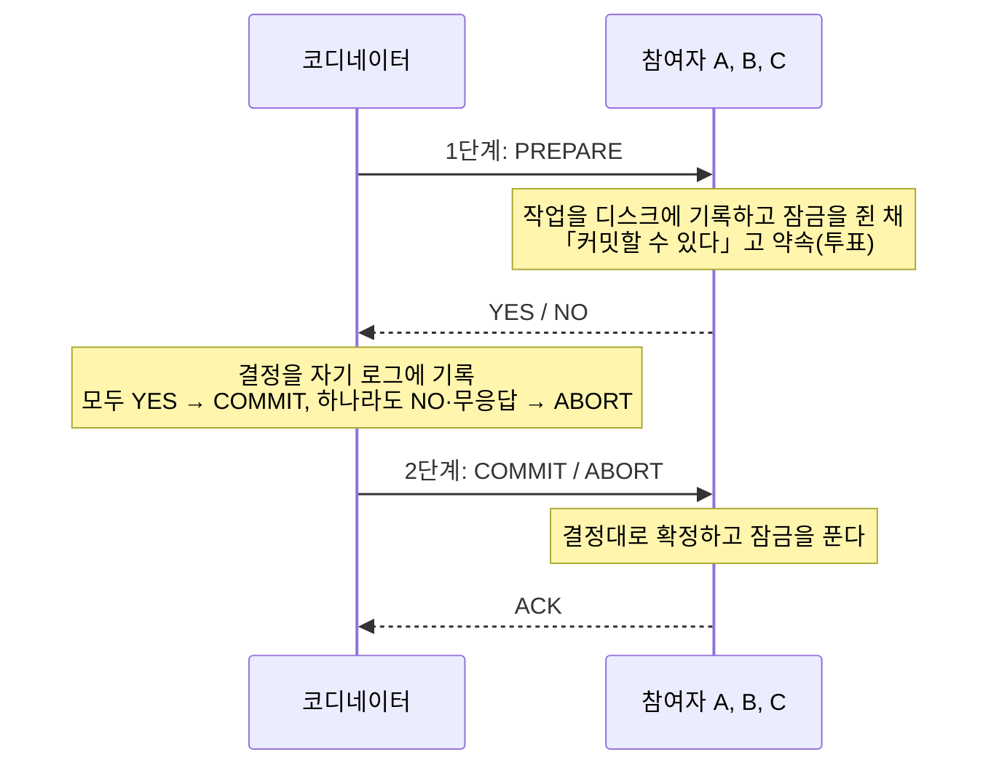
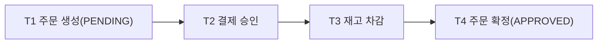
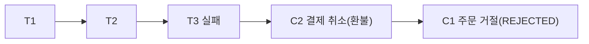

> 「fru1tworld/cs-basic 모의 면접 질문 목록」의 분산 트랜잭션·사가 항목이 묻는 개념을 바탕으로, Chris Richardson의 「[Pattern: Saga](https://microservices.io/patterns/data/saga.html)」를 참고해 재구성한 노트다.

## 분산 트랜잭션이란

**분산 트랜잭션(distributed transaction)** 은 서로 다른 저장소 여러 곳에 걸친 쓰기를 **전부 반영하거나 전부 취소하는** 트랜잭션이다. 주문 생성(주문 DB), 결제 승인(결제 DB), 재고 차감(재고 DB)이 한 업무인데 저장소가 셋이면, 한 DB의 로컬 트랜잭션([[transaction|트랜잭션과 회복]])은 자기 DB만 원자적으로 만들 뿐 나머지를 묶지 못한다.

필요해지는 때는 다음과 같다.

- 마이크로서비스가 **서비스마다 DB를 따로** 가질 때([[microservices-architecture|마이크로서비스 아키텍처]])
- 한 DB를 **샤딩**해 한 작업이 여러 샤드에 걸칠 때([[database-sharding|데이터베이스 샤딩]])
- DB 쓰기와 메시지 발행처럼 **종류가 다른 자원**을 함께 바꿀 때

방법은 크게 둘이다. 모든 참여자가 함께 확정하는 **2단계 커밋**과, 각자 로컬 트랜잭션으로 진행하고 실패하면 되돌리는 **사가**다. DB 쓰기와 이벤트 발행만 묶는 경우는 둘 다 필요 없고 트랜잭셔널 아웃박스로 푼다([[distributed-data-patterns|데이터 관리 패턴]]).

## 2단계 커밋(2PC)

**2단계 커밋(two-phase commit)** 은 코디네이터(coordinator) 하나가 참여자(participant)들의 커밋을 두 단계로 조율하는 프로토콜이다. 표준 인터페이스가 XA이고, PostgreSQL의 `PREPARE TRANSACTION`, MySQL의 `XA START … XA PREPARE … XA COMMIT`이 참여자 쪽 구현이다.

YES로 투표한 참여자는 그 뒤로 **혼자서는 커밋도 취소도 할 수 없다.** 코디네이터의 결정을 기다려야 한다. 이 약속 덕분에 원자성이 지켜진다.

### 2PC가 잘 쓰이지 않는 이유

| 문제 | 내용 |
| --- | --- |
| **블로킹** | 참여자가 YES를 보낸 뒤 코디네이터가 죽으면, 참여자는 결정을 모른 채 잠금을 쥐고 기다린다(in-doubt 상태). 그 행을 건드리는 다른 트랜잭션도 함께 막힌다 |
| 코디네이터 단일 장애점 | 코디네이터가 복구돼 로그에서 결정을 읽어야 끝난다. 결정 로그를 잃으면 사람이 수동으로 정리한다 |
| 지연과 처리량 | 왕복 두 번과 참여자마다의 디스크 기록이 더해지고, 그동안 잠금을 쥐므로 경합이 늘어난다 |
| 가용성 | 참여자 **전원**이 살아 있어야 커밋한다. 참여자가 늘수록 성공 확률은 곱으로 떨어진다 |
| 지원 범위 | 참여자 모두 XA를 지원해야 한다. 대부분의 메시지 브로커, NoSQL, 외부 REST API는 참여할 수 없다 |
| 결합 | 서비스들이 같은 트랜잭션 관리자와 잠금 수명에 묶여 독립 배포·확장이라는 마이크로서비스의 목적과 어긋난다 |

3단계 커밋(3PC)은 블로킹을 줄이려 단계를 하나 더 넣었지만, 메시지 지연에 상한이 있다고 가정하므로 네트워크 분할이 있는 실제 환경에서는 안전하지 않다. 대신 분산 DB는 참여자 각각을 합의(Paxos·Raft)로 복제한 그룹으로 만들어, 참여자가 「죽지 않는」 상태에서 2PC를 돈다(Google Spanner). 샤딩 미들웨어 중에도 여러 노드에 걸친 쓰기를 내부에서 2PC로 처리하는 것이 있다(Citus 등). 결국 2PC는 **한 DB 제품 내부**에서는 쓰이지만, 서비스 사이 연동에는 사가를 쓴다.

## 사가 패턴

**사가(saga)** 는 긴 업무를 **서비스별 로컬 트랜잭션의 연쇄**로 나누고, 중간 단계가 실패하면 이미 끝난 단계를 **보상 트랜잭션(compensating transaction)** 으로 거꾸로 되돌리는 패턴이다. 1987년 DB 논문에서 오래 걸리는 트랜잭션(long-lived transaction)을 위해 나온 개념이다.

정상:

실패:

| 비교 | 2PC | 사가 |
| --- | --- | --- |
| 원자성 | 모두 함께 확정 | 결국 모두 반영되거나 모두 보상된다 |
| 격리 | 잠금으로 보장 | **없다.** 중간 결과가 다른 트랜잭션에 보인다 |
| 잠금 | 전체가 끝날 때까지 쥔다 | 단계마다 로컬 트랜잭션이 끝나면 푼다 |
| 일관성 | 즉시 | 최종 일관성 |
| 실패 처리 | 프로토콜이 롤백 | 보상 로직을 업무 규칙으로 직접 설계 |
| 참여자 요구 | XA 지원 | 로컬 트랜잭션과 메시지·API만 있으면 된다 |
| 맞는 곳 | 한 DB 제품 내부, 짧은 트랜잭션 | 서비스 사이, 오래 걸리는 업무 |

ACID의 A·C·I·D 중 사가는 **격리(I)를 포기**한 대가로 가용성과 독립성을 얻는다.

### 보상 트랜잭션 설계

보상은 DB 롤백이 아니라 **업무상 반대 동작(semantic undo)** 이다. 결제의 보상은 「결제 행 삭제」가 아니라 「환불」이고, 기록에는 결제와 환불이 둘 다 남는다.

| 원칙 | 이유 |
| --- | --- |
| 멱등하게 | 보상 요청도 재전송된다. 두 번 환불하면 안 된다. 사가 ID·단계 ID로 처리 여부를 기록한다 |
| 반드시 성공하게(재시도 가능하게) | 보상이 실패하면 데이터가 어긋난 채 남는다. 업무 규칙상 거절될 수 없는 동작으로 만든다 |
| 순서 뒤바뀜에 견디게 | 원 요청보다 보상 요청이 먼저 도착할 수 있다(원 요청이 타임아웃 났는데 실제로는 늦게 처리되는 경우). 「취소된 사가 ID」를 기록해 늦게 온 원 요청을 거부한다 |
| 되돌릴 수 없는 일은 뒤로 | 이메일 발송, 외부 송금처럼 보상이 불가능한 동작은 사가의 뒤쪽에 둔다 |

이 마지막 원칙을 단계 배치로 정리하면 다음과 같다.

| 단계 종류 | 뜻 | 놓는 자리 |
| --- | --- | --- |
| 보상 가능 트랜잭션(compensatable) | 뒤에서 실패하면 보상으로 되돌린다 | 앞쪽 |
| 피벗 트랜잭션(pivot) | 이것이 성공하면 사가는 반드시 끝까지 간다. 되돌리지 않는 분기점 | 가운데 하나 |
| 재시도 가능 트랜잭션(retriable) | 피벗 뒤의 단계. 실패해도 보상하지 않고 성공할 때까지 재시도한다 | 뒤쪽 |

### 보상이 실패하면

보상은 「성공할 때까지」가 원칙이다.

1. **재시도**: 지수 백오프 + 지터로 다시 시도한다. 그러려면 보상이 멱등해야 한다([[resiliency-patterns|장애 확산을 막는 복원력 패턴]]).
2. **상태 영속화**: 사가가 어느 단계까지 갔고 무엇을 보상했는지 사가 로그(오케스트레이터 DB)에 기록해, 프로세스가 죽어도 이어서 보상한다.
3. **격리와 경보**: 재시도 상한을 넘으면 DLQ나 「수동 처리 대기」 상태로 옮기고 운영자에게 알린다. 사가는 `COMPENSATION_FAILED` 같은 상태로 남겨 다른 흐름이 그 데이터를 정상으로 쓰지 않게 한다.
4. **사후 대사(reconciliation)**: 배치가 서비스들의 기록을 맞대어 어긋난 건을 찾고 보정한다. 결제처럼 돈이 걸린 곳은 이 안전망을 반드시 둔다([[payment-system|결제 시스템 설계: 흐름, 멱등성, 대사, 핫스팟 계정]]).

### 중간 상태와 격리 부재

사가가 진행되는 동안에는 **일부 단계만 반영된 상태**가 외부에 보인다. 주문은 만들어졌는데 결제는 아직 진행 중인 상태가 그렇다. 격리가 없어서 생기는 이상은 셋이다.

| 이상 | 예 |
| --- | --- |
| 갱신 손실(lost update) | 사가가 고친 값을 다른 사가가 읽지 않고 덮어쓴다 |
| 더티 리드(dirty read) | 나중에 보상될 값을 다른 트랜잭션이 읽고 판단한다. 취소될 결제로 등급을 올려 준다 |
| 퍼지 리드(fuzzy read) | 한 사가가 같은 데이터를 두 번 읽는 사이 다른 사가가 바꿔 값이 다르다 |

| 대응책 | 동작 |
| --- | --- |
| **시맨틱 락(semantic lock)** | 보상 가능 단계가 레코드에 `PENDING`·`APPROVAL_PENDING` 같은 상태를 표시한다. 다른 요청은 이 상태를 보고 거절하거나 기다리거나 사용자에게 알린다. 가장 흔한 방법이다 |
| 교환 가능한 갱신(commutative update) | 「잔액 = X」 대신 「+100, −100」처럼 순서와 상관없이 같은 결과가 나오는 연산으로 만든다 |
| 비관적 관점(pessimistic view) | 단계 순서를 바꿔 더티 리드의 위험이 큰 갱신을 재시도 가능 단계(뒤쪽)로 옮긴다 |
| 값 다시 읽기(reread value) | 갱신 직전에 값을 다시 읽어 바뀌었으면 사가를 중단하고 다시 시작한다(낙관적 잠금) |
| 버전 파일(version file) | 순서가 뒤바뀐 요청을 기록해 두고 올바른 순서로 재배열해 적용한다 |
| 값에 따라(by value) | 금액이 크거나 위험한 요청만 2PC·강한 일관성 경로로 보내고 나머지는 사가로 처리한다 |

사용자 경험도 중간 상태를 전제로 설계한다.

- 화면에 「주문 접수됨, 결제 확인 중」처럼 **진행 중 상태를 그대로 보여 주고**, 끝나면 알림·폴링·웹소켓으로 갱신한다. 「완료」라고 먼저 말하고 나중에 취소하는 것보다 낫다.
- 재고·좌석처럼 경합하는 자원은 **임시 예약(만료 시간 포함)** 으로 잡고, 사가가 끝나면 확정하거나 만료로 푼다.
- 중간 상태 레코드는 다른 기능(정산, 추천, 통계)이 확정 데이터로 쓰지 않게 상태로 거른다.

### 구현: 코레오그래피와 오케스트레이션

| 비교 | 코레오그래피(choreography) 사가 | 오케스트레이션(orchestration) 사가 |
| --- | --- | --- |
| 진행 | 각 서비스가 앞 단계의 이벤트를 구독해 자기 단계를 하고 다음 이벤트를 낸다 | 오케스트레이터가 단계마다 명령을 보내고 응답을 받아 다음을 정한다 |
| 사가 상태 | 이벤트에 흩어져 있다. 「지금 어디까지 갔나」를 한곳에서 볼 수 없다 | 오케스트레이터의 상태 기계·DB에 있다 |
| 보상 | 실패 이벤트를 각 서비스가 구독해 각자 보상한다. 단계가 늘면 누가 무엇에 반응하는지 추적하기 어렵다 | 오케스트레이터가 역순으로 보상 명령을 보낸다 |
| 결합 | 서비스끼리 서로의 이벤트를 안다. 순환 의존이 생기기 쉽다 | 서비스는 오케스트레이터의 명령만 안다. 오케스트레이터에 로직이 몰린다 |
| 맞는 곳 | 단계가 2~4개인 단순한 흐름 | 단계가 많고, 분기·타임아웃·보상이 복잡한 흐름 |

오케스트레이터는 Temporal, Camunda, AWS Step Functions 같은 워크플로 엔진으로 만들면 상태 영속화·재시도·타이머를 엔진이 맡는다. 두 방식의 일반 비교(신뢰성, 변경 비용, 성능)는 [[microservices-architecture|마이크로서비스 아키텍처]]에 있다. 어느 쪽이든 단계 사이의 메시지는 아웃박스로 발행해야 「로컬 커밋은 됐는데 다음 단계 메시지가 사라지는」 일이 없다.

## 정리

- 저장소가 여럿이면 로컬 트랜잭션으로는 원자성을 못 얻는다. 2PC로 함께 확정하거나 사가로 진행·보상한다.
- 2PC는 원자성과 격리를 주지만 블로킹, 코디네이터 장애, 전원 생존 요구 때문에 서비스 사이에는 맞지 않는다.
- 사가는 격리를 포기하고 로컬 트랜잭션 + 보상으로 최종 일관성을 얻는다. 보상은 멱등하고 반드시 성공해야 하며, 되돌릴 수 없는 단계는 피벗 뒤로 둔다.
- 보상 실패는 재시도, 사가 로그, 경보·수동 처리, 대사 배치로 다룬다.
- 중간 상태는 시맨틱 락과 진행 중 UX로 드러내 다루고, 복잡한 흐름은 오케스트레이션으로 만든다.

관련 노트: [[distributed-data-patterns|데이터 관리 패턴: CDC, 이벤트 소싱, CQRS, 최종 일관성]], [[microservices-architecture|마이크로서비스 아키텍처]], [[distributed-system-patterns|분산 시스템의 통신·데이터 흐름 패턴]], [[event-driven-architecture|이벤트 기반 아키텍처 설계]], [[payment-system|결제 시스템 설계: 흐름, 멱등성, 대사, 핫스팟 계정]], [[transaction|트랜잭션과 회복]]
