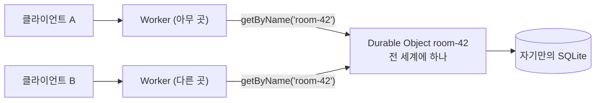

> Bytes(Fireship)의 「A love letter to Durable Objects」(2026.08)를 계기로, 동작과 한도는 Cloudflare Durable Objects 공식 문서로 확인해 재구성한 노트다.

## Durable Object란

**Durable Object(DO)** 는 저장소가 붙은 특별한 Cloudflare Worker다. 일반 Worker와 같은 런타임에서 같은 코드(JavaScript, WASM)를 돌리지만 두 가지가 더 있다.

1. **전 세계에서 유일한 이름.** 같은 이름으로 부르면 어디서 요청하든 같은 인스턴스 하나로 간다.
2. **자기만의 영구 저장소.** 그 객체 안에서만 읽고 쓸 수 있는 SQLite 데이터베이스다.

여기에 **싱글 스레드** 실행이 더해진다. 한 객체 안에서는 코드가 브라우저처럼 한 스레드에서 협력적으로 돈다. 이 셋을 합치면 계산과 상태가 한 곳에 묶인 **액터(actor)** 가 된다. 액터는 상태를 숨기고 메시지로만 주고받으며, 주소(이름)로 찾아간다([[concurrency-models#공유 메모리 대신 메시지: CSP와 액터|동시성 모델]]).

## 왜 필요한가

서버리스 함수는 상태가 없고, 요청마다 아무 인스턴스에서나 돈다([[serverless-architecture|서버리스 아키텍처]]). 그래서 「같은 채팅방의 메시지 순서를 맞춘다」, 「한 사용자의 요청 수를 센다」, 「문서 하나의 동시 편집을 조정한다」 같은 **조정(coordination)** 이 필요하면 외부 DB나 Redis에 락을 걸어야 했다.

DO는 조정이 필요한 단위마다 **딱 하나의 실행 지점**을 준다. 방 하나, 사용자 하나, 문서 하나가 각자 객체 하나다. 그 객체 안에서는 요청이 순서대로 처리되므로 락 없이 강한 일관성을 얻는다.



## 핵심 성질

| 성질 | 내용 |
| --- | --- |
| 생성 | 처음 접근할 때 암묵적으로 만들어진다. 객체 수에 제한이 없다 |
| 위치 | 처음 요청된 곳 근처에 배치된다. 위치 힌트(location hint)를 줄 수 있지만 보장은 아니다 |
| ID | `getByName()`·`idFromName()`은 이름에서 같은 ID를 결정적으로 만든다. `newUniqueId()`는 무작위 ID라 매핑을 따로 저장해야 할 때만 쓴다 |
| 호출 | Worker는 스텁(stub)을 얻어 RPC 메서드를 부른다. 스텁을 만드는 것만으로는 객체가 깨어나지 않고, 메서드를 불러야 깨어난다. 스텁 호출은 반드시 `await`한다 |
| 수명 | 일이 없으면 몇 초 뒤 메모리에서 내려간다. **메모리 상태는 그때 사라진다.** 필요한 것은 저장소에 쓴다 |
| 저장소 | SQLite 백엔드는 SQL API와 키-값 API를 모두 준다. 예전 키-값 전용 백엔드는 이미 그 네임스페이스가 있는 계정만 쓸 수 있어, 새 클래스는 SQLite다 |

### 입력 게이트와 출력 게이트

싱글 스레드라도 `await`에서 다른 요청이 끼어들 수 있다. DO는 저장소 작업 주변에 게이트를 둬서 흔한 경쟁 조건을 막는다.

- **입력 게이트**: 동기 실행과 저장소 작업 중에는 새 이벤트를 들이지 않는다. 그래서 `get` → 계산 → `put` 사이에 저장소 말고 다른 I/O가 없으면 다른 요청이 끼어들지 않는다.
- **출력 게이트**: 아직 디스크에 확정되지 않은 쓰기가 있으면 응답을 내보내지 않는다. 클라이언트가 받은 응답은 이미 저장된 상태를 뜻한다.
- 사이에 `await` 없이 연달아 한 쓰기는 하나의 원자적 트랜잭션으로 합쳐진다.
- **`fetch()` 같은 외부 I/O를 기다리는 동안에는 다른 요청이 끼어든다.** 이때는 버전 비교(check-and-set)나 `transaction()`으로 지킨다.
- `blockConcurrencyWhile()`은 모든 요청을 막으므로 생성자의 초기화·마이그레이션에만 쓴다. 호출 하나가 5ms면 객체 처리량이 초당 약 200건으로 묶인다. 그 안에서 외부 I/O를 하지 않는다.

## 예: 키별 처리율 제한

IP나 API 키마다 객체 하나를 두면 전역 카운터 없이 정확한 처리율 제한이 된다.

```ts
// src/index.ts
import { DurableObject } from "cloudflare:workers";

export class RateLimiter extends DurableObject {
  async hit(limit: number, windowMs: number): Promise<boolean> {
    const now = Date.now();
    let start = (await this.ctx.storage.get<number>("start")) ?? now;
    let count = (await this.ctx.storage.get<number>("count")) ?? 0;
    if (now - start >= windowMs) {
      start = now;
      count = 0;
    }
    count += 1;
    await this.ctx.storage.put({ start, count });
    return count <= limit;
  }
}

export default {
  async fetch(request: Request, env: Env): Promise<Response> {
    const key = request.headers.get("CF-Connecting-IP") ?? "unknown";
    const allowed = await env.RATE_LIMITER.getByName(key).hit(100, 60_000);
    return allowed
      ? new Response("ok")
      : new Response("Too Many Requests", { status: 429 });
  },
};
```

```jsonc
// wrangler.jsonc
{
  "durable_objects": {
    "bindings": [{ "name": "RATE_LIMITER", "class_name": "RateLimiter" }]
  },
  "migrations": [{ "tag": "v1", "new_sqlite_classes": ["RateLimiter"] }]
}
```

`get`과 `put` 사이에 외부 I/O가 없으므로 입력 게이트 덕분에 같은 키의 동시 요청이 카운트를 덮어쓰지 않는다. 고정 창 대신 토큰 버킷 같은 다른 알고리즘도 같은 자리에 넣으면 된다([[api-security|API 보안 체크리스트]]). `Env` 타입은 `wrangler types`로 만든다.

## WebSocket 하이버네이션

실시간 방은 연결은 많고 메시지는 드문 경우가 대부분이다. **Hibernation API**를 쓰면 클라이언트 연결은 Cloudflare 네트워크에 붙어 있는 채로 객체는 메모리에서 내려가고, 그동안 실행 시간(GB-s) 요금이 쌓이지 않는다. 메시지가 오면 자동으로 깨어난다.

| 요소 | 역할 |
| --- | --- |
| `this.ctx.acceptWebSocket(server)` | 서버 쪽 소켓을 하이버네이션 가능하게 받는다. 일반 `ws.accept()`로 받으면 객체가 잠들지 못한다 |
| `webSocketMessage(ws, message)` | 메시지 처리기. ping 프레임은 런타임이 처리한다 |
| `webSocketClose(ws, code, reason, wasClean)`, `webSocketError` | 종료·오류 처리기 |
| `ws.serializeAttachment(value)` / `deserializeAttachment()` | 연결마다 붙여 두는 상태(최대 16KB). 하이버네이션을 넘어 유지된다 |
| `this.ctx.getWebSockets()` | 지금 붙어 있는 소켓 목록. 방 전체에 팬아웃할 때 쓴다 |

깨어날 때 **생성자가 다시 돈다.** 생성자 작업은 가볍게 두고, 연결별 상태는 첨부(attachment)에, 방 상태는 SQLite에 둔다. 웹소켓 서버를 직접 운영할 때의 방 분할·팬아웃·연결 한계는 [[realtime-websocket-server|실시간 웹소켓 서버 설계]]에 있다. DO에서는 「방 = 객체 하나」가 그 방 액터 역할을 한다.

## 알람

객체는 스스로 깨어날 시각을 예약할 수 있다.

- 객체마다 **알람은 한 번에 하나**다. `ctx.storage.setAlarm(ms)`가 기존 알람을 덮어쓴다. 여러 예약이 필요하면 저장소에 목록을 두고 `alarm()`이 다음 것을 다시 예약한다.
- `alarm()` 처리기는 **최소 한 번** 실행이 보장된다. 드물게 두 번 돌 수 있으니 멱등하게 짠다.
- 처리기가 예외를 던지면 2초부터 지수적으로 늘어나는 간격으로 최대 6번 재시도한다. 긴 장애에 재시도를 다 쓰지 않도록 예외를 잡고 새 알람을 예약하고 끝내는 편이 낫다.
- 알람은 반복되지 않는다. 주기 작업이면 처리기 안에서 다시 예약한다. 할 일이 있을 때만 예약한다.
- 생성자에서 `setAlarm`을 부르기 전에 `getAlarm()`으로 이미 예약된 것이 있는지 본다.

세션 만료, 지연 배치 처리, 방이 비면 정리하기 같은 일에 쓴다. 여러 단계에 걸친 긴 작업을 재시도·복원까지 보장하려면 내구성 워크플로가 더 맞다([[durable-workflow-temporal|내구성 워크플로와 Temporal]]).

## 쓰임새

| 쓰임 | 객체 하나의 단위 | 이유 |
| --- | --- | --- |
| 처리율 제한 | IP, API 키, 테넌트 | 키마다 정확한 카운터, 락 불필요 |
| 채팅·협업 방 | 방, 문서 | 메시지 순서, 접속자 목록, WebSocket 팬아웃([[chat-system-design\|채팅 시스템 설계]], [[collaborative-editing\|실시간 공동 편집]]) |
| 사용자·테넌트별 DB | 사용자, 테넌트 | 객체마다 독립된 SQLite. 한 사용자의 데이터가 한 곳에 모인다 |
| 게임 세션 | 매치, 로비 | 권위 있는 게임 상태 하나([[multiplayer-game-server\|멀티플레이 게임 서버]]) |
| 순서·유일성 보장 | 재고 품목, 예약 슬롯, 시퀀스 | 한 곳에서 순서대로 처리하므로 중복 판매가 없다 |
| AI 에이전트 상태 | 에이전트 인스턴스 | Cloudflare Agents SDK가 에이전트 하나를 DO 하나로 돌린다 |

## 설계 규칙과 한도

- **조정의 원자(atom)마다 객체 하나.** 모든 요청을 받는 「전역」 객체 하나를 만들지 않는다. 그것은 단일 병목이다.
- 객체 하나의 처리량은 **초당 1,000건이 소프트 한도**다. 넘으면 대기열에 쌓였다가 overloaded 오류로 실패한다. 실제로는 요청당 일의 양에 따라 더 낮으니 부하 테스트로 목표를 잡고, 한 원자의 트래픽이 그보다 크면 샤드로 나눈다(샤드 수 = 원자의 최대 초당 요청 ÷ 샤드당 목표).
- 자주 읽는 전역 설정은 DO가 아니라 Workers KV에 둔다. 상태 없는 일은 일반 Worker가 한다.
- 객체는 언제든 내려갈 수 있고 종료 훅이 없다. 진행 상황은 조금씩 저장한다.
- 오류의 `.retryable`·`.overloaded` 속성으로 재시도 여부를 판단하고 지수 백오프를 건다.

| 한도(SQLite 백엔드, 2026년 기준) | 값 |
| --- | --- |
| 객체당 저장소 | 10GB(유료 플랜) |
| 계정 저장소 | 유료 무제한, 무료 5GB |
| 요청당 CPU | 기본 30초, 최대 5분까지 설정 |
| 객체당 처리량 | 초당 1,000건(소프트) |
| 받는 WebSocket 메시지 크기 | 32MiB |
| 행·문자열·BLOB 최대 | 8MB |
| 클래스 수 | 유료 500, 무료 100 |

무료 플랜에서도 SQLite 백엔드 DO를 쓸 수 있다.

## 같은 모델의 다른 구현

DO의 핵심은 「프로세스 + 로컬 SQLite + 다른 기계로의 복제」다. 쓰기는 다른 곳에 복제된 뒤에 확정되므로 프로세스가 죽거나 옮겨 가도 상태를 되살린다. 2026년 8월 공개된 오픈소스 **celld**는 이 구조를 직접 운영할 수 있게 만든 구현이다. 셀(객체)마다 SQLite와 워커 프로세스를 두고 SQLite의 WAL을 S3·R2 같은 객체 저장소로 계속 복제해, 버킷을 진짜 원본으로 삼고 노드는 갈아 끼울 수 있게 한다. Cloudflare의 Workers·DO JavaScript API와 호환되고 `wrangler` 설정으로 배포한다.

Erlang/OTP의 프로세스, Akka·Orleans의 가상 액터(virtual actor)도 「이름으로 찾아가는, 상태를 가진 단일 실행 단위」라는 같은 생각이다. Orleans의 가상 액터처럼 DO도 호출하면 알아서 활성화되고, 쓰지 않으면 내려간다.

## 정리

- DO는 전역 유일 이름 + 전용 SQLite + 싱글 스레드를 묶은 서버리스 액터다.
- 조정이 필요한 단위(방, 사용자, 문서, 키)마다 객체 하나를 두면 락 없이 강한 일관성을 얻는다.
- 입력·출력 게이트가 저장소 작업 주변의 경쟁을 막지만, 외부 I/O를 기다리는 동안에는 끼어들기가 생긴다.
- WebSocket 하이버네이션으로 놀고 있는 연결의 비용을 없애고, 알람은 하나뿐이며 최소 한 번 실행되니 멱등하게 짠다.
- 전역 객체 하나는 병목이다. 초당 1,000건 소프트 한도를 기준으로 원자 단위로 쪼갠다.

관련 노트: [[realtime-websocket-server|실시간 웹소켓 서버 설계]], [[collaborative-editing|실시간 공동 편집: OT와 CRDT]], [[concurrency-models|동시성 모델]], [[serverless-architecture|서버리스 아키텍처]], [[chat-system-design|채팅 시스템 설계]], [[multiplayer-game-server|멀티플레이 게임 서버 설계]], [[durable-workflow-temporal|내구성 워크플로와 Temporal]], [[websocket|WebSocket]]
