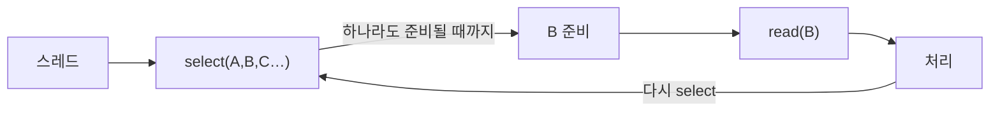
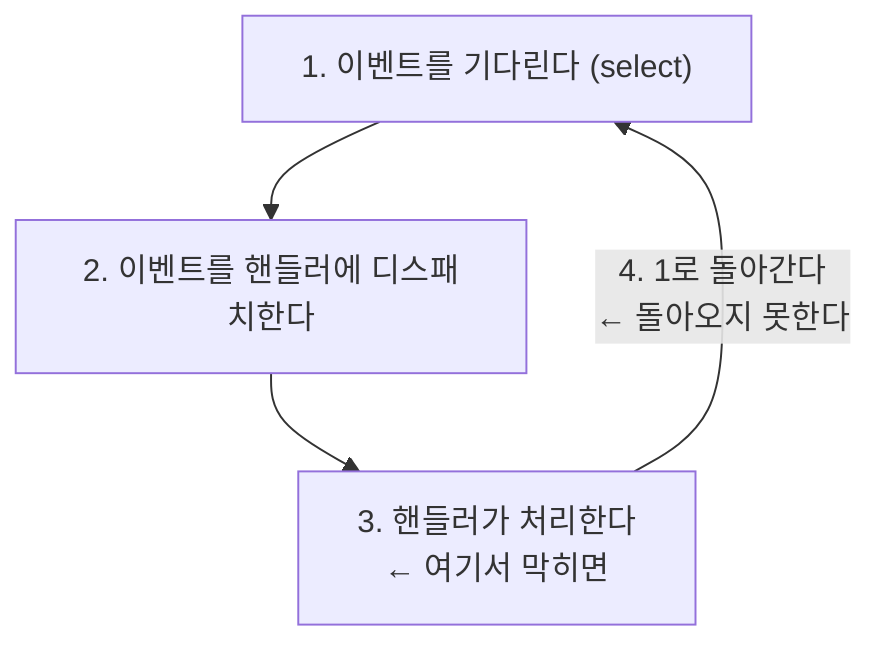

> 김종민의 「[비동기 서버에서 이벤트 루프를 블록하면 안 되는 이유](https://engineering.linecorp.com/ko/blog/do-not-block-the-event-loop-part1)」 1~3부(LINE Engineering, 2022.09~10)를 바탕으로 재구성하고, Armeria 스레드 모델과 Java 가상 스레드는 공식 문서로, NIO 버퍼 종류는 「[Java NIO FileChannel 과 DirectByteBuffer](http://homoefficio.github.io/2020/08/10/Java-NIO-FileChannel-%EA%B3%BC-DirectByteBuffer)」로 보강한 노트다.

## 이벤트 루프 서버란

**이벤트 루프(event loop)** 는 이벤트가 생길 때까지 기다렸다가, 생기면 그 이벤트를 처리할 핸들러에 넘기는(dispatch) 일을 무한히 반복하는 동시성 모델이다. Netty, Armeria, Spring WebFlux, Vert.x, Node.js(libuv), Redis, Nginx가 이 구조로 적은 스레드에서 수많은 연결을 처리한다.

이 구조의 전제는 **루프 한 바퀴가 짧다**는 것이다. 핸들러 하나가 스레드를 오래 붙잡으면 그 루프에 묶인 다른 연결은 모두 기다린다. 브라우저 JS의 이벤트 루프(콜 스택·태스크 큐)는 [[event-loop|브라우저에서 JavaScript가 동작하는 원리: 이벤트 루프]]에 있다. 이 노트는 서버 쪽 이벤트 루프가 어떻게 생겨났는지를 다룬다.

## 다중 접속 서버의 발전

가장 단순한 소켓 서버는 `accept()`로 연결을 받고 그 연결에서 `read()`·`write()`를 반복한다. `read()`는 데이터가 올 때까지 잠들기 때문에, **첫 클라이언트가 연결을 끊기 전까지 다음 클라이언트는 `listen` 대기열에서 기다린다.** 이것을 풀려는 시도가 세 갈래로 나왔다.

| 방식 | 구조 | 장점 | 한계 |
| --- | --- | --- | --- |
| 멀티프로세스 | 부모가 `accept()`, 연결마다 `fork()`한 자식이 처리 | 흐름이 단순하다. 프로세스끼리 메모리가 격리돼 하나가 죽어도 나머지는 산다 | 프로세스 복사 비용이 크고, 프로세스 간 정보 교환이 어렵다 |
| 멀티스레드 | 메인 스레드가 `accept()`, 연결마다 워커 스레드 생성 | 프로세스보다 싸고, 메모리를 공유해 정보 교환이 쉽다 | 스레드 하나의 문제가 프로세스 전체에 번진다. 스레드 수만큼 스택 메모리와 컨텍스트 전환 비용이 든다 |
| 스레드 풀 | 미리 만든 스레드 N개가 연결을 나눠 맡는다 | 생성 비용을 없애고 자원 상한을 둔다 | 동시에 처리하는 연결 수가 N개를 넘지 못한다. 놀고 있는 Keep-Alive 연결도 스레드를 잡는다 |
| I/O 멀티플렉싱 | 스레드 하나가 여러 소켓을 묶어 감시하고 **준비된 소켓만** 처리 | 연결 수와 스레드 수가 분리된다. 수만 연결(C10K)을 적은 스레드로 감당한다 | 핸들러가 막히면 감시하던 모든 연결이 함께 멈춘다 |

프로세스·스레드의 비용 차이는 [[process-and-thread|프로세스와 스레드]]에, 스레드 풀이 실제 서버에서 쓰이는 모습(Tomcat의 요청당 스레드)은 [[spring-singleton-thread-safety|스프링의 싱글톤 빈과 요청 스레드]]에, Apache와 Nginx의 처리 방식 비교는 [[web-server-and-nginx|웹 서버, WAS, 그리고 Nginx]]에 있다.

## I/O 멀티플렉싱: 먼저 묻고 나서 읽는다

소켓 `read()`는 두 단계를 거친다. 패킷이 도착해 **커널 버퍼**에 쌓이기를 기다리고, 그 데이터를 **사용자 공간 버퍼**로 복사한다. 블로킹 I/O는 첫 단계부터 스레드를 재운다.

멀티플렉싱은 순서를 바꾼다. `select`·`epoll_wait` 같은 호출로 "읽을 준비가 된 소켓이 생길 때까지" 한꺼번에 기다리고, 돌아온 소켓에만 `read()`를 부른다. **`read()` 자체는 여전히 동기 호출이지만, 데이터가 이미 와 있으므로 무한정 잠들지 않는다.**

블로킹 I/O


멀티플렉싱



`select`·`poll`·`epoll`·`kqueue`·`io_uring`의 차이(매번 fd 집합을 넘기는가, 커널에 등록해 두는가, fd 1024개 제한)는 [[unix-file-io|UNIX 파일 입출력과 파일 디스크립터]]의 「I/O 멀티플렉싱」에 있다. Windows의 대응물은 IOCP다. 플랫폼마다 API가 달라 서버 프레임워크는 보통 이 차이를 감싸는 계층(libuv, Java NIO, Netty transport)을 둔다.

## Java NIO: 채널, 버퍼, 셀렉터

Java 1.4의 **NIO(New I/O)** 가 JVM에서 멀티플렉싱을 쓰는 표준 API다. `Selector`는 내부적으로 `SelectorProvider`가 OS에 맞는 구현(Linux는 epoll, macOS는 kqueue)을 고른다.

| 구성 요소 | 역할 |
| --- | --- |
| 채널(Channel) | 양방향 I/O 통로. `ServerSocketChannel`(연결 수신), `SocketChannel`(TCP), `DatagramChannel`(UDP), `FileChannel`(파일) |
| 버퍼(ByteBuffer) | 채널과 주고받는 데이터 그릇. 쓰기 → `flip()`으로 읽기 모드 전환 → 읽기 → `clear()`·`compact()` |
| 셀렉터(Selector) | 등록된 여러 채널 중 이벤트가 준비된 것을 골라 준다 |
| SelectionKey | 채널을 셀렉터에 등록하면 받는 열쇠. 관심 이벤트(interest set), 준비된 이벤트(ready set), 채널·셀렉터 참조, **첨부 객체(attachment)** 를 담는다 |

- 셀렉터에 등록하려면 채널을 먼저 `configureBlocking(false)`로 논블로킹으로 바꿔야 한다.
- 관심 이벤트는 `OP_ACCEPT`·`OP_CONNECT`·`OP_READ`·`OP_WRITE`이고 `|`로 조합한다.
- `select()`는 준비된 채널이 생길 때까지 막히고, `select(timeout)`은 시간 제한을 두고, `selectNow()`는 바로 돌아온다.
- 논블로킹 채널에서 `accept()`는 `null`을, `read()`는 0바이트를 돌려줄 수 있으므로 반환값을 늘 확인한다.

### 힙 버퍼와 다이렉트 버퍼

| 종류 | 위치 | 특징 |
| --- | --- | --- |
| `HeapByteBuffer` (`allocate`) | JVM 힙 | GC가 관리한다. 할당이 싸다. GC가 객체를 옮길 수 있어 OS에 주소를 그대로 넘기지 못한다 |
| `DirectByteBuffer` (`allocateDirect`) | 힙 밖 네이티브 메모리 | OS·DMA가 바로 읽고 쓴다. 할당·해제가 비싸다 |
| `MappedByteBuffer` (`FileChannel.map`) | 파일을 매핑한 네이티브 메모리 | 파일 일부를 메모리처럼 다룬다 |

- **힙 버퍼로 채널 I/O를 하면 JDK가 내부에서 임시 다이렉트 버퍼를 만들어 한 번 더 복사한다.** 임시 버퍼는 스레드별 캐시에 보관해 재사용하지만, 크기가 제각각이면 캐시가 맞지 않아 할당·해제가 반복된다.
- 다이렉트 버퍼의 네이티브 메모리는 그 버퍼 객체가 GC될 때 풀린다. 힙에 여유가 있어 GC가 늦게 돌면 네이티브 메모리가 먼저 차서 `OutOfMemoryError: Direct buffer memory`가 난다. `-XX:MaxDirectMemorySize`는 상한일 뿐 회수를 앞당기지 않는다.
- 그래서 큰 파일·소켓 I/O가 잦으면 다이렉트 버퍼를 **직접 할당해 오래 재사용**한다. 내부 API(`sun.nio.ch.DirectBuffer.cleaner()`)로 강제 해제하는 방법은 JDK 9 모듈 캡슐화 이후 막혔다. 해제 시점을 코드로 정해야 하면 Java 22에 정식화된 FFM API의 `Arena`로 네이티브 메모리를 할당하고 `close()`로 바로 돌려준다.

## Reactor 패턴: 루프와 핸들러를 나눈다

셀렉터 루프 안에 `if (accept) … else if (read) …`를 늘어놓으면 이벤트 종류가 늘 때마다 루프가 비대해진다. **Reactor 패턴**은 이를 두 역할로 나눈다.

| 역할 | 하는 일 |
| --- | --- |
| Reactor | 무한 루프에서 이벤트를 기다리다가, 생기면 그 이벤트를 맡은 핸들러에 디스패치한다. **이것이 곧 이벤트 루프다** |
| 핸들러(Handler) | 이벤트를 받아 실제 로직을 수행한다. 연결 수락용 `AcceptHandler`, 읽기·쓰기용 `EchoHandler`처럼 나뉜다 |

핸들러는 `SelectionKey`의 첨부 객체로 붙여 두고, Reactor는 꺼내서 호출만 한다.

```java
// Reactor: 기다리고, 꺼내고, 넘긴다
while (true) {
    selector.select();
    for (SelectionKey key : selector.selectedKeys()) {
        ((Handler) key.attachment()).handle();   // dispatch
    }
    selector.selectedKeys().clear();
}

// 연결이 들어오면 AcceptHandler가 SocketChannel을 OP_READ로 등록하고
// 그 키에 EchoHandler를 첨부한다. EchoHandler는 read → OP_WRITE로 전환 → write → OP_READ로 복귀
```

Netty는 이 구조를 다듬은 것이다. `EventLoop` 하나가 스레드 하나와 셀렉터 하나를 갖고, 여러 채널을 평생 맡는다. 연결 수락만 하는 boss 그룹과 I/O를 처리하는 worker 그룹을 나누는 멀티 리액터 구성이 기본이다. 준비를 통지받는 Reactor와 완료를 통지받는 Proactor의 비교는 [[concurrency-models|동시성·병렬·비동기·논블로킹과 동시성 모델]]에 있다.

## 이벤트 루프를 블록하면 안 되는 이유

이벤트 루프 스레드는 다음을 반복한다.



핸들러 안에서 외부 API를 블로킹으로 호출하면(`future.join()`, `get()`, JDBC, `Thread.sleep()`), 응답이 올 때까지 **그 스레드가 맡은 모든 연결의 이벤트가 처리되지 않는다.** 이벤트 루프 스레드는 CPU 코어 수의 몇 배 정도뿐이라, 몇 개만 막혀도 서버 전체 응답이 느려지거나 멈춘다. 블로킹 호출이 같은 루프에서 처리돼야 할 응답을 기다리면 **풀리지 않는 데드락**이 된다.

| 원인 | 예 | 처리 |
| --- | --- | --- |
| 블로킹 I/O | 동기 HTTP 클라이언트, JDBC, 파일 읽기, `join()` | 별도 블로킹 스레드 풀로 넘기거나 비동기 API(`thenApply`, 논블로킹 클라이언트)로 바꾼다 |
| 블로킹 대기 | `Thread.sleep()`, 락 대기 | 타이머·스케줄러 API로 바꾼다 |
| 긴 CPU 계산 | 대용량 JSON 처리, 암호화, 압축 | 작업을 잘게 나눠 여러 번에 처리하거나 워커 스레드 풀로 보낸다 |

### Armeria에서의 처리

Armeria는 소켓 I/O와 논블로킹 로직을 이벤트 루프(`armeria-common-worker-*`, 기본 CPU 코어 × 2개)에서 돌리고, 블로킹 작업은 **blockingTaskExecutor**(`armeria-common-blocking-tasks-*`, 기본 200개)로 보낸다.

| 방법 | 쓰는 곳 |
| --- | --- |
| `ctx.blockingTaskExecutor()` | `CompletableFuture.supplyAsync(..., ctx.blockingTaskExecutor())`. 요청 컨텍스트가 블로킹 스레드로 전파된다 |
| `@Blocking` | 어노테이션 서비스의 메서드·클래스를 블로킹 실행기에서 돌린다 |
| `useBlockingTaskExecutor(true)` | gRPC·Thrift 서비스 빌더 |

이벤트 루프에서 `CompletableFuture`의 `join()`·`get()`을 부르면 Armeria가 `Blocking event loop, don't do this.` 경고 로그를 남긴다. 이 경고는 버그로 다룬다. Node.js도 같은 원칙이라 CPU를 오래 쓰는 일은 `worker_threads`로 뺀다([[nodejs-runtime|Node.js 런타임과 OS 차이 다루기]]).

## 가상 스레드와의 관계

Java 21(JEP 444)에 정식 도입된 **가상 스레드**는 블로킹 호출을 만나면 런타임이 가상 스레드를 OS 스레드(캐리어)에서 내린다. 그래서 **요청당 스레드 + 블로킹 코드**로 짜도 이벤트 루프 서버에 가까운 동시 연결 수를 얻는다. JDK 24(JEP 491)부터는 `synchronized` 안에서 블로킹해도 캐리어에 묶이지(pinning) 않는다. 네이티브 코드에서 다시 Java로 들어와 블로킹하는 경우는 여전히 묶인다.

| 선택 | 맞는 상황 |
| --- | --- |
| 이벤트 루프 + 논블로킹 API | 스트리밍, 수많은 장기 연결, 프록시·게이트웨이처럼 I/O 경로 자체를 다루는 서버 |
| 요청당 가상 스레드 + 블로킹 API | JDBC 같은 블로킹 라이브러리가 많은 일반 업무 서버. 콜백·리액티브 체인 없이 순차 코드로 쓴다 |

**가상 스레드가 이벤트 루프 블로킹을 고쳐 주지는 않는다.** 이벤트 루프 스레드는 가상 스레드가 아니므로, 그 위에서 블로킹하면 똑같이 멈춘다. 블로킹 작업을 넘길 실행기를 가상 스레드 기반으로 만드는 것은 별개의 선택이다. 가상 스레드를 Spring에서 켜는 방법은 [[spring-singleton-thread-safety|스프링의 싱글톤 빈과 요청 스레드]]에 있다.

## 정리

- 블로킹 서버는 연결마다 프로세스·스레드를 붙여 동시성을 얻었고, 스레드 풀은 그 비용에 상한을 뒀지만 동시 연결 수도 함께 묶였다.
- I/O 멀티플렉싱은 "준비된 소켓만 읽는" 방식으로 연결 수와 스레드 수를 분리했다. Java에서는 NIO의 `Selector`가 이를 감싼다.
- Reactor 패턴은 기다리고 디스패치하는 루프(Reactor)와 처리하는 핸들러를 나눈다. 그 Reactor가 이벤트 루프다.
- 이벤트 루프 스레드 하나가 여러 연결을 맡으므로, 핸들러의 블로킹 I/O·긴 계산은 그 연결 전부를 멈춘다. 블로킹 작업은 별도 스레드 풀로, 긴 계산은 쪼개거나 워커로 보낸다.

이벤트 루프 위의 코드는 "곧 돌려준다"는 약속을 지켜야 한다.

관련 노트: [[concurrency-models|동시성·병렬·비동기·논블로킹과 동시성 모델]], [[unix-file-io|UNIX 파일 입출력과 파일 디스크립터]], [[process-and-thread|프로세스와 스레드]], [[spring-singleton-thread-safety|스프링의 싱글톤 빈과 요청 스레드]], [[web-server-and-nginx|웹 서버, WAS, 그리고 Nginx]], [[event-loop|브라우저에서 JavaScript가 동작하는 원리: 이벤트 루프]], [[spring-application-design|스프링 애플리케이션 설계]]
