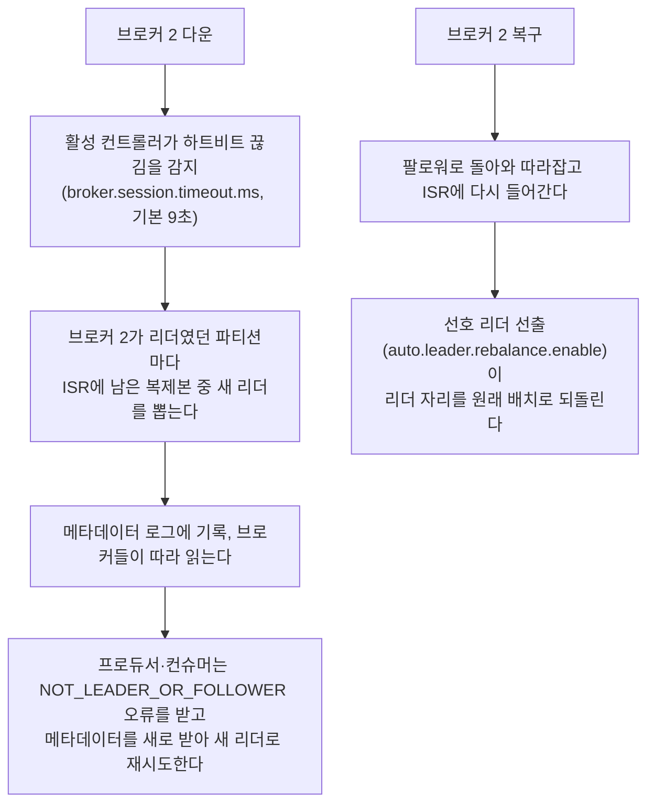
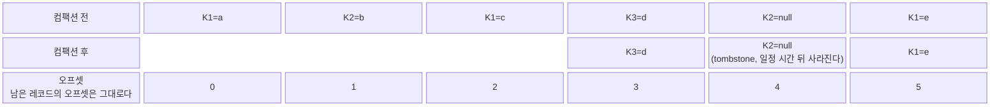
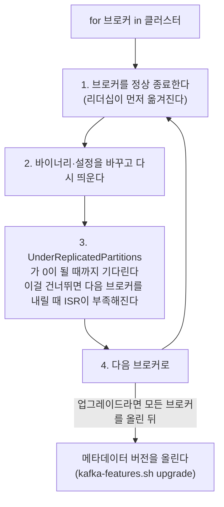
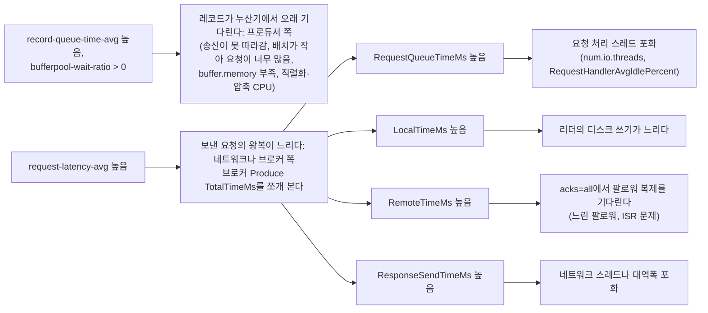

> Apache Kafka 공식 문서(4.2 설정 기본값)를 기준으로, 「fru1tworld/cs-basic 모의 면접 질문 목록」의 Kafka 항목이 묻는 개념을 채워 재구성한 노트다. Kafka의 기본 구조(토픽·파티션·컨슈머 그룹)와 전달 보장은 [[message-queue-kafka|메시지 큐와 Kafka]]에 있다.

## 이 노트의 자리

[[message-queue-kafka|메시지 큐와 Kafka]]가 「Kafka가 무엇이고 왜 빠른가」를 다룬다면, 이 노트는 **클러스터를 돌릴 때 정하는 값과 보는 지표**를 다룬다. 설정 이름과 기본값은 Kafka 4.x 기준이다.

## 복제와 ISR

토픽의 파티션마다 **복제 계수(replication factor)** 만큼 복제본(replica)을 서로 다른 브로커에 둔다. 복제본 하나가 **리더(leader)** 로 모든 읽기·쓰기를 받고, 나머지 **팔로워(follower)** 는 리더의 로그를 가져와(fetch) 따라 쓴다. 보통 복제 계수는 3이고, `broker.rack`을 지정하면 복제본을 랙·가용 영역(AZ)마다 흩어 둔다.

| 개념 | 뜻 |
| --- | --- |
| ISR(in-sync replicas) | 리더를 제때 따라오는 복제본 집합(리더 포함). `replica.lag.time.max.ms`(기본 30초) 동안 리더 끝까지 따라오지 못한 팔로워는 ISR에서 빠지고, 다시 따라잡으면 들어온다 |
| 하이 워터마크(high watermark) | ISR 전원이 복제한 마지막 오프셋. **컨슈머는 하이 워터마크까지만 읽는다.** 그래서 리더만 가진 메시지는 리더가 바뀌어도 소비자에게 보인 적이 없다 |
| 리더 에포크(leader epoch) | 리더가 바뀔 때마다 오르는 번호. 복구된 옛 리더는 새 리더의 에포크 기록을 보고 갈라진 꼬리를 잘라 내(truncate) 로그를 맞춘다 |
| 언클린 리더 선출 | ISR이 모두 죽었을 때 ISR 밖 복제본을 리더로 세우는 것. 가용성은 얻지만 복제되지 않은 메시지를 잃는다. `unclean.leader.election.enable=false`가 기본이다 |

ISR이 **복제의 일관성 단위**다. 쓰기 확인, 리더 선출, 컨슈머 가시성이 모두 ISR을 기준으로 정해지므로, ISR이 자주 줄었다 늘었다 하면 내구성과 가용성이 함께 흔들린다.

### acks와 min.insync.replicas

프로듀서의 `acks`는 「어디까지 기록되면 성공으로 보나」, 토픽·브로커의 `min.insync.replicas`는 「`acks=all` 쓰기에 ISR이 최소 몇 개 있어야 하나」를 정한다.

| acks | 성공 기준 | 유실 가능성 | 지연 |
| --- | --- | --- | --- |
| `0` | 보내기만 하고 응답을 기다리지 않는다 | 브로커가 못 받아도 모른다 | 가장 짧다 |
| `1` | 리더의 로그에 쓰이면 성공 | 팔로워가 복제하기 전에 리더가 죽으면 잃는다 | 짧다 |
| `all` (`-1`, 기본값) | 현재 ISR 전원이 받으면 성공 | ISR 수가 `min.insync.replicas` 이상이면 그만큼 살아 있는 한 잃지 않는다 | 가장 느린 ISR 팔로워에 묶인다 |

복제 계수 3, `min.insync.replicas=2`, `acks=all`이 내구성의 표준 조합이다.

| 살아 있는 ISR | `acks=all` 쓰기 | `acks=1` 쓰기 | 읽기 |
| --- | --- | --- | --- |
| 3 | 성공 | 성공 | 가능 |
| 2 | 성공 | 성공 | 가능 |
| 1 | **실패**(`NotEnoughReplicas`). 쓰기를 거절해 내구성을 지킨다 | 성공하지만 그 메시지는 복제본 하나에만 있다 | 가능 |
| 0 | 리더가 없어 파티션이 오프라인 | 실패 | 불가 |

`min.insync.replicas`는 `acks=all`에만 적용된다. `acks=1` 프로듀서는 ISR이 하나뿐이어도 쓰기에 성공하므로, 클러스터 설정만으로 내구성이 보장되지 않는다.

## 컨트롤러와 장애 조치

### ZooKeeper에서 KRaft로

클러스터 메타데이터(브로커 목록, 토픽, 파티션 리더, ISR, 설정, ACL)를 누가 관리하느냐가 바뀌었다. Kafka 4.0부터는 KRaft만 지원한다.

| 비교 | ZooKeeper 모드 (3.x까지) | KRaft 모드 (4.0부터 유일) |
| --- | --- | --- |
| 메타데이터 저장 | 외부 ZooKeeper 앙상블 | Kafka 내부 메타데이터 로그(`__cluster_metadata`)를 Raft로 복제 |
| 컨트롤러 | 브로커 하나가 ZooKeeper를 통해 컨트롤러로 뽑힌다 | 컨트롤러 노드 3대나 5대가 쿼럼을 이루고, 그중 하나가 활성 컨트롤러다 |
| 컨트롤러 교체 | 새 컨트롤러가 ZooKeeper에서 메타데이터 전체를 다시 읽는다. 파티션이 많으면 오래 걸린다 | 대기 컨트롤러가 이미 메타데이터 로그를 따라와 있어 거의 바로 넘겨받는다 |
| 메타데이터 전파 | 컨트롤러가 브로커에 RPC로 밀어 준다 | 브로커가 메타데이터 로그를 오프셋으로 따라 읽는다 |
| 운영 | 시스템 두 개(Kafka, ZooKeeper)의 보안·모니터링·업그레이드 | Kafka 하나 |

컨트롤러 쿼럼은 과반이 살아 있어야 메타데이터를 바꿀 수 있다. 3대면 1대, 5대면 2대까지 견딘다. 중요한 클러스터에서는 컨트롤러를 브로커와 같은 프로세스에 두는 결합 모드(combined mode)보다 **전용 컨트롤러 노드**를 둔다.

**ZooKeeper 클러스터는 4.x로 바로 올릴 수 없다.** 3.x에서 KRaft로 먼저 옮긴 뒤 올린다. 브리지 릴리스로는 3.9를 쓴다.

```text
1. 3.9로 올린다
2. KRaft 컨트롤러 쿼럼을 마이그레이션 모드로 띄운다 (ZooKeeper 메타데이터를 복사하고, 이후 변경을 양쪽에 쓴다)
3. 브로커를 하나씩 KRaft 모드로 재시작한다
4. 마이그레이션을 끝내고 ZooKeeper 연결을 끊는다 (이 뒤로는 되돌릴 수 없다)
5. 4.x로 올린다
```

전환 전에는 ZooKeeper 전용 기능·도구를 쓰는 곳(ZooKeeper 주소로 접속하는 옛 스크립트, ZooKeeper에 저장한 SCRAM 자격 증명, 외부 도구)을 찾아 바꿔 둔다.

### 브로커 장애 조치



리더가 한 브로커에 몰리면 그 브로커만 바빠지므로, 장애 뒤에는 **선호 리더(preferred leader)** 로 리더를 되돌리는 것까지가 복구다. 활성 컨트롤러가 죽으면 쿼럼 안에서 Raft 선거로 새 활성 컨트롤러를 뽑는다.

## 프로듀서

### 전송 경로와 전송 방식

`send()`는 레코드를 **레코드 누산기(record accumulator)** 의 파티션별 배치에 넣고 바로 돌아온다. 별도 송신 스레드가 배치를 브로커별로 묶어 보낸다.

| 방식 | 코드 | 장점 | 단점 |
| --- | --- | --- | --- |
| 보내고 잊기(fire-and-forget) | `send(record)` | 가장 빠르다 | 실패를 모른다 |
| 동기 전송 | `send(record).get()` | 레코드마다 성공·실패를 확실히 안다 | 레코드마다 왕복을 기다려 처리량이 왕복 지연에 묶인다 |
| 비동기 전송 | `send(record, callback)` | 배치의 이점을 살리면서 콜백에서 실패를 처리한다 | 콜백 안의 실패 처리(재전송, 기록)를 직접 짜야 한다 |

기본은 비동기 전송 + 콜백이다. 동기 전송은 건수가 적고 결과를 바로 확인해야 하는 곳에만 쓴다.

### 배치와 지연

| 설정 | 기본값 | 효과 |
| --- | --- | --- |
| `batch.size` | 16KiB | 파티션별 배치의 최대 크기. 차면 바로 보낸다 |
| `linger.ms` | 5ms (4.0에서 0에서 바뀌었다) | 배치가 덜 찼어도 이 시간이 지나면 보낸다. 늘리면 배치가 커진다 |
| `buffer.memory` | 32MiB | 누산기 전체 메모리. 가득 차면 `send()`가 `max.block.ms`(기본 60초)까지 막힌다 |
| `compression.type` | `none` | 배치 단위로 압축한다 |
| `delivery.timeout.ms` | 120초 | 재시도를 포함해 레코드 하나를 성공시키는 데 쓰는 전체 시간 상한 |

배치가 크면 요청 수가 줄고 압축률이 올라 처리량이 늘지만, 레코드가 기다리는 시간만큼 지연이 는다. 브로커 부하는 바이트보다 **요청 수**에 민감하므로, 작은 레코드를 많이 보내는 프로듀서는 배치를 키우는 것이 가장 큰 개선이다.

### 압축 코덱

| 코덱 | 압축률 | CPU | 맞는 곳 |
| --- | --- | --- | --- |
| `gzip` | 높다 | 많이 든다 | 네트워크·저장 비용이 CPU보다 비쌀 때 |
| `snappy` | 중간 | 적다 | 무난한 기본 선택 |
| `lz4` | 중간 | 가장 적다 | 지연에 민감할 때 |
| `zstd` | 높다 | 중간 | 압축률과 속도의 균형. 대부분의 새 시스템 |

압축은 프로듀서가 배치째 하고, 브로커는 토픽의 `compression.type=producer`(기본값)이면 받은 그대로 저장하며, 컨슈머가 푼다. 토픽에 프로듀서와 다른 코덱을 지정하면 브로커가 다시 압축하느라 CPU를 쓴다. 레코드가 비슷할수록(JSON 로그) 배치가 클수록 압축이 잘 된다.

### 멱등 프로듀서와 순서

재시도는 중복과 순서 뒤바뀜을 만든다. 첫 요청이 기록됐는데 응답만 잃으면 재전송이 같은 레코드를 한 번 더 쓰고, 요청 여러 개가 동시에 날아가는 중에 앞 요청만 실패해 재전송되면 뒤 요청보다 늦게 기록된다.

**멱등 프로듀서**(`enable.idempotence=true`, 기본값)는 프로듀서마다 ID(PID)를 받고 파티션별 일련번호를 레코드에 붙인다. 브로커는 이미 받은 번호를 버리고, 번호가 건너뛰면 거절한다. 그래서 `max.in.flight.requests.per.connection`이 5 이하인 한 **재시도해도 중복 없이 파티션 안 순서가 지켜진다.** 멱등성이 꺼진 채 재시도와 동시 요청 수 2 이상을 쓰면 순서가 뒤바뀔 수 있다.

멱등 프로듀서가 막는 것은 **한 프로듀서 세션 안의 재전송 중복**뿐이다. 애플리케이션이 실패를 보고 같은 내용을 새로 `send()`하거나, 프로듀서가 재시작해 새 PID를 받으면 브로커는 다른 레코드로 본다. 이런 중복은 메시지에 업무 키를 넣고 소비자가 걸러야 한다. 여러 파티션에 걸친 원자적 쓰기는 트랜잭션이 맡는다([[message-queue-kafka|메시지 큐와 Kafka]]의 전달 보장).

### 처리량과 지연 튜닝

| 목표 | 프로듀서 | 브로커·컨슈머 |
| --- | --- | --- |
| 처리량 | `linger.ms`·`batch.size`를 키운다, `zstd`·`lz4` 압축, 비동기 전송, 프로듀서 인스턴스·파티션 수 늘리기, `buffer.memory` 늘리기 | `num.io.threads`(기본 8)·`num.network.threads`(기본 3)를 코어와 디스크 수에 맞춘다, 컨슈머 `fetch.min.bytes`를 키워 한 번에 많이 가져오기 |
| 지연 | `linger.ms=0`, 작은 배치, `lz4` 또는 무압축, 내구성을 양보할 수 있으면 `acks=1` | 컨슈머 `fetch.max.wait.ms`(기본 500ms)를 줄인다, 팔로워 복제를 빠르게(`num.replica.fetchers`), 리전을 넘지 않는 배치 |

`acks=1`로 바꿔도 **종단 지연은 생각만큼 줄지 않는다.** 컨슈머는 하이 워터마크까지만 읽으므로 팔로워 복제가 끝나야 메시지가 보이기 때문이다.

## 컨슈머 그룹

### 리밸런스

컨슈머 그룹의 파티션 배정을 다시 정하는 일이 **리밸런스(rebalance)** 다. 그룹 코디네이터(브로커 하나)가 관리한다.

| 일어나는 때 | 예 |
| --- | --- |
| 멤버 변화 | 컨슈머 추가, 정상 종료, 배포로 인한 재시작 |
| 하트비트 끊김 | `session.timeout.ms`(기본 45초) 안에 하트비트가 없다 |
| 처리 지연 | `poll()` 사이 간격이 `max.poll.interval.ms`(기본 5분)를 넘는다. 레코드 처리가 느리면 살아 있어도 그룹에서 쫓겨난다 |
| 구독 대상 변화 | 파티션 수 증가, 정규식 구독에 맞는 새 토픽 |

| 프로토콜 | 동작 | 영향 |
| --- | --- | --- |
| 즉시(eager) 리밸런스 | 모든 멤버가 모든 파티션을 내려놓고 다시 받는다 | 리밸런스 동안 그룹 전체가 멈춘다(stop-the-world) |
| 협력적 점진(cooperative incremental) 리밸런스 | 옮겨야 할 파티션만 내려놓는다. `CooperativeStickyAssignor` | 나머지 파티션은 계속 처리된다 |
| 새 컨슈머 그룹 프로토콜(KIP-848, `group.protocol=consumer`) | 배정을 브로커 코디네이터가 계산하고, 멤버별로 점진적으로 바꾼다. 그룹 전체가 맞춰 기다리는 동기화 장벽이 없다 | Kafka 4.0부터 정식 기능이다. 한 멤버의 지연이 그룹 전체를 붙잡지 않는다 |

리밸런스를 줄이는 방법은 다음과 같다.

- **정적 멤버십(static membership)**: `group.instance.id`를 고정하면 세션 타임아웃 안에 같은 ID로 돌아온 컨슈머는 리밸런스 없이 원래 파티션을 다시 받는다. 롤링 배포에 효과가 크다.
- `max.poll.records`(기본 500)를 줄이거나 `max.poll.interval.ms`를 늘려, 한 번 가져온 묶음을 처리하는 시간이 간격을 넘지 않게 한다.
- 파티션을 내려놓는 콜백(`onPartitionsRevoked`)에서 처리한 오프셋을 커밋해, 새 담당자가 같은 메시지를 다시 처리하는 범위를 줄인다.

### 오프셋 관리

컨슈머 그룹의 커밋 오프셋은 압축 토픽 `__consumer_offsets`에 (그룹, 토픽, 파티션) 키로 저장된다. 재시작하거나 파티션을 새로 받은 컨슈머는 **커밋된 오프셋부터** 읽는다. 커밋이 없거나 그 오프셋이 보존 기간이 지나 사라졌으면 `auto.offset.reset`을 따른다(`latest` 기본, `earliest`, 예외를 내는 `none`). 특정 시점부터 다시 읽으려면 `seek()`이나 `kafka-consumer-groups.sh --reset-offsets`를 쓴다.

| 커밋 방식 | 동작 | 위험 |
| --- | --- | --- |
| 자동 커밋 (`enable.auto.commit=true`, 기본 5초 간격) | `poll()`이 호출될 때 지난번에 돌려준 레코드까지 커밋한다 | 레코드를 다른 스레드로 넘겨 처리하면 처리가 끝나기 전에 커밋돼 **유실**될 수 있다. 커밋 사이에 죽으면 최대 5초 분량을 다시 처리한다 |
| 수동 동기 커밋 (`commitSync`) | 처리를 마친 뒤 커밋하고 응답을 기다린다 | 커밋마다 왕복이 들어 처리량이 준다 |
| 수동 비동기 커밋 (`commitAsync`) | 기다리지 않는다 | 실패해도 재시도하지 않는다. 늦게 도착한 옛 커밋이 새 커밋을 덮을 수 있기 때문이다 |
| 외부 저장 | 처리 결과와 오프셋을 **같은 DB 트랜잭션**에 저장하고, 파티션을 받을 때 `seek()`으로 그 위치부터 읽는다 | 구현이 늘지만 외부 DB까지 정확히 한 번 처리가 된다 |

처리 루프에서는 `commitAsync`, 종료·리밸런스 때는 `commitSync`로 마무리하는 조합이 흔하다. 처리한 뒤 커밋하면 유실 대신 중복이 생기므로 처리는 멱등하게 만든다.

### 컨슈머 랙

**컨슈머 랙(consumer lag)** 은 파티션별로 「로그 끝 오프셋 − 커밋된 오프셋」이다. `read_committed` 컨슈머는 로그 끝 대신 마지막 안정 오프셋(LSO, 아직 끝나지 않은 트랜잭션의 시작점)을 기준으로 한다.

- 확인: `kafka-consumer-groups.sh --describe --group <그룹>`이 파티션별 `CURRENT-OFFSET`, `LOG-END-OFFSET`, `LAG`를 보여 준다. 클라이언트 지표 `records-lag-max`, 그룹 단위로 랙 추세를 판정하는 Burrow, Prometheus 익스포터도 쓴다.
- 경보는 절댓값보다 **추세**로 건다. 순간 폭주로 늘었다가 줄어드는 랙은 정상이고, 계속 늘어나는 랙이 문제다. 랙을 「몇 초 늦었나」로 바꿔 보면 SLA와 비교하기 쉽다.

| 랙이 느는 원인 | 컨슈머를 늘리면 | 대책 |
| --- | --- | --- |
| 처리 로직이 느리다 | 파티션 수까지는 효과가 있다 | 처리 최적화, 배치 처리, 키별 순서를 지키는 컨슈머 내부 병렬화 |
| 컨슈머 수가 이미 파티션 수 이상이다 | **효과 없다.** 남는 컨슈머는 논다 | 파티션을 늘린다. 순서 없이 처리해도 되면 공유 그룹(share group)을 쓴다 |
| 특정 키가 몰린 핫 파티션 | **효과 없다.** 그 파티션은 한 컨슈머만 읽는다 | 키 설계를 바꾼다(키에 버킷 번호 덧붙이기) |
| 하류 DB·외부 API가 병목이다 | **오히려 악화된다.** 하류에 더 많은 동시 요청이 간다 | 하류 용량을 늘리거나 묶어 쓰기(bulk), 속도 제한 |
| 리밸런스가 반복된다 | 멤버가 늘면 리밸런스가 더 잦아진다 | 정적 멤버십, `max.poll.interval.ms` 조정 |

**랙이 0이라고 처리가 끝난 것은 아니다.** 랙은 커밋된 오프셋으로 계산하고, 커밋은 「처리 완료」가 아니라 「여기까지 다시 읽지 않아도 된다」는 표시일 뿐이다.

- 자동 커밋이나 「받자마자 커밋」은 처리 전에 오프셋을 올린다. 레코드를 스레드 풀로 넘겨 비동기로 처리하면 랙 0인 순간에도 작업은 큐에 쌓여 있다.
- 처리에 실패해 재시도 토픽이나 DLQ로 보낸 레코드도 원래 토픽에서는 커밋된다.
- 그래서 실제 완료는 처리 결과 쪽 지표(처리 성공 건수, 종단 지연, DLQ 적재량)로 따로 본다.

### 공유 그룹: 큐처럼 읽기

컨슈머 그룹은 파티션 하나를 컨슈머 하나에 묶으므로 병렬도가 파티션 수에 갇힌다. **공유 그룹(share group, KIP-932 「Queues for Kafka」)** 은 같은 파티션을 여러 컨슈머가 레코드 단위로 나눠 받고, 레코드마다 확인(acknowledge)·해제·거절한다. 파티션 수보다 많은 컨슈머로 작업 큐처럼 처리할 수 있지만, 파티션 안 순서는 보장하지 않는다. 4.0 조기 공개, 4.1 미리보기를 거쳐 4.2에서 정식 기능이 됐다.

## 보존과 로그 컴팩션

파티션 로그는 **세그먼트(segment)** 파일들로 나뉜다. 지금 쓰고 있는 활성 세그먼트가 `segment.bytes`(기본 1GiB)나 `segment.ms`(기본 7일)에 이르면 닫히고 새 세그먼트가 열린다. 정리는 닫힌 세그먼트 단위로 일어난다.

| 정책 (`cleanup.policy`) | 동작 | 맞는 토픽 |
| --- | --- | --- |
| `delete` (기본) | `retention.ms`(기본 7일)나 `retention.bytes`(파티션당, 기본 무제한) 중 먼저 넘은 기준으로 오래된 세그먼트를 통째로 지운다 | 이벤트·로그 스트림 |
| `compact` | 키마다 **최신 값만** 남기고 옛 값을 지운다 | 키별 최신 상태를 담는 토픽 |
| `compact,delete` | 컴팩션하면서 보존 기간이 지난 것도 지운다 | 오래된 키를 버려도 되는 상태 토픽 |

- 세그먼트는 안의 **가장 새 레코드**가 보존 기간을 넘어야 지워지고, 활성 세그먼트는 지워지지 않는다. 그래서 데이터는 설정한 보존 기간보다 오래 남을 수 있다.
- 보존 기간은 컨슈머가 읽었는지와 상관없다. 컨슈머가 보존 기간보다 오래 멈춰 있으면 읽지 못한 메시지가 사라지고 `auto.offset.reset`이 적용된다.

### 로그 컴팩션



| 규칙 | 내용 |
| --- | --- |
| 무엇이 남나 | 키마다 마지막 레코드. 남은 레코드의 순서와 오프셋은 바뀌지 않는다(중간에 빈 번호가 생긴다) |
| 삭제 | 값이 `null`인 레코드(tombstone)가 그 키를 지운다. tombstone 자체는 `delete.retention.ms`(기본 1일) 뒤 사라진다. 그 전에 끝까지 읽은 컨슈머는 삭제를 본다 |
| 언제 도나 | 백그라운드 클리너 스레드가 정리되지 않은 비율이 `min.cleanable.dirty.ratio`(기본 0.5)를 넘은 로그를 정리한다. 활성 세그먼트는 정리하지 않는다 |
| 쓰임 | `__consumer_offsets`, Kafka Streams 상태 저장소의 변경 로그, CDC로 흘린 테이블 상태, 설정·참조 데이터 |

컴팩션 토픽은 **처음부터 끝까지 읽으면 키별 최신 상태가 복원**되는 테이블 역할을 한다. 반대로 「무슨 일이 있었나」 이력을 남겨야 하는 이벤트 토픽에 쓰면 중간 사건이 사라진다.

## 보안

| 층 | 수단 | 설정 |
| --- | --- | --- |
| 전송 암호화 | TLS | 리스너의 보안 프로토콜 `SSL` 또는 `SASL_SSL`. 키스토어·트러스트스토어를 둔다. TLS를 켜면 제로 카피 전송의 이점이 사라진다 |
| 인증 | mTLS | `ssl.client.auth=required`로 클라이언트 인증서를 검증하고, 인증서 DN이 주체(principal)가 된다 |
| 인증 | SASL | `GSSAPI`(Kerberos), `PLAIN`(아이디·비밀번호, 반드시 TLS와 함께), `SCRAM-SHA-256/512`(자격 증명을 클러스터 메타데이터에 해시로 저장), `OAUTHBEARER`(OAuth 토큰) |
| 인가 | ACL | 「주체 P가 자원 R에 연산 O를 허용·거부」. KRaft에서는 `StandardAuthorizer`를 쓴다 |
| 자원 보호 | 쿼터 | 사용자·클라이언트 ID별 생산·소비 대역폭과 요청 처리 시간 비율 |

리스너는 여러 개를 둘 수 있다. 브로커 사이 복제용, 내부 서비스용, 외부 클라이언트용 리스너를 나눠 보안 프로토콜을 다르게 준다(`listener.security.protocol.map`).

ACL은 자원 유형(Topic, Group, Cluster, TransactionalId)과 이름 패턴(정확히 일치 `LITERAL`, 접두사 `PREFIXED`)으로 건다.

```bash
# 주문 서비스는 orders 토픽에 쓰기만
kafka-acls.sh --bootstrap-server broker:9093 --command-config admin.properties \
  --add --allow-principal User:order-svc --operation Write --topic orders

# 정산 서비스는 orders 토픽을 settlement 그룹으로 읽기 (토픽과 그룹 둘 다 Read가 필요하다)
kafka-acls.sh --bootstrap-server broker:9093 --command-config admin.properties \
  --add --allow-principal User:settle-svc --operation Read --topic orders --group settlement
```

ACL이 하나도 없는 자원은 기본적으로 거부된다(`allow.everyone.if.no.acl.found=false`). 운영 계정은 `super.users`로 지정한다.

### 멀티 테넌시

공유 클러스터에 여러 팀·고객을 태울 때는 이름·권한·자원을 함께 나눈다.

| 나누는 것 | 방법 |
| --- | --- |
| 이름 공간 | 토픽·그룹 이름에 테넌트 접두사(`teamA.orders`)를 붙인다 |
| 권한 | 접두사 ACL(`PREFIXED`)로 테넌트가 자기 접두사 자원만 만들고 읽고 쓰게 한다 |
| 자원 | 테넌트 주체별 쿼터로 대역폭과 요청 처리 시간을 제한한다 |
| 강한 격리 | 장애·성능 간섭까지 막아야 하면 클러스터를 나눈다 |

## 클러스터 운영

### 하드웨어와 네트워크

| 자원 | 고려할 것 |
| --- | --- |
| 메모리 | Kafka는 OS **페이지 캐시**로 읽기를 받아 낸다. JVM 힙은 작게 두고 남는 메모리를 페이지 캐시에 준다. 스왑은 거의 쓰지 않게 한다(`vm.swappiness`를 낮게) |
| 디스크 | 순차 쓰기 처리량이 중요하다. `log.dirs`에 디스크 여러 개를 나열해 파티션을 흩고, OS·애플리케이션 로그와 데이터 디스크를 나눈다. 파일 시스템은 XFS나 ext4 |
| 네트워크 | 들어온 바이트는 팔로워 수만큼 브로커 사이 복제 트래픽이 되고, 컨슈머 그룹 수만큼 나가는 트래픽이 된다. 보통 디스크보다 네트워크가 먼저 찬다 |
| 파일 디스크립터 | 파티션마다 세그먼트·인덱스 파일과 연결을 연다. 상한을 넉넉히 올린다 |
| 배치 | 복제본을 AZ마다 흩고(`broker.rack`), AZ 사이 전송 비용이 크면 컨슈머가 같은 AZ의 팔로워에서 읽게 한다(`client.rack`, 팔로워 읽기) |

### 롤링 재시작과 무중단 업그레이드

브로커를 내릴 때는 **통제된 종료(controlled shutdown, 기본 켜짐)** 가 그 브로커가 리더인 파티션의 리더십을 미리 다른 ISR로 옮긴다. 그래서 갑자기 죽을 때보다 사용 불가 시간이 짧다.



복제 계수 3, `min.insync.replicas=2`면 브로커 한 대가 내려가도 `acks=all` 쓰기가 계속된다. 한 번에 두 대를 내리면 쓰기가 멈추는 파티션이 생긴다. 메타데이터 버전을 마지막에 올리는 이유는 그 전까지 옛 버전으로 되돌릴 수 있게 하기 위해서다. 클러스터 자체를 바꿔야 하면 MirrorMaker 2로 새 클러스터에 데이터를 복제해 두고 클라이언트를 옮긴다.

### 브로커 증설과 파티션

**새 브로커는 붙여도 아무 파티션도 맡지 않는다.** 기존 파티션은 그대로 있고, 이후 만든 토픽만 새 브로커에 배치된다. 부하를 옮기려면 파티션을 재배치해야 한다.

| 단계 | 내용 |
| --- | --- |
| 재배치 계획 | `kafka-reassign-partitions.sh --generate`로 안을 만들거나, Cruise Control이 부하(디스크, 네트워크, CPU)를 보고 계획을 세운다 |
| 실행 | `--execute --throttle <바이트/초>`로 복제 대역폭을 제한한다. 제한 없이 옮기면 복제 트래픽이 서비스 트래픽을 잡아먹는다 |
| 확인 | `--verify`로 끝났는지 확인하고 스로틀을 푼다. 트래픽이 적은 시간에 한다 |

파티션 수를 늘릴 때는 다음을 안다.

- **파티션은 줄일 수 없다.** 늘리기만 된다.
- 기본 파티셔너는 `hash(key) % 파티션 수`로 파티션을 고르므로, 늘리면 **같은 키가 다른 파티션으로 간다.** 키별 순서가 늘린 순간을 경계로 깨지고, 컴팩션 토픽은 한 키의 옛 값과 새 값이 다른 파티션에 남는다. 그래서 키 기반 토픽은 처음부터 파티션을 넉넉히 잡는다.
- 파티션이 너무 많으면 파일·메모리·리더 선출·복제 부담이 는다. 목표 처리량을 파티션 하나의 처리량(프로듀서 쪽과 컨슈머 쪽 중 느린 것)으로 나눠 수를 정한다.

## 모니터링과 장애 진단

### 핵심 지표

| 대상 | 지표 | 뜻·경보 기준 |
| --- | --- | --- |
| 브로커 | `UnderReplicatedPartitions` | 복제가 덜 된 파티션 수. 0이 아니면 브로커 장애·디스크·네트워크 문제 |
| 브로커 | `UnderMinIsrPartitionCount` | ISR이 `min.insync.replicas`보다 적은 파티션. `acks=all` 쓰기가 실패하고 있다 |
| 컨트롤러 | `OfflinePartitionsCount` | 리더가 없는 파티션. 즉시 대응 |
| 컨트롤러 | `ActiveControllerCount` | 클러스터 전체 합이 정확히 1이어야 한다 |
| 브로커 | `IsrShrinksPerSec` / `IsrExpandsPerSec` | 자주 오르내리면 팔로워가 불안정하다 |
| 브로커 | `RequestHandlerAvgIdlePercent`, `NetworkProcessorAvgIdlePercent` | I/O·네트워크 스레드 여유. 낮으면 스레드 포화 |
| 브로커 | 요청 종류별 `TotalTimeMs`와 그 구성(`RequestQueueTimeMs`, `LocalTimeMs`, `RemoteTimeMs`, `ResponseSendTimeMs`) | 요청 지연이 어디서 생기나 |
| 브로커 | 디스크 사용률, `BytesInPerSec`·`BytesOutPerSec` | 보존 설정 대비 디스크 여유, 네트워크 포화 |
| 프로듀서 | `record-error-rate`, `record-retry-rate`, `request-latency-avg`, `record-queue-time-avg` | 실패·재시도, 브로커 왕복 지연, 누산기 대기 |
| 컨슈머 | `records-lag-max`, 리밸런스 횟수·시간, 커밋 지연 | 처리가 따라가나 |

브로커 지표는 JMX로 나온다. Prometheus JMX 익스포터 + Grafana로 모으고, 랙은 Burrow나 컨슈머 그룹 익스포터, 파티션 균형은 Cruise Control로 본다. 웹 UI로는 Kafka UI, AKHQ 같은 도구가 있다.

### 프로듀서 전송이 느릴 때: 어느 쪽 병목인가



배치 크기 평균(`batch-size-avg`)과 요청당 레코드 수(`records-per-request-avg`)가 작으면 브로커가 아니라 배치 설정부터 고친다.

### 흔한 장애와 대응

| 증상 | 원인 | 대응 |
| --- | --- | --- |
| 브로커 한 대 다운 | 하드웨어, OOM, 디스크 | 리더는 자동으로 옮겨진다. 복구 후 URP 0 확인, 선호 리더 재선출 |
| 디스크 가득 참 | 보존 설정 대비 유입 증가, 컨슈머가 아니라 보존이 정리 기준이라는 착각 | 보존 기간·크기 축소, 디스크 증설, 파티션 재배치. 사용률 경보를 미리 건다 |
| `NotEnoughReplicas` 쓰기 실패 | ISR이 `min.insync.replicas` 아래로 줄었다 | 느리거나 죽은 팔로워 복구. 내구성을 낮춰 우회하지 않는다 |
| 컨트롤러 쿼럼 과반 상실 | 컨트롤러 노드 장애 | 메타데이터를 바꾸는 일(리더 선출, ISR 변경, 토픽 생성)이 멈춘다. 이때 브로커 장애가 겹치면 파티션이 복구되지 않으므로 컨트롤러를 먼저 살린다 |
| 리밸런스 폭주 | 처리 지연으로 `max.poll.interval.ms` 초과, 잦은 배포 | 정적 멤버십, 처리 묶음 축소, 협력적 리밸런스·새 컨슈머 프로토콜 |
| 랙 증가 | 위 「컨슈머 랙」 표 | 원인별 대책 |
| 핫 파티션 | 키 쏠림 | 키 재설계 |

## 정리

- 내구성은 복제 계수 3, `min.insync.replicas=2`, `acks=all`, 언클린 선출 금지의 조합으로 얻고, 일관성의 기준은 ISR과 하이 워터마크다.
- 4.0부터 메타데이터는 KRaft 컨트롤러 쿼럼이 관리한다. ZooKeeper 클러스터는 3.9에서 먼저 옮긴다.
- 프로듀서 처리량은 배치·압축·비동기 전송에서, 순서와 중복 방지는 멱등 프로듀서에서 나온다.
- 리밸런스는 정적 멤버십·협력적 리밸런스·새 그룹 프로토콜로 줄이고, 오프셋은 처리한 뒤 커밋한다.
- 랙이 0이어도 처리가 끝났다는 뜻은 아니고, 컨슈머를 늘려도 파티션 수·핫 파티션·하류 병목은 풀리지 않는다.
- 운영의 눈은 URP, UnderMinIsr, 오프라인 파티션, 요청 시간 분해, 랙 추세다.

관련 노트: [[message-queue-kafka|메시지 큐와 Kafka]], [[event-driven-architecture|이벤트 기반 아키텍처 설계]], [[distributed-data-patterns|데이터 관리 패턴: CDC, 이벤트 소싱, CQRS, 최종 일관성]], [[distributed-time-and-failure|분산 시스템의 시간과 장애: 8가지 착각부터 논리 시계까지]], [[high-availability-redundancy|고가용성 이중화 구조와 장애 감지]]
