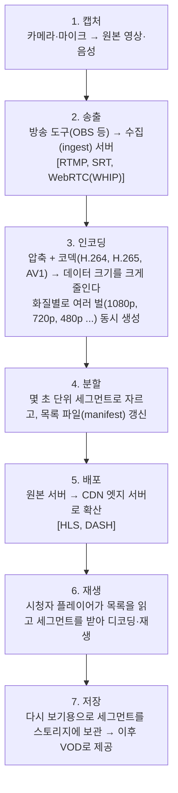

> ByteByteGo의 System Design 101 가이드 「[Live Streaming Explained](https://bytebytego.com/guides/live-streaming-explained)」를 바탕으로 재구성한 노트다.

## 라이브 스트리밍이란

일반 스트리밍(VOD)은 미리 올려 둔 파일을 재생한다. **라이브 스트리밍**은 지금 촬영 중인 영상을 수 초 지연으로 수많은 시청자에게 보낸다. 미리 처리할 시간이 없으므로 **인코딩·분할·배포를 흐르는 동안 계속** 해야 한다.

## 파이프라인

### 압축과 코덱

압축은 프레임 사이에 바뀌지 않는 부분(배경)을 반복 저장하지 않고, 움직이는 부분의 차이만 담는 원리다. 코덱은 효율이 좋을수록 같은 화질을 더 적은 비트로 보내지만 인코딩 연산이 무겁다. 호환성은 H.264가 가장 넓고, H.265·AV1은 같은 화질에 더 적은 대역폭을 쓴다.

### 세그먼트와 적응형 비트레이트

영상을 몇 초 단위 조각으로 자르면 일반 HTTP 파일처럼 다룰 수 있다. 그래서 **CDN에 캐시**할 수 있고, 시청자는 조각을 하나씩 받으며 재생한다.

**적응형 비트레이트(ABR, Adaptive Bitrate Streaming)** 는 같은 구간을 화질별로 여러 벌 만들어 두고, 플레이어가 네트워크 상태를 보며 **조각마다 화질을 바꿔** 받는 방식이다. 지하철에서 화질이 잠깐 떨어지지만 끊기지 않는 이유다. 그래서 3·4단계에서 화질별 파일을 함께 만든다.

### CDN

시청자 수만 명이 원본 서버 한 곳에 몰리면 버티지 못한다. 세그먼트를 **CDN 엣지 서버**로 퍼뜨려 시청자가 가까운 엣지에서 받게 하면 지연과 원본 부하가 모두 준다 → [[cdn|CDN]]

## 프로토콜

| 프로토콜 | 구간 | 특징 |
| --- | --- | --- |
| RTMP | 송출(방송 도구 → 수집 서버) | 원래 플래시 재생용이었지만 지금은 송출 표준으로 남았다. 재생에는 쓰지 않는다 |
| SRT | 송출 | UDP 기반으로 불안정한 망에서도 손실을 복구하며 보낸다 |
| HLS (HTTP Live Streaming) | 시청 | 애플이 만든 HTTP 기반 방식. 애플 기기가 기본 지원하고 가장 널리 쓰인다 |
| DASH (MPEG-DASH) | 시청 | 국제 표준 HTTP 기반 방식. 애플 기기는 기본 지원하지 않는다 |
| WebRTC | 송출·시청 | 1초 미만 지연. 화상 회의·양방향 방송용. 시청자가 많으면 미디어 서버(SFU) 비용이 크다 → [[webrtc\|WebRTC]] |

HLS와 DASH는 모두 ABR을 지원하고, 같은 세그먼트 형식(CMAF)을 함께 쓰면 하나의 인코딩으로 두 방식을 모두 서빙할 수 있다.

## 지연 시간 등급

| 등급 | 지연 | 방식 | 쓰임 |
| --- | --- | --- | --- |
| 일반 | 10~30초 | 표준 HLS·DASH (세그먼트 몇 개를 버퍼링) | 일방향 방송 |
| 저지연 | 2~5초 | LL-HLS, 저지연 DASH (부분 세그먼트를 미리 전송) | 채팅이 붙은 라이브 방송, 스포츠 |
| 실시간 | 1초 미만 | WebRTC | 화상 회의, 경매, 양방향 방송 |

지연을 줄일수록 버퍼가 얇아져 끊김에 약해지고, 대규모 배포 비용이 오른다.

## 정리

- 라이브 스트리밍은 캡처 → 송출 → 인코딩 → 분할 → CDN 배포 → 재생이 쉬지 않고 흐르는 파이프라인이다.
- 세그먼트로 자르면 HTTP 파일처럼 CDN에 캐시할 수 있고, 화질별 사본을 두면 플레이어가 망 상태에 맞춰 고른다(ABR).
- 송출은 RTMP·SRT, 시청은 HLS·DASH가 기본이고, 1초 미만이 필요하면 WebRTC를 쓴다.
- 지연과 안정성·비용은 맞바꾸는 관계다.

관련 노트: [[cdn|CDN]], [[webrtc|WebRTC]], [[big-tech-stack-anatomy|대규모 서비스 기술 스택 해부]], [[block-file-object-storage|블록·파일·오브젝트 스토리지]]
