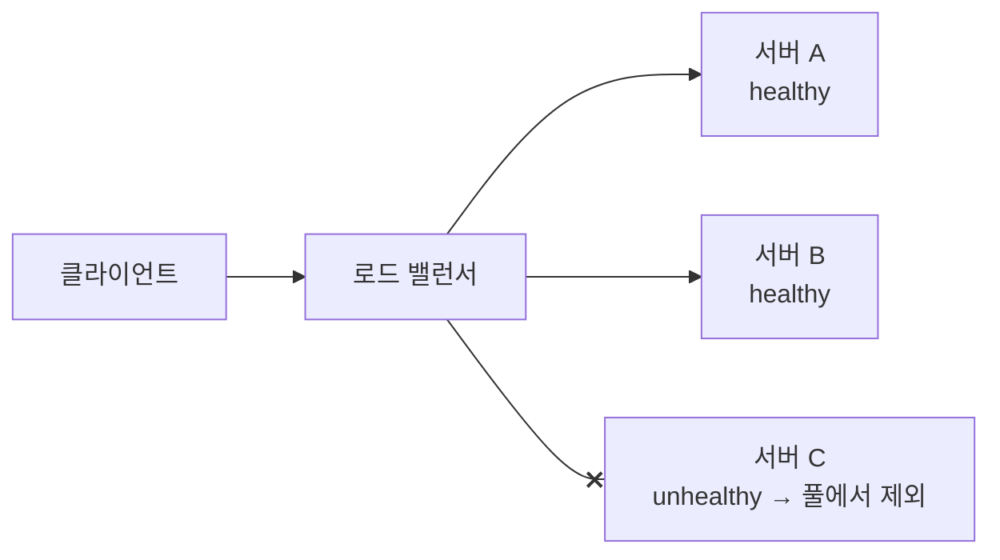

> ByteByteGo의 System Design 101 가이드 「[What is a Load Balancer?](https://bytebytego.com/guides/what-is-a-load-balancer)」, 「[Key Use Cases for Load Balancers](https://bytebytego.com/guides/key-use-cases-for-load-balancers)」, 「[Load Balancer Realistic Use Cases](https://bytebytego.com/guides/load-balancer-realistic-use-cases-you-may-not-know)」, 「[Top 6 Load Balancing Algorithms](https://bytebytego.com/guides/top-6-load-balancing-algorithms)」를 바탕으로, 패킷 전달 방식과 로드 밸런서 이중화는 「[L4/L7 스위치의 대안, 오픈 소스 로드 밸런서 HAProxy](https://d2.naver.com/helloworld/284659)」로 보강해 재구성한 노트다.
> 배치 토폴로지, L4 구현 방식, 제어 평면 부분은 Matt Klein의 「Introduction to modern network load balancing and proxying」 번역 「[네트워크 로드 밸런싱 및 프록시 소개](https://ziwon.github.io/post/modern-network-load-balancing-and-proxying/)」를 바탕으로 보강했다.
> 「DNS 라운드 로빈」은 jbee의 「[Interview Question for Beginner](https://github.com/jbee37142/Interview_Question_for_Beginner)」 네트워크 문서를 바탕으로 보강했다.

## 로드 밸런서란

로드 밸런서(load balancer)는 **들어오는 트래픽을 여러 서버에 나눠 보내는 장치나 소프트웨어**다. 클라이언트는 로드 밸런서의 주소 하나만 알고, 그 뒤에 서버가 몇 대 있는지, 어느 서버가 죽었는지는 모른다.

서버 한 대로 버티는 수직 확장에는 한계가 있다. 로드 밸런서는 **같은 서버를 여러 대 두는 수평 확장**을 가능하게 하는 첫 부품이다.

## 하는 일

| 기능 | 설명 |
| --- | --- |
| 트래픽 분산 | 요청을 여러 서버에 고르게 나눠 한 서버에 몰리지 않게 한다 |
| 헬스 체크 | 서버에 주기적으로 요청을 보내 응답이 정상인 서버에만 트래픽을 보낸다 |
| 장애 우회(고가용성) | 죽거나 느려진 서버를 풀에서 빼고 남은 서버로 돌린다. 서버 몇 대가 문제여도 서비스는 이어진다 |
| 수평 확장 | 서버를 풀에 더하기만 하면 트래픽이 새 서버로도 간다. 오토스케일링과 짝을 이룬다 |
| TLS 종료(SSL termination) | 암호화·복호화를 로드 밸런서가 맡아 뒤 서버의 CPU 부담을 던다 |
| 세션 고정(sticky session) | 같은 사용자의 요청을 같은 서버로 보낸다. 서버 메모리에 세션을 두는 앱에 필요하다 |
| 플랫폼·경로별 라우팅 | 모바일과 데스크톱 요청, `/api`와 `/static`을 서로 다른 백엔드로 보낸다 (L7) |
| 영역 간 분산(cross-zone) | 여러 가용 영역·지역에 걸쳐 나눠, 한 영역이 통째로 죽어도 버틴다 |

세션 고정은 편하지만 **특정 서버에 부하가 쏠리고, 그 서버가 죽으면 세션이 사라진다.** 세션을 Redis 같은 외부 저장소에 두거나 토큰 방식으로 바꾸면 고정 없이도 어느 서버로 가도 된다([[session-vs-token-auth|세션과 토큰 인증]]).

## L4와 L7

| 구분 | L4 (전송 계층) | L7 (응용 계층) |
| --- | --- | --- |
| 보는 정보 | IP 주소, TCP/UDP 포트 | HTTP 메서드, URL 경로, 헤더, 쿠키 |
| HTTP 해석 | 하지 않는다. 패킷·연결 단위로 넘긴다 | 요청을 열어 보고 판단한다 |
| 속도 | 빠르고 가볍다 | 해석 비용이 든다 |
| 할 수 있는 일 | 연결 분산, TCP·UDP 아무 프로토콜이나 | 경로·헤더 기반 라우팅, TLS 종료, 쿠키 기반 고정, 요청 재작성 |
| 클라우드 예 | AWS NLB | AWS ALB |

L4는 **연결 단위**로 나누기 때문에 HTTP/2·gRPC처럼 연결 하나에 요청 여러 개를 오래 실어 나르는 프로토콜과 맞지 않는다. 무거운 클라이언트의 긴 연결 하나가 서버 한 대에 계속 붙어 있게 된다. L7은 연결 안의 **요청·스트림 단위**로 나누고, 재시도·서킷 브레이커·레이트 리밋까지 할 수 있다.

규모가 큰 시스템은 앞단에 L4를 두고 그 뒤에 L7(또는 API 게이트웨이)을 두는 식으로 겹쳐 쓴다. 작은 서비스는 L7 하나로 충분하다. OSI 계층 자체는 [[osi-7-layer|OSI 7계층]]에 있다.

## 형태

| 형태 | 설명 | 예 |
| --- | --- | --- |
| 하드웨어 | 전용 장비. 높은 처리량, 비싸고 늘리기 어렵다 | F5 같은 어플라이언스 |
| 소프트웨어 | 일반 서버·VM·컨테이너에 설치 | Nginx, HAProxy, Envoy |
| 클라우드 관리형 | 클라우드가 운영하고 자동으로 확장된다 | AWS Elastic Load Balancing, Google Cloud Load Balancing, Azure Load Balancer |
| GSLB (Global Server Load Balancing) | 여러 지역의 데이터 센터 사이에서 나눈다. 보통 DNS나 애니캐스트로 구현 | 지역 장애 대비, 가까운 리전으로 보내기([[dns\|DNS 라우팅 정책]]) |

### DNS 라운드 로빈

로드 밸런서 없이 **한 도메인에 A 레코드를 여러 개** 두고, DNS 서버가 질의마다 IP 순서를 돌려 주는 가장 단순한 분산이다. 장비가 필요 없지만 한계가 분명하다.

| 한계 | 이유 |
| --- | --- |
| 서버마다 공인 IP가 필요하다 | 클라이언트가 서버 IP로 직접 접속한다 |
| 고르게 나뉘지 않는다 | 통신사 리졸버·프록시·브라우저·OS가 응답을 TTL 동안 캐시해, 같은 캐시 뒤의 사용자는 모두 같은 서버로 간다 |
| 장애를 모른다 | DNS는 서버의 부하나 생사를 보지 않아 죽은 서버 IP도 계속 준다. TTL을 줄여도 캐시가 다 사라질 때까지 일부 요청은 실패한다 |
| 세션 유지가 어렵다 | 다음 질의에서 다른 서버로 갈 수 있다 |

그래서 DNS 단계에서는 가중치 응답, 헬스 체크와 연동한 장애 조치, 지역 기반 응답(Route 53 같은 관리형 DNS의 라우팅 정책)으로 단점을 보완하고, 데이터 센터 안의 세밀한 분산은 로드 밸런서가 맡는다.

## 분산 알고리즘

분산 알고리즘은 서버 상태를 보지 않고 정해진 규칙대로 나누는 **정적(static)** 알고리즘(라운드 로빈, 고정 라운드 로빈, 가중 라운드 로빈, 해시)과, 연결 수·응답 시간 같은 실시간 상태를 보는 **동적(dynamic)** 알고리즘(최소 연결, 최소 응답 시간)으로 나뉜다. 정적 알고리즘은 단순하고 빠르지만 서버가 무상태여야 고르게 나뉜다.

| 알고리즘 | 방식 | 어울리는 곳 |
| --- | --- | --- |
| 라운드 로빈 | 차례대로 돌아가며 보낸다 | 서버 성능과 요청 비용이 비슷할 때 |
| 고정(sticky) 라운드 로빈 | 한 사용자의 첫 요청이 간 서버로 이후 요청도 계속 보낸다 | 세션을 서버 메모리에 둔 서비스. 부하가 한 서버에 쏠릴 수 있다 |
| 가중 라운드 로빈 | 서버마다 비중을 두고 돌린다 | 사양이 다른 서버가 섞여 있을 때, 새 버전에 일부만 보낼 때 |
| 최소 연결 | 현재 연결이 가장 적은 서버로 | 요청마다 처리 시간이 크게 다를 때, WebSocket처럼 연결이 오래 갈 때 |
| 최소 응답 시간 | 응답이 가장 빠른 서버로 | 서버 상태가 들쭉날쭉할 때 |
| IP 해시·일관 해시 | 클라이언트 IP나 키의 해시로 서버를 정한다 | 같은 클라이언트를 같은 서버로, 캐시 서버 분산 |

## 헬스 체크와 서비스 디스커버리

| 기능 | 방식 |
| --- | --- |
| 서비스 디스커버리 | 뒤에 어떤 서버가 있는지 알아낸다. 정적 설정, DNS, ZooKeeper·etcd·Consul, Envoy의 xDS 같은 동적 API |
| 능동 헬스 체크 | 정해진 주기로 서버에 요청(`/health`)을 보내 본다 |
| 수동 헬스 체크 | 실제 트래픽의 결과(연속 연결 실패, 5xx 연속 발생)로 이상을 추론해 잠시 풀에서 뺀다(이상치 감지) |

동적 알고리즘 중 **두 개 골라 덜 바쁜 쪽(power of two choices)** 은 무작위로 서버 둘을 뽑아 부하가 적은 쪽에 보내는 방식이다. 모든 서버의 상태를 비교하지 않아도 쏠림이 크게 줄어 프록시가 여러 대일 때 특히 잘 맞는다.

## L4 로드 밸런서의 구현 방식

| 방식 | 동작 | 특징 |
| --- | --- | --- |
| 종료(termination) | 클라이언트 연결을 받아 끝내고 서버로 새 연결을 연다 | 단순하다. 손실이 많은 구간 가까이에서 연결을 끊어 주면 성능에 유리하다 |
| 패스스루(passthrough) | 연결을 끝내지 않고 연결 추적과 NAT로 패킷만 넘긴다 | 메모리·CPU가 적게 들고, 혼잡 제어를 서버가 그대로 한다 |
| DSR(Direct Server Return) | 요청만 로드 밸런서를 지나고 **응답은 서버가 클라이언트로 바로** 보낸다(GRE 캡슐화 등) | 응답이 요청보다 훨씬 큰 서비스에서 로드 밸런서 용량을 아낀다. 서버도 설정에 참여해야 한다 |

- 패스스루의 NAT 방식은 목적지 IP를 가상 IP(VIP)에서 실제 서버 IP로 바꾸고, 응답이 로드 밸런서를 지날 때 출발지를 다시 VIP로 바꾼다. 응답까지 로드 밸런서가 감당한다.
- DSR은 같은 L2 망이면 IP는 두고 **MAC 주소만** 바꿔 넘기고(서버는 VIP를 루프백에 둔다), 망이 다르면 IP-in-IP·GRE 터널로 캡슐화해 넘긴다.
- 종료 방식(L7 프록시 포함)에서는 서버에 로드 밸런서 IP가 보인다. 원래 클라이언트 IP는 `X-Forwarded-For` 헤더나 PROXY 프로토콜로 넘기고 서버가 그것을 읽게 설정한다([[proxy|프록시: 포워드 프록시와 리버스 프록시]]). L7의 세션 고정은 응답에 서버 식별 쿠키를 붙이고 다음 요청에서 그 쿠키로 같은 서버를 고르는 식이다.

고가용성은 두 가지로 만든다.

- **액티브·스탠바이 쌍**: 두 대가 상태를 공유하고 한 대는 대기한다. 단순하지만 용량 절반이 놀고 확장이 어렵다. 소프트웨어 로드 밸런서(HAProxy 등)는 보통 keepalived의 **VRRP**로 하트비트를 주고받다가, 액티브가 응답하지 않으면 스탠바이가 VIP를 넘겨받는다([[high-availability-redundancy|고가용성 이중화 구조와 장애 감지]]).
- **ECMP + 일관 해시 클러스터**: 라우터가 ECMP로 여러 로드 밸런서에 흐름을 나누고, 각 로드 밸런서는 일관 해시로 같은 흐름을 같은 서버에 보낸다. 상태 공유 없이 수평 확장되고 여러 대가 죽어도 버틴다. Google Maglev, AWS NLB가 이 계열이다.

L7 프록시는 보통 상태 없이 여러 대를 나란히 두어 확장한다. 그래서 큰 시스템은 **앞단 L4 클러스터(대량 트래픽·DDoS 흡수) + 뒤의 L7 프록시**의 2단 구성을 많이 쓴다.

## 배치 토폴로지

| 토폴로지 | 위치 | 장단점 |
| --- | --- | --- |
| 미들 프록시 | 클라이언트와 서버 사이의 중앙 장비·소프트웨어(HAProxy, Nginx, Envoy, 클라우드 LB) | 쓰기 쉽다. 단일 장애 지점·병목이 되고, 문제가 생기면 어디서 막혔는지 보기 어렵다 |
| 엣지 프록시 | 인터넷에 노출된 미들 프록시 | TLS 종료, 레이트 리밋, 인증을 더해 외부 트래픽의 관문이 된다 |
| 클라이언트 내장 라이브러리 | 서비스 코드 안(gRPC 클라이언트 등) | 중앙 병목이 없고 가장 빠르다. 언어마다 구현해야 하고, 업그레이드를 모든 서비스에 배포해야 한다 |
| 사이드카 프록시 | 서비스 옆에 붙은 별도 프로세스(Envoy, Linkerd) | 라이브러리의 장점을 언어와 무관하게 얻는다. 약간의 지연이 더해진다. **서비스 메시**의 바탕이다 |

서비스 간 트래픽은 사이드카(서비스 메시)로, 외부 트래픽은 엣지 프록시로 받는 구성이 흔하다. 이때 프록시들은 **데이터 평면**이 되고, 설정·라우팅 규칙·인증서를 내려 주고 상태를 모으는 중앙 **제어 평면**(Istio의 istiod 등)이 따로 선다. 존 장애 시 자동 우회, 전역 정책 적용, 이상 탐지를 제어 평면이 맡는다([[distributed-system-patterns|분산 시스템의 통신·데이터 흐름 패턴]]).

## 정리

- 로드 밸런서는 트래픽 분산, 헬스 체크로 장애 우회, 수평 확장을 맡는다.
- L4는 IP·포트만 보고 빠르게, L7은 HTTP를 열어 보고 똑똑하게 나눈다.
- 세션 고정은 최후의 수단이다. 상태를 서버 밖으로 빼면 어느 서버로 가도 된다.
- 리버스 프록시·API 게이트웨이와 겹치는 기능이 많다. 차이는 [[api-gateway|API 게이트웨이]]에 정리했다.

관련 노트: [[api-gateway|API 게이트웨이]], [[proxy|프록시: 포워드 프록시와 리버스 프록시]], [[web-scalability-components|웹 확장성의 구성 요소]], [[high-traffic-resilience|대규모 트래픽에서 서비스를 지키는 설계]], [[kubernetes-request-path|쿠버네티스 위 웹 서비스의 요청 경로]]
