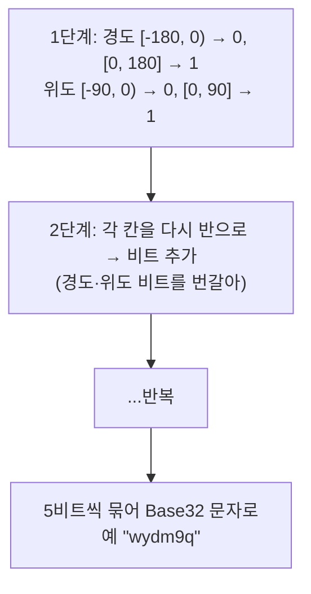
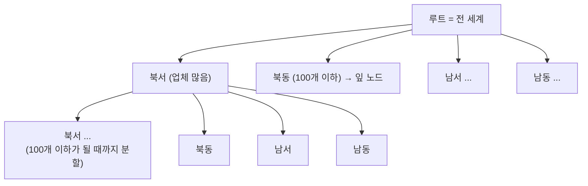
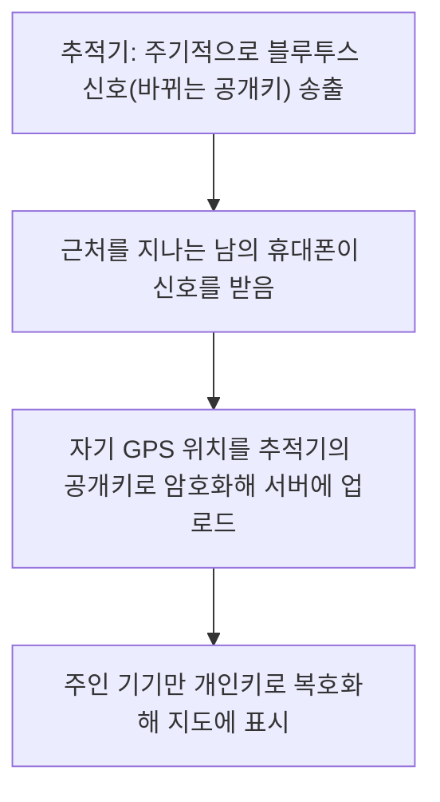

> ByteByteGo의 System Design 101 가이드 「[Proximity Service](https://bytebytego.com/guides/proximity-service)」, 「[Quadtree](https://bytebytego.com/guides/quadtree)」, 「[Design Google Maps](https://bytebytego.com/guides/design-google-maps)」, 「[How do AirTags work?](https://bytebytego.com/guides/how-do-airtags-work)」, 「[How do Google/Apple Maps blur license plates and human faces on Street View?](https://bytebytego.com/guides/how-do-googleapple-maps-blur-license-plates-and-human-faces-on-street-view)」를 바탕으로 재구성한 노트다. 육각형 격자 거리 근사는 「[배민라이더스 배달 경로와 거리 계산 개발 과정](https://techblog.woowahan.com/2608/)」으로 보강했다. 차량 배차 사례는 High Scalability의 「[How Uber Scales Their Real-Time Market Platform](http://highscalability.com/blog/2015/9/14/how-uber-scales-their-real-time-market-platform.html)」(2015)로 보강했다.

## 주변 검색 서비스

"반경 1km 안의 식당"을 찾는 서비스는 보통 둘로 나눈다.

| 서비스 | 하는 일 | 부하 특성 |
| --- | --- | --- |
| 업체 서비스 | 업체 정보 추가·수정·삭제, 상세 조회 | 쓰기는 드물고 읽기는 캐시가 잘 먹는다 |
| 위치 기반 서비스(LBS) | 위치와 반경을 받아 주변 업체 목록 반환 | 읽기만 많고 쓰기는 없다. 상태가 없어 수평 확장이 쉽다 |

### 왜 색인이 필요한가

위도·경도 컬럼만 두면 질의마다 **모든 업체와의 거리**를 계산해야 한다. 위도 범위 색인과 경도 범위 색인을 따로 걸어도, 두 범위의 교집합을 구하는 데 각각 큰 결과를 읽어야 해서 느리다. 그래서 **2차원 공간을 1차원 키나 트리로 바꿔** 색인한다.

## 지오해시

**지오해시(geohash)** 는 지도를 반복해서 나누며 비트를 붙이는 방식이다.



- **접두사가 같으면 같은 칸 안에 있다.** 그래서 `WHERE geohash LIKE 'wydm9%'` 같은 접두사 검색이 일반 B-트리 색인으로 된다.
- 길이가 길수록 칸이 작다. 반경에 맞는 길이를 고른다(6자리는 대략 1km 안팎 크기의 칸).
- **경계 문제**: 바로 옆이어도 칸 경계를 넘으면 접두사가 전혀 다를 수 있다. 그래서 내 칸과 **이웃 8칸**을 함께 조회한 뒤 실제 거리로 거른다.
- 결과가 적으면 길이를 줄여(칸을 키워) 다시 찾는다.
- 칸 크기가 고정이라 도심의 한 칸에는 업체가 너무 많고 바다의 칸은 텅 빈다.

## 쿼드트리

**쿼드트리(quadtree)** 는 2차원 공간을 **네 칸으로 재귀 분할**하되, 칸 안의 업체가 기준(예: 100개)을 넘을 때만 더 쪼개는 트리다. 밀도에 맞춰 칸 크기가 달라지는 것이 지오해시와의 차이다.



- 검색: 루트에서 내 위치가 든 잎 노드까지 내려간다. 업체가 모자라면 이웃 노드에서 더 가져온다.
- **DB가 아니라 메모리 자료구조**다. LBS 서버마다 시작할 때 전체 업체로 트리를 만든다.
- 업체가 수억 개면 트리를 만드는 데 몇 분이 걸리고, 그동안 그 서버는 트래픽을 받지 못한다. 그래서 새 버전을 **일부 서버씩 순차 배포**해 클러스터 전체가 동시에 빠지지 않게 한다.
- 업체 추가·삭제는 즉시 반영하기보다 다음 날 재구축처럼 늦게 반영하는 경우가 많다.

### 고르는 기준

| 구분 | 지오해시 | 쿼드트리 |
| --- | --- | --- |
| 저장 | DB 문자열 컬럼 + 일반 색인 | 서버 메모리의 트리 |
| 칸 크기 | 고정(길이로 조절) | 밀도에 따라 달라짐 |
| 갱신 | 행 하나 수정 | 트리 수정이 까다롭다. 주기적 재구축 |
| 맞는 곳 | 구현이 단순해야 할 때, 반경 검색 | "가장 가까운 k개" 검색, 밀도 차가 클 때 |

실무에서는 PostGIS·Redis·Elasticsearch의 공간 색인이나 S2(구면 셀)·H3(육각형 격자) 같은 라이브러리를 쓰는 경우가 많다. 원리는 위와 같다.

## 지도 서비스의 세 부분

| 구성 요소 | 하는 일 |
| --- | --- |
| 위치 서비스 | 클라이언트가 몇 초마다 보내는 위치를 기록한다. 쓰기가 매우 많아 묶어서 보내고 쓰기 처리량이 큰 저장소에 둔다. 새 도로·폐쇄 도로 탐지, 지도 정확도 개선, 실시간 교통 정보의 재료가 된다 |
| 지도 렌더링 | 세계 지도를 확대 단계마다 작은 **타일** 이미지(또는 벡터 타일)로 미리 잘라 둔다. 타일은 거의 안 바뀌는 정적 파일이라 객체 스토리지 + CDN으로 서빙하고, 클라이언트는 화면에 필요한 타일만 받는다 → [[cdn\|CDN]] |
| 내비게이션 | 지오코딩(주소 → 위경도) 후 경로 계획: 상위 k개 최단 경로 계산 → 현재·과거 교통으로 소요 시간 예측 → 시간과 사용자 조건(유료 도로 회피 등)으로 순위 |

도로망은 그래프이고 최단 경로는 다익스트라·A* 계열로 찾는다. 전 세계 도로를 한 번에 탐색할 수 없으므로 지역 타일로 나누고, 고속도로 같은 상위 계층 그래프를 따로 두어 먼 거리를 빠르게 잇는다.

## 오프라인 위치 찾기 네트워크

AirTag 같은 분실물 추적기는 GPS나 통신 모듈 없이 **주변 기기를 중계기로** 쓴다.



- 중계한 사람도, 서버 운영자도 위치를 읽을 수 없다. 공개키를 주기적으로 바꿔 신호로 특정 추적기를 따라다니지도 못하게 한다.
- 정확도와 갱신 빈도는 **주변 기기 밀도**에 달렸다. 사람이 드문 곳에서는 위치가 늦게, 부정확하게 갱신된다.
- 남을 몰래 추적하는 데 악용될 수 있어, 낯선 추적기가 함께 이동하면 알려 주는 기능이 플랫폼 간 표준으로 들어갔다.

## 지도 이미지 비식별화

거리 사진을 공개하는 서비스는 얼굴과 번호판을 자동으로 흐린다. 전형적인 머신러닝 파이프라인 세 단계로 나뉜다.

| 단계 | 내용 |
| --- | --- |
| 데이터 파이프라인 | 얼굴·번호판에 경계 상자를 단 학습 데이터 → 전처리·증강(정규화, 크기 조정) → 객체 탐지 모델 학습 |
| 블러 파이프라인 | 수집한 거리 사진 전처리 → 모델로 민감 객체 탐지 → 해당 영역 블러 → 객체 스토리지에 저장 |
| 서빙 파이프라인 | 사용자에게는 **블러 처리된 이미지만** 서빙한다. 원본 접근은 따로 통제한다 |

탐지 모델은 놓치는 것(미탐)이 더 위험하므로 재현율을 높게 잡고, 신고된 이미지는 다시 처리하는 경로를 둔다.

## 육각형 격자로 이동 거리 근사하기

배달·호출 서비스는 「얼마나 떨어져 있나」를 초당 수많은 요청에 답해야 한다. **직선거리(하버사인 공식)** 는 구면 위 최단 거리라 산·강·공원 같은 장애물을 무시해 실제 이동 거리와 크게 다를 수 있다. 외부 길찾기 API는 정확하지만 호출 비용과 응답 시간이 대량 요청에 맞지 않는다. 그 사이의 절충이 **격자 위 경로 탐색**이다.

| 요소 | 내용 |
| --- | --- |
| 육각형 격자 | 지도를 육각형 칸으로 나눈다. 이웃 6칸까지의 중심 거리가 모두 같아 이동 비용을 단순하게 모델링한다(Uber H3가 대표 라이브러리). 어떤 좌표가 어느 칸인지는 다각형 포함 검사 없이 격자 인덱스 계산으로 끝난다 |
| 좌표계 | 큐브 좌표(x+y+z=0)는 거리·범위·방향 계산에, 오프셋 좌표는 지도 위 행·열 표현에 편하다. 서로 변환할 수 있다 |
| 위경도 → 거리 | 위도 1도는 어디서나 약 111km지만 경도 1도의 거리는 위도에 따라 줄어든다. 좁은 지역은 기준점의 보정 비율로 근사할 수 있지만 넓은 지역에선 오차가 커진다 |
| 셀 통행 비용 | 과거 이동 기록이 많이 지나간 칸은 싸게, 기록이 없는 칸은 비싸게 둔다. 평균·최대 같은 통계를 조합하되 상한·하한을 둬 극단값을 누른다 |
| 도로망 보강 | 공공 도로 데이터(shapefile)를 좌표계에 맞추고 도로 유형으로 거른 뒤, 선분을 지나는 칸 집합으로 바꿔 통행 가능 칸으로 표시한다. 기록이 없는 신규 지역의 공백을 메운다 |
| 경로 탐색 | **A\*** 알고리즘으로 「지금까지 비용 + 목표까지 추정 거리」가 작은 칸부터 우선순위 큐로 탐색해 탐색 범위를 줄인다 |

위치 로그는 결측과 잡음이 많다. 같은 좌표가 반복되면 고정된 신호원(기지국·와이파이) 위치일 가능성이 있어 전처리에서 걸러 낸다. 수집 주기가 길면 경로 정보가 사라지므로, 분석 목적에 맞는 해상도로 처음부터 수집해야 한다. 목표는 완벽한 최단 경로가 아니라 **충분히 그럴듯하고 빠른 근사**다.

## 실시간 배차: 움직이는 공급과 수요 맞추기

차량 호출 배차는 주변 검색에 **위치가 계속 바뀐다**는 조건이 붙은 문제다. 공급(기사)도 수요(승객)도 제멋대로 움직이고, 위치 색인에 초당 수백만 건의 쓰기가 들어오며 읽기는 그 몇 배다.

```text
기사 앱 --위치 갱신(수 초마다)--> 공급 서비스 --> 공급 위치 색인(geo by supply)
승객 요청 --> 수요 서비스 --> 배차 최적화(DISCO)
  1. 위치 색인에서 근처 후보를 거칠게 거른다(셀 단위)
  2. 경로·ETA 서비스가 직선거리가 아니라 도로망 기준 도착 시간을 계산한다
  3. ETA로 정렬해 기사에게 차례로 제안한다
```

- 공급과 수요를 「승용차·배달 같은 제품」에 묶지 않고 **능력과 요구 조건**으로 일반화하면, 도시·제품마다 따로 만든 배차를 한 시스템으로 합칠 수 있다.
- 배차 가능한 차만 색인하던 단순화를 버리고 **모든** 공급을 추적하면, 손님을 내려 줄 예정인 차까지 후보로 넣어 전체 대기 시간을 줄인다. 공항처럼 도착 순서가 중요한 곳은 가상 대기열을 따로 둔다.
- 지도 셀로 색인을 나누고 셀을 서버에 배치할 때 **일관된 해싱 링 + 가십 기반 멤버십**(Uber의 Ringpop, SWIM 프로토콜)을 쓰면, 서버가 늘고 줄어도 각 노드가 자기 담당 셀을 알고 요청을 주인에게 넘긴다.
- 데이터센터 장애에는 기사 앱을 상태 저장소로 쓰는 방식이 나왔다. 서버가 주기적으로 여정 상태 요약을 기사 폰에 내려 두고, 다른 데이터센터로 넘어갔을 때 폰이 그 상태를 올려 이어 가게 한다.

## 정리

- 주변 검색은 2차원을 색인 가능한 형태로 바꾸는 문제다. 지오해시는 접두사 검색, 쿼드트리는 밀도 적응형 메모리 트리다.
- 지오해시는 경계 때문에 이웃 칸까지 조회하고, 쿼드트리는 재구축 시간 때문에 순차 배포한다.
- 지도는 위치 수집(쓰기 폭주), 타일 서빙(정적 + CDN), 경로 계산(그래프 + 교통 예측)으로 나뉜다.
- 위치 데이터는 민감하다. 오프라인 찾기 네트워크의 종단 간 암호화와 거리 사진 비식별화가 그 예다.

관련 노트: [[cdn|CDN]], [[database-sharding|데이터베이스 샤딩]], [[web-scalability-components|웹 확장성의 구성 요소]], [[block-file-object-storage|블록·파일·오브젝트 스토리지]]
