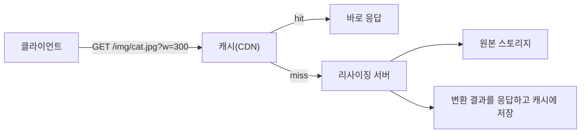
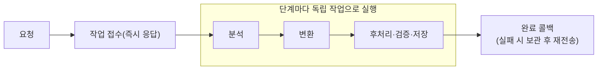

> 「[온디맨드 이미지 리사이징 원리 및 예제](https://roka88.dev/102)」, 「[LINE 트랜스코딩 서버 아키텍처 개선기 – 1](https://engineering.linecorp.com/ko/blog/line-transcoding-server-architecture-improvement-1/)」을 바탕으로 재구성한 노트다.

## 왜 별도 설계가 필요한가

사용자가 올린 원본을 그대로 내보내면 모바일 목록 화면에서 수 MB짜리 사진을 받게 된다. 그래서 서비스는 원본을 용도별 크기·포맷·화질로 바꿔 내보낸다. 이 변환은 CPU를 많이 쓰고, 결과물은 저장 공간을 차지한다. **언제 변환하고, 결과를 어디에 두느냐**가 설계의 핵심이다.

## 미리 만들기와 요청 시 변환

| 방식 | 동작 | 장점 | 단점 |
| --- | --- | --- | --- |
| 미리 만들기(pre-generation) | 업로드할 때 정해진 크기를 모두 만들어 저장 | 조회가 가장 빠르다 | 쓰지 않는 크기도 만든다. 저장 비용이 크고, **새 크기가 필요하면 기존 파일 전체를 다시 만들어야 한다** |
| 요청 시 변환(on-demand) | 원본만 저장하고 요청 URL의 파라미터대로 그때 변환 | 저장 공간이 작고 새 크기에 바로 대응한다 | 첫 요청과 캐시 미스 때 느리고, 그 순간 연산이 몰린다 |

요청 시 변환은 **캐시 적중률이 성패를 가른다.** 적중률이 낮으면 매 요청이 변환으로 이어져 서버가 과부하에 걸린다.

## 온디맨드 리사이징의 구조

- **파라미터는 URL에 담고 GET으로 받는다.** URL이 곧 캐시 키가 되어 CDN·브라우저 캐시를 그대로 쓴다.
- 허용할 크기를 목록으로 제한한다. 임의의 `w` 값을 받으면 공격자가 무한히 다른 크기를 요청해 캐시를 무력화하고 변환 서버를 태운다.
- 비율 규칙을 정한다. 너비·높이 중 하나만 오면 비율을 유지하고, 둘 다 오면 맞춤(유지·늘이기·여백·가운데 자르기) 정책을 옵션으로 고르게 한다.
- 원본 스토리지는 CDN과 변환 함수만 읽을 수 있게 접근 정책을 건다.

### HTTP 캐시로 전송까지 줄이기

| 장치 | 역할 |
| --- | --- |
| `Cache-Control: max-age` | 클라이언트·CDN이 다시 묻지 않고 재사용하는 기간 |
| `ETag` + `If-None-Match` | 기간이 지난 뒤 다시 물을 때, 바뀌지 않았으면 `304 Not Modified`로 본문 없이 응답 |

**같은 이름에 다른 이미지를 덮어쓰지 않는다**는 정책이 있으면, 파일은 불변이므로 아주 긴 `max-age`와 강한 검증자를 쓸 수 있다. 이미지를 바꿀 때는 새 이름(해시가 붙은 이름)으로 올린다. 자세한 동작은 [[http-cache|HTTP 캐시]]에 있다.

### 서버와 엣지 함수

변환을 상시 서버에서 할 수도, CDN 엣지에서 실행되는 함수(CloudFront Lambda@Edge·CloudFront Functions, Cloudflare Workers 등)에서 할 수도 있다. 엣지 함수는 캐시 미스 처리를 사용자 가까이에서 하고 서버 관리가 필요 없다. 다만 **요청이 많고 꾸준하면 상시 서버보다 비싸질 수 있고**, 실행 시간·메모리·패키지 크기 제한이 있다([[cdn|CDN]], [[aws-lambda-internals|AWS Lambda의 내부 구조]]). 많은 CDN·클라우드가 이미지 변환을 관리형 기능으로 제공하므로, 직접 만들기 전에 그쪽을 먼저 검토한다.

포맷도 같이 고른다. 브라우저가 `Accept` 헤더로 AVIF·WebP 지원을 알리면 그에 맞는 포맷으로 변환해 같은 화질에서 크기를 줄인다. 이때 응답에 `Vary: Accept`를 붙여 캐시가 포맷별로 따로 저장하게 한다.

## 동영상 트랜스코딩 파이프라인

동영상 변환은 이미지보다 훨씬 오래 걸리므로 **요청에 바로 결과를 돌려줄 수 없다.** 작업을 받아 두고 끝나면 알리는 비동기 구조가 기본이다.

- **단계를 나눈다.** 분석, 변환, 후처리·검증·저장을 따로 실행하면 단계별로 자원을 다르게 쓰고 병렬화하기 쉽다.
- **처리 흐름을 프리셋으로 설정화한다.** 자주 쓰는 흐름(해상도 묶음, 썸네일 추출 규칙)을 설정으로 정의하면 코드 배포 없이 바꿀 수 있고, 어떤 프리셋에 요청이 몰리는지로 부하를 예측할 수 있다.
- **결과가 확정된 뒤에만 완료를 알린다.** 저장이 끝나기 전에 알리면 받는 쪽이 아직 없는 파일을 읽으려 한다.
- **완료 알림은 유실되지 않게 한다.** 콜백 전송이 실패하면 메시지를 보관했다가 다시 보낸다.
- **가장 오래 걸리는 단계부터 최적화한다.** 대개 인코딩이다.

### 재생을 빠르게 하는 파일 배치

| 기법 | 내용 |
| --- | --- |
| 점진적 다운로드(progressive download) | MP4의 메타데이터(`moov` 박스)를 파일 앞쪽에 두면 다 받기 전에 재생·탐색할 수 있다. 인코더는 보통 메타데이터를 마지막에 쓰므로, 앞으로 옮기려면 데이터 오프셋을 다시 계산해야 한다(`faststart` 옵션) |
| 적응형 스트리밍(ABR) | 여러 화질로 잘게 나눈 조각을 만들고, 플레이어가 네트워크 상황에 맞춰 화질을 바꿔 받는다(HLS, DASH). 콘텐츠 보호가 필요하면 조각을 암호화한다 |
| 의미 있는 대표 이미지 | 썸네일을 첫 프레임에서 뽑으면 검은 화면이 나오기 쉽다. 밝기·변화량을 분석해 의미 있는 프레임을 고른다 |

### 이미지·애니메이션 포맷을 고를 때

- 압축 효율이 좋은 새 포맷이라도 **클라이언트 디코더 지원과 구현 비용**, 디코딩할 때 전체를 메모리에 올려야 하는지를 함께 본다.
- 저사양 기기를 고려하면 필요한 부분만 디코딩(부분 로드)할 수 있는 형식이 유리하다.
- 기존 표준 포맷의 확장 영역(주석·메타데이터 블록)에 부가 정보를 넣으면 호환성을 지키면서 기능을 더할 수 있다.
- 접근 패턴에 맞게 데이터를 배치한다. 프레임을 어떤 순서로 늘어놓느냐에 따라 첫 프레임을 읽는 I/O 양이 크게 달라진다.

## 정리

- 원본만 두고 요청 시 변환하면 저장과 유연성을 얻지만, **캐시 적중률**이 낮으면 변환 서버가 무너진다.
- 파라미터는 URL에, 허용 크기는 목록으로, 파일은 불변으로 두고 긴 캐시와 검증자를 쓴다.
- 엣지 함수와 관리형 이미지 변환은 운영을 줄이지만 비용과 실행 제한을 따진다.
- 동영상은 단계로 나눈 비동기 파이프라인으로 처리하고, 결과 확정 뒤 유실 없는 완료 알림을 보낸다.

관련 노트: [[cdn|CDN]], [[http-cache|HTTP 캐시]], [[block-file-object-storage|블록·파일·오브젝트 스토리지]], [[caching-strategies|캐시 전략: 계층, 읽기·쓰기 패턴, 교체 정책, 장애 패턴]], [[aws-lambda-internals|AWS Lambda의 내부 구조]]
