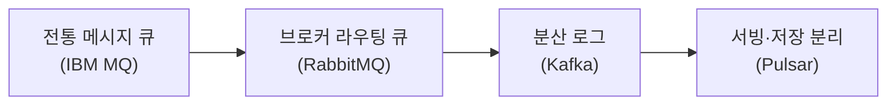
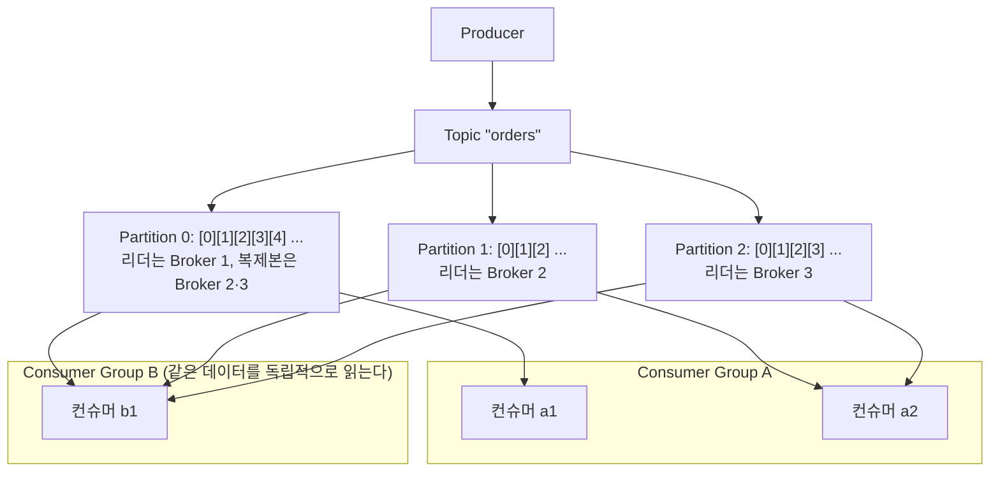
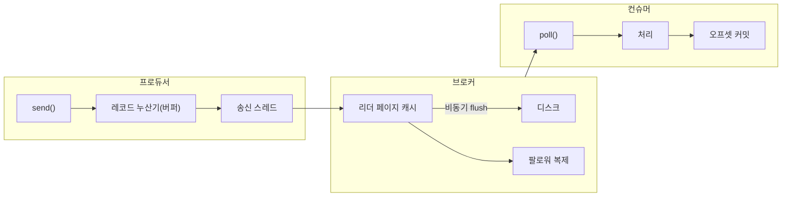
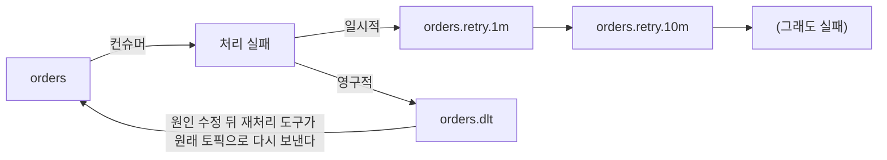
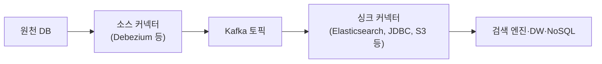
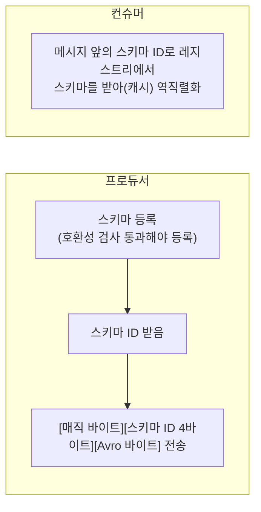

> ByteByteGo의 System Design 101 가이드 「[Types of Message Queue](https://bytebytego.com/guides/types-of-message-queue)」, 「[Message Queue Evolution](https://bytebytego.com/guides/how-do-message-queue-architectures-evolve)」, 「[The Ultimate Kafka 101](https://bytebytego.com/guides/the-ultimate-kafka-101-you-cannot-miss)」, 「[Why is Kafka Fast](https://bytebytego.com/guides/why-is-kafka-fast)」, 「[Delivery Semantics](https://bytebytego.com/guides/delivery-semantics)」, 「[Can Kafka Lose Messages?](https://bytebytego.com/guides/can-kafka-lose-messages)」, 「[Top 5 Kafka Use Cases](https://bytebytego.com/guides/top-5-kafka-use-cases)」를 바탕으로, 설정 기본값은 Apache Kafka 공식 문서로 확인해 재구성한 노트다. 운영 설계와 구독 모델은 「[아파치 카프카 레퍼런스: 설계](https://godekdls.github.io/Apache%20Kafka/design/)」(공식 문서 번역), 「[Kafka 운영자가 말하는 처음 접하는 Kafka](https://www.popit.kr/kafka-%EC%9A%B4%EC%98%81%EC%9E%90%EA%B0%80-%EB%A7%90%ED%95%98%EB%8A%94-%EC%B2%98%EC%9D%8C-%EC%A0%91%ED%95%98%EB%8A%94-kafka/)」, 「[LINE에서 Kafka를 사용하는 방법](https://engineering.linecorp.com/ko/blog/how-to-use-kafka-in-line-1/)」, 「[ActiveMQ의 Virtual Destinations를 활용한 메세지 로드밸런싱](https://ryan-han.com/post/server/activemq_virtual_destinations/)」으로 보강했다. Kafka와 RabbitMQ 비교, 정확히 한 번 처리, DLQ, Kafka Connect·Streams·스키마 레지스트리는 「fru1tworld/cs-basic 모의 면접 질문 목록」이 묻는 개념을 채워 넣었다.

## 메시지 큐란

**메시지 큐(message queue)** 는 생산자(producer)가 넣은 메시지를 보관했다가 소비자(consumer)에게 넘기는 중간 저장소다. 생산자와 소비자가 서로의 속도·가용성에 묶이지 않게 떼어 놓는 것이 핵심이다. 비동기 처리와 생산자·큐·소비자의 기본 구성은 [[web-scalability-components|웹 확장성의 구성 요소]]에 있다.

| 얻는 것 | 설명 |
| --- | --- |
| 결합도 감소 | 생산자는 누가 메시지를 읽는지 모른다. 소비자를 붙이고 떼도 생산자는 그대로다 |
| 부하 평탄화 | 트래픽이 몰리면 큐가 버퍼가 되고, 소비자는 자기 속도로 처리한다 |
| 장애 격리 | 소비자가 잠시 죽어도 메시지는 큐에 남는다 |
| 확장 | 소비자 수만 늘리면 처리량이 오른다 |

### 고를 때 보는 기준

| 기준 | 질문 |
| --- | --- |
| 처리량·지연 | 초당 몇 건을, 얼마나 빨리 넘겨야 하나 |
| 확장성 | 메시지·소비자가 늘 때 노드를 붙여 늘릴 수 있나 |
| 신뢰성·내구성 | 장애가 나도 메시지를 잃지 않나, 얼마나 오래 보관하나 |
| 재처리 | 이미 읽은 메시지를 다시 읽을 수 있나 |
| 라우팅 | 메시지 속성에 따라 다른 큐로 보낼 수 있나 |
| 프로토콜·생태계 | AMQP, MQTT, 자체 프로토콜 중 무엇을 쓰나. 커넥터·클라이언트가 충분한가 |
| 운영 부담 | 직접 운영하나, 관리형 서비스(SQS, 관리형 Kafka 등)를 쓰나 |

## 구조의 변화: 큐에서 로그로

| 세대 | 대표 | 구조 | 잘 맞는 곳 |
| --- | --- | --- | --- |
| 전통 엔터프라이즈 MQ | IBM MQ | 큐 단위로 메시지를 확실히 한 번 넘기는 데 집중. 트랜잭션 지원이 강하다 | 금융권 기간 시스템 |
| 라우팅 브로커 | RabbitMQ | 생산자는 **익스체인지(exchange)** 에 보내고, 익스체인지가 타입(direct, topic, fanout, headers)과 라우팅 키에 따라 큐로 나눠 넣는다. 소비자가 확인(ack)하면 메시지는 지워진다 | 작업 분배, 복잡한 라우팅 |
| 분산 로그 | Kafka | 메시지를 **지우지 않고 추가 전용 로그(append-only log)** 로 보관한다. 소비자는 자기 읽은 위치(offset)만 기억하고, 여러 소비자가 같은 데이터를 각자 읽거나 다시 읽는다 | 대용량 이벤트 스트리밍, 데이터 파이프라인 |
| 계층 분리 | Pulsar | 메시지를 받는 서빙 계층(broker)과 저장 계층(BookKeeper)을 나눴다. 브로커가 상태를 덜 가져 노드 증설과 파티션 이동이 쉽다 | 멀티 테넌트, 큐와 스트림을 한 플랫폼에서 |

오래된 메시지를 싼 오브젝트 스토리지로 내려 보관하는 **계층형 저장(tiered storage)** 은 Pulsar가 먼저 기본으로 내세웠고, Kafka도 3.6부터 정식 기능으로 들어왔다.

**큐(queue)와 로그(log)의 차이**가 고르는 기준이 된다. 큐는 「작업을 한 소비자에게 한 번 넘기고 지운다」, 로그는 「일어난 일을 순서대로 남기고 여러 소비자가 각자 읽는다」. 그래서 처리할 **작업(커맨드)** 을 워커에게 나눠 줄 때는 메시지 큐가, 일어난 **사실(이벤트)** 을 여러 시스템이 각자 읽고 다시 읽어야 할 때는 이벤트 스트림이 맞는다. 커맨드와 이벤트의 구분은 [[event-driven-architecture|이벤트 기반 아키텍처 설계]]에 있다.

### Kafka와 RabbitMQ

| 비교 | RabbitMQ | Kafka |
| --- | --- | --- |
| 모델 | 메시지 브로커. 익스체인지가 큐로 라우팅한다 | 분산 커밋 로그. 토픽을 파티션으로 나눠 저장한다 |
| 소비 후 메시지 | 확인(ack)하면 큐에서 지운다 | 지우지 않는다. 보존 기간·크기·컴팩션 기준으로만 정리한다 |
| 전달 방식 | 브로커가 소비자에게 민다(push). 프리페치 수로 미리 보낼 양을 정한다 | 소비자가 당겨 간다(pull) |
| 진행 상태 | 메시지마다 ack·nack. 브로커가 상태를 안다 | 소비자 그룹이 파티션별 오프셋 하나만 커밋한다 |
| 다시 읽기 | 소비한 메시지는 없다(스트림 큐는 예외) | 오프셋을 되돌려 언제든 다시 읽는다. 새 소비자가 과거부터 읽을 수 있다 |
| 순서 | 큐 하나에 소비자 하나일 때 순서가 지켜진다 | 파티션 안에서 지켜진다 |
| 라우팅 | direct·topic·fanout·headers 익스체인지로 유연하다 | 토픽과 키 기반 파티션 선택 정도다. 복잡한 분기는 소비자나 스트림 처리가 한다 |
| 큐 기능 | 우선순위 큐, 메시지별 TTL, 지연 재전달, 데드 레터 익스체인지를 브로커가 지원한다 | 기본은 없다. 재시도 토픽·DLQ를 애플리케이션이나 커넥터가 만든다 |
| 처리량·보관 | 메시지가 큐에 쌓이지 않을 때 가장 빠르다. 짧게 머무는 작업 메시지에 맞다 | 순차 I/O와 배치로 대용량을 오래 보관하며 처리한다 |
| 맞는 곳 | 작업 분배, 요청-응답형 비동기 처리, 메시지별 라우팅 | 이벤트 스트리밍, 데이터 파이프라인, 여러 시스템이 같은 데이터를 읽는 허브 |

둘의 경계는 좁아지고 있다. RabbitMQ는 Raft로 복제하는 쿼럼 큐(quorum queue)와 로그처럼 다시 읽는 스트림(stream)을 지원하고, Kafka는 공유 그룹(share group, 「Queues for Kafka」)으로 파티션 하나를 여러 소비자가 레코드 단위로 확인하며 나눠 읽는 큐 방식을 4.2에서 정식 기능으로 넣었다.

### 점대점과 발행·구독을 함께 쓰기

| 모델 | 전달 | 문제 |
| --- | --- | --- |
| 큐(점대점) | 메시지 하나를 소비자 하나가 받는다. 소비자를 늘리면 부하가 나뉜다 | 여러 시스템이 같은 메시지를 받아야 할 때 맞지 않는다 |
| 토픽(발행·구독) | 구독자 모두가 같은 메시지를 받는다 | 같은 역할의 서버 여러 대가 구독하면 서버마다 같은 메시지를 처리하는 중복이 생긴다 |

그래서 대부분의 시스템은 **구독 그룹 사이에는 토픽처럼, 그룹 안에서는 큐처럼** 동작하는 모델을 제공한다. Kafka의 컨슈머 그룹, ActiveMQ·Amazon MQ의 Virtual Topic(논리 토픽에 발행하면 브로커가 구독 그룹마다 물리 큐를 만든다), SNS 토픽 → 서비스별 SQS 큐 팬아웃이 같은 생각이다. 생산자를 고치지 않고 소비자를 늘리고 줄일 수 있다.

## Kafka의 구조

Kafka는 분산 이벤트 저장소이자 스트리밍 플랫폼이다. 원래 대규모 로그 처리를 위해 만들어져, 메시지를 보존 기간이 끝날 때까지 남겨 두고 소비자가 자기 속도로 끌어가게(pull) 한다.

| 개념 | 뜻 |
| --- | --- |
| 메시지(record) | 데이터의 기본 단위. 키, 값, 헤더, 타임스탬프로 이뤄진다 |
| 토픽(topic) | 메시지를 담는 이름 붙은 분류. 폴더에 비유된다 |
| 파티션(partition) | 토픽을 나눈 순서 있는 로그. **순서는 파티션 안에서만 보장**된다. 같은 키는 같은 파티션으로 간다 |
| 오프셋(offset) | 파티션 안에서 메시지의 위치 번호. 소비자가 어디까지 읽었는지를 나타낸다 |
| 프로듀서 | 메시지를 모아(batch) 토픽으로 보내고, 키로 파티션을 고른다 |
| 컨슈머 그룹 | 함께 한 토픽을 나눠 읽는 컨슈머 묶음. 파티션 하나는 그룹 안의 컨슈머 하나에게만 배정된다. 그래서 **그룹의 병렬도 상한은 파티션 수**다 |
| 브로커·클러스터 | 파티션을 저장하는 서버. 파티션마다 리더 하나와 팔로워 복제본을 여러 브로커에 둔다 |
| ISR(in-sync replicas) | 리더를 제때 따라오는 복제본 집합. 리더가 죽으면 ISR 중에서 새 리더를 뽑는다 |

클러스터 메타데이터는 과거에 ZooKeeper가 관리했지만, Kafka 4.0부터는 Kafka 자체의 합의 프로토콜인 **KRaft** 만 지원한다.

### 왜 빠른가

| 설계 | 효과 |
| --- | --- |
| **순차 I/O** | 로그 끝에 이어 쓰고 순서대로 읽는다. 디스크도 순차 접근은 임의 접근보다 훨씬 빠르고, OS 페이지 캐시와 미리 읽기(read-ahead)가 그대로 먹힌다 |
| **제로 카피(zero copy)** | 디스크의 데이터를 애플리케이션 메모리로 올리지 않고 커널이 바로 네트워크 카드로 보낸다 |
| 배치·압축 | 여러 메시지를 묶어 보내고 묶음 단위로 압축해 요청 수와 바이트를 줄인다 |
| 파티션 병렬화 | 파티션 단위로 브로커·컨슈머에 나눠 수평 확장한다 |

일반 전송 (복사 4번, 문맥 전환 여러 번)

제로 카피 (sendfile)

제로 카피는 브로커가 저장한 바이트를 그대로 내보낼 수 있을 때만 된다. TLS로 암호화해 보내면 사용자 공간에서 암호화해야 하므로 이 이점이 사라진다.

## 전달 보장 수준

메시지 시스템이 「몇 번 전달하느냐」에 대해 약속하는 수준이다.

| 수준 | 약속 | 대가 | 맞는 곳 |
| --- | --- | --- | --- |
| **at-most once** (최대 한 번) | 중복은 없지만 유실될 수 있다. 다시 보내지 않는다 | 가장 싸고 빠르다 | 지표 수집, 로그처럼 일부 유실이 괜찮은 데이터 |
| **at-least once** (최소 한 번) | 유실은 없지만 중복될 수 있다. 확인을 못 받으면 다시 보낸다 | 소비자가 중복을 걸러야 한다 | 대부분의 업무 이벤트. 메시지마다 고유 키를 두고 DB 유니크 제약이나 처리 기록으로 중복을 막는다 |
| **exactly once** (정확히 한 번) | 유실도 중복도 없다 | 구현이 가장 어렵고 성능 비용이 크다 | 결제·거래·회계처럼 중복이 허용되지 않고, 하위 시스템이 멱등성을 지원하지 않을 때 |

### 정확히 한 번이 어려운 이유

보낸 쪽은 확인 응답이 오지 않았을 때 **메시지가 안 간 것인지, 처리됐는데 응답만 잃은 것인지** 구별할 수 없다([[distributed-time-and-failure|분산 시스템의 시간과 장애]]). 다시 보내면 중복이 생기고, 안 보내면 유실이 생긴다. 소비자 쪽도 같다. 「처리」와 「처리했다는 기록(오프셋 커밋, ack)」은 서로 다른 시스템에 쓰는 두 동작이라, 둘 사이에 죽으면 둘 중 하나만 남는다. 그래서 네트워크 전달만으로는 정확히 한 번을 만들 수 없고, **최소 한 번 전달 + 멱등한 처리**(같은 메시지를 여러 번 처리해도 결과가 한 번과 같게)로 **효과상 정확히 한 번(effectively once)** 을 만든다.

| 수단 | 막는 것 |
| --- | --- |
| 멱등 처리 | 메시지 ID나 업무 키를 처리 기록 테이블·유니크 제약으로 걸러 중복 적용을 막는다. 「값을 X로」 같은 절대 갱신, upsert |
| 처리와 기록을 한 트랜잭션에 | 처리 결과와 「어디까지 처리했나」(오프셋, 처리한 메시지 ID)를 같은 DB 트랜잭션에 쓴다 |
| 발행 쪽 원자성 | DB 변경과 이벤트 발행을 아웃박스로 묶는다([[distributed-data-patterns\|데이터 관리 패턴]]) |

### Kafka의 정확히 한 번(EOS)

Kafka는 **읽고-처리하고-쓰는(consume-transform-produce) 흐름이 Kafka 안에서 닫혀 있을 때** 정확히 한 번을 보장한다.

| 구성 요소 | 동작 |
| --- | --- |
| 멱등 프로듀서 | 프로듀서 ID와 파티션별 일련번호로 브로커가 재전송 중복을 버린다. 기본으로 켜져 있다 |
| 트랜잭션 | `transactional.id`를 준 프로듀서가 `beginTransaction()` → 여러 파티션에 쓰기 → `sendOffsetsToTransaction()`으로 읽은 쪽 오프셋 커밋까지 → `commitTransaction()`. 쓰기와 오프셋이 함께 확정되거나 함께 버려진다 |
| 좀비 차단(fencing) | 같은 `transactional.id`로 새 인스턴스가 뜨면 에포크가 올라, 죽은 줄 알았던 옛 인스턴스의 쓰기를 브로커가 거부한다 |
| `read_committed` 소비 | 컨슈머가 `isolation.level=read_committed`면 커밋된 트랜잭션의 메시지만 읽고, 중단된 트랜잭션의 메시지는 건너뛴다 |
| Kafka Streams | `processing.guarantee=exactly_once_v2` 설정 하나로 위 과정을 프레임워크가 해 준다 |

Kafka 밖의 DB나 외부 API에 쓰는 순간 이 보장은 끝난다. 그쪽은 멱등한 쓰기나 「결과와 오프셋을 같은 DB 트랜잭션에 저장」으로 맞춘다([[kafka-operations|Kafka 운영]]의 오프셋 관리). 멱등성을 적용하는 방법은 [[resiliency-patterns|장애 확산을 막는 복원력 패턴]]에 있다.

## 메시지는 어디서 유실되나

「Kafka는 메시지를 잃지 않는다」는 설정이 맞을 때의 이야기다. 유실은 세 구간에서 생긴다.

| 구간 | 유실 원인 | 대책 |
| --- | --- | --- |
| 프로듀서 | `send()`는 비동기다. 메시지는 메모리 버퍼에 쌓였다가 송신 스레드가 보낸다. 실패 콜백을 무시하거나 확인 없이 보내면 모른 채 사라진다 | `acks=all`, 재시도, 멱등 프로듀서(`enable.idempotence=true`). Kafka 3.0부터 이 둘이 기본값이다. 전송 콜백에서 실패를 처리한다 |
| 브로커 | 디스크 기록은 성능을 위해 비동기로 flush된다. 복제본이 부족한 상태에서 리더가 죽으면 아직 복제되지 않은 메시지가 사라진다 | 복제 계수 3, `min.insync.replicas=2` 이상, `unclean.leader.election.enable=false`(기본값). 내구성은 fsync가 아니라 **복제**로 확보한다 |
| 컨슈머 | 자동 커밋은 처리 전에 오프셋을 커밋할 수 있다. 처리 도중 컨슈머가 죽으면 그 메시지는 다시 읽히지 않는다 | 자동 커밋을 끄고 **처리한 뒤 커밋**한다. 처리 루프에서는 비동기 커밋으로 처리량을 지키고, 종료·예외 처리에서는 동기 커밋으로 마지막 오프셋을 확실히 남긴다 |

처리한 뒤 커밋하면 커밋 직전에 죽었을 때 같은 메시지를 다시 처리한다. 즉 **유실을 막으면 중복이 생기므로** 소비자 처리를 멱등하게 만드는 것이 한 세트다. `acks`와 `min.insync.replicas` 조합별로 쓰기가 성공·실패하는 조건, 오프셋 커밋 방식의 비교는 [[kafka-operations|Kafka 운영: 복제, 컨슈머 그룹, 튜닝, 모니터링]]에 있다.

## Kafka가 쓰이는 곳

| 용도 | 흐름 |
| --- | --- |
| 로그 수집·분석 | 여러 서비스의 로그를 Kafka로 모아 검색·분석 저장소(Elasticsearch 등)로 보낸다 |
| 스트림 처리·추천 | 클릭·조회 이벤트를 실시간으로 흘려 Flink 같은 스트림 처리기로 특징을 만들고 모델에 넣는다 |
| 모니터링·알림 | 지표를 모아 실시간 집계하고 임계값을 넘으면 알린다 |
| CDC(변경 데이터 캡처) | DB 변경 로그를 Kafka 토픽으로 흘려 캐시·검색 인덱스·데이터 웨어하우스를 맞춘다. [[distributed-data-patterns\|데이터 관리 패턴]] |
| 시스템 이전 | 옛 시스템과 새 시스템에 같은 이벤트를 흘려 결과를 비교하며 점진적으로 옮긴다 |
| 마이크로서비스 연동 | 서비스마다 자기 DB의 변경을 아웃박스로 발행하고(주문 서비스 → `orders` 토픽, 키는 주문 ID), 결제·배송·알림 서비스가 각자 컨슈머 그룹으로 구독해 사가를 이어 가거나 자기 조회 모델을 만든다. [[event-driven-architecture\|이벤트 기반 아키텍처 설계]], [[distributed-transaction\|분산 트랜잭션: 2PC와 사가]] |

### 스트림 처리와 배치 처리

| 비교 | 배치 처리 | 스트림 처리 |
| --- | --- | --- |
| 입력 | 끝이 있는 데이터(bounded). 하루치 파일, 테이블 전체 | 끝이 없는 데이터(unbounded). 계속 들어오는 이벤트 |
| 결과가 나오는 때 | 작업이 끝난 뒤 한꺼번에 | 이벤트가 들어올 때마다, 또는 윈도가 닫힐 때마다 |
| 지연·처리량 | 지연은 길지만 한 번에 많이 처리해 효율이 좋다 | 지연이 짧지만 상태·순서·늦은 이벤트를 다뤄야 한다 |
| 시간 | 처리 시점에 데이터가 다 있다 | 이벤트 시간(event time)과 처리 시간이 다르다. 늦게 온 이벤트를 윈도에 얼마나 기다려 줄지(워터마크) 정한다 |

Kafka는 둘 다의 입력이 된다. 보존 기간 동안 로그가 남아 있으므로 같은 토픽을 스트림 처리기(Kafka Streams, Flink)가 실시간으로 읽고, 배치 작업이 오프셋 범위를 정해 한꺼번에 읽을 수도 있다. 로직을 바꾸면 오프셋을 되돌려 **로그를 다시 재생해 결과를 새로 만드는** 것도 된다. 배치 계층과 실시간 계층을 따로 두는 람다 아키텍처 대신 스트림 하나와 재생으로 둘을 대신하는 구조를 카파 아키텍처(Kappa architecture)라고 한다. 배치·스트림·ETL의 일반 용어는 [[data-pipeline-basics|데이터 파이프라인과 저장소 용어]]에 있다.

### NoSQL 저장소로 내보낼 때

Kafka 토픽을 MongoDB·Cassandra·Elasticsearch 같은 저장소에 싱크할 때 맞출 것은 다음과 같다.

| 고려할 것 | 이유와 방법 |
| --- | --- |
| 멱등한 쓰기 | 전달은 최소 한 번이다. 삽입(insert) 대신 Kafka 메시지 키를 문서 ID·기본 키로 쓰는 **upsert**로 써서 재전달돼도 결과가 같게 한다 |
| 순서 | 순서는 파티션 안에서만 지켜진다. 같은 엔터티의 변경은 같은 키로 보내야 저장소에 순서대로 반영된다. 재시도 토픽으로 돌린 메시지는 뒤에 온 메시지보다 늦게 쓰일 수 있으므로 버전·타임스탬프로 옛 값이 새 값을 덮지 않게 한다 |
| 삭제 | 값이 없는 tombstone을 저장소의 삭제로 옮길지 정한다 |
| 쓰기 속도 | 저장소의 쓰기 한도를 넘으면 컨슈머가 묶어 쓰고(bulk), 속도를 늦추거나 `pause()`로 잠시 멈춘다. 저장소가 느려 랙이 쌓이면 컨슈머를 늘려도 저장소만 더 바빠진다 |
| 스키마 | 메시지 스키마와 저장소의 문서·컬럼 구조를 어떻게 대응시킬지, 필드가 늘 때 어떻게 할지 정한다 |

직접 컨슈머를 짜기보다 Kafka Connect 싱크 커넥터(MongoDB, Cassandra, Elasticsearch 커넥터)를 쓰면 오프셋·재시도·DLQ를 프레임워크가 맡는다.

## 처리 실패와 DLQ

소비자가 메시지를 처리하다 실패하면 무한히 다시 시도할 수도, 버릴 수도 없다. 실패를 **종류별로** 나눠 다룬다.

| 실패 종류 | 예 | 처리 |
| --- | --- | --- |
| 일시적 실패 | 하류 API 타임아웃, DB 잠금 | 백오프를 두고 재시도한다 |
| 영구적 실패(독 메시지, poison message) | 역직렬화 오류, 필수 필드 누락, 업무 규칙 위반 | 재시도해도 같으므로 바로 **데드 레터 큐(DLQ)** 로 보낸다 |

Kafka에는 브로커가 제공하는 DLQ가 없다. 실패한 메시지를 **별도 토픽에 쓰는 것**이 DLQ다.

| 방식 | 동작 | 대가 |
| --- | --- | --- |
| 막는 재시도(blocking) | 실패한 메시지를 그 자리에서 몇 번 재시도한 뒤 DLQ로 보낸다 | 그동안 그 파티션 전체가 멈춘다. 순서는 지켜진다 |
| 막지 않는 재시도(non-blocking) | 실패한 메시지를 지연 시간이 다른 재시도 토픽으로 넘기고 원래 파티션은 계속 처리한다 | 처리가 막히지 않지만 **같은 키의 순서가 깨진다** |

- DLQ 메시지에는 원래 토픽·파티션·오프셋, 예외 종류·메시지, 실패 시각을 헤더로 붙여 원인을 추적하고 재처리할 수 있게 한다.
- DLQ는 쌓이기만 하면 소용없다. 적재량에 경보를 걸고, 원인을 고친 뒤 다시 흘려보낼 재처리 경로를 처음부터 만든다.
- Spring for Apache Kafka는 `DefaultErrorHandler` + `DeadLetterPublishingRecoverer`(막는 재시도)와 `@RetryableTopic`(재시도 토픽 체인)을 제공한다. Kafka Connect는 싱크 커넥터에 `errors.tolerance=all`과 `errors.deadletterqueue.topic.name`을 주면 변환·직렬화에 실패한 레코드를 DLQ 토픽으로 보낸다.

## Kafka 생태계: Connect, Streams, 스키마 레지스트리

| 구성 요소 | 하는 일 |
| --- | --- |
| Kafka Connect | 코드 없이 설정만으로 외부 시스템과 Kafka 사이에 데이터를 옮기는 프레임워크 |
| Kafka Streams | 애플리케이션 안에 넣어 쓰는 스트림 처리 Java 라이브러리 |
| ksqlDB | Kafka Streams 위에서 SQL로 스트림 처리를 하는 Confluent의 서버. Confluent Community License라 Apache Kafka 프로젝트에 속하지 않는다 |
| 스키마 레지스트리 | 메시지 스키마를 등록·버전 관리하고 호환성을 검사하는 서버. Confluent Schema Registry, Apicurio Registry가 있다 |

### Kafka Connect

| 개념 | 뜻 |
| --- | --- |
| 워커(worker) | 커넥터를 실행하는 프로세스. 단독(standalone) 모드는 한 프로세스에 오프셋을 로컬 파일로 두고, 분산(distributed) 모드는 워커 여러 대가 작업을 나누고 설정·오프셋·상태를 Kafka 내부 토픽에 저장해 워커가 죽으면 다른 워커가 이어받는다 |
| 커넥터·태스크 | 커넥터가 일을 태스크 여러 개로 나누고, 태스크가 실제로 데이터를 옮긴다. `tasks.max`로 병렬도를 정한다 |
| 컨버터(converter) | Kafka 바이트와 Connect 내부 레코드를 서로 바꾼다. JSON, Avro, Protobuf(스키마 레지스트리 연동) |
| SMT(single message transform) | 레코드 하나씩 가볍게 바꾼다. 필드 이름 바꾸기, 마스킹, 토픽 라우팅 |

파이프라인은 REST API로 커넥터 설정(JSON)을 등록해 만든다. 맞는 커넥터가 없으면 직접 만든다.

| 종류 | 구현할 것 |
| --- | --- |
| 소스 커넥터 | `SourceConnector`(설정 검증, 태스크 설정 나누기) + `SourceTask.poll()`. `poll()`이 돌려주는 `SourceRecord`에 **소스 파티션과 소스 오프셋**(예: 테이블 이름, 마지막으로 읽은 ID)을 넣으면 Connect가 저장했다가 재시작 때 그 위치부터 읽게 해 준다 |
| 싱크 커넥터 | `SinkConnector` + `SinkTask.put()`(받은 레코드 묶음 쓰기)·`flush()`. 오프셋 커밋은 Connect가 한다 |
| 공통 | 설정 항목을 `ConfigDef`로 선언하고, JAR를 워커의 `plugin.path`에 둔다. 단순한 변형만 필요하면 커넥터 대신 SMT를 만든다 |

### Kafka Streams와 상태 저장소

Kafka Streams는 별도 클러스터 없이 **애플리케이션 인스턴스를 늘리는 것으로 확장**하는 라이브러리다. 입력 토픽의 파티션이 처리 단위(태스크)가 되고, 같은 `application.id`를 쓰는 인스턴스들이 컨슈머 그룹처럼 태스크를 나눈다.

| 개념 | 뜻 |
| --- | --- |
| KStream / KTable | 이벤트 하나하나의 흐름 / 키별 최신 값의 테이블. 컴팩션 토픽은 KTable로 읽는다 |
| 상태 저장소(state store) | 집계·조인·윈도 계산의 중간 상태. 태스크마다 로컬에 둔다. 기본은 디스크 기반 RocksDB이고 인메모리 저장소도 고를 수 있다 |
| 변경 로그 토픽(changelog) | 상태 저장소의 모든 변경을 컴팩션 토픽에 함께 써 둔다. 인스턴스가 죽으면 태스크를 받은 인스턴스가 이 토픽을 재생해 상태를 복원한다 |
| 대기 복제본(standby replica) | `num.standby.replicas`(기본 0)만큼 다른 인스턴스가 변경 로그를 미리 따라 읽어 둔다. 장애 때 복원 시간이 거의 없어진다 |
| 대화형 쿼리(interactive query) | 상태 저장소를 애플리케이션이 직접 조회해 API로 내준다 |

상태가 클수록 장애 뒤 변경 로그 재생이 오래 걸린다. 대기 복제본, 로컬 상태 디렉터리(`state.dir`)를 재시작 뒤에도 남기는 배포, 정적 멤버십으로 태스크가 다른 인스턴스로 옮겨 다니지 않게 하는 것이 복원 시간을 줄인다.

| 비교 | Kafka Streams | ksqlDB |
| --- | --- | --- |
| 형태 | Java·Kotlin 라이브러리. 내 애플리케이션 안에서 돈다 | 별도 서버 클러스터. SQL 문으로 스트림·테이블을 정의한다 |
| 표현력 | 임의 코드, 외부 호출, 세밀한 상태 제어 | SQL로 표현되는 필터·변환·집계·조인 |
| 맞는 곳 | 업무 로직이 들어간 스트림 처리 서비스 | 탐색, 간단한 실시간 집계·변환, SQL에 익숙한 팀 |

### 스키마 레지스트리

생산자와 소비자는 서로 다른 시기에 배포된다. 메시지 형식이 말없이 바뀌면 소비자가 역직렬화에 실패하거나 필드를 잘못 읽는다. 스키마 레지스트리는 **토픽별 스키마 버전을 한곳에 두고 호환성 규칙을 강제한다.**

- 메시지마다 스키마 전체가 아니라 ID만 실어 크기를 줄인다.
- 호환성 규칙(backward, forward, full)을 어기는 변경은 **등록 단계에서 거절**되므로, 깨지는 배포가 운영에 나가기 전에 막힌다. 규칙의 뜻과 안전한 변경 방법은 [[distributed-data-patterns|데이터 관리 패턴]]의 스키마 진화에 있다.
- Avro, Protobuf, JSON Schema를 지원한다.

## 운영 설계: 공유 클러스터와 보존 정책

| 주제 | 내용 |
| --- | --- |
| 풀(pull) 방식 | 브로커가 밀어 넣지 않고 컨슈머가 자기 속도로 가져간다. 느린 컨슈머가 과부하에 빠지지 않고, 롱 폴링으로 빈 요청을 줄인다. 오프셋을 되돌리면 과거 데이터를 다시 처리할 수 있다 |
| 보존(retention) | 읽혀도 지우지 않고 기간·크기 기준으로 보관한다. 그래서 같은 토픽을 분산 작업 큐로도, 변경 이벤트를 여러 하위 서비스에 퍼뜨리는 데이터 허브로도 쓴다. 세그먼트 단위 삭제와 기본값은 [[kafka-operations\|Kafka 운영]]에 있다 |
| 로그 컴팩션(log compaction) | 키마다 **최신 값만 남기고** 옛 값을 정리한다. 상태 복원, DB 변경 구독, 이벤트 소싱의 스냅샷에 쓴다. tombstone과 동작 규칙은 [[kafka-operations\|Kafka 운영]]에 있다 |
| 공유 클러스터 | 서비스마다 클러스터를 따로 두면 운영 비용이 서비스 수만큼 는다. 하나의 큰 클러스터에 데이터를 모으면 탐색·접근 방식이 통일되고 운영 역량을 집중할 수 있다 |
| 멀티 테넌트 보호 | 악의가 없어도 설정 실수 하나가 공유 클러스터 전체를 느리게 한다. 요청마다 **클라이언트를 식별**할 수 있게 하고, 클라이언트별 **쿼터**(네트워크 대역폭, 브로커 요청 처리 시간)를 건다. 이름 접두사와 접두사 ACL로 테넌트를 나누는 법은 [[kafka-operations\|Kafka 운영]]의 보안에 있다 |
| 요청 수가 비용이다 | 브로커 부하는 데이터 양보다 **요청 수**에 더 민감하다. 프로듀서 배치(`linger.ms`, `batch.size`)로 레코드를 묶어 요청당 오버헤드를 줄인다 |
| 파티션과 순서 | 토픽 전체 순서가 꼭 필요하면 파티션을 하나로 둬야 하지만 병렬성을 잃는다. 대개 순서가 필요한 단위(주문 ID 등)를 키로 써서 그 키 안에서만 순서를 지킨다 |
| 복제 계수 | 브로커 수에 맞춰 복제본이 고르게 흩어지게 정한다. 보통 3이다 |

## 정리

- 큐는 작업을 한 번 넘기고 지우고, 로그는 일어난 일을 남겨 여러 소비자가 다시 읽게 한다. Kafka는 로그 쪽이다.
- Kafka의 순서는 파티션 안에서만 보장되고, 컨슈머 그룹의 병렬도는 파티션 수가 상한이다.
- 속도는 순차 I/O, 페이지 캐시, 제로 카피, 배치에서 나온다.
- 유실을 막으려면 프로듀서 `acks=all`·멱등성, 브로커 복제·`min.insync.replicas`, 컨슈머 「처리 후 커밋」을 함께 맞춘다.
- 정확히 한 번은 최소 한 번 전달에 멱등한 처리를 더해 만든다.
- 처리 실패는 일시적·영구적으로 나눠 재시도 토픽과 DLQ로 보내고, 재처리 경로를 함께 만든다.
- 외부 시스템 연동은 Kafka Connect, 상태 있는 스트림 처리는 Kafka Streams, 형식 계약은 스키마 레지스트리가 맡는다.

더 읽을거리: 「[스케일아웃없이 순간 급증하는 주문 처리하기 (Microservice with Kafka)](https://tv.naver.com/v/11212897)」(영상)

관련 노트: [[kafka-operations|Kafka 운영: 복제, 컨슈머 그룹, 튜닝, 모니터링]], [[event-driven-architecture|이벤트 기반 아키텍처 설계]], [[web-scalability-components|웹 확장성의 구성 요소: 한 장으로 보는 웹 아키텍처]], [[distributed-data-patterns|데이터 관리 패턴: CDC, 이벤트 소싱, CQRS, 최종 일관성]], [[realtime-recsys|실시간 추천과 실험: 밴딧, 피드백 지연, A/B 테스트]], [[virtual-waiting-room|대기열 시스템(가상 대기실) 설계]], [[queue-deque|큐와 덱]]
