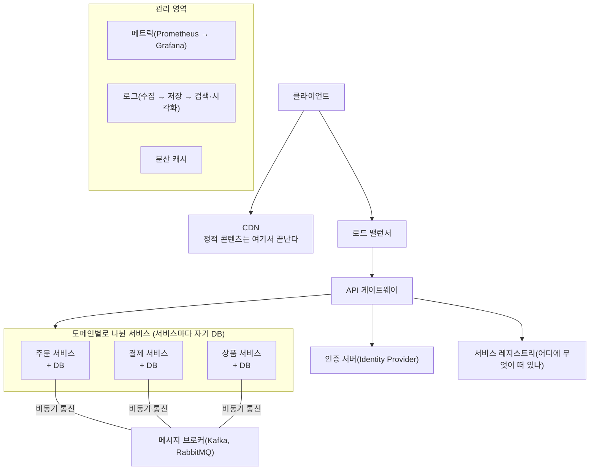
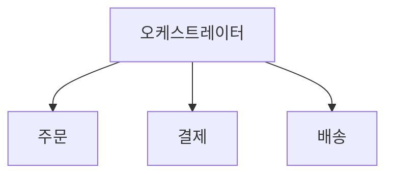
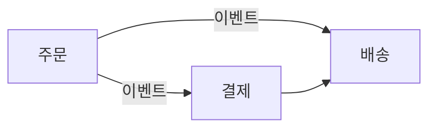

> ByteByteGo의 System Design 101 가이드 「[Typical Microservice Architecture](https://bytebytego.com/guides/what-does-a-typical-microservice-architecture-look-like)」, 「[9 Essential Components of a Production Microservice Application](https://bytebytego.com/guides/9-essential-components-of-a-production-microservice-application)」, 「[9 Best Practices for Building Microservices](https://bytebytego.com/guides/9-best-practices-for-building-microservices)」, 「[9 Best Practices for Developing Microservices](https://bytebytego.com/guides/9-best-practices-for-developing-microservices)」, 「[Orchestration vs. Choreography in Microservices](https://bytebytego.com/guides/orchestration-vs-choreography-microservices)」, 「[Is Microservice Architecture the Silver Bullet?](https://bytebytego.com/guides/is-microservice-architecture-the-silver-bullet)」, 「[Amazon Prime Video Monitoring Service](https://bytebytego.com/guides/amazon-prime-video-monitoring-service)」를 바탕으로 재구성한 노트다. 공통 특성은 James Lewis·Martin Fowler의 「[Microservices](http://channy.creation.net/articles/microservices-by-james_lewes-martin_fowler)」(번역), 도메인 단위 묶기는 「[Introducing Domain-Oriented Microservice Architecture](https://www.uber.com/blog/microservice-architecture/)」, 모듈러 모놀리스는 「[잘 키운 모노리스 하나 열 마이크로서비스 안 부럽다](https://www.slideshare.net/arawnkr/ss-195979955)」, 분리 신호는 「[마이크로서비스 아키텍처. 그것이 뭣이 중헌디?](http://guruble.com/마이크로서비스microservice-아키텍처-그것이-뭣이-중헌디/)」로 보강했다. 설계 결정 패턴은 microservices.io의 「[A pattern language for microservices](https://microservices.io/patterns/index.html)」 가운데 분해(비즈니스 역량·하위 도메인), 데이터(서비스별 DB·공유 DB), 서비스 발견(클라이언트 측·서버 측·레지스트리), 섀시·외부화된 설정, 배포 패턴을 바탕으로 보강했다.

## 마이크로서비스란

**마이크로서비스 아키텍처(MSA)는 하나의 큰 애플리케이션을 비즈니스 기능 단위의 작은 서비스 여러 개로 나누는 구조다.** 각 서비스는 독립된 프로세스로 돌고, 자기 데이터를 갖고, 따로 빌드·배포·확장된다. 서비스끼리는 네트워크(REST, gRPC, 메시지 브로커)로 대화한다.

| 얻는 것 | 치르는 것 |
| --- | --- |
| 서비스별로 따로 확장한다 | 호출이 네트워크를 타므로 지연과 실패가 늘어난다 |
| 한 서비스의 장애가 전체로 번지지 않게 막을 수 있다 | 분산 트랜잭션, 데이터 일관성이 어려워진다 |
| 팀이 서비스 단위로 독립해 배포한다 | 배포·모니터링·디버깅해야 할 대상이 많아진다 |
| 서비스마다 맞는 기술을 고른다 | 운영 인프라(게이트웨이, 레지스트리, 관측)가 필수가 된다 |

여러 아키텍처 패턴 중 MSA의 위치는 [[software-architecture-patterns|소프트웨어 아키텍처 패턴]]에 있다.

## 전형적인 구조

## 운영에 필요한 구성 요소

| 구성 요소 | 역할 | 대표 도구 |
| --- | --- | --- |
| API 게이트웨이 | 클라이언트의 단일 진입점. 라우팅, 필터링, 인증 위임, 부하 분산 | Kong, Spring Cloud Gateway, 클라우드 관리형 게이트웨이 |
| 서비스 레지스트리·디스커버리 | 서비스 인스턴스의 주소를 등록하고 찾는다. 클라이언트 측·서버 측 방식은 아래 「서로를 어떻게 찾나」 | Consul, Eureka, ZooKeeper, Kubernetes Service |
| 서비스 계층 | 비즈니스 기능 하나씩을 맡은 서비스. 인스턴스를 여러 개 띄운다 | Spring Boot, NestJS 등 |
| 인증·인가 서버 | 신원 확인과 접근 제어를 한곳에서 | Keycloak, Microsoft Entra ID, Okta |
| 데이터 저장소 | 서비스별 DB | PostgreSQL, MySQL 등 |
| 분산 캐시 | 반복 조회를 줄여 성능을 높인다 | Redis, Memcached |
| 비동기 메시징 | 서비스 간 결합을 줄이고 부하를 완충 | Kafka, RabbitMQ |
| 메트릭 시각화 | 서비스 상태를 수치로 본다 | Prometheus + Grafana |
| 로그 수집 | 흩어진 로그를 한곳에 모아 검색 | ELK(Logstash → Elasticsearch → Kibana) |

인증을 게이트웨이에서 할지 각 서비스에서 할지는 [[auth-placement|인증·인가 로직은 어디에 두나]], 서비스 디스커버리와 서킷 브레이커는 [[high-traffic-resilience|대규모 트래픽에서 서비스를 지키는 설계]]에 있다.

## 설계·개발 원칙

| 원칙 | 내용 |
| --- | --- |
| **실패를 전제로 설계한다** | 분산 시스템은 반드시 어딘가 실패한다. 서킷 브레이커, 벌크헤드(자원 격리), 우아한 성능 저하(graceful degradation)로 장애가 번지지 않게 한다 |
| 작게, 한 가지 책임 | 서비스 하나는 한 가지 일을 잘한다. 경계는 [[domain-driven-design\|도메인 주도 설계]]의 바운디드 컨텍스트로 잡는다 |
| **데이터는 서비스가 소유한다** | 서비스마다 저장소를 따로 둔다. 다른 서비스의 DB를 직접 읽지 않고 API나 이벤트로 받는다. 그래야 서비스가 독립적으로 진화한다. 공유 DB와의 비교는 아래 「데이터를 어떻게 두나」 |
| 가벼운 프로토콜 | REST, gRPC, 메시지 브로커로 통신한다([[grpc\|gRPC]]) |
| 상태 없는 서비스 | 상태는 DB·캐시에 두고 인스턴스는 언제든 늘리고 줄일 수 있게 한다 |
| 복원력 패턴 | 재시도 정책, 캐싱, 속도 제한(rate limiting)으로 가용성을 높인다 |
| 모든 구간의 보안 | 통신 경로가 많아 공격 표면이 넓다. 서비스 간 호출도 인증하고 암호화한다 |
| 중앙 로그·추적 | 요청 하나가 여러 서비스를 지나므로 로그를 모으고 요청 ID로 엮는다 |
| 빌드·배포 분리 | 서비스마다 빌드 파이프라인을 따로 두고 컨테이너로 배포한다([[vm-vs-container\|VM과 컨테이너]]) |
| 비슷한 성숙도 유지 | 한 서비스 안의 코드는 비슷한 수준으로 안정화해 두고, 실험적인 기능은 새 서비스로 뺀다 |
| 마이크로 프론트엔드 | 프론트엔드도 도메인별로 나눠 백엔드 서비스와 같은 팀이 맡을 수 있다 |

## 서비스 협업: 오케스트레이션과 코레오그래피

여러 서비스가 하나의 업무(주문 → 결제 → 배송)를 함께 처리하는 방식은 두 가지다.

오케스트레이션 (중앙이 순서를 호출)

코레오그래피 (각자 규칙에 따라 반응)

| 비교 | 오케스트레이션(orchestration) | 코레오그래피(choreography) |
| --- | --- | --- |
| 비유 | 지휘자가 연주자를 이끈다 | 정해 둔 규칙대로 무용수들이 서로 반응한다 |
| 흐름 | 중앙 오케스트레이터가 서비스를 호출하고 결과를 조합 | 서비스가 이벤트를 내고, 관심 있는 서비스가 받아 반응 |
| 신뢰성 | 트랜잭션 관리와 오류 처리를 한곳에서 한다 | 점대점 통신이라 실패 시나리오가 복잡하다 |
| 변경 | 새 서비스를 넣을 때 오케스트레이터만 고친다 | 관련된 서비스 여럿을 고쳐야 한다 |
| 성능 | 모든 호출이 중앙을 거쳐 지연이 늘고, 처리량이 오케스트레이터에 묶인다 | 중앙이 없어 지연이 적다 |
| 장애 | 오케스트레이터가 단일 장애 지점이 되므로 고가용성이 필요하다 | 단일 장애 지점은 없지만 전체 흐름이 눈에 안 보인다 |

워크플로 엔진(Netflix Conductor, Temporal 등)이 오케스트레이터 역할을 한다. 이벤트 기반 협업은 [[web-scalability-components|웹 확장성의 구성 요소]]의 이벤트 기반 아키텍처와 같은 생각이다.

## 패턴 언어로 본 설계 결정

마이크로서비스를 고르면 따라오는 결정들은 「문제 → 해법 → 대가」 모양의 패턴으로 정리되어 있다(microservices.io의 패턴 언어). 결정마다 선택지가 둘 이상이다.

### 어떻게 나누나

| 기준 | 방법 | 예(온라인 상점) |
| --- | --- | --- |
| 비즈니스 역량(business capability) | 회사가 가치를 만드는 **일** 단위로 나눈다. 조직도와 비슷하게 나오고, 업무가 바뀌지 않는 한 경계가 안정적이다 | 상품 카탈로그, 재고, 주문, 배송 |
| 하위 도메인(subdomain) | [[domain-driven-design\|DDD]]의 하위 도메인마다 서비스를 둔다. 하위 도메인은 **핵심**(차별화 요소, 직접 만든다), **지원**(필요하지만 차별화는 아님, 외주 가능), **일반**(어디나 같음, 기성품을 쓴다)으로 나뉜다 | 핵심: 추천·가격, 일반: 결제·인증은 외부 서비스 |

둘 다 기술 계층(UI·DB)이 아니라 업무로 나눈다. 경계를 찾는 출발점은 조직 구조와 핵심 도메인 객체다.

### 데이터를 어떻게 두나

| | 서비스별 데이터베이스(database per service) | 공유 데이터베이스(shared database) |
| --- | --- | --- |
| 방법 | 서비스의 데이터는 그 서비스의 API로만 접근한다 | 여러 서비스가 한 DB를 직접 읽고 쓴다 |
| 얻는 것 | 느슨한 결합. 서비스마다 맞는 저장소(검색은 Elasticsearch, 그래프는 Neo4j) | 익숙한 ACID 트랜잭션과 조인 |
| 치르는 것 | 여러 서비스에 걸친 트랜잭션·조인이 어렵다 → [[distributed-data-patterns\|사가, CQRS, API 조합]] | 스키마 변경이 다른 서비스를 깨뜨리고, 한 서비스의 무거운 쿼리가 다른 서비스를 느리게 한다. 사실상 분산 모놀리스 |

「서비스별 DB」가 서버를 서비스마다 하나씩 띄우라는 뜻은 아니다. 관계형 DB라면 비용이 낮은 순서로 **서비스 전용 테이블 → 서비스 전용 스키마 → 서비스 전용 DB 서버**를 고른다. 어느 쪽이든 서비스마다 다른 DB 계정과 권한(grant)을 줘서 남의 테이블을 직접 읽지 못하게 막는다. 막지 않으면 결국 누군가 API를 우회한다.

### 서로를 어떻게 찾나

인스턴스는 자동 확장·재배포로 IP가 계속 바뀐다. 그래서 **서비스 레지스트리**(인스턴스 주소 목록)를 두고 호출 때 찾는다.

| | 클라이언트 측 발견(client-side discovery) | 서버 측 발견(server-side discovery) |
| --- | --- | --- |
| 흐름 | 클라이언트가 레지스트리에 물어 인스턴스를 고르고 직접 호출한다 | 클라이언트는 고정 주소의 라우터(로드 밸런서)로 보내고, 라우터가 레지스트리를 보고 넘긴다 |
| 장점 | 홉이 하나 적다. 클라이언트가 똑똑한 부하 분산을 한다 | 클라이언트 코드가 단순하다. 언어마다 라이브러리가 필요 없다 |
| 단점 | 언어·프레임워크마다 발견 로직이 필요하다 | 라우터를 따로 운영·이중화해야 한다 |
| 예 | Eureka + Spring Cloud LoadBalancer(과거에는 Netflix Ribbon) | AWS ELB, 쿠버네티스 Service(kube-proxy), 서비스 메시의 사이드카 |

레지스트리에 등록하는 방법도 둘이다. 인스턴스가 시작·종료 때 스스로 등록·해제하고 하트비트를 보내는 **자기 등록**, 배포 플랫폼이 대신 등록하는 **서드파티 등록**이다. 쿠버네티스는 플랫폼이 등록하고 DNS로 찾게 해서, 대부분 별도 레지스트리 없이 서버 측 발견을 쓴다.

### 공통 관심사를 어떻게 처리하나

| 패턴 | 내용 |
| --- | --- |
| 외부화된 설정(externalized configuration) | DB 자격 증명·다른 서비스 주소 같은 설정을 코드 밖(환경 변수, 설정 서비스)에서 받는다. 같은 빌드를 모든 환경에 그대로 배포한다. [[cloud-design-patterns\|클라우드 설계 패턴]]의 외부 설정 저장소와 같은 생각이다 |
| 마이크로서비스 섀시(microservice chassis) | 설정, 로깅, 헬스 체크, 메트릭, 트레이싱, 서비스 발견 같은 공통 기능을 프레임워크로 묶어 새 서비스가 바로 갖추게 한다. Spring Boot + Spring Cloud, Go kit, Micronaut 등. 언어가 섞이면 언어마다 섀시가 필요해, 네트워크 관심사는 **서비스 메시**(사이드카)로 옮기는 추세다 |
| 원격 프로시저 호출(remote procedure invocation) | REST·gRPC로 동기 요청-응답. 단순하지만 호출하는 동안 상대가 살아 있어야 한다. 대안은 메시지 기반 비동기 통신이다 |

### 어디에 배포하나

| 패턴 | 내용 |
| --- | --- |
| 컨테이너당 서비스 인스턴스 하나 | 서비스를 컨테이너 이미지로 묶고 인스턴스마다 컨테이너 하나를 띄운다. 기술 스택을 캡슐화하고 자원을 제한한다. 지금의 기본값이다 |
| 서비스 배포 플랫폼 | 서비스를 배포·확장·관리하는 자동화 플랫폼에 맡긴다. 쿠버네티스, 관리형 컨테이너 서비스(ECS, Cloud Run) |
| 서버리스 배포 | 함수 단위로 올리고 요청당 과금받는다. [[serverless-architecture\|서버리스 아키텍처]] |

## 마이크로서비스의 공통 특성

마이크로서비스라는 이름이 정착할 때 정리된 공통 특성 가운데, 위 원칙 표에 없는 것들이다.

| 특성 | 뜻 |
| --- | --- |
| 서비스로 컴포넌트화 | 라이브러리 호출 대신 프로세스 간 통신으로 잇는다. 독립 교체가 쉬운 대신 원격 호출이 비싸 API가 굵직해지고, 서비스 경계를 옮기기 어렵다 |
| 비즈니스 역량 중심 팀 | UI·서버·DB 같은 기술 계층별 팀이 아니라 기능별 교차 기능 팀을 둔다. 시스템 구조는 조직의 소통 구조를 닮는다(콘웨이 법칙) |
| 프로젝트가 아니라 제품 | 만들고 넘기는 대신 팀이 개발부터 운영까지 책임진다(you build it, you run it) |
| 똑똑한 끝점, 단순한 파이프 | 로직은 서비스 안에 두고, 통신 인프라는 메시지 전달만 한다. 중앙 ESB에 라우팅·변환 로직을 몰아넣지 않는다 |
| 분산 거버넌스 | 표준 기술을 강요하지 않고 문제에 맞는 도구를 고른다. 좋은 해법은 공유 라이브러리·사내 오픈소스로 퍼뜨린다 |
| 분산 데이터 관리 | 서비스마다 저장소와 저장 기술을 따로 고른다(polyglot persistence). 분산 트랜잭션 대신 최종 일관성과 보상 작업을 쓴다 |
| 진화적 설계 | 함께 바뀌는 것끼리 묶는다. 소비자 주도 계약(consumer-driven contract)과 관대한 읽기(tolerant reader, 모르는 필드는 무시)로 서비스가 따로 진화하게 한다 |

## 도메인 단위로 묶기: DOMA

서비스가 수천 개로 늘면 의존 관계가 깊어지고, 하위 서비스의 지연이 위로 연쇄 전파되고, 기능 하나를 바꾸려 여러 서비스를 함께 고쳐 배포해야 한다. 서로 독립적으로 보이지만 함께 배포해야 하는 상태를 **분산 모놀리스(distributed monolith)** 라 한다. 마이크로서비스의 이점을 잃은 상태다.

**도메인 지향 마이크로서비스 아키텍처(DOMA)** 는 개별 서비스 대신 **관련 서비스 묶음(도메인)** 을 설계 단위로 삼아 이를 다룬다.

| 요소 | 내용 |
| --- | --- |
| 도메인 | 논리적 기능 하나를 이루는 서비스 묶음 |
| 계층(layer) | 「어느 계층이 어느 계층을 부를 수 있나」를 정한다. 위쪽일수록 특정 제품에 가깝고 장애 영향 범위가 작다. 아래쪽일수록 범용이고 영향이 크다. 특정 제품용으로 시작한 기능이 여러 곳에서 쓰이면 아래 계층으로 내려간다 |
| 게이트웨이 | 도메인의 단일 진입점. 내부 서비스 구조를 감춰서, 안을 고쳐 쓰거나 다시 써도 바깥 소비자는 옮기지 않아도 된다 |
| 확장 지점 | 다른 팀이 코어 코드를 고치지 않고 기능을 붙이게 한다. 로직 확장은 플러그인·프로바이더 인터페이스로, 데이터 확장은 코어 모델에 임의 필드를 넣는 대신 별도로 붙인다 |

도메인은 다른 도메인의 로직이나 데이터 모델을 안에 하드코딩하지 않는다. 이런 구조는 한 번의 전면 재설계보다 **작은 방향 조정을 꾸준히 반복**해서 옮겨 간다.

## 모듈러 모놀리스: 나누기 전 단계

조직과 트래픽이 독립 배포를 요구하기 전에는 **배포 단위는 하나로 두되 모듈 경계를 엄격히 나눈 모놀리스**가 대개 더 싸다. 단순한 배포·운영과 로컬 트랜잭션을 유지하면서, 나중에 서비스로 떼어 낼 경계를 미리 만든다.

| 단계 | 하는 일 |
| --- | --- |
| 모듈 분리 | 바운디드 컨텍스트(주문, 배송, 카탈로그)마다 모듈을 나누고 의존 방향을 정한다 |
| 캡슐화 | 모듈 내부는 숨기고 공개 인터페이스로만 주고받는다 |
| 컨텍스트 경계 | 모듈마다 애플리케이션 컨텍스트(DI 컨테이너)를 분리해 의존을 격리한다 |
| 설정 모듈화 | 모듈 단위로 기능을 켜고 설정을 관리한다 |

모듈 안은 포트와 어댑터 스타일로 짠다. 유스케이스와 리포지토리 인터페이스는 코어에, 구현은 바깥에 둔다([[software-architecture-patterns|소프트웨어 아키텍처 패턴]]). 모듈 경계는 말로만 지키면 무너지므로 아키텍처 테스트나 모듈 검증 도구(Spring Modulith, ArchUnit 등)로 강제한다. 모듈 사이 후속 처리를 이벤트로 넘겨 두면 서비스로 떼어 낼 때 그대로 메시지로 바꿀 수 있다([[event-driven-architecture|이벤트 기반 아키텍처 설계]]).

### 나눌 때가 됐다는 신호

다음 증상이 여럿 겹치면 서비스 분리를 검토할 때다. 하나둘이면 모듈 경계를 다듬는 것으로 충분한 경우가 많다.

- 배포 한 번이 오래 걸리고, 작은 수정에도 전체 회귀 테스트가 필요하다.
- 한 곳의 버그 수정이 엉뚱한 곳의 더 큰 버그를 만든다.
- 팀이 늘어 같은 코드베이스에서 배포 일정과 변경이 서로 막힌다.
- 기능별로 부하 특성이 달라(한 기능만 트래픽이 몰림) 따로 확장하고 싶다.

## 마이크로서비스가 맞지 않는 곳

**MSA는 특정 문제를 풀려고 나온 구조이지 기본값이 아니다.** 다음 성질을 가진 시스템은 모놀리스가 낫다.

| 성질 | 왜 MSA가 불리한가 | 예 |
| --- | --- | --- |
| 지연에 극도로 민감하다 | 서비스를 프로세스로 나누면 네트워크 왕복이 생긴다. 밀리초·마이크로초 단위 응답을 지킬 수 없다 | 실시간 게임, 저지연 트레이딩 |
| 상태를 메모리에 둬야 한다 | MSA 서비스는 보통 무상태이고 상태를 DB에 둔다. 상태 변경이 즉시 보여야 하는 곳에선 느리다 | 게임 캐릭터의 체력 변화 |
| 같은 인스턴스와 계속 대화한다 | 웹소켓 연결과 고정 라우팅(sticky routing)이 필요해 무상태 확장의 이점이 줄어든다 | 게임 세션, 주문 매칭 엔진 |
| 단계 사이에 큰 데이터가 오간다 | 단계마다 데이터를 네트워크·객체 스토리지로 넘기는 비용이 크다 | 영상 프레임 분석 파이프라인 |

### 사례: 분산 구조를 한 프로세스로 합치기

실시간 영상 스트림의 품질을 감시하는 파이프라인(미디어 변환 → 결함 탐지 → 알림)이 서버리스 함수와 워크플로 서비스로 짜여 있던 사례(Amazon Prime Video)가 있다. 비용이 컸던 곳은 두 군데였다.

- **상태 전이마다 과금되는 오케스트레이션**: 초당 여러 번 상태가 바뀌었다.
- **단계 사이의 데이터 전달**: 중간 프레임을 객체 스토리지에 올렸다 내려받았다.

변환기와 탐지기를 한 프로세스에 넣자 데이터가 메모리 안에서 넘어가고 오케스트레이션 비용이 사라져 인프라 비용이 크게 줄었다. 교훈은 **분해에도 비용이 있다**는 것과 **아키텍처는 상황에 따라 다시 검토하는 전략이지 신념이 아니다**라는 것이다. 서버리스를 먼저 시도하는 것(serverless first)과 서버리스만 고집하는 것(serverless only)은 다르다.

## 정리

- MSA는 기능 단위의 작은 서비스가 자기 데이터와 배포를 갖는 구조다. 독립 확장·배포를 얻는 대신 네트워크 비용과 운영 복잡도를 치른다.
- 게이트웨이, 레지스트리, 인증 서버, 메시징, 메트릭·로그 수집이 사실상 필수 구성 요소다.
- 실패를 전제로 설계하고, 데이터는 서비스가 소유하고, 서비스는 상태 없이 만든다.
- 협업은 중앙이 흐름을 쥐는 오케스트레이션과 이벤트로 반응하는 코레오그래피 중에서 신뢰성과 결합도를 보고 고른다.
- 지연·메모리 상태·대용량 단계 간 전달이 핵심인 시스템은 모놀리스가 낫다. 왜 나누는지 먼저 묻는다.
- 서비스가 많아지면 도메인·계층·게이트웨이로 묶어 분산 모놀리스를 피하고, 나누기 전에는 모듈러 모놀리스로 경계를 먼저 만든다.

더 읽을거리: 「[Mastering Chaos - A Netflix Guide to Microservices](https://www.youtube.com/watch?v=CZ3wIuvmHeM)」(QCon 영상), 「[우아한 모노리스](https://youtu.be/SrQeIz3gXZg)」(우아한테크 영상)

관련 노트: [[event-driven-architecture|이벤트 기반 아키텍처 설계]], [[software-architecture-patterns|소프트웨어 아키텍처 패턴]], [[domain-driven-design|도메인 주도 설계]], [[web-scalability-components|웹 확장성의 구성 요소]], [[high-traffic-resilience|대규모 트래픽에서 서비스를 지키는 설계]], [[auth-placement|인증·인가 로직은 어디에 두나]], [[bff|BFF (Backend For Frontend)]]
