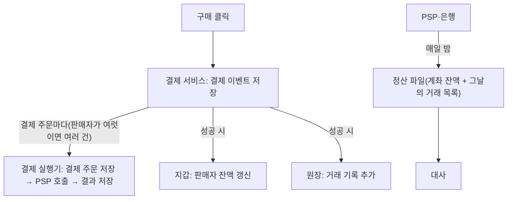

> ByteByteGo의 System Design 101 가이드 「[Payment System](https://bytebytego.com/guides/payment-system)」, 「[How to Avoid Double Payment](https://bytebytego.com/guides/how-to-avoid-double-payment)」, 「[Reconciliation in Payment](https://bytebytego.com/guides/reconciliation-in-payment)」, 「[Handling Hotspot Accounts](https://bytebytego.com/guides/handling-hotspot-accounts)」, 「[10 Principles for Building Resilient Payment Systems](https://bytebytego.com/guides/10-principles-for-building-resilient-payment-systems-by-shopify)」, 「[E-commerce Workflow](https://bytebytego.com/guides/e-commerce-workflow)」를 바탕으로 재구성한 노트다.

## 결제 시스템이란

결제 시스템은 **주문을 돈의 이동으로 바꾸고, 그 결과를 장부에 정확히 남기는 시스템**이다. 다른 시스템과 달리 작은 오류가 곧 금전 손실이나 이중 청구가 된다. 그래서 설계의 중심은 속도보다 **정확히 한 번(exactly-once) 처리**와 **기록 간 일치**다.

카드사·은행 쪽에서 실제 돈이 어떻게 움직이는지는 [[money-movement|자금 이동: 청산과 결제]], 카드 결제망의 구조는 [[card-payment-network|카드 결제망과 간편결제]]에서 다룬다. 이 노트는 가맹점(쇼핑몰) 내부의 결제 시스템을 다룬다.

## 전자상거래 안에서 결제의 위치

결제는 주문 흐름의 한 단계다. 전형적인 전자상거래는 네 영역으로 나뉜다.

| 영역 | 하는 일 |
| --- | --- |
| 조달(procurement) | 공급사를 고르고 계약·발주·반품·대금 정산을 관리한다 |
| 재고(inventory) | 입고된 상품을 창고 단위로 관리하고 주문에 맞춰 재고를 예약한다 |
| 커머스 플랫폼 | 상품 정보·가격·프로모션을 관리하고, 회원 가입 → 탐색 → 장바구니 → 주문 → **결제**를 처리한다 |
| 배송(transportation) | 출고 주문을 받아 실물 배송과 수령 확인을 처리한다 |


한 주문에 여러 창고·판매자의 상품이 섞이면 **주문 분할**이 필요하다. 분할 기준(창고 위치, 판매자, 상품 유형)은 재고 예약 전에 정해야 결제 단위와 출고 단위가 맞는다.

## 결제 흐름: 구성 요소

| 구성 요소 | 역할 |
| --- | --- |
| 결제 서비스(payment service) | 결제 이벤트를 받아 저장하고 전체 흐름을 조율한다 |
| 결제 실행기(payment executor) | 결제 주문 하나를 외부 PSP에 실행하고 결과를 저장한다 |
| PSP(Payment Service Provider) | 카드·계좌에서 실제로 돈을 끌어오는 외부 사업자 (Stripe, PayPal, 토스페이먼츠 등) |
| 지갑(wallet) | 판매자별 잔액을 기록한다 |
| 원장(ledger) | 모든 금전 거래를 **추가 전용(append-only)** 으로 기록한다 |



- **결제 이벤트와 결제 주문은 1:N이다.** 한 번의 결제(장바구니)에 판매자가 여럿이면 판매자별 결제 주문으로 나뉜다.
- 원장은 **복식부기(double-entry bookkeeping)** 로 쓴다. 모든 거래는 한쪽의 차변(debit)과 다른 쪽의 대변(credit)이 같은 금액으로 짝을 이루므로, 전체 합이 항상 0이어야 한다.

| 계정 | 차변 | 대변 |
| --- | --- | --- |
| 구매자 | 200 | |
| 판매자 | | 200 |

## 이중 결제 막기: 재시도 + 멱등성

결제 시스템에서 가장 심각한 사고는 **같은 결제를 두 번 청구하는 것**이다. 정확히 한 번 실행은 두 조건으로 나누면 풀린다.

| 조건 | 수단 | 의미 |
| --- | --- | --- |
| 최소 한 번(at-least-once) | **재시도(retry)** | 네트워크 오류·타임아웃이 나면 다시 보낸다 |
| 최대 한 번(at-most-once) | **멱등성 검사(idempotency check)** | 같은 요청이 여러 번 와도 결과는 한 번만 반영한다 |

두 조건이 동시에 성립하면 정확히 한 번이다.

### 멱등 키

멱등성은 **같은 호출을 몇 번 반복해도 결과가 같다**는 성질이다. 결제 API에서는 클라이언트가 만든 고유 값을 요청 헤더에 실어 보낸다.

```http
POST /payments
Idempotency-Key: 01J9Z3K8Q4V6X2...
```

- 서버는 키를 고유 제약이 걸린 저장소에 기록한다. 같은 키가 다시 오면 **실행하지 않고 처음 결과를 그대로 돌려준다.**
- 키는 일정 기간이 지나면 만료한다.
- 키로는 UUID v4를 흔히 쓰지만, **ULID처럼 시간순으로 정렬되는 ID**를 쓰면 인덱스 삽입 위치가 몰려 B-트리 쓰기 효율이 좋아지고 생성 시각으로 조회·정리하기 쉽다.
- 재시도는 지수 백오프와 지터를 넣어 PSP에 부하를 몰지 않는다.

## 대사(reconciliation)

대사는 **서로 다른 시스템의 기록을 비교해 금액이 맞는지 확인하는 과정**이다. 결제에서는 정보 흐름(주문·결제 기록)과 자금 흐름(실제 정산)이 비동기로 움직이므로, 정확히 한 번을 설계해도 대사는 늘 필요하다. 어딘가에서 반드시 어긋나기 때문이다.

예를 들어 200달러 결제라면 세 곳의 기록이 맞아야 한다.

```text
쇼핑몰 주문 기록 200  ↔  PSP 거래 기록 200  ↔  원장: 구매자 차변 200 / 판매자 대변 200
```

| 문제 | 해법 |
| --- | --- |
| **형식 불일치**: 시스템마다 날짜·통화·ID 형식이 다르다 | 비교 전에 공통 형식으로 바꾸는 정규화 계층을 둔다 |
| **데이터 양**: 하루 거래가 수억 건이다 | 실시간에 가까운 대사가 필요하면 스트림 처리(Flink 등), 아니면 하루 단위 배치 처리로 비교한다 |
| **마감 시각(cut-off) 차이**: 내부 23:59:55 거래가 외부에는 다음 날 00:00:30으로 찍힌다 | 「일시적 불일치(temporary break)」로 분류해 다음 날 외부 기록과 다시 맞춘다. 맞으면 해소, 안 맞으면 사람이 조사한다 |

- 불일치(break)는 **DB에 저장해 상태를 추적**한다. 이메일·스프레드시트로 처리하면 누락된다.
- 대사는 결제 시스템의 안전망이다. 다른 모든 장치가 실패해도 대사가 돈의 어긋남을 잡는다.

## 핫스팟 계정

**핫스팟 계정**은 동시에 많은 갱신이 몰리는 계정이다. 대형 판매자가 할인 행사를 열면 그 판매자의 잔액 행 하나에 쓰기가 집중된다. 잔액 갱신마다 **행 잠금(row lock)** 을 걸면 요청이 줄을 서서 처리량이 떨어지고 시스템 병목이 된다.

| 방법 | 원리 | 대가 |
| --- | --- | --- |
| 처리율 제한(rate limit) | 일정 시간에 받을 요청 수를 제한하고 나머지는 거절하거나 나중에 재시도시킨다 | 가장 간단하지만 사용자 경험이 나빠진다 |
| **하위 계정 분할** | 판매자 잔액을 여러 하위 계정으로 쪼개 요청마다 하나만 잠근다. 총잔액은 하위 계정의 합이다 | 출금·잔액 조회 때 합산이 필요하다. 하위 계정 하나가 바닥나면 다른 하위 계정으로 넘겨야 한다 |
| 캐시에서 먼저 갱신 | 메모리 캐시에서 잔액을 먼저 갱신하고, 상세 내역과 DB 잔액은 비동기로 반영한다 | 처리량은 높지만 캐시 장애 시 유실 위험이 있어 로그·큐로 내구성을 보강해야 한다 |

핫스팟은 결제만의 문제가 아니다. 인기 게시물 좋아요 수, 한정 판매 재고처럼 **한 행에 쓰기가 몰리는 모든 곳**에 같은 해법(분할, 비동기 집계)이 통한다.

## 장애에 강한 결제 시스템의 운영 원칙

결제는 외부 PSP·은행에 의존하므로 외부가 느려질 때 함께 무너지지 않게 설계한다.

| 원칙 | 내용 |
| --- | --- |
| 타임아웃을 짧게, 빨리 실패 | 라이브러리 기본 타임아웃(수십 초)을 그대로 두지 않는다. 읽기는 수 초, 연결·쓰기는 그보다 짧게 잡아 스레드가 묶이지 않게 한다 |
| 서킷 브레이커 | 실패가 쌓인 의존성(HTTP, DB, 캐시, gRPC)은 일정 시간 호출을 끊어 장애 전파를 막는다 |
| 용량 관리 | 처리량 = 동시 처리 수 ÷ 평균 처리 시간(리틀의 법칙). 큐에 쌓인 요청과 처리 시간으로 한계를 계산해 둔다 |
| 모니터링과 알림 | 사용자 대면 시스템은 **네 가지 골든 시그널**: 지연(latency), 트래픽(traffic), 오류(errors), 포화도(saturation)를 본다 |
| 구조화 로깅 | 로그를 키-값 구조로 남겨 중앙에 모으고, 결제 ID·멱등 키로 한 건의 흐름을 추적할 수 있게 한다 |
| 멱등 키 | 모든 결제 쓰기 요청에 멱등 키를 강제한다 |
| 일관된 대사 | 외부 금융 파트너와의 불일치를 DB에 기록하고 추적한다 |
| 부하 테스트 | 대규모 할인 행사 같은 최대 부하를 정기적으로 재현해 한계를 미리 안다 |
| 장애 대응 체계 | 장애 채널마다 역할을 정한다: 장애 지휘자(incident manager), 고객 대응 담당, 서비스 담당자 |
| 장애 회고 | 무슨 일이 있었나, **시스템에 대해 어떤 잘못된 가정을 하고 있었나**, 재발을 막으려면 무엇을 하나를 묻는다 |

## 정리

- 결제 서비스는 결제 이벤트를 결제 주문으로 나눠 PSP에 실행하고, 성공하면 지갑과 원장(복식부기, 추가 전용)을 갱신한다.
- 정확히 한 번 = 재시도(최소 한 번) + 멱등 키(최대 한 번).
- 정보 흐름과 자금 흐름은 어긋나므로 대사는 생략할 수 없다. 정규화, 대용량 비교, 마감 시각 차이를 다룬다.
- 한 계정에 쓰기가 몰리면 잠금 대신 하위 계정 분할이나 비동기 집계로 푼다.
- 결제 시스템의 신뢰는 빠른 처리보다 "두 번 청구하지 않고, 어긋나면 반드시 잡아낸다"에서 나온다.

관련 노트: [[card-payment-network|카드 결제망과 간편결제]], [[money-movement|자금 이동: 청산과 결제]], [[high-traffic-resilience|대규모 트래픽에서 서비스를 지키는 설계]], [[rest-api|REST API]], [[transaction|트랜잭션과 회복]], [[payment-address-forms|결제·주소 폼]]
