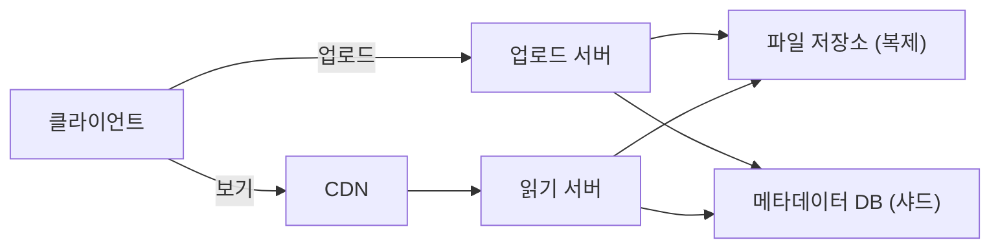

> Educative의 「[The complete guide to the System Design Interview](https://grokkingtechinterview.com/the-complete-guide-to-the-system-design-interview-in-2022-e2d30fe22448)」에 실린 Instagram 설계 풀이를 바탕으로 재구성한 노트다.

## 사진 공유 서비스란

사용자가 사진·동영상을 올리고, 다른 사용자를 팔로우하고, 팔로우한 사람들의 인기 사진으로 채운 피드를 보는 서비스다. 핵심은 **크고 많은 미디어 파일**과 **작고 자주 읽히는 메타데이터**를 다르게 다루는 것이다. 피드 생성 자체는 [[news-feed-design|뉴스 피드 설계]], 이미지 리사이징·트랜스코딩은 [[media-processing-pipeline|이미지·동영상 처리 서버 설계]]에 있다.

| 구분 | 요구 사항 |
| --- | --- |
| 기능 | 사진·동영상 업로드·다운로드·보기, 제목으로 검색, 팔로우, 팔로우한 사람들의 인기 사진으로 된 피드 |
| 비기능 | 높은 가용성, 피드 지연 약 200ms, **올린 파일은 절대 잃지 않는다** |
| 범위 밖 | 태그 달기와 태그 검색, 댓글, 사용자 태그 |

## 규모 추정

```text
전체 사용자 5억 명, 하루 활성 사용자 100만 명
하루 새 사진 200만 장 → 약 23장/초
사진 평균 200KB
하루 저장: 200만 × 200KB = 400GB
10년 저장: 400GB × 365 × 10 ≈ 1,460TB (1,024 단위로 약 1,425TB)
```

미디어 파일은 메타데이터보다 수백 배 크다. 그래서 둘을 같은 저장소에 두지 않는다.

## 저장 구조

| 데이터 | 저장소 | 이유 |
| --- | --- | --- |
| 사진·동영상 파일 | 분산 파일·오브젝트 스토리지(HDFS, S3 같은) | 크고 바뀌지 않는 덩어리라 블록 저장과 복제에 맞다 |
| 사진 메타데이터 | 키-값 NoSQL. 키는 PhotoID, 값은 사진 위치·사용자 위치·생성 시각 등을 담은 객체 | 조회 패턴이 「ID로 한 건」이고 규모가 커지면 RDB의 조인·확장이 부담이 된다 |
| 사용자-사진, 팔로우 관계 | 와이드 칼럼 저장소(Cassandra). UserPhoto는 키가 UserID, 값이 그 사용자의 PhotoID 목록. UserFollow도 같은 꼴 | 한 사용자의 목록을 한 파티션에서 읽는다([[wide-column-database\|와이드 칼럼 데이터베이스]]) |

관계형 DB로 시작해도 되지만, 확장할 때 스키마 그대로 수평 분할하기가 어려워진다. 어떤 DB를 고를지의 기준은 [[database-selection|용도별 데이터베이스와 고르는 법]]에 있다.

### 테이블별 크기

int와 dateTime을 4바이트로 잡고 10년치를 계산한다.

| 테이블 | 한 행 | 계산 | 크기 |
| --- | --- | --- | --- |
| User | UserID 4 + Name 20 + Email 32 + 생년월일 4 + 가입일 4 + 마지막 로그인 4 = 68B | 5억 × 68B | 약 34GB |
| Photo | PhotoID 4 + UserID 4 + 경로 256 + 사진 위경도 8 + 사용자 위경도 8 + 생성일 4 = 284B | 200만 × 284B = 하루 약 0.57GB, × 3,650일 | 약 2TB |
| UserFollow | 두 ID 8B | 5억 명 × 평균 500명 팔로우 × 8B | 약 2TB |
| 합계 | | | 약 4TB (1,024 단위로 약 3.7TB) |

메타데이터는 10년에 수 TB라 파일(PB 단위)에 비하면 작다. 그래도 한 서버에 담기에는 크고 읽기가 몰리므로 샤딩한다.

## 업로드와 읽기 분리

업로드는 디스크에 쓰므로 읽기보다 훨씬 느리다. 같은 서버가 둘 다 받으면 느린 업로드가 연결을 다 차지해 **읽기를 못 받는다.** 그래서 업로드 서버와 읽기 서버를 나누고 각각 따로 늘린다. 웹 서버의 동시 연결 수에는 한계가 있으므로 이 분리가 곧 처리량 문제다.



## 잃지 않기: 복제

파일을 잃으면 안 되므로 사진·동영상마다 **여러 벌을 서로 다른 서버에** 둔다. 한 서버가 죽으면 다른 사본에서 읽는다. 같은 원칙을 서비스에도 적용해 각 서비스를 여러 벌 띄우면 하나가 죽어도 시스템은 돈다. 복제 구성과 장애 조치는 [[high-availability-redundancy|고가용성 이중화 구조와 장애 감지]]에 있다.

## 메타데이터 샤딩과 ID

| 방식 | 문제 |
| --- | --- |
| UserID로 샤딩 | 인기 사용자의 샤드에 부하가 몰리고, 사진이 많은 사용자는 한 샤드에 다 안 들어갈 수 있다. 한 사용자의 사진을 한 샤드에 모으면 그 샤드가 죽을 때 그 사용자의 사진이 다 사라진다 |
| **PhotoID로 샤딩** | 사진이 고르게 퍼진다. `PhotoID % 샤드 수`로 위치를 정하고, PhotoID가 전역에서 고유하면 ShardID를 따로 붙일 필요가 없다 |

PhotoID로 샤드를 찾으려면 저장 **전에** ID를 알아야 하므로 샤드마다 자동 증가를 쓸 수 없다. 해법은 ID만 내주는 별도 DB(티켓 서버)다. 64비트 ID 열만 있는 테이블에 행을 넣고 그 값을 PhotoID로 쓴다. 이 DB가 단일 장애 지점이 되지 않도록 홀수만 내는 서버와 짝수만 내는 서버를 두고 로드 밸런서로 번갈아 쓴다. 설정과 다른 방식(Snowflake, UUIDv7)은 [[distributed-unique-id|분산 환경의 고유 ID 생성]]에 있다.

샤딩 방식 전반은 [[database-sharding|데이터베이스 샤딩]]에 있다.

## 배포

전 세계 사용자에게 사진을 빠르게 주려면 지리적으로 퍼진 캐시 서버(CDN)로 콘텐츠를 사용자 가까이에 둔다. 인기 사진에 읽기가 몰리므로 메타데이터 앞에도 캐시를 두고 LRU로 내보낸다([[caching-strategies|캐시 전략]]).

## 정리

- 미디어 파일과 메타데이터는 크기와 접근 패턴이 달라 저장소를 나눈다.
- 규모 추정은 파일 저장량(PB)과 메타데이터 크기(TB)를 따로 낸다.
- 느린 업로드가 읽기를 막지 않게 업로드·읽기 서버를 나눈다.
- 파일은 여러 벌 복제해 잃지 않고, 메타데이터는 PhotoID로 샤딩한다.
- 샤드를 찾으려면 ID가 먼저 필요하므로 홀짝 티켓 서버 같은 전역 ID 생성기를 둔다.

관련 노트: [[news-feed-design|뉴스 피드 설계]], [[media-processing-pipeline|이미지·동영상 처리 서버 설계]], [[url-shortener-design|URL 단축기 설계]], [[distributed-unique-id|분산 환경의 고유 ID 생성]], [[database-sharding|데이터베이스 샤딩]]
