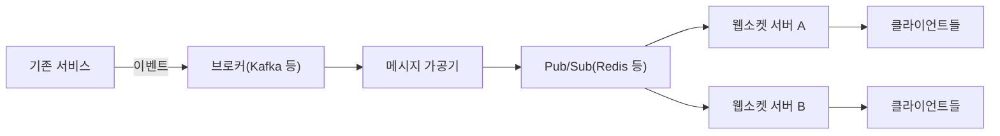

> 「[LINE LIVE 채팅 기능의 기반이 되는 아키텍처](https://engineering.linecorp.com/ko/blog/the-architecture-behind-chatting-on-line-live/)」, 「[실시간 댓글 개발기(part.1)](https://tech.kakao.com/posts/390)」, 「[실시간 댓글 개발기(part.2) - 웹소켓 스트레스 테스트 및 안정화 작업](https://tech.kakao.com/posts/391)」을 바탕으로 재구성한 노트다. 경량 프로세스의 대기와 무중단 코드 교체는 「[Erlang at Facebook](http://www.erlang-factory.com/upload/presentations/31/EugeneLetuchy-ErlangatFacebook.pdf)」(2009)로 보강했다.

## 무엇이 다른가

일반 API 서버는 요청을 받고 응답하면 끝이다. 실시간 서버는 **연결을 계속 붙잡고 있다가 서버 쪽 사건을 밀어 준다.** 그래서 병목이 요청 처리량(TPS)만이 아니라 다음 셋이 된다.

| 자원 | 왜 문제가 되나 |
| --- | --- |
| 동시 연결 수 | 연결마다 소켓(파일 디스크립터)·버퍼·세션 객체가 메모리를 차지한다 |
| 팬아웃 | 사건 하나가 그 방에 연결된 모든 사용자에게 복제된다. 보낼 메시지 수 = 사건 수 × 연결 수 |
| 서버 간 전파 | 같은 방 사용자가 여러 서버에 흩어져 있으면 서버끼리 사건을 나눠야 한다 |

폴링과 웹소켓 중 무엇을 쓸지, 프로토콜 자체의 동작은 [[websocket|WebSocket]]에 있다. 당장의 요구가 단순한 갱신뿐이면 폴링이 운영하기 쉽다. 사용자 상호작용이 계속 늘어날 서비스라면 웹소켓이 확장 여지가 크다.

## 구조

1. 클라이언트는 웹소켓으로 연결하고 보고 있는 페이지(방)를 구독한다.
2. 웹소켓 서버는 그 방의 Pub/Sub 채널을 구독한다.
3. 사용자 행동은 기존 API를 통해 처리되고 이벤트로 발행된다([[event-driven-architecture|이벤트 기반 아키텍처 설계]]).
4. 가공기가 이벤트를 통일된 메시지 형식으로 바꿔 방 채널에 발행한다.
5. 채널을 구독한 모든 웹소켓 서버가 받아 자기에게 붙은 클라이언트에게 보낸다.

모듈마다 역할을 최소로 두면 문제가 생겼을 때 원인을 좁히기 쉽다.

## 설계 요소

### 연결 하나에 여러 메시지 타입

연결 하나로 채팅, 좋아요, 공지, 시스템 알림이 모두 오간다. 메시지에 **공통 타입 필드**를 두고 타입별로 처리기(클래스)에 매핑하면 새 메시지 종류를 붙이기 쉽다. STOMP 같은 하위 프로토콜은 이 위에 구독(SUBSCRIBE)·발행(SEND) 개념을 얹는다.

### 방 단위 분할

트래픽이 커지면 사용자를 **방(그룹)** 으로 나눠 같은 방 사람끼리만 메시지를 주고받게 한다. 부하가 방 단위로 나뉘고, 한 방이 여러 서버에 걸칠 때만 Pub/Sub로 사건을 전파하면 된다.

### 액터 모델로 상태 관리

방과 사용자의 상태를 공유 메모리에 두고 락으로 지키는 대신, **액터**마다 상태를 숨기고 메시지로만 주고받게 하면 동시성 버그가 줄어든다([[concurrency-models|동시성 모델]]).

| 계층 | 액터 | 하는 일 |
| --- | --- | --- |
| 전역 | 라우터 | 메시지를 알맞은 방으로 보낸다 |
| 방 | 방 액터 | 방 상태와 구독자 목록을 관리하고 팬아웃한다 |
| 사용자 | 연결 액터 | 소켓 하나를 맡아 송수신한다 |

- **액터 안에서는 절대 블로킹 호출을 하지 않는다.** 블로킹하면 메일박스가 쌓이고 스레드가 고갈된다. DB·Redis 호출은 비동기 API로 한다.
- **감독 계층**: 부모 액터가 자식의 장애를 받아 재시작·재개·중지·상위 전파 중 하나를 고른다.
- 호출자는 액터의 실제 위치를 모르고 **참조**로만 접근한다. 그래서 액터가 다른 서버에 있어도 같은 코드로 다룬다.

- 놀고 있는 연결이 대부분이면 **대기 중인 액터의 메모리**가 한계를 정한다. Erlang의 `erlang:hibernate/3`는 콜스택을 버리고 힙을 최소로 줄인 채 다음 메시지를 기다려, 오래 매달린 롱 폴링·웹소켓 핸들러에 잘 맞는다. 문자열을 리스트 대신 바이너리로 두는 것도 메모리를 크게 줄인다.
- Erlang은 **실행 중 코드 교체**(hot code swap)를 지원해, 연결과 상태를 유지한 채 수십 초 만에 새 코드를 올리고 쉽게 되돌린다. 연결을 끊으면 재접속 폭주가 생기는 실시간 서버에서 특히 값지다.

### 저장: 뜨거운 데이터와 영구 데이터 분리

방송 중 채팅처럼 쓰기가 몰리는 데이터는 **인메모리 저장소에 먼저 쓰고, 끝난 뒤 영구 저장소로 옮긴다.** 최근 메시지 조회는 시간을 점수로 쓰는 정렬 집합(Redis Sorted Set)이 맞는다. Redis 클라이언트는 클러스터 지원, 장애 조치·리디렉션 처리, 비동기 API, 구독 연결의 자동 복구, 유지보수 상태를 보고 고른다.

### 팬아웃을 묶어서 보낸다

사건마다 즉시 모든 연결에 보내면, 사건이 몰리는 순간 보낼 메시지가 **사건 수 × 연결 수**로 폭증하고 서버가 감당할 최대 처리량을 예측할 수 없다. **일정 주기(예: 초당 몇 번)로 사건을 모아 한 메시지로 보내면** 송신 횟수가 연결 수 × 주기로 고정된다. 실시간성을 조금 내주고 예측 가능성을 얻는다.

### 불안정한 연결 정리

전송 상태(쌓인 송신 버퍼, 응답 없는 하트비트)를 보고 연결이 불안정하다고 판단하면 **서버가 먼저 끊고 클라이언트가 재접속하게** 한다. 느린 클라이언트 하나가 버퍼를 무한히 잡아먹는 것을 막는다.

## 한계를 정하는 것들

### 파일 디스크립터와 포트

소켓 하나는 파일 디스크립터 하나다. 프로세스와 커널의 열린 파일 수 상한(`ulimit -n`, `fs.file-max`)이 곧 연결 수 상한이다. 컨테이너는 호스트와 별도로 ulimit을 설정하므로 컨테이너 쪽도 올려야 한다.

「포트가 16비트라 연결은 6만 5천 개가 한계」라는 말은 **클라이언트 한 대가 서버 한 곳에 붙을 때**만 맞다. TCP 연결은 `(출발지 IP, 출발지 포트, 목적지 IP, 목적지 포트, 프로토콜)` 조합으로 구분되므로, 서로 다른 클라이언트가 많은 서버 쪽에서는 포트가 한계가 되지 않는다. 오히려 **부하 테스트 클라이언트** 쪽이 출발지 포트에 막히기 쉽다([[transport-layer|전송 계층: 포트, TCP, UDP]]).

### 메모리와 GC

연결 수가 늘면 세션 객체가 힙을 채우고 GC 시간이 길어진다. 연결당 메모리를 재서 서버당 목표 연결 수를 정하고, 그 이상은 서버를 늘린다.

### 로드밸런서

서버 자원이 넉넉한데도 연결이 실패하면 앞단 로드밸런서(VIP)의 연결 수립 처리량이나 TLS 처리 한계를 의심한다. 서버에 직접 붙여 비교하면 어느 쪽 문제인지 가려진다.

## 부하 테스트

HTTP API용 부하 도구로 웹소켓을 시험하면 결과를 믿기 어렵다. 웹소켓 테스트에는 HTTP와 다른 점이 있다.

| HTTP API 테스트 | 웹소켓 테스트 |
| --- | --- |
| 요청 하나 보내고 끝 | 연결을 **유지한 채** 진행한다 |
| 단계가 하나 | CONNECT → SUBSCRIBE → 메시지 수신 확인 → DISCONNECT 단계를 모두 확인한다 |
| 자원 반환을 신경 쓸 일이 적다 | 연결을 맺고 끊을 때 자원이 제대로 반환되는지(메모리 누수) 봐야 한다 |
| 실패 원인이 비교적 분명 | 서버가 죽으면 연결 과부하 때문인지 밀린 메시지 때문인지 가리기 어렵다 |

- **테스트 클라이언트가 먼저 버텨야 한다.** 무거운 런타임으로 만든 클라이언트는 수천 연결에서 먼저 메모리가 바닥난다. 가벼운 언어(Go 등)로 연결만 확인하는 클라이언트를 따로 만들어 기준선을 잡고, 그다음 구독·메시지 단계를 더한다.
- **변수를 하나씩 바꾼다.** 커널·컨테이너·WAS·프레임워크 설정을 한꺼번에 바꾸면 무엇이 효과였는지 알 수 없다. 비교 기준(base case)을 먼저 만든다.
- **스레드 덤프로 막힌 곳을 찾는다.** 덤프를 시각화 도구로 보면 어떤 스레드가 몇 개의 스레드를 블로킹하고 있는지 한눈에 보인다. 공유 자원에 거는 동기화가 흔한 원인이다.
- 연결 수, 구독 성공 수, 메모리, GC 시간, 파일 디스크립터 수를 함께 기록한다.

## 정리

- 실시간 서버의 병목은 TPS보다 **동시 연결 수, 팬아웃, 서버 간 전파**다.
- 방 단위로 나누고, 서버 간 전파는 Pub/Sub로, 상태는 액터 같은 메시지 기반 모델로 관리한다.
- 사건을 주기적으로 묶어 보내 팬아웃 처리량을 고정한다.
- 연결 상한은 포트가 아니라 파일 디스크립터와 메모리다. 앞단 로드밸런서도 한계가 된다.
- 부하 테스트는 연결 수명 주기 전체를 확인하는 전용 클라이언트로, 변수를 하나씩 바꿔 가며 한다.

관련 노트: [[websocket|WebSocket]], [[chat-system-design|채팅 시스템 설계: 연결, 접속 상태, 메시지 전달]], [[event-driven-architecture|이벤트 기반 아키텍처 설계]], [[redis|Redis]], [[concurrency-models|동시성·병렬·비동기·논블로킹과 동시성 모델]], [[transport-layer|전송 계층: 포트, TCP, UDP]], [[multiplayer-game-server|멀티플레이 게임 서버 설계]]
