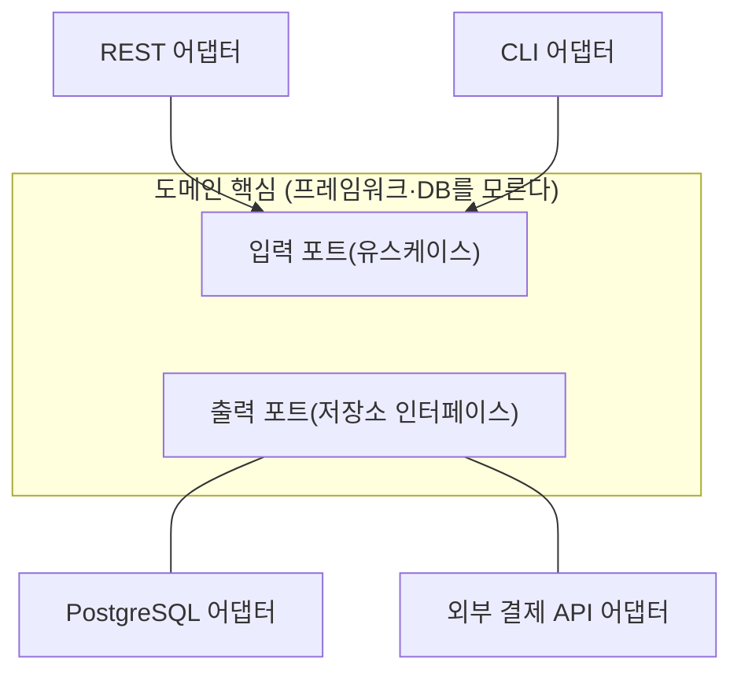

> ByteByteGo의 System Design 101 가이드 「[6 Software Architectural Patterns You Must Know](https://bytebytego.com/guides/6-software-architectural-patterns-you-must-know)」, 「[Top 5 Software Architectural Patterns](https://bytebytego.com/guides/top-5-software-architectural-patterns)」를 바탕으로 재구성한 노트다. 클라우드 아키텍처 스타일은 Azure Architecture Center의 「[Architecture styles](https://learn.microsoft.com/en-us/azure/architecture/guide/architecture-styles/)」로 보강했다. 상호작용 축에 따른 스타일 분류와 선택 경험칙은 Mary Shaw·Paul Clements의 「[A Field Guide to Boxology](https://web.cs.wpi.edu/~cs562/s98/pdf/Boxology.pdf)」(1997)를 바탕으로 더했다.

## 아키텍처 패턴이란

**아키텍처 패턴은 시스템의 큰 덩어리를 어떻게 나누고, 덩어리끼리 어떻게 대화하게 할지에 대한 검증된 틀이다.** 클래스 수준의 [[gof-design-patterns|디자인 패턴]]보다 한 단계 위에서 시스템 전체의 모양을 정한다.

패턴은 정답이 아니라 트레이드오프의 묶음이다. 어떤 패턴이든 무언가를 쉽게 만드는 대신 다른 무언가를 어렵게 만든다.

## 여섯 가지 패턴 비교

| 패턴 | 구조 | 잘 맞는 곳 | 약점 |
| --- | --- | --- | --- |
| **계층형(Layered)** | 표현 → 비즈니스 → 영속성 → DB처럼 층마다 역할이 하나다. 위층은 아래층만 부른다 | 빨리 만들어야 하는 일반 업무 애플리케이션 | 규칙을 지키지 않으면 층을 건너뛰는 호출이 늘어 코드가 엉킨다. 기능 하나 고치려고 모든 층을 건드린다 |
| **클라이언트-서버** | 요청하는 클라이언트와 응답하는 서버가 네트워크로 통신한다 | 웹, 실시간 서비스 등 대부분의 네트워크 애플리케이션 | 서버가 단일 장애 지점이 되기 쉽다 |
| **이벤트 기반(Event-Driven)** | 서비스가 이벤트를 발행하고, 관심 있는 서비스가 구독해 반응한다 | 구성 요소 사이의 결합을 느슨하게 하고 싶은 곳, 비동기 처리 | 흐름이 코드에 드러나지 않아 개별 구성 요소를 테스트하고 추적하기 어렵다 |
| **마이크로서비스** | 큰 시스템을 독립 배포되는 작은 서비스로 나눈다 | 팀이 많고 기능별로 확장 요구가 다른 시스템 | 분산 시스템의 복잡도(네트워크, 일관성, 운영)가 붙는다 |
| **플러그인(마이크로커널)** | 최소한의 코어 시스템에 독립된 플러그인 모듈이 기능을 더한다 | IDE, 브라우저, 빌드 도구처럼 시간이 지나며 기능이 늘어나는 제품 | 코어를 바꾸기 어렵다. 플러그인 계약이 굳어 버린다 |
| **헥사고날(포트와 어댑터)** | 핵심 도메인을 가운데 두고, 외부(DB, UI, 외부 API)는 포트(인터페이스)와 어댑터(구현)로만 연결한다 | 외부 연동이 자주 바뀌거나 도메인 로직을 독립적으로 테스트해야 하는 곳 | 추상화 층이 늘어 개발 시간과 학습 비용이 든다 |

마이크로서비스는 [[microservices-architecture|마이크로서비스 아키텍처]]에서 자세히 다룬다.

## 클라우드 아키텍처 스타일

위 표가 코드와 모듈의 모양이라면, 클라우드 쪽에서는 **배포 단위와 통신 방식**까지 묶어 「아키텍처 스타일」이라 부른다. 스타일은 특정 기술을 요구하지 않지만 잘 맞는 기술은 있다(마이크로서비스와 컨테이너처럼).

| 스타일 | 구조 | 맞는 곳 | 주의 |
| --- | --- | --- | --- |
| N계층(N-tier) | 표현·비즈니스·데이터 계층을 논리 층과 물리 티어로 나눈다. 위층은 아래층만 부른다 | 이미 계층형인 앱을 큰 변경 없이 클라우드로 옮길 때, 온프레미스와 섞인 환경 | 수평으로 나뉜 층이라 기능 하나를 바꿀 때 여러 층을 건드려 잦은 배포가 어렵다 |
| 웹-큐-워커(Web-Queue-Worker) | HTTP를 받는 웹 프런트엔드와 무거운 일을 하는 워커를 메시지 큐로 잇는다 | 도메인은 단순한데 이미지 처리·보고서 생성 같은 무거운 작업이 있는 앱. 관리형 서비스로 쉽게 배포한다 | 웹과 워커가 각자 커지면 둘 다 모놀리스가 된다. 큐의 쓰임은 [[cloud-design-patterns\|클라우드 설계 패턴]] |
| 마이크로서비스 | 바운디드 컨텍스트마다 자기 저장소를 가진 서비스, 게이트웨이, 메시징 | 변경이 잦은 복잡한 도메인, 여러 팀 | 서비스 발견·데이터 일관성·운영 성숙도가 필요하다 |
| 이벤트 기반 | 생산자가 브로커에 이벤트를 내고 소비자들이 거의 실시간으로 반응한다 | IoT, 금융 거래, 대량 스트림 처리 | 전달 보장, 순서, 최종 일관성 |
| 빅 데이터 | 데이터 레이크에 모아 배치로 분석하고, 스트림은 실시간으로 처리해 분석 저장소에서 합친다 | 기존 DB에 담기지 않는 규모의 분석, 예측 모델 | 배치와 스트림 두 경로를 함께 운영해야 한다(람다 아키텍처) |
| 빅 컴퓨트 | 스케줄러가 작업을 수천 코어에 나눠 보낸다. 서로 독립인 작업(embarrassingly parallel)과 고속 인터커넥트(InfiniBand, RDMA)가 필요한 밀결합 작업으로 나뉜다 | 시뮬레이션, 금융 위험 모델링, 3D 렌더링 | 필요할 때만 용량을 빌려 쓰도록 설계한다 |

## 헥사고날 아키텍처의 모양

- **의존 방향은 항상 안쪽(도메인)을 향한다.** 어댑터가 포트를 구현하고, 도메인은 구체 기술을 모른다.
- DB를 바꾸거나 테스트용 가짜 저장소를 끼울 때 어댑터만 갈아 끼운다.
- 클린 아키텍처, 어니언 아키텍처도 "도메인을 중심에 두고 의존을 안쪽으로"라는 같은 생각을 다르게 그린 것이다. 도메인 모델을 어떻게 짜는지는 [[domain-driven-design|도메인 주도 설계]]에 있다.

## 계층형과 헥사고날의 차이

| 비교 | 계층형 | 헥사고날 |
| --- | --- | --- |
| 중심 | 데이터베이스(맨 아래 층) | 도메인 |
| 의존 방향 | 위에서 아래로. 비즈니스 층이 영속성 층에 의존한다 | 바깥에서 안으로. 영속성 어댑터가 도메인의 포트에 의존한다 |
| DB 교체 | 비즈니스 층까지 영향이 갈 수 있다 | 어댑터 하나만 바꾼다 |
| 초기 비용 | 낮다 | 인터페이스를 먼저 정해야 해서 높다 |

## 스타일을 가르는 축: 구성 요소와 커넥터

위의 패턴 이름은 사람마다 다른 뜻으로 쓴다. 이름 대신 **구성 요소끼리 제어와 데이터를 어떻게 주고받나**로 스타일을 가르면 비교가 정확해진다(Shaw·Clements의 분류, 1997).

| 축 | 묻는 것 | 값의 예 |
| --- | --- | --- |
| 구성 요소·커넥터 | 실행 단위는 무엇이고, 무엇이 둘을 잇나 | 구성 요소: 프로그램, 객체, 프로세스, 필터. 커넥터: 프로시저 호출, RPC, 메시지 프로토콜, 데이터 스트림, 공유 저장소 |
| 제어 | 제어가 어떤 모양(topology)으로 흐르고, 동기화는 어떤가(synchronicity), 상대가 언제 정해지나(binding time) | 선형·계층(트리)·스타·임의 그래프 / 락스텝·동기·비동기 / 작성·컴파일·실행 시점 |
| 데이터 | 데이터가 어떤 모양으로, 얼마나 연속적으로(continuity), 어떤 방식(mode)으로 흐르나 | 배치·스트림·연속 갱신 / 전달(passed)·공유(shared)·복사·방송 |
| 제어·데이터 관계 | 두 흐름의 모양이 같은가, 방향이 같은가 | 파이프는 같은 방향, 클라이언트-서버는 제어가 서버로 데이터가 클라이언트로 흐른다 |
| 추론 | 이 스타일에서 어떤 성질을 증명하기 쉬운가 | 파이프라인의 함수 합성, 이벤트 시스템의 비결정성 |

이 축으로 다섯 계열이 나온다. 실제 시스템은 순수형으로 나오지 않고 섞인다. 순수형을 알아야 혼합형을 설명하고, 쓸데없는 섞임을 걷어 낼 수 있다.

| 계열 | 하위 스타일 | 지금의 예 |
| --- | --- | --- |
| 데이터 흐름(data flow) | 일괄 순차(batch sequential), 파이프와 필터 | Unix 파이프, ETL, 스트림 처리 |
| 호출-반환(call-and-return) | 메인 프로그램·서브루틴, 추상 자료형·객체 지향, 계층형 | 대부분의 애플리케이션 코드, 계층형 아키텍처 |
| 독립 구성 요소(interacting processes) | 통신하는 프로세스, 이벤트 시스템 | 액터, 이벤트 기반 아키텍처, 마이크로서비스 |
| 데이터 중심(data-centered) | 저장소(repository), 블랙보드 | DB 중심 업무 시스템, 공유 상태 위의 협업 |
| 가상 머신 | 인터프리터, 규칙 기반 시스템 | JVM·브라우저 JS 엔진, 규칙 엔진 |

## 어떻게 고르나

문제의 모양에서 시작하는 경험칙이 있다.

| 문제의 특징 | 고려할 스타일 |
| --- | --- |
| 순차 단계로 나뉜다 | 일괄 순차나 파이프라인. 각 단계가 점진적이라 앞 단계가 끝나기 전에 뒤 단계가 시작할 수 있으면 파이프라인 |
| 연속적이거나 아주 긴 데이터 스트림을 변환한다 | 파이프라인. 단, 풍부한 구조의 데이터를 넘겨야 하면 텍스트(ASCII)만 흐르는 파이프는 피한다 |
| 데이터의 이해·관리·표현이 핵심이다 | 저장소나 추상 자료형. 데이터가 오래 살면 저장소, 표현이 바뀔 것 같으면 추상 자료형으로 변경을 가둔다 |
| 저장소인데 입력이 잡음이 많고 실행 순서를 미리 정할 수 없다 | 블랙보드 |
| 저장소인데 실행 순서가 들어오는 요청이 정하고 데이터가 정형이다 | DBMS |
| 물리 시스템에 붙어 예측 못 할 외란 속에 연속 동작을 제어한다 | 폐루프 제어(closed loop control) |
| 계산은 설계했는데 그것을 돌릴 기계가 없다 | 인터프리터 |
| 신호를 받는 쪽을 보내는 쪽에 묶고 싶지 않다 | 이벤트 |
| 작업이 생산자와 소비자로 나뉜다 | 클라이언트-서버 |

- **변경이 어디서 자주 일어나는지**를 본다. 외부 연동이 자주 바뀌면 헥사고날, 기능이 계속 붙으면 플러그인, 팀과 배포 단위를 나눠야 하면 마이크로서비스다.
- 처음에는 단순한 계층형 모놀리스로 시작하고, 경계가 분명해진 뒤에 나누는 편이 대개 싸다.
- 한 시스템이 여러 패턴을 섞는다. 마이크로서비스 각각의 내부는 계층형이나 헥사고날이고, 서비스 사이는 이벤트 기반일 수 있다.

## 정리

- 아키텍처 패턴은 시스템을 나누는 큰 틀이고, 패턴마다 얻는 것과 잃는 것이 있다.
- 계층형은 빠르게 만들기 좋지만 규칙이 무너지면 엉킨다. 이벤트 기반은 결합을 줄이지만 추적이 어렵다.
- 헥사고날은 도메인을 중심에 두고 외부를 포트와 어댑터로 떼어 내 교체와 테스트를 쉽게 한다.
- 변경이 일어나는 방향에 맞춰 패턴을 고르고, 필요해질 때 나눈다.

관련 노트: [[microservices-architecture|마이크로서비스 아키텍처]], [[domain-driven-design|도메인 주도 설계]], [[gof-design-patterns|GoF 디자인 패턴]], [[web-scalability-components|웹 확장성의 구성 요소]], [[frontend-mv-architecture|프론트엔드 MV* 아키텍처의 흐름]]
