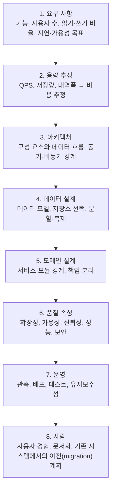

> ByteByteGo의 System Design 101 가이드 「[The Fantastic Four of System Design](https://bytebytego.com/guides/who-are-the-fantastic-four-of-system-design)」, 「[System Design Cheat Sheet](https://bytebytego.com/guides/system-design-cheat-sheet)」, 「[A cheat sheet for system designs](https://bytebytego.com/guides/a-cheat-sheet-for-system-designs)」, 「[System Design Blueprint](https://bytebytego.com/guides/system-design-blueprint-the-ultimate-guide)」, 「[Top 5 Trade-offs in System Designs](https://bytebytego.com/guides/top-5-trade-offs-in-system-designs)」, 「[Must Know System Design Building Blocks](https://bytebytego.com/guides/must-know-system-design-building-blocks)」, 「[CAP, BASE, SOLID, KISS](https://bytebytego.com/guides/cap-base-solid-kiss-what-do-these-acronyms-mean)」를 바탕으로 재구성한 노트다. 클라우드 설계의 기둥과 원칙은 Microsoft의 「[Azure Well-Architected Framework](https://learn.microsoft.com/en-us/azure/well-architected/)」, 「[Design principles for Azure applications](https://learn.microsoft.com/en-us/azure/architecture/guide/design-principles/)」로 보강했다. KISS와 코드 원칙의 연결은 「[fru1tworld/cs-basic 모의 면접 질문 목록](https://github.com/fru1tworld/cs-basic/blob/main/interview/cs/etc.md)」을 점검해 보강했다. 설계 진행 순서와 어림셈은 「[checkcheckzz/system-design-interview](https://github.com/checkcheckzz/system-design-interview)」의 팁, Pramp의 「[The Anatomy Of A System Design Interview](https://blog.pramp.com/system-design-interview-process-e91aae2dbe83)」, 「[How to Succeed in a System Design Interview](https://blog.pramp.com/how-to-succeed-in-a-system-design-interview-27b35de0df26)」, Palantir의 「[How to Rock a Systems Design Interview](http://www.palantir.com/2011/10/how-to-rock-a-systems-design-interview/)」, HiredInTech의 「[The System Design Process](http://www.hiredintech.com/system-design/the-system-design-process/)」, 「[Numbers Everyone Should Know](http://everythingisdata.wordpress.com/2009/10/17/numbers-everyone-should-know/)」로, 관리 용이성·비용 속성은 AOSA 2권의 「[Scalable Web Architecture and Distributed Systems](https://aosabook.org/en/v2/distsys.html)」로, 성능 문제와 확장성 문제의 구분은 Jonas Bonér의 「[Scalability, Availability & Stability Patterns](http://www.slideshare.net/jboner/scalability-availability-stability-patterns)」로 보강했다.

## 시스템 설계란

시스템 설계는 **요구 사항을 만족하는 구성 요소와 그 사이의 데이터 흐름을 정하는 일**이다. 기능 요구 사항(무엇을 하나)은 출발점일 뿐이고, 설계의 대부분은 비기능 요구 사항(얼마나 많이, 얼마나 빨리, 얼마나 오래 멈추지 않고)을 맞추는 데 쓰인다. 그 비기능 요구 사항을 **품질 속성(quality attribute)** 이라 부른다.

## 네 가지 품질 속성

| 속성 | 뜻 | 재는 법 | 주요 수단 |
| --- | --- | --- | --- |
| 확장성(Scalability) | 부하가 늘어도 자원을 더해 성능을 유지하는 능력 | 부하를 늘렸을 때 응답 시간이 유지되는가 | 무상태 서비스, 수평 확장, 캐시, 샤딩, 비동기 처리 |
| 가용성(Availability) | 요청했을 때 응답을 받을 수 있는 시간의 비율 | 가동률(99.9%, 99.99% …) | 이중화, 페일오버, 다중 AZ·리전 |
| 신뢰성(Reliability) | 장애가 있어도 **올바른 결과**를 꾸준히 내는 능력 | 오류율, 장애 간 평균 시간(MTBF) | 복제, 검증, 멱등성, 재시도, 테스트 |
| 성능(Performance) | 주어진 자원으로 정해진 속도를 내는 능력 | 지연 시간(p50·p99), 처리량(QPS·TPS) | 캐시, 인덱스, 병렬화, 비동기 처리 |

가용성과 신뢰성은 다르다. **가용성은 응답이 오는지, 신뢰성은 그 응답이 맞는지**를 본다. 가용성을 높인 시스템도 오래된 데이터를 돌려줄 수 있다.

### 처리량을 높이는 법

처리량(throughput)은 단위 시간에 처리하는 요청 수다. 높이는 순서는 대개 이렇다.

1. **캐시**로 디스크·DB 같은 느린 I/O까지 가지 않게 한다.
2. 계산이 무거운 작업은 **스레드·워커 수**를 늘린다. 단, 너무 많으면 문맥 전환과 경합으로 오히려 느려진다.
3. 병목을 측정해 찾고, 무거운 작업은 **비동기 처리**로 요청 경로에서 떼어 낸다.

확장 전략의 세부는 [[web-scalability-components|웹 확장성의 구성 요소]], 가용성을 이중화로 높이는 구조는 [[high-availability-redundancy|고가용성 이중화 구조와 장애 감지]]에 있다.

여기에 두 가지를 더 본다. **관리 용이성(Manageability)** 은 운영의 확장성이다. 문제를 얼마나 빨리 진단하고, 얼마나 쉽게 고치고 배포하나로 잰다. **비용(Cost)** 은 장비·라이선스값만이 아니라 만드는 데 드는 개발 시간, 운영 인력, 교육까지 합친 총소유비용(TCO)이다. 서버를 더해 확장성을 얻으면 관리할 서버와 비용이 늘듯, 속성끼리는 자주 부딪친다.

**성능 문제와 확장성 문제는 증상이 다르다.** 사용자 한 명일 때도 느리면 성능 문제이고, 한 명일 때는 빠른데 부하가 몰릴 때만 느려지면 확장성 문제다. 목표는 「받아들일 만한 지연 시간 안에서 최대 처리량」이다.

## 다섯 가지 트레이드오프

정답인 설계는 없고, 무엇을 얻으려고 무엇을 내주는지가 있을 뿐이다.

| 트레이드오프 | 한쪽을 높이면 | 판단 기준 |
| --- | --- | --- |
| 비용 ↔ 성능 | 더 빠른 하드웨어·더 많은 복제본·캐시는 돈이 든다 | 목표 지연 시간을 먼저 정하고, 그 이상은 사지 않는다 |
| 신뢰성 ↔ 확장성 | 노드가 늘수록 고장 날 곳과 조율할 것이 늘어 정확성을 지키기 어렵다 | 일관성이 꼭 필요한 데이터와 아닌 데이터를 나눈다 |
| 성능 ↔ 일관성 | 모든 복제본이 같은 값을 갖게 기다리면 느려진다 | 최종 일관성(eventual consistency)으로 충분한 곳을 찾는다 |
| 보안 ↔ 유연성 | 인증·권한·감사 단계가 늘수록 통합과 변경이 번거롭다 | 데이터 민감도에 비례해 통제를 건다 |
| 개발 속도 ↔ 품질 | 빨리 내놓으면 테스트·설계가 얕아진다 | 되돌리기 어려운 결정(데이터 모델, 공개 API)에만 시간을 쓴다 |

SQL·NoSQL, 배치·스트림, 동기·비동기처럼 기술 선택에서 반복되는 양자택일과 흔한 문제의 처방은 [[system-design-choices|시스템 설계의 선택지와 흔한 문제의 해법]]에 있다.

## 빌딩 블록

대부분의 설계는 아래 부품의 조합이다.

| 분류 | 부품 | 하는 일 |
| --- | --- | --- |
| 네트워크·통신 | DNS | 도메인을 IP로 바꾼다. [[dns\|DNS]] |
| | 로드 밸런서 | 트래픽을 여러 서버에 나눈다. [[load-balancer\|로드 밸런서]] |
| | API 게이트웨이 | 여러 서비스 앞의 단일 진입점. 인증·라우팅·속도 제한. [[api-gateway\|API 게이트웨이]] |
| | CDN | 정적 콘텐츠를 사용자 가까이서 내준다. [[cdn\|CDN]] |
| 분산 처리 | 메시지 큐 | 서비스를 비동기로 잇고 결합을 끊는다. [[message-queue-kafka\|메시지 큐와 Kafka]] |
| | 분산 캐시 | 자주 읽는 데이터를 메모리에 둔다 |
| | 분산 작업 스케줄러 | 예약 작업을 여러 노드 중 한 곳에서만 실행하게 조율한다 |
| 서비스 관리 | 서비스 디스커버리 | 주소를 하드코딩하지 않고 서비스끼리 서로를 찾는다 |
| 데이터 | 데이터베이스 | 구조화된 데이터를 저장한다 |
| | 객체 스토리지 | 이미지·영상·문서 같은 큰 파일을 저장한다 |
| | 샤딩 | 데이터를 행 단위로 여러 노드에 나눈다. [[database-sharding\|데이터베이스 샤딩]] |
| | 복제 | 같은 데이터를 여러 노드에 복사해 읽기를 늘리고 장애에 대비한다 |
| | 일관된 해싱 | 노드가 늘거나 줄 때 다시 배치할 키를 최소로 줄인다 |
| | 고유 ID 생성기 | 여러 노드에서 겹치지 않는 ID를 만든다. [[distributed-unique-id\|분산 환경의 고유 ID 생성]] |
| 관측·복원력 | 메트릭·로그·트레이스 | 시스템 내부 상태를 밖에서 본다 |
| | 복원력 패턴 | 타임아웃·재시도·서킷 브레이커. [[resiliency-patterns\|장애 확산을 막는 복원력 패턴]] |

## 클라우드 설계의 다섯 기둥과 원칙

클라우드 제공자는 품질 속성을 **Well-Architected Framework**의 다섯 기둥으로 묶는다. AWS·Azure·Google Cloud가 같은 이름의 틀을 쓴다(AWS와 Google Cloud는 여섯 번째로 지속 가능성을 둔다). 설계 리뷰를 할 때 다섯 기둥을 하나씩 짚으면 빠진 것이 드러난다.

| 기둥 | 목표 | 대표 수단 |
| --- | --- | --- |
| 신뢰성(Reliability) | 가동률·복구 목표(RTO·RPO)를 지킨다 | 이중화, 장애 모드 분석, 재해 복구([[disaster-recovery\|재해 복구]]) |
| 보안(Security) | 기밀성·무결성을 지킨다 | 관리형 ID, 최소 권한, 암호화, 위협 모델링 |
| 비용 최적화(Cost Optimization) | 예산 안에서 가치를 낸다 | 사용량 기반 확장, 예약 할인, 비용 태깅([[cloud-cost-optimization\|클라우드 비용 최적화]]) |
| 운영 우수성(Operational Excellence) | 운영 중 문제를 줄인다 | IaC, CI/CD, 관측 가능성, 자동화 |
| 성능 효율성(Performance Efficiency) | 수요 변화에 맞춘다 | 수평 확장, 캐시, 배포 전 부하 테스트 |

기둥을 지키는 설계 원칙은 세 무리로 정리된다.

| 무리 | 원칙 | 뜻 |
| --- | --- | --- |
| 핵심 | 스스로 회복하게(self-healing) | 실패를 감지해 자동으로 복구한다. 재시도, 헬스 체크, 서킷 브레이커, 벌크헤드 |
| | 모든 것을 이중으로 | 단일 장애점을 없앤다. 로드 밸런서 뒤 여러 인스턴스, DB 복제본, 다중 영역·리전 |
| | 조율을 줄인다 | 비동기로 잇고 최종 일관성을 받아들인다. 조율이 필요한 곳이 확장의 병목이다 |
| | 수평 확장을 전제로 | 세션 고정(sticky session)을 피하고 지표 기반 자동 확장을 쓴다 |
| | 한계를 기준으로 분할 | DB·네트워크·계산의 한계를 파티셔닝으로 피한다. 파티션 키는 핫스팟이 생기지 않게 고른다 |
| 운영 | 운영을 위해 설계 | 로그·분산 추적·표준 메트릭을 처음부터 넣는다 |
| | 관리형 서비스를 쓴다 | IaaS보다 PaaS. 운영 부담을 제공자에게 넘긴다 |
| | ID 서비스를 쓴다 | 인증을 직접 만들지 않고 관리형 ID 플랫폼에 맡긴다 |
| 전략 | 진화를 위해 설계 | 느슨한 결합, 버전이 있는 API로 서비스가 따로 바뀌게 한다 |
| | 비즈니스 요구에서 출발 | RTO·SLA·SLO를 먼저 정하고 그에 맞춰 설계한다 |
| | 장애 모드 분석(FMA) | 설계 단계에서 실패 지점을 찾아 위험·영향으로 점수를 매기고 대응을 정한다 |

이 원칙을 구현하는 구체 패턴은 [[cloud-design-patterns|클라우드 설계 패턴]]과 [[resiliency-patterns|복원력 패턴]]에 있다.

## 설계 진행 순서

열린 문제(「X 같은 서비스를 설계하라」)를 받으면 아래 순서로 범위를 좁혀 간다. 실제 대화는 순서대로 흐르지 않지만, 빠뜨린 단계가 없는지 확인하는 뼈대가 된다. **답보다 근거가 중요하다.** 정답이 하나인 문제가 아니므로 선택마다 이유와 대가를 말로 남긴다.

| 단계 | 할 일 | 던질 질문 |
| --- | --- | --- |
| 1. 목표와 사용 사례 | 시스템이 무엇을 위해 있고 누가 어떻게 쓰나를 정한다. 잘 아는 제품이라도 가정을 말로 맞춘다 | 사용자는 누구인가, 입력과 출력은 무엇인가, 핵심 기능은 무엇인가 |
| 2. 범위 | 기능을 중요도순으로 적고 이번에 다룰 것과 뺄 것을 합의한다 | API만인가 전 구간인가, 모바일·웹 모두인가, 인증·통계·기존 시스템 연동이 필요한가 |
| 3. 규모와 제약 | 숫자로 규모를 정하고 어림셈한다(아래 「어림셈」) | 읽기·쓰기 비율, 동시 요청 수, 목표 응답 시간, 사용자당 데이터 상한 |
| 4. 상위 설계 | 끝에서 끝까지의 흐름을 그린다. 진입점(사용자 요청, 외부 API, 오프라인 작업)과 구성 요소(로드 밸런서, 서비스, 주·복제 DB와 캐시)를 잇는다. 세부는 아직 넣지 않는다 | 데이터는 어디서 들어와 어디에 쌓이나, 동기·비동기 경계는 어디인가 |
| 5. 구성 요소 설계 | 구성 요소마다 API, DB 스키마, 핵심 자료구조와 알고리즘을 정한다. 필요하면 특정 기능의 객체 설계까지 내려간다 | URL 단축이면 해시와 키 생성, 피드면 팬아웃 방식처럼 문제마다 단골 자료구조가 있다 |
| 6. 병목과 트레이드오프 | 부하를 키웠을 때 무엇이 먼저 무너지나 찾고, 대안을 장단점과 함께 비교한다 | 어떤 DB와 캐시를 왜 고르나, 단일 장애점은 어디인가, 장애가 나면 무엇을 포기하나 |

- 처음부터 큰 그림을 완성하려 하지 않는다. **단순하게 시작하고 반복해서 키운다.**
- 써 보지 않은 기술은 「X는 써 보지 않았지만 Y 문제의 흔한 해법이다」처럼 정직하게 말한다. 제품의 세부 설정보다 **필요를 알아보고 흔한 해법을 짝짓는 능력**이 더 중요하다(로드 밸런서가 필요하다는 판단과 NGINX가 흔한 선택이라는 지식).
- 설계 감각에 필요한 바탕은 동시성(스레드, 교착, 일관성), 네트워크(IPC, TCP/IP, 처리량과 지연의 차이), 추상화(OS·파일 시스템·DB가 대략 어떻게 동작하나), 실제 성능 수치, 어림셈, 가용성·내구성이다. 모두를 깊이 알 필요는 없고, 어떤 질문을 던지고 언제 전문가를 찾을지 알 만큼 익숙하면 된다.

### 어림셈: 봉투 뒷면 계산

**어림셈(back-of-the-envelope calculation)** 은 대략의 숫자로 불가능한 설계를 일찍 걸러 내는 계산이다. 남은 후보만 프로토타입이나 마이크로벤치마크로 확인한다. 어림셈 결과와 벤치마크가 다르면 머릿속 모델 어딘가가 틀린 것이므로 그 차이에서 배운다.

```text
예: URL 단축 서비스
새 URL 월 1억 개 × 평균 수명 10일 × 하루 1회 클릭 ≈ 월 10억 클릭
10억 / (30일 × 86,400초) ≈ 초당 약 400 요청 (최대치는 평균의 몇 배로 잡는다)
```

어림셈의 재료는 기본 연산의 비용이다. 아래는 Jeff Dean이 정리한 고전적인 수치(2009년 무렵)로, 절대값보다 **자릿수 차이**를 외우는 표다.

| 연산 | 시간 | 감각 |
| --- | --- | --- |
| L1 캐시 참조 | 0.5ns | |
| 주 메모리 참조 | 100ns | L1의 200배 |
| 1KB 압축(Zippy, 지금의 Snappy) | 3µs | |
| 1Gbps 네트워크로 2KB 전송 | 20µs | |
| 메모리에서 1MB 순차 읽기 | 250µs | |
| 같은 데이터센터 안 왕복 | 500µs | |
| 디스크 탐색(seek) | 10ms | 메모리 참조의 10만 배 |
| 디스크에서 1MB 순차 읽기 | 20ms | |
| 캘리포니아 → 네덜란드 → 캘리포니아 패킷 | 150ms | 빛의 속도가 정하는 하한 |

- 지금 하드웨어는 메모리 순차 읽기·네트워크가 이보다 몇 배 빠르고, SSD의 무작위 읽기는 수십~100µs 수준이라 HDD 탐색보다 두 자릿수 빠르다. 그래도 **메모리 < 같은 DC 왕복 < 디스크 < 대륙 간 왕복**의 순서와 무작위 I/O가 순차 I/O보다 훨씬 비싸다는 결론은 그대로다.
- OS 수준 비용도 같은 방식으로 어림한다. 시스템 콜은 수십~수백 ns, 컨텍스트 전환은 캐시 오염까지 치면 수 µs~수십 µs, `fork()`는 수십~수백 µs다.
- 프론트엔드 쪽 수치(네트워크 왕복, 파싱, 프레임 예산)는 [[frontend-latency-numbers|프론트엔드 개발자가 알아야 할 지연 시간 숫자]]에 있다.

## 설계 논의 체크리스트

실무 설계 문서를 쓸 때는 위 진행 순서를 조금 더 넓혀, 아래 항목이 빠지지 않았는지 본다.



## 자주 나오는 약어

| 약어 | 뜻 | 핵심 |
| --- | --- | --- |
| CAP | Consistency, Availability, Partition tolerance | 네트워크 분할이 생기면 일관성과 가용성 중 하나를 포기한다. 분할은 분산 시스템에서 반드시 생기므로 실제 선택은 「분할 때 무엇을 내주나」다. DB를 CP·AP로 딱 잘라 분류하는 것은 거친 근사다. [[database-models\|데이터베이스 모델]] |
| BASE | Basically Available, Soft state, Eventually consistent | ACID보다 느슨한 모델. 가용성을 우선하고, 상태는 시간이 지나면 일관해진다. 많은 NoSQL이 택한다 |
| ACID | Atomicity, Consistency, Isolation, Durability | 트랜잭션의 네 성질. [[transaction\|트랜잭션과 회복]] |
| SOLID | 객체지향 설계 다섯 원칙 | 단일 책임, 개방·폐쇄, 리스코프 치환, 인터페이스 분리, 의존성 역전. [[frontend-solid\|프론트엔드와 SOLID 원칙]] |
| KISS | Keep It Simple, Stupid | 대부분의 시스템은 단순할 때 가장 잘 돈다. 복잡도는 필요가 증명될 때만 더한다. 코드 수준의 DRY·YAGNI와 함께 [[simple-design\|Simple Design]]에 정리했다 |

## 정리

- 설계의 대부분은 확장성·가용성·신뢰성·성능 같은 **비기능 요구 사항**을 맞추는 일이다.
- 가용성은 응답이 오는지, 신뢰성은 응답이 맞는지다. 둘을 따로 목표로 잡는다.
- 모든 선택은 트레이드오프다. 무엇을 얻고 무엇을 내주는지 말로 적어 둔다.
- 설계는 빌딩 블록의 조합이다. 부품 하나하나의 역할과 한계를 알면 처음 보는 문제도 조립할 수 있다.

관련 노트: [[system-design-choices|시스템 설계의 선택지와 흔한 문제의 해법]], [[software-architecture-patterns|소프트웨어 아키텍처 패턴]], [[web-scalability-components|웹 확장성의 구성 요소]], [[high-availability-redundancy|고가용성 이중화 구조와 장애 감지]], [[resiliency-patterns|장애 확산을 막는 복원력 패턴]], [[distributed-system-patterns|분산 시스템의 통신·데이터 흐름 패턴]], [[backend-developer-roadmap|백엔드 개발자가 알아야 할 것]]
