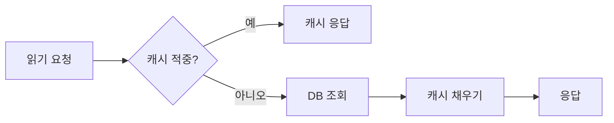

> Donne Martin의 「[The System Design Primer](https://github.com/donnemartin/system-design-primer)」에 제시된 개념과 사례를 주제별로 재구성한 노트다. 원본 라이선스는 [CC BY 4.0](https://creativecommons.org/licenses/by/4.0/)이다.

## 캐시는 빠른 읽기의 대가로 일관성을 관리하는 계층이다

캐싱은 계산·디스크·네트워크의 반복 비용을 줄인다. 대신 **만료·갱신·캐시 미스 폭증·핫 키** 문제가 생긴다.

| 캐시 위치 | 장점 | 대표 고려사항 |
| --- | --- | --- |
| 클라이언트·브라우저 | 불필요한 네트워크 요청 감소 | 사용자별 데이터와 갱신 |
| CDN | 원본 서버 호출 감소 | TTL·콘텐츠 무효화 |
| 리버스 프록시·웹 서버 | 요청 결과 재사용 | 캐시 키와 개인화 응답 |
| 애플리케이션 메모리 | 계산 결과와 객체 재사용 | 노드별 데이터 차이 |
| 분산 캐시 | 여러 인스턴스의 공통 핫 데이터 | 장애·분할·메모리 압박 |
| DB·쿼리 레벨 | 반복 조회 비용 감소 | 변경 시 갱신 기준 |

## 캐시 갱신 패턴

| 패턴 | 처리 | 장단점 |
| --- | --- | --- |
| Cache-aside | 미스 시 DB 조회 뒤 캐시에 저장 | 단순하지만 첫 요청이 느릴 수 있음 |
| Write-through | DB 쓰기와 연동해 캐시도 갱신 | 일관성이 비교적 명확하나 쓰기 지연 |
| Write-behind / write-back | 캐시에 먼저 쓰고 나중에 DB 반영 | 쓰기 지연 감소, 미반영 데이터 유실 위험 |
| Refresh-ahead | 예상 만료 전에 미리 재계산 | 핫 데이터에 유리하지만 불필요한 계산 가능 |

## 비동기화가 해결하는 문제

외부 API 호출·대량 이메일·썸네일 변환 등 오래 걸리는 작업을 사용자 요청에서 분리할 수 있다.

- **Message queue**: 작업 또는 이벤트를 저장·전달한다. 전달 보장 방식과 중복 처리를 명확히 한다.
- **Task queue**: 실행 대상 작업을 워커에 배분한다. 재시도 횟수·지수 백오프·데드레터 큐를 설계한다.
- **Backpressure**: 생산 속도가 소비를 압도하면 입력을 늦추거나 제한해 시스템을 보호한다.
- **비용**: 큐 사용은 비동기 지연·순서·최종 일관성과 운영 복잡성의 증가를 동반한다.

관련 노트: [[caching-strategies|캐싱 전략]], [[message-queue-kafka|메시지 큐]], [[resiliency-patterns|회복 탄력성 패턴]]
