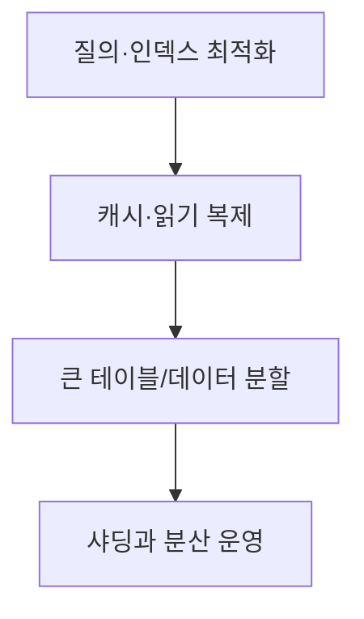

> Donne Martin의 「[The System Design Primer](https://github.com/donnemartin/system-design-primer)」에 제시된 개념과 사례를 주제별로 재구성한 노트다. 원본 라이선스는 [CC BY 4.0](https://creativecommons.org/licenses/by/4.0/)이다.

## 데이터베이스를 고를 때 첫 질문

저장소 선택은 유행이나 처리량 수치 하나로 결정하지 않는다. **질의 패턴·트랜잭션 경계·데이터 모델·일관성 요구·운영 복잡도**를 함께 평가한다.

| 모델 | 강점 | 확인할 제약 |
| --- | --- | --- |
| 관계형 DB | 명확한 스키마, 관계·조인, 트랜잭션 | 수평 분할과 분산 트랜잭션의 비용 |
| 키-값 | 키 조회를 중심으로 단순한 접근 | 조인·임의 조건 검색에 제한 |
| 문서 | 문서 단위 표현과 구조 변화 | 정합성·인덱스·다중 문서 갱신 검토 |
| 와이드 칼럼 | 대규모 분산 데이터에 맞는 접근 패턴 | 파티션 키·질의 패턴을 먼저 설계 |
| 그래프 | 연결 관계 탐색을 직접 표현 | 그래프 순회 비용과 운영 환경 고려 |

## ACID와 일관성

ACID는 원자성(전부 적용 또는 전부 취소), 일관성(제약 유지), 격리성(동시 트랜잭션 충돌 제어), 지속성(커밋 보존)을 뜻한다. CAP의 Consistency와 **데이터베이스 ACID의 Consistency는 같은 정의가 아니다.** 제품별 격리 수준과 복제 동작은 별도 확인한다.

## 확장 기법의 순서

| 기법 | 작동 원리 | 비용·위험 |
| --- | --- | --- |
| Primary–replica 복제 | 주 서버 쓰기를 읽기 복제본에 전달 | 복제 지연, 읽기 후 즉시 쓰기 보장 어려움 |
| 다중 쓰기/마스터 | 여러 지점에서 쓰기 | 충돌·분산 합의·복구의 복잡성 |
| Federation | 데이터 영역을 서비스/DB별로 분리 | 조인·트랜잭션의 경계 변경 |
| Sharding | 한 데이터 집합을 여러 노드로 분할 | 키 편향, 재분산, 크로스 샤드 질의 |
| Denormalization | 일부 값을 중복 저장해 조회를 단순화 | 갱신 때 여러 사본 정합성 관리 |
| Index tuning | 조회 경로에 맞춘 자료구조·통계 개선 | 쓰기·메모리·저장 공간 증가 |

NoSQL도 트랜잭션·일관성의 지원 범위가 제품마다 다르다. SQL과 NoSQL의 이분법보다 **실제 기능·장애 상황·팀 운영 역량**을 기준으로 결정한다.

관련 노트: [[database-models|데이터베이스 모델]], [[index-design|인덱스 설계]], [[distributed-data-patterns|분산 데이터]], [[distributed-transaction|분산 트랜잭션]]
