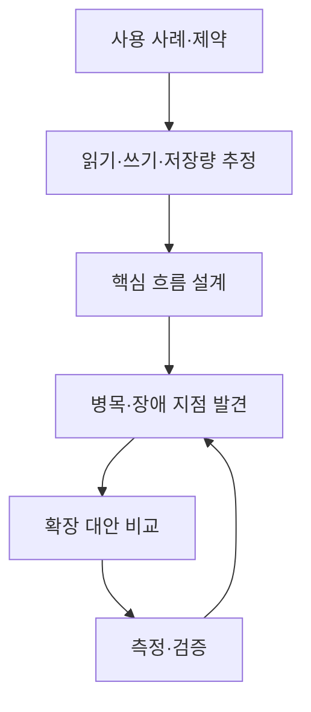

> Donne Martin의 「[The System Design Primer](https://github.com/donnemartin/system-design-primer)」에 제시된 개념과 사례를 주제별로 재구성한 노트다. 원본 라이선스는 [CC BY 4.0](https://creativecommons.org/licenses/by/4.0/)이다.

## 설계의 출발점은 기술이 아니라 제약이다

시스템 설계는 서버·DB 제품을 빠르게 나열하는 일이 아니다. **누가 무엇을 얼마나 많이, 어떤 품질 수준으로 사용할지** 정한 뒤 기능과 비기능 요구사항에서 컴포넌트를 역산하는 작업이다.

| 단계 | 확인 항목 | 결과물 |
| --- | --- | --- |
| 1. 범위 정의 | 사용자·유스케이스·입출력·데이터 규모·읽기/쓰기 비율·지연 허용·가용성 | 요구사항과 명시적 가정 |
| 2. 개략 설계 | 클라이언트, 게이트웨이, 서비스, 데이터 저장, 큐·캐시 간 연결 | 주요 데이터 흐름도 |
| 3. 핵심 상세 | 데이터 스키마·키 생성·인덱스·API·일관성·오류 처리 | 핵심 시퀀스와 트레이드오프 |
| 4. 확장 계획 | 병목·핫스팟·리플리카·파티셔닝·캐시·LB·비동기화 | 부하에 따른 변화 순서 |

## 대략적인 용량 추정

대략 계산(back-of-the-envelope)은 정확한 실측치가 아니라 **설계안이 얼마나 큰 규모를 감당해야 하는지** 확인하는 방법이다.

| 추정 | 계산 관점 |
| --- | --- |
| 평균 RPS | 하루 요청 수 / 86,400 |
| 피크 RPS | 평균에 피크 계수를 적용하며, 계수는 근거 있는 부하 가정이어야 한다 |
| 데이터 누적 | 기록당 크기 × 생성 건수 × 보관 기간 |
| 캐시 | 핫 데이터 크기 × 복제 계수, 만료·무효화 정책 포함 |
| 전송량 | 평균 응답 크기 × 초당 요청 수 |
| 디스크 | 원본 + 색인 + 로그 + 복제·백업 오버헤드 |

계산 결과만으로 성능이 결정되지는 않는다. 제품·네트워크·SSD·CPU 실측을 기준으로 다시 검증한다. 원문 부록에 실린 지연 시간 표는 **역사적인 비교용 예시**이므로 실제 장치 지연으로 단정하지 않는다.

## 설계 과정에서 자주 놓치는 것

- 평균 사용자 수와 동시 사용자 수를 구분한다.
- 읽기와 쓰기 경로를 따로 추적한다.
- 실패한 재시도·중복 요청·데이터 정합성 처리까지 설명한다.
- 단순한 구성이 충분하다면 분산 시스템을 도입하지 않는다.
- 설계상의 가정이 바뀌면 다시 계산한다.

관련 노트: [[system-design-fundamentals|시스템 설계 기초]], [[system-design-choices|시스템 설계 의사결정]], [[production-readiness-checklist|운영 준비 점검]]
