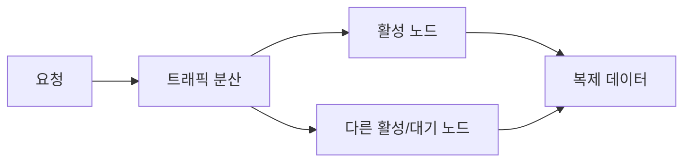

> Donne Martin의 「[The System Design Primer](https://github.com/donnemartin/system-design-primer)」에 제시된 개념과 사례를 주제별로 재구성한 노트다. 원본 라이선스는 [CC BY 4.0](https://creativecommons.org/licenses/by/4.0/)이다.

## 서로 다른 측정 축

| 축 | 의미 | 흔한 착각 |
| --- | --- | --- |
| 성능(Performance) | 현재 자원으로 작업을 얼마나 빨리·많이 처리하는가 | 빠른 단일 서버가 자동으로 확장 가능한 것은 아님 |
| 확장성(Scalability) | 자원을 추가할 때 처리 능력을 얼마나 유지·늘릴 수 있는가 | 서버를 늘리면 항상 선형적으로 빨라지지는 않음 |
| 지연(Latency) | 요청 하나가 처리되는 시간 | 평균만으로 사용자 경험을 판단하기 어려움 |
| 처리량(Throughput) | 단위 시간당 처리하는 작업 수 | 처리량 증가가 꼬리 지연 악화를 동반할 수 있음 |

운영에서는 동시 사용자 수·요청 크기·대기열·p95/p99 지연까지 함께 측정한다.

## CAP 정리와 데이터 일관성

네트워크 파티션이 있는 분산 시스템에서 CAP의 일관성(C)은 **모든 읽기가 가장 최신의 쓰기를 관측하거나 실패**한다는 뜻이고, 가용성(A)은 **정상 노드에 대한 요청이 응답을 받는다**는 뜻이다. 네트워크 분할(P)이 발생했을 때 강한 일관성과 가용성의 선택을 피할 수 없다는 것이 핵심이다. 정상 환경의 모든 설계 결정을 단순히 "둘 중 두 개"로 분류하지 않는다.

| 일관성 모델 | 이해하기 쉬운 구분 | 적합한 사용 예 |
| --- | --- | --- |
| 강한 일관성 | 완료된 쓰기를 이후 읽기에 일관되게 반영 | 중복 처리에 민감한 데이터 |
| 최종 일관성 | 갱신 전파 후에는 동일한 상태에 수렴 | 일부 피드·캐시·복제 시스템 |
| 약한 일관성 | 읽기가 어떤 버전을 볼지 강하게 보장하지 않음 | 시간 민감한 일부 스트림·캐시 |

최종 일관성이 자동으로 충돌을 해결해 주지는 않는다. 버전·병합·중복 처리 정책을 별도 설계한다.

## 고가용성 패턴

- **Active-passive**: 주 노드 장애를 감지하면 대기 노드가 인계받는다. 장애 감지와 전환 지연이 생긴다.
- **Active-active**: 여러 노드가 동시에 요청을 처리한다. 상태 충돌·중복 동작·동기화 비용이 늘 수 있다.
- **복제(Replication)**: 읽기 분산·내결함성에 유리하지만 지연·복제 순서·데이터 유실 가능성을 관리해야 한다.
- **가용성 백분율**: 99.9%와 99.99%는 오류 허용 시간이 다르다. 측정 창, 예정 중단 포함 여부, 종단 간 종속성을 명시한다.

관련 노트: [[high-availability-redundancy|고가용성]], [[distributed-time-and-failure|분산 시스템의 시간과 실패]], [[distributed-data-patterns|분산 데이터 패턴]]
