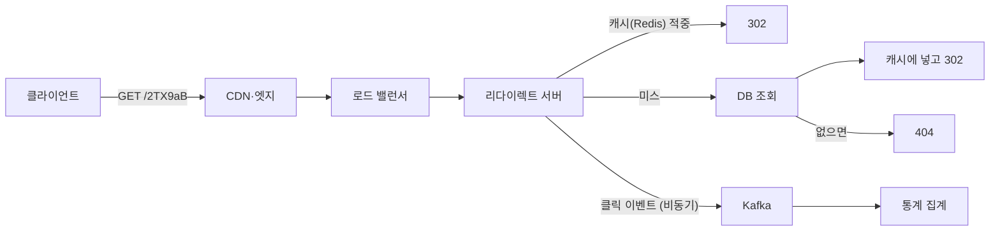

> 「fru1tworld/cs-basic 모의 면접 질문 목록」의 URL 단축기 설계 항목이 묻는 개념을 바탕으로, ByteByteGo 「[Design a URL Shortener](https://bytebytego.com/courses/system-design-interview/design-a-url-shortener)」의 구성을 참고해 재구성한 노트다.

## URL 단축기란

**URL 단축기(URL shortener)** 는 `https://example.com/products/2026/10/very/long/path?utm_source=…` 같은 긴 주소를 `https://sho.rt/2TX9aB`처럼 짧은 코드로 바꿔 주고, 짧은 주소로 들어오면 원래 주소로 리다이렉트하는 서비스다. 구조는 단순하지만 **읽기가 압도적으로 많은 키-값 조회 서비스**의 설계 요소(ID 생성, 인코딩, 캐시, 샤딩)가 모두 들어 있다.

| 요구 사항 | 내용 |
| --- | --- |
| 기능 | 단축 생성, 리다이렉트, 사용자 지정 별칭, 만료, 클릭 통계 |
| 지연 | 리다이렉트는 사용자가 기다리는 경로라 수 ms~수십 ms 안에 끝나야 한다 |
| 가용성 | 짧은 주소가 이미 인쇄물·메시지에 퍼져 있으므로 리다이렉트가 죽으면 링크가 모두 깨진다. 생성보다 리다이렉트의 가용성이 우선이다 |
| 수명 | 한 번 만든 코드는 오래 유지된다. 같은 코드가 다른 주소를 가리키면 안 된다 |

## 규모 추정

```text
쓰기: 하루 1억 건 → 약 1,160건/초
읽기: 쓰기의 10배 → 약 11,600건/초 (피크는 몇 배)
보관: 10년 → 1억 × 365 × 10 ≈ 3,650억 건
코드 길이: Base62(0-9, a-z, A-Z) 7자 → 62^7 ≈ 3.5조 가지 → 3,650억 건을 충분히 담는다
저장: 한 건 평균 100바이트라면 3,650억 × 100B ≈ 36.5TB
```

코드 길이는 「필요한 총 건수 < 62^n」을 만족하는 가장 작은 n으로 정한다. 6자는 약 568억 가지, 7자는 약 3.5조 가지다.

## API와 리다이렉트

```text
POST /api/v1/urls          { "longUrl": "https://…", "alias": "선택", "expiresAt": "선택" }
  → 201 { "shortUrl": "https://sho.rt/2TX9aB" }

GET /2TX9aB
  → 301 또는 302, Location: https://원래 주소
```

| 상태 코드 | 뜻 | 장점 | 단점 |
| --- | --- | --- | --- |
| **301 Moved Permanently** | 영구 이동. 브라우저가 결과를 캐시한다 | 두 번째 방문부터 서버를 거치지 않아 부하가 준다 | 클릭이 서버에 오지 않아 **통계를 잃는다.** 목적지를 바꾸거나 만료시켜도 캐시된 브라우저는 옛 주소로 간다 |
| **302 Found** (또는 307) | 임시 이동. 매번 서버에 묻는다 | 모든 클릭을 셀 수 있고, 목적지 변경·만료·차단이 즉시 반영된다 | 모든 클릭이 서버 부하가 된다 |

클릭 분석이 상품의 핵심이면 302, 부하 절감이 우선이면 301을 쓴다. 302를 쓰더라도 리다이렉트 응답 자체는 캐시·CDN 엣지에서 처리해 원본 서버까지 오는 요청을 줄인다.

## 코드 생성 방식

| 방식 | 동작 | 장점 | 단점 |
| --- | --- | --- | --- |
| 해시 후 자르기 | 긴 URL을 MD5·SHA-256 등으로 해시해 앞 7자(Base62)를 쓴다. 충돌하면 URL에 소금(salt)을 붙여 다시 해시한다 | 같은 URL은 같은 코드가 된다(중복 생성 방지). 조율이 필요 없다 | 자르면 충돌이 생기므로 쓸 때마다 존재 확인 조회가 필요하다 |
| **고유 ID + Base62 인코딩** | 분산 ID 생성기로 정수 ID를 받아 Base62로 바꾼다 | **충돌이 없다.** 존재 확인이 필요 없다 | ID가 순서대로면 코드가 예측 가능해 다른 링크를 훑어볼 수 있다. ID 생성기가 필요하다 |
| 무작위 코드 | 무작위 7자를 만들고 유니크 제약으로 충돌 시 다시 만든다. 또는 미리 만들어 둔 코드 풀에서 꺼내 쓴다(키 생성 서비스) | 예측할 수 없다 | 채워질수록 충돌 재시도가 는다. 코드 풀은 별도 서비스·동시성 관리가 필요하다 |

Base62 인코딩은 정수를 62진수로 바꾸는 것이다. `0-9`를 0~9, `a-z`를 10~35, `A-Z`를 36~61로 둘 때 11157은 다음과 같다.

```text
11157 = 2 × 62² + 55 × 62 + 59
       → [2, 55, 59] → "2" "T" "X" → 2TX
```

고유 ID는 Snowflake 같은 분산 ID 생성기, DB 시퀀스, 서버마다 번호 구간을 미리 나눠 주는 방식으로 얻는다([[distributed-unique-id|분산 환경의 고유 ID 생성]]). 순차 ID의 예측 가능성이 문제면 ID를 비트 섞기(가역 순열)로 뒤섞은 뒤 인코딩한다. 비공개 링크에는 예측 불가능한 무작위 코드를 쓴다.

## 데이터 모델과 저장소

```text
urls
  short_code  VARCHAR(10)  PRIMARY KEY     ← 리다이렉트 조회 키
  long_url    TEXT
  user_id     BIGINT
  created_at  TIMESTAMP
  expires_at  TIMESTAMP NULL
  (해시 방식이면 long_url 해시에 인덱스를 둬 같은 URL 재요청을 찾는다)
```

- 접근 패턴이 「코드로 한 건 읽기」뿐이므로 **키-값 저장소**(DynamoDB, Cassandra)와 잘 맞는다. 인덱스를 둔 RDB도 충분하다.
- 수십 TB가 되면 `short_code`의 해시로 샤딩한다. 코드로만 찾으므로 샤드를 넘는 조회가 없다([[database-sharding|데이터베이스 샤딩]]).

## 읽기 경로와 쓰기 경로

[리다이렉트]



[생성]


- 읽기가 쓰기의 수십 배이고 소수의 인기 링크에 몰리므로 **캐시가 핵심**이다. 코드 → 긴 URL은 거의 바뀌지 않아 캐시하기 좋다([[caching-strategies|캐시 전략]]).
- 없는 코드로 오는 요청(오타, 스캔)이 DB까지 가지 않게 블룸 필터나 「없음」 결과의 짧은 캐시를 둔다.
- 클릭 기록은 리다이렉트 응답을 막지 않게 비동기 이벤트로 보내 따로 집계한다([[message-queue-kafka|메시지 큐와 Kafka]]).
- 리다이렉트 서버는 상태가 없어 수평으로 늘린다.

## 추가로 정할 것

| 주제 | 고려할 것 |
| --- | --- |
| 사용자 지정 별칭 | 유니크 검사, 금지어·예약어(`api`, `admin`) 목록, 자동 생성 코드와 이름 공간이 겹치지 않게(길이나 문자 규칙으로 구분) |
| 만료 | `expires_at`이 지난 코드는 조회 때 404로 처리(지연 삭제)하고, 배치로 정리한다. 캐시 TTL을 만료 시각보다 길게 두지 않는다. 지운 코드를 바로 재사용하면 옛 링크가 엉뚱한 곳으로 가므로 재사용하지 않는다 |
| 같은 URL 재요청 | 매번 새 코드를 줄지, 사용자별로 같은 코드를 돌려줄지 정한다 |
| 악용 방지 | 피싱·악성 URL 검사, 생성 API 속도 제한([[resiliency-patterns\|장애 확산을 막는 복원력 패턴]]), 신고된 코드 차단(302여야 즉시 반영된다) |
| 통계 | 클릭 수, 시간대, 국가, 유입 경로를 스트림 처리로 집계한다 |

## 정리

- URL 단축기는 쓰기는 적고 읽기가 많은 키-값 조회 서비스다. 리다이렉트의 지연과 가용성이 생성보다 중요하다.
- 코드 길이는 총 건수로 정한다. Base62 7자면 약 3.5조 가지다.
- 통계와 즉시 변경이 필요하면 302, 부하 절감이 우선이면 301이다.
- 코드는 고유 ID + Base62가 충돌 없이 단순하고, 예측이 문제면 섞거나 무작위 코드를 쓴다.
- 캐시·CDN으로 읽기를 받고, 클릭 기록은 비동기로 빼고, 코드 해시로 샤딩한다.

관련 노트: [[distributed-unique-id|분산 환경의 고유 ID 생성]], [[caching-strategies|캐시 전략: 계층, 읽기·쓰기 패턴, 교체 정책, 장애 패턴]], [[database-sharding|데이터베이스 샤딩]], [[system-design-fundamentals|시스템 설계의 품질 속성과 트레이드오프]], [[web-crawler-at-scale|대규모 웹 크롤러 설계]]
