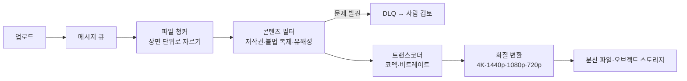

> karanpratapsingh의 「[System Design](https://github.com/karanpratapsingh/system-design)」 강의 저장소를 바탕으로 재구성한 노트다. Open Connect의 규모는 [Netflix Open Connect](https://openconnect.netflix.com/en/) 공식 페이지로 확인했다.

## 무엇을 설계하나

주문형 동영상(VOD) 서비스는 **한 번 올린 영상을 아주 많은 사람이 오래 반복해서 보는** 서비스다. 업로드는 드물고 무겁고, 시청은 잦고 대역폭을 많이 먹는다. 그래서 설계의 무게는 두 곳에 실린다. 올라온 원본을 기기·네트워크에 맞는 여러 벌로 바꾸는 **처리 파이프라인**, 그리고 그 결과를 시청자 가까이에서 내려 주는 **전송망**이다. 생방송은 [[live-streaming|라이브 스트리밍의 구조]]가 따로 다룬다.

| 구분 | 내용 |
| --- | --- |
| 기능 | 영상 재생과 공유, 콘텐츠 팀(YouTube라면 사용자)의 영상 업로드, 제목·태그 검색, 댓글 |
| 비기능 | 고가용성과 낮은 지연, **업로드는 하나도 잃지 않는다**(높은 신뢰성), 확장성 |
| 확장 | 지역 차단(geo-blocking), 보던 곳부터 이어 보기, 시청 지표·분석 |

## 규모 추정

```text
사용자 10억, DAU 2억 × 하루 5편 시청 = 하루 10억 회 시청 → 초당 약 1.2만 요청
읽기:쓰기 = 200:1 → 하루 500만 편 업로드
저장: 500만 × 평균 100MB = 하루 500TB → 10년이면 약 1,825PB
수신 대역폭: 하루 500TB / 86,400초 ≈ 초당 5.8GB
```

원본 크기는 이보다 훨씬 크다. 고급 카메라로 찍은 2시간짜리 8K 원본은 4TB에 이르기도 한다. 처리 단계에서 크기를 줄이지 않으면 저장과 전송 비용을 감당할 수 없다.

## 데이터 모델과 API

| 테이블 | 내용 |
| --- | --- |
| `users` | 이름, 이메일, 생년월일 등 |
| `videos` | 제목, 스트림 URL, 태그, 올린 사용자 |
| `tags` | 영상에 붙은 태그 |
| `views` | 시청 기록. 어디까지 봤는지(`offset`)도 둔다 |
| `comments` | 영상의 댓글 |

테이블마다 소유 서비스를 정해 나누고, 서비스별로 PostgreSQL이나 Cassandra를 고른다. 시청 기록처럼 쓰기가 많은 데이터는 분산 NoSQL이 맞는다.

```text
uploadVideo(title, description, data: Stream<byte>, tags?): boolean
streamVideo(videoID, codec, resolution, offset?): VideoStream   codec 예: h.264, h.265, VP9, AV1
searchVideo(query, nextPage?): Video[]                         nextPage는 페이지 토큰
comment(videoID, comment): boolean
```

`streamVideo`의 `offset`(초)이 있어 영상의 아무 지점부터 받을 수 있다. 서비스는 사용자, 스트림, 검색, 미디어(업로드·처리), 분석으로 나누고, 서비스 사이는 gRPC로, 찾기는 서비스 디스커버리·서비스 메시로 한다.

## 처리 파이프라인

업로드가 끝나면 처리 작업을 **메시지 큐**에 넣는다. 처리는 오래 걸리는 작업이고, 큐를 두면 업로드 기능과 처리 파이프라인이 떨어져 각자 늘리고 실패를 다시 시도할 수 있다(Amazon SQS, RabbitMQ).



| 단계 | 하는 일 |
| --- | --- |
| 파일 청커 | 파일을 작은 조각(청크)으로 나눈다. 반복되는 데이터의 중복 저장을 없애고, 바뀐 조각만 보내 전송량을 줄인다. 보통은 일정 시간 간격으로 자르지만 Netflix는 **장면 단위**로 자른다. 클라이언트가 조각을 요청할 때 장면 하나가 통째로 오므로 재생 중 끊길 가능성이 낮다 |
| 콘텐츠 필터 | 플랫폼 정책 위반을 검사한다. Netflix처럼 콘텐츠 등급에 따라 미리 승인할 수도, YouTube처럼 엄격하게 검사할 수도 있다. 머신러닝 모델이 저작권·불법 복제·선정성을 보고, 문제가 있으면 작업을 DLQ로 보내 운영 팀이 살펴본다 |
| 트랜스코더 | 원본을 압축하지 않은 중간 형식으로 풀었다가 목표 형식으로 다시 인코딩한다. 비트레이트를 맞추고 해상도를 낮추고 재압축해 기기에 맞는 작은 파일을 만든다(FFmpeg, AWS Elemental MediaConvert) |
| 화질 변환 | 트랜스코딩 결과를 4K, 1440p, 1080p, 720p 같은 여러 해상도로 만든다. 시청자가 원하는 화질을 고를 수 있다 |

결과는 HDFS·GlusterFS 같은 분산 파일 시스템이나 S3 같은 오브젝트 스토리지에 올린다([[block-file-object-storage|블록·파일·오브젝트 스토리지]]). 단계를 나누고 완료를 늦게 알리는 같은 원칙의 일반형은 [[media-processing-pipeline|이미지·동영상 처리 서버 설계]]에 있다.

## 재생과 전송

### CDN과 Open Connect

시청자의 연결 속도는 제각각이고, 같은 조각을 원본에서 다시 받게 하면 비용과 지연이 모두 커진다. 그래서 조각을 [[cdn|CDN]] 엣지에 캐시해 가까운 곳에서 내려 준다.

Netflix는 한 걸음 더 나간 **Open Connect**를 운영한다. 자사 영상만 내려 주는 전용 CDN으로, 천 곳이 넘는 ISP와 손잡고 **ISP 망 안에 Open Connect Appliance(OCA)라는 캐시 서버를 직접 들여놓는다.** 시청 트래픽 대부분이 ISP 안에서 끝나므로 인터넷 구간을 덜 지나고, ISP는 바깥으로 나가는 트래픽 비용을 아낀다. OCA에 문제가 생기면 다른 OCA나 Netflix 데이터센터로 넘긴다. 일반 CDN이 여러 고객의 콘텐츠를 사업자 거점(PoP)에 캐시한다면, Open Connect는 한 서비스의 콘텐츠를 시청자 바로 옆에 미리 깔아 두는 쪽이다.

### 적응형 비트레이트와 이어 보기

- **적응형 비트레이트(ABR)**: HLS·DASH 같은 프로토콜로 같은 구간을 화질별로 여러 벌 두고, 플레이어가 네트워크 상태에 따라 조각마다 화질을 바꿔 받는다. 끊김 없는 재생을 위해 화질을 잠깐 낮춘다([[live-streaming|라이브 스트리밍의 구조]]).
- **이어 보기**: `views` 테이블에 저장한 `offset`으로 그 시각의 장면 조각을 찾아 거기서부터 재생한다.

## 검색, 트렌드, 공유

- **검색**: 제목·태그 검색은 일반 DB로는 느리므로 Elasticsearch 같은 검색 엔진에 색인한다([[elasticsearch-search|Elasticsearch 검색]]).
- **트렌드**: 최근 N초 동안 많이 검색된 질의를 세어 M초마다 배치로 갱신하고 캐시한다([[trending-topics|실시간 트렌딩과 Top-K 집계]]).
- **공유**: 영상 링크는 URL 단축 서비스로 짧게 만들어 준다([[url-shortener-design|URL 단축기 설계]]).

## 지역 차단과 추천

- **지역 차단**: 배급 계약이 나라마다 달라, 계약하지 않은 지역에서는 특정 콘텐츠를 막아야 한다. 사용자 위치는 IP나 프로필의 지역 설정으로 정하고, CDN의 지역 제한 기능(Amazon CloudFront의 geographic restriction)이나 DNS의 지리 위치 라우팅([[dns|DNS 라우팅 정책]])으로 막는다.
- **추천**: 시청 기록으로 다음에 볼 것을 예측한다. 기본 알고리즘은 협업 필터링이고([[recsys-basics|추천 시스템 기초]]), 실제 서비스는 프로필(나이·지역), 탐색·스크롤 행동, 시청 시각, 기기, 검색어까지 신호로 쓰는 자체 모델을 쓴다.
- **지표·분석**: 서비스마다 나온 이벤트를 모아 Spark로 분석하고, 중요한 메타데이터는 따로 저장한다.

## 병목과 대응

| 질문 | 대응 |
| --- | --- |
| 서비스 하나가 죽으면 | 서비스마다 여러 인스턴스를 둔다 |
| 트래픽을 어떻게 나누나 | 클라이언트·서버·DB·캐시 사이에 로드 밸런서를 둔다 |
| DB 부하 | 읽기 복제본을 늘리고, 해시·리스트·범위·복합 분할로 샤딩하며 쏠림은 일관된 해싱으로 푼다([[database-sharding\|데이터베이스 샤딩]]) |
| 캐시 가용성 | 분산 캐시를 여러 인스턴스·복제본으로 둔다. 정적 미디어는 최대한 캐시하고 LRU로 내보낸다 |
| 저장 비용 | 효율이 좋은 코덱(AV1 등)으로 다시 인코딩하고, 거의 안 보는 화질 변형은 지우거나 싼 저장 계층으로 내린다 |

## 정리

- VOD는 쓰기 한 번에 읽기가 수백 번이다. 무거운 일은 업로드 뒤 비동기 파이프라인에서 하고, 읽기는 CDN이 받는다.
- 파이프라인은 청크 → 콘텐츠 검사 → 트랜스코딩 → 화질 변환이고, 문제 작업은 DLQ로 뺀다.
- 장면 단위 청크와 ABR은 끊김을, ISP 안의 캐시 서버(Open Connect)는 거리와 비용을 줄인다.
- 결론: 동영상 서비스는 「한 번 만들어 가까이 깔아 두는」 문제다.

관련 노트: [[media-processing-pipeline|이미지·동영상 처리 서버 설계]], [[live-streaming|라이브 스트리밍의 구조: 인코딩, 세그먼트, ABR, CDN]], [[cdn|CDN]], [[url-shortener-design|URL 단축기 설계]], [[photo-sharing-design|사진 공유 서비스 설계]], [[message-queue-kafka|메시지 큐와 Kafka]]
