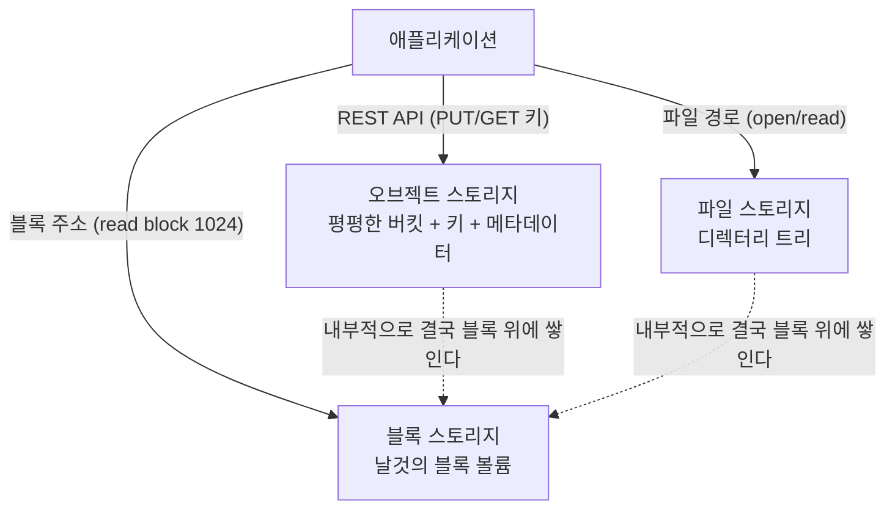
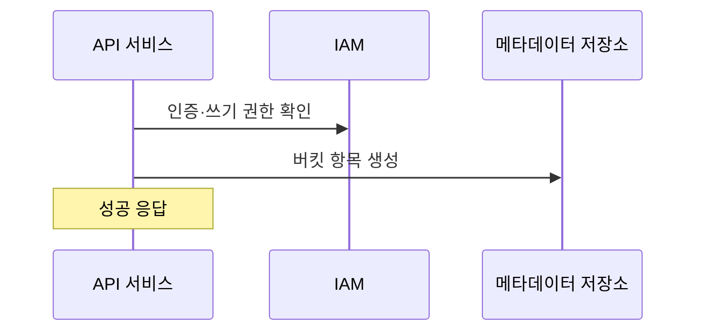
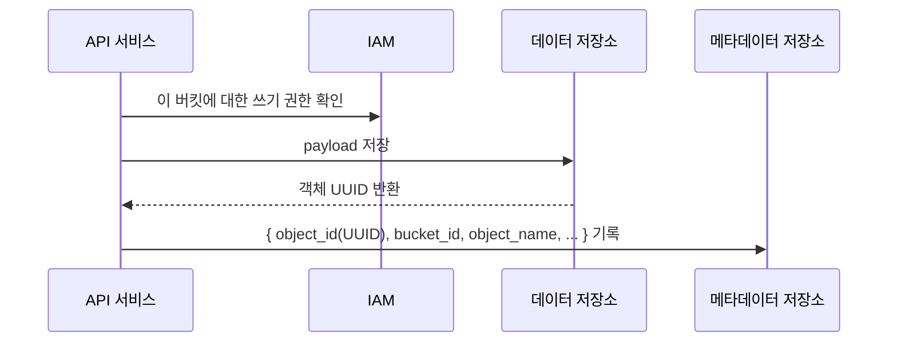
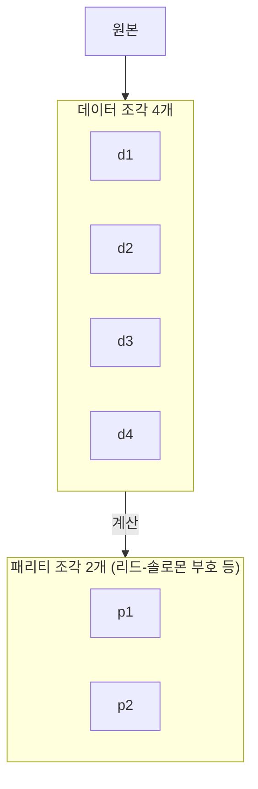
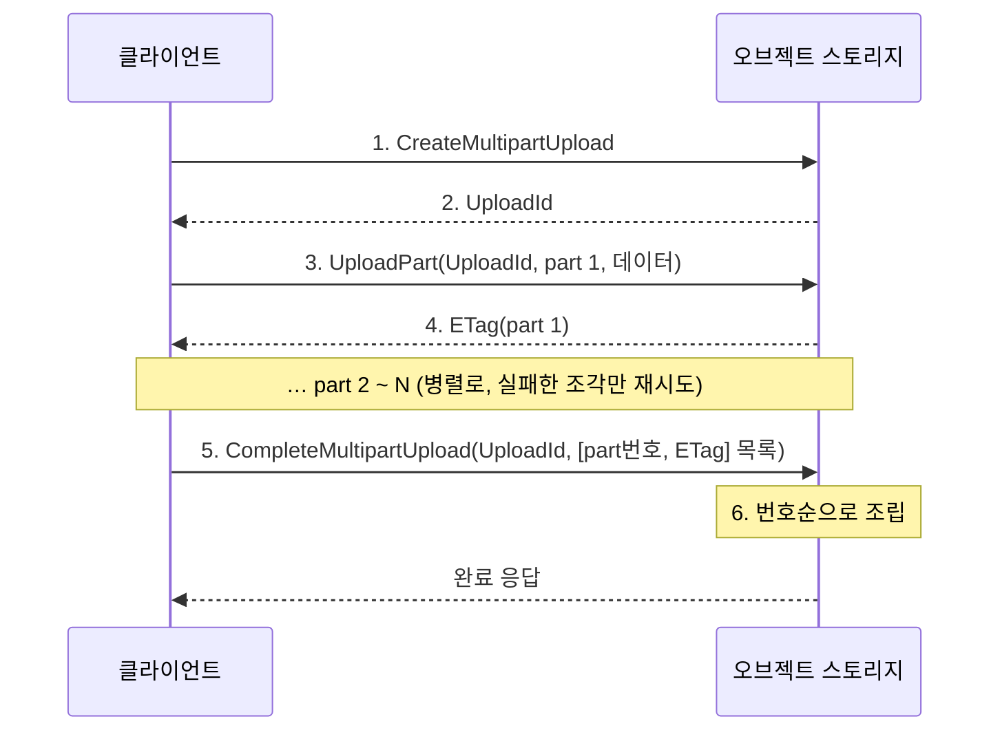

> ByteByteGo의 System Design 101 가이드 「[Storage Systems Overview](https://bytebytego.com/guides/storage-systems-overview)」, 「[Top 6 Use Cases of Object Stores](https://bytebytego.com/guides/explain-the-top-6-use-cases-of-object-stores)」, 「[Erasure Coding](https://bytebytego.com/guides/erasure-coding)」, 「[How to Upload a Large File to S3](https://bytebytego.com/guides/how-to-upload-a-large-file-to-s3)」를 바탕으로, 멀티파트 업로드는 Amazon S3 공식 문서로 확인해 재구성한 노트다.
> 버킷·객체 구조와 업로드 흐름은 같은 가이드의 「[What Happens When You Upload a File to Amazon S3?](https://bytebytego.com/guides/what-happens-when-you-upload-a-file-to-amazon-s3)」를 바탕으로 보탰다. 청크 기반 BLOB 저장소는 「[대규모 분산 스토리지(Kage)의 발전과정](https://tech.kakao.com/posts/336)」을 바탕으로 보탰다.

## 세 가지 스토리지

| 항목 | 블록 스토리지 | 파일 스토리지 | 오브젝트 스토리지 |
| --- | --- | --- | --- |
| 단위 | 고정 크기 블록 | 파일과 디렉터리 | 객체(데이터 + 메타데이터 + 고유 키) |
| 구조 | 서버에 날것의 볼륨으로 보인다. 서버가 파일 시스템을 올리거나 DB가 직접 관리한다 | 블록 위에 계층형 디렉터리를 얹은 추상화 | 디렉터리 없는 평평한 키 공간. `/`는 이름의 일부일 뿐이다 |
| 접근 | 직접 연결(SATA, NVMe) 또는 네트워크(iSCSI, Fibre Channel) | NFS, SMB/CIFS | HTTP REST API |
| 공유 | 보통 **서버 하나가 독점**한다 | 여러 서버가 동시에 공유한다 | 어디서든 API로 접근한다 |
| 수정 | 블록 단위로 제자리 수정 | 파일 일부 수정 | 대개 **객체 전체를 다시 쓴다** |
| 성능 | 가장 빠르다. 지연이 낮다 | 중간 | 지연이 크지만 처리량과 규모는 사실상 무제한 |
| 비용·규모 | 비싸고 볼륨 크기에 한계 | 중간 | 가장 싸고, 내구성이 높고, 규모가 크다 |
| 쓰임 | DB, 가상 머신 디스크 | 팀 공유 폴더, 여러 서버가 같은 파일을 보는 앱 | 미디어, 백업, 데이터 레이크, 정적 파일 |
| 클라우드 예 | EBS, Persistent Disk | EFS, Filestore | S3, Cloud Storage, Azure Blob Storage |

블록 스토리지가 가장 먼저 나왔고, 파일 스토리지는 그 위의 추상화이며, 오브젝트 스토리지는 **성능을 일부 내주고 내구성·규모·비용을 얻는** 선택이다. 파일 시스템이 블록을 관리하는 방식은 [[file-system|파일 시스템]]에 있다.

## 오브젝트 스토리지의 쓰임새

| 쓰임 | 이유 |
| --- | --- |
| 아카이브 | 감사·법적 보관용 오래된 데이터를 싼 저장 등급으로 내린다. 접근 빈도에 따라 등급을 자동으로 옮기는 수명 주기 규칙을 쓴다 |
| 비정형 데이터 | 이미지, 동영상, 음악, 문서를 DB에 BLOB으로 넣지 않고 오브젝트 스토리지에 두고, DB에는 키(URL)만 저장한다 |
| 클라우드 네이티브 앱 | API로 바로 붙고, 용량 계획 없이 늘어난다. 정적 웹사이트와 CDN 원본으로도 쓴다 |
| 데이터 레이크 | 여러 팀이 원본 데이터를 Parquet 같은 형식으로 쌓아 두고, 분석 엔진이 그 위에서 바로 쿼리한다. ETL·웨어하우스의 출발점이 된다 |
| IoT·로그 | 센서·로그처럼 계속 쌓이는 데이터를 받아 두고 나중에 분석·학습에 쓴다 |
| 백업·복구 | DB 스냅숏, 파일 시스템 백업을 보관했다가 복구에 쓴다. 다른 리전으로 복제해 재해에 대비한다 |

## 버킷과 객체: 업로드는 어떻게 저장되나

| 용어 | 뜻 |
| --- | --- |
| 버킷(bucket) | 객체를 담는 논리적 그릇. 이름이 전역에서 유일하다. 버킷 자체는 메타데이터만 있다 |
| 객체(object) | 저장 단위. **데이터(payload)** 와 **메타데이터**(이름-값 쌍)로 이뤄진다 |
| 객체 데이터 | 임의의 바이트열. **불변**이다. 고치려면 새 객체(또는 새 버전)를 쓴다 |
| 객체 메타데이터 | ID, 버킷, 객체 이름, 크기, 콘텐츠 타입 등. 바꿀 수 있다 |

S3 같은 객체 스토리지는 내부에서 **메타데이터 저장소와 데이터 저장소를 분리**한다. 메타데이터는 작고 자주 조회되며 검색·목록이 필요하고, 데이터는 크고 한 번 쓰면 바뀌지 않으므로 서로 다른 저장 방식이 맞기 때문이다.

[버킷 생성] PUT /bucket-to-share

[객체 업로드] PUT /bucket-to-share/script.txt

- 경로처럼 보이는 `/bucket-to-share/script.txt`는 실제 디렉터리가 아니라 **버킷 이름 + 객체 키**다. 폴더는 키의 접두사로 흉내 낸다.
- 데이터 저장소는 이름이 아니라 UUID로 객체를 찾는다. 이름 → UUID 매핑은 메타데이터 저장소가 맡는다. 그래서 같은 이름으로 다시 올리면 새 UUID의 데이터가 생기고 메타데이터만 그쪽을 가리키게 된다(버전 관리의 바탕).
- 모든 요청은 먼저 IAM으로 권한을 확인한다. 공개 버킷 실수가 대형 유출로 이어지므로 기본은 비공개다.

## 이레이저 코딩

데이터를 잃지 않게 하는 가장 단순한 방법은 **복제**다. 같은 데이터를 3벌 두면 2대가 죽어도 남는다. 대신 저장 공간이 3배다. **이레이저 코딩(erasure coding)** 은 데이터를 조각내고 수학적으로 계산한 **패리티(parity)** 조각을 더해, 일부 조각을 잃어도 나머지로 원본을 복원한다.

4 + 2 이레이저 코딩

6개 조각을 서로 다른 서버(가능하면 다른 랙·가용 영역)에 둔다.
d3, d4를 잃음 → d1, d2, p1, p2로 d3, d4를 다시 계산한다.

| 항목 | 3벌 복제 | 4+2 이레이저 코딩 |
| --- | --- | --- |
| 견디는 장애 | 2개 | 2개 |
| 추가 공간 | 200% (원본의 3배) | 50% (원본의 1.5배) |
| 읽기 | 아무 복제본에서 바로 읽는다 | 여러 조각을 모아야 한다. 장애 시 복원 계산이 필요하다 |
| 복구 비용 | 복사만 하면 된다 | 남은 조각을 여러 서버에서 읽어 다시 계산한다. 네트워크·CPU 비용이 크다 |
| 맞는 곳 | 지연이 중요한 뜨거운 데이터 | 크고 차가운 데이터, 오브젝트 스토리지 |

같은 장애 허용 수준에서 공간을 훨씬 적게 쓰고, 조각을 여러 장애 영역에 흩으면 내구성도 높아진다. 대형 오브젝트 스토리지가 「99.999999999%(11 nines)」 수준의 내구성을 설계 목표로 내세울 수 있는 기반이 이런 기법이다. RAID 5·6도 같은 원리(패리티)를 디스크 단위로 쓴 것이다. [[memory-hierarchy|메모리 계층 구조]]

## 멀티파트 업로드

몇 GB짜리 파일을 한 번에 올리면 오래 걸리고, 중간에 연결이 끊기면 처음부터 다시 올려야 한다. **멀티파트 업로드(multipart upload)** 는 파일을 조각내 따로 올리고, 저장소가 마지막에 조립한다.

| 이점 | 설명 |
| --- | --- |
| 병렬 전송 | 여러 조각을 동시에 올려 처리량을 높인다 |
| 부분 재시도 | 실패한 조각만 다시 올린다 |
| 일시 정지·재개 | 조각 단위로 이어서 올린다 |
| 크기를 몰라도 시작 | 스트리밍 중인 데이터도 받은 만큼 조각으로 올린다 |

- **ETag** 는 조각마다 돌려받는 식별자다. 완료 요청에 조각 번호와 함께 넣어 저장소가 조각을 검증·조립한다. 무결성을 더 확실히 하려면 조각마다 체크섬(CRC32, SHA-256 등)을 함께 보낸다.
- S3 기준으로 조각은 마지막 조각을 빼고 최소 5MiB이고, 최대 10,000개까지 나눈다. S3는 100MB가 넘는 객체에 멀티파트 업로드를 권장한다.
- **끝내지 않은 업로드의 조각도 저장 요금이 붙는다.** 미완료 멀티파트 업로드를 일정 기간 뒤 중단하는 수명 주기 규칙을 버킷에 걸어 둔다.
- 브라우저에서 바로 올릴 때는 서버가 조각마다 **사전 서명 URL(presigned URL)** 을 발급해, 파일이 애플리케이션 서버를 거치지 않게 한다. 서버를 거치는 업로드는 [[file-upload-multer|NestJS 파일 업로드(Multer)]]에 있다.

## 작은 파일이 많을 때: 청크 기반 BLOB 저장소

메신저 사진·동영상처럼 **작은 파일이 엄청나게 많이** 쌓이면 NAS·NFS 같은 파일 시스템이 먼저 한계에 닿는다. 파일 하나를 읽을 때도 이름 → inode 변환, inode 읽기, 데이터 읽기로 디스크 I/O가 여러 번 일어나고, 파일 수에 비례해 늘어나는 메타데이터가 병목이 된다. Facebook Haystack 같은 사내 BLOB 저장소는 이를 다음 구조로 푼다.

| 설계 | 내용 |
| --- | --- |
| 큰 청크 파일에 이어 쓰기 | 개별 파일을 만들지 않고, 정해진 크기의 큰 파일(청크)에 데이터를 순차로 덧붙인다 |
| 위치를 키로 돌려준다 | 쓰기 요청에는 내용만 주고, 저장소가 「청크 ID + 오프셋」을 담은 키를 돌려준다. 읽을 때는 키로 위치를 바로 계산해 디스크 I/O 한 번에 끝낸다. 키는 서비스가 보관해야 하고, 잃으면 데이터를 찾을 수 없다 |
| 메타데이터 노드와 데이터 노드 분리 | 네임 노드는 어느 청크 묶음에 쓸 수 있는지만 알려 주고, 실제 데이터는 데이터 노드가 주고받는다 |
| 3벌 복제 | 물리적으로 다른 서버 세 곳의 청크를 한 묶음(청크셋)으로 둔다. 마스터에 먼저 쓰고 나머지에 전달한다. 둘이 죽어도 읽을 수 있고 읽기 부하도 나뉜다 |
| 청크 단위 만료 | 일정 기간만 보관하는 데이터는 청크 전체를 통째로 지워 디스크를 재활용한다. 파일 단위 삭제보다 훨씬 싸다 |
| 청크 할당 스케줄링 | 청크 사용률, 남은 쓰기 가능 청크 수를 기준으로 새 청크를 미리 열어 특정 노드에 쓰기가 몰리지 않게 한다 |
| 데이터센터 이중화 | 복제본을 두 데이터센터에 나눠 두면 한쪽 장애에도 읽을 수 있다. 다만 모든 묶음이 두 곳에 걸쳐 있으면 데이터센터 간 단절 때 쓰기가 전부 실패하므로, 한 곳 안에서만 구성한 묶음도 함께 둔다 |

오늘날 대부분의 서비스는 이런 저장소를 직접 만들지 않고 S3 같은 관리형 오브젝트 스토리지를 쓴다. 하지만 오브젝트 스토리지 내부도 같은 아이디어(메타데이터와 데이터 분리, 큰 파일에 묶어 쓰기, 복제·이레이저 코딩)로 돌아간다.

## 정리

- 블록은 빠르고 한 서버가 독점하며, 파일은 여러 서버가 공유하는 계층 구조이고, 오브젝트는 느리지만 싸고 크고 튼튼하다.
- 미디어·백업·데이터 레이크처럼 크고 덜 자주 바뀌는 데이터는 오브젝트 스토리지에 두고 DB에는 키만 저장한다.
- 이레이저 코딩은 복제보다 훨씬 적은 공간으로 같은 장애를 견디는 대신, 읽기·복구에 계산 비용을 낸다.
- 큰 파일은 멀티파트 업로드로 조각내 병렬로 올리고, 미완료 업로드 정리 규칙을 함께 둔다.

관련 노트: [[media-processing-pipeline|이미지·동영상 처리 서버 설계]], [[file-system|파일 시스템]], [[memory-hierarchy|메모리 계층 구조]], [[aws-cloud-basics|AWS 클라우드 기초: 인프라, 컴퓨팅, 보안 그룹]], [[disaster-recovery|고가용성과 재해 복구 설계]], [[file-upload-multer|NestJS 파일 업로드(Multer)]], [[database-selection|용도별 데이터베이스와 고르는 법]]
