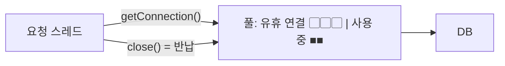
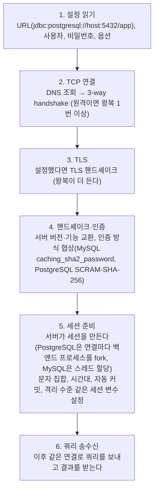
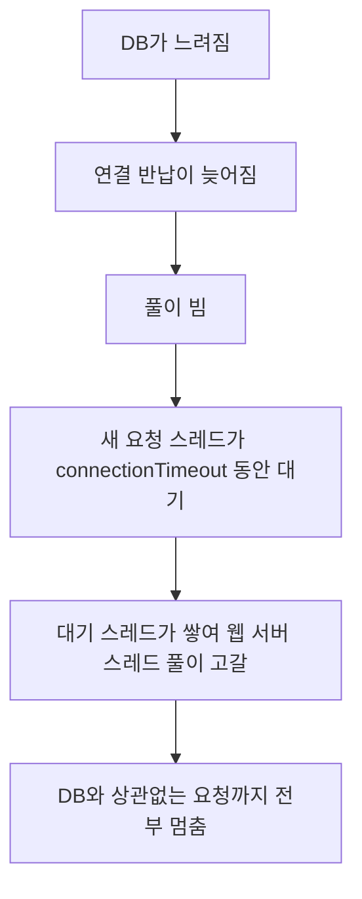

> 「[Commons DBCP 이해하기](https://d2.naver.com/helloworld/5102792)」, 「[JDBC로 실행되는 SQL에 자동으로 프로젝트 정보 주석 남기기](https://techblog.woowahan.com/2584/)」를 바탕으로, 설정 이름은 HikariCP 공식 문서로 확인해 재구성한 노트다. 연결이 만들어지는 과정은 「[fru1tworld/cs-basic 모의 면접 질문 목록](https://github.com/fru1tworld/cs-basic/blob/main/interview/cs/db.md)」의 질문을 실마리로 보강했다.

## 커넥션 풀이란

DB 연결을 맺는 데는 TCP 연결, 인증, 세션 초기화가 든다. 요청마다 연결을 새로 맺으면 그 비용을 매번 치르고, 동시 요청이 몰리면 DB가 감당할 수 없는 수의 연결이 생긴다. **커넥션 풀**은 연결을 미리 만들어 두고 빌려준 뒤 돌려받아 재사용한다.



### 연결 하나가 만들어지는 과정

애플리케이션은 DB 프로토콜을 직접 다루지 않고 **드라이버**(JDBC 드라이버, `psycopg`, `mysql2` 등)를 통해 연결한다.



Java에서는 `DriverManager.getConnection()`이 이 과정을 매번 처음부터 하고, 실무에서는 `DataSource` 인터페이스 뒤에 커넥션 풀 구현체를 둬서 이미 만들어진 연결을 꺼내 준다. 2~5단계가 요청마다 반복되는 비용이 풀을 쓰는 이유다.

애플리케이션 코드의 `close()`는 실제로 연결을 끊지 않고 풀에 돌려준다. 풀은 DB 앞의 **방파제** 역할도 한다. 풀 크기가 동시에 DB로 가는 쿼리 수의 상한이 되므로, 잘 잡으면 일부의 문제가 전체로 번지지 않고, 잘못 잡으면 풀 자체가 병목이 된다.

## 구현체

| 구현체 | 위치 |
| --- | --- |
| **HikariCP** | Spring Boot의 기본 풀. 가볍고 빠르다 |
| Tomcat JDBC Pool | Tomcat에 내장. JDBC 인터셉터로 SQL을 가로챌 수 있다 |
| Apache Commons DBCP 2 | 오래 쓰인 범용 풀 |
| PgBouncer, ProxySQL, RDS Proxy | 애플리케이션 밖에 두는 프록시형 풀. 서버리스·다수 인스턴스가 한 DB를 쓸 때 연결 수를 모은다 |

## 풀 크기

| 개념 | HikariCP | Commons DBCP |
| --- | --- | --- |
| 최대 연결 수 | `maximumPoolSize` (기본 10) | `maxTotal` (1.x는 `maxActive`) |
| 유지할 최소 유휴 연결 | `minimumIdle` (기본은 최대와 같음) | `minIdle`, `maxIdle` |
| 연결을 빌릴 때 기다리는 시간 | `connectionTimeout` (기본 30초) | `maxWaitMillis` (1.x는 `maxWait`, 기본 무한) |

- **최대 연결 수가 처리량의 상한이다.** 요청 하나가 연결을 0.5초 쥔다면, 연결 5개로는 초당 10건이 한계다. 나머지 요청은 연결이 돌아올 때까지 기다린다.
- 최소와 최대를 같게 두는 **고정 크기 풀**이 보통 낫다. 최대보다 최소 유휴(`maxIdle`)를 작게 잡으면 부하가 잠깐 오를 때마다 연결을 새로 맺고 반납 때 끊는 일이 반복된다.
- 무작정 키우지 않는다. DB가 받을 수 있는 연결 수 ÷ 애플리케이션 인스턴스 수가 상한이고, DB 쪽 CPU·디스크 수보다 훨씬 많은 동시 쿼리는 문맥 전환과 경합으로 오히려 느려진다. 실제 부하를 측정해 정한다.
- 연결을 오래 쥐는 코드(트랜잭션 안에서 외부 API 호출)가 있으면 풀이 빨리 마른다. 풀 크기보다 그 코드를 먼저 고친다.

## 대기 시간은 짧게

풀이 비었을 때 연결을 기다리는 주체는 **요청을 처리하는 스레드**다.



- 대기 시간이 길면 장애가 **전체 서비스 정지로 번진다.** 게다가 오래 기다려 응답해도 사용자는 이미 떠난 뒤다.
- 사용자가 참을 수 있는 시간보다 짧게 잡아, 과부하 때는 **일부 요청만 빨리 실패**하게 한다. 전체 장애를 간헐적 오류로 줄이는 선택이다([[resiliency-patterns|장애 확산을 막는 복원력 패턴]]).
- 너무 짧으면 평소에도 연결을 못 얻어 오류가 잦다. 응답 시간 목표, 웹 서버 스레드 수, 풀 크기를 함께 보고 정한다.
- DB 로그인 단계에서 무한 대기하는 연결도 사용 중으로 잡히므로 드라이버의 로그인·소켓 타임아웃도 설정한다.

## 연결 상태 관리

DB나 중간 방화벽은 오래 쉬는 연결을 몰래 끊는다. 끊긴 연결을 빌려주면 첫 쿼리가 실패한다.

| 장치 | 역할 |
| --- | --- |
| 유효성 검사 | 빌려줄 때나 쉬는 동안 연결이 살아 있는지 확인한다. JDBC 4의 `Connection.isValid()`를 쓰거나 `SELECT 1` 같은 가벼운 쿼리를 쓴다. 실제 테이블을 읽는 검사 쿼리는 금물이다 |
| 유휴 연결 정리 | 백그라운드 스레드가 오래 쉰 연결을 닫는다(HikariCP `idleTimeout`, DBCP의 Evictor 스레드) |
| 최대 수명 | 연결을 일정 시간 뒤 새로 바꾼다(HikariCP `maxLifetime`). DB의 연결 타임아웃(MySQL `wait_timeout`)이나 네트워크 장비의 유휴 차단 시간보다 **짧게** 잡는다 |
| 누수 감지 | 빌려 간 뒤 오래 반납되지 않은 연결을 로그로 알린다(HikariCP `leakDetectionThreshold`, DBCP `removeAbandoned`) |

DBCP처럼 빌릴 때마다 검사하는 방식은 매번 왕복이 생긴다. 쉬는 연결을 주기적으로 검사하고(`testWhileIdle`), 빌릴 때 검사는 끄는 조합이 흔했다.

## 연결에 묶인 상태 주의

세션 변수, 임시 테이블, MySQL의 `GET_LOCK` 같은 **세션 단위 상태는 연결에 붙는다.** 쿼리마다 풀에서 다른 연결을 받는 코드(Spring `JdbcTemplate`를 트랜잭션 없이 쓸 때)에서는 앞 쿼리에서 만든 상태가 다음 쿼리에 없다. 같은 연결을 써야 하는 작업은 트랜잭션으로 묶거나 연결을 직접 받아 끝까지 쓰고 반납한다. 다음 사용자가 그 연결을 받아 남은 상태를 보는 일도 막아야 한다. MySQL 잠금 함수를 분산 락으로 쓰는 예는 [[distributed-system-patterns|분산 시스템 패턴]]에 있다.

## SQL에 출처 주석 달기

여러 애플리케이션이 한 DB를 나눠 쓰면, 슬로 쿼리 로그나 `SHOW PROCESSLIST`에서 문제 쿼리가 **어느 서비스에서 왔는지** 찾기 어렵다. IP로 거꾸로 찾는 방법은 느리다. 모든 SQL 앞에 서비스·팀 이름을 주석으로 붙이면 바로 보인다.

```sql
/* service=order-api team=commerce */ SELECT ... FROM orders WHERE ...
```

JDBC는 `DataSource → Connection → Statement`가 모두 인터페이스라서 **프록시로 감쌀 수 있다.** SQL 문자열이 확정되는 `prepareStatement()`·`execute()` 호출 지점에서 주석을 붙이면 ORM(JPA, MyBatis, jOOQ)이나 드라이버와 상관없이 모든 쿼리에 적용된다.

| 방식 | 장점 | 단점 |
| --- | --- | --- |
| DataSource·Connection·Statement 프록시 직접 구현 | 특정 풀에 묶이지 않는다 | 작성할 코드가 많다 |
| 풀의 인터셉터(Tomcat JDBC `JdbcInterceptor`) | 설정만으로 끼운다 | 풀 구현에 묶이고 동작이 덜 드러난다 |
| ORM 전용 기능(Hibernate `StatementInspector` 등) | 간단하다 | 그 ORM을 거치는 쿼리에만 적용된다 |

- 주석 값은 허용한 문자(영문·숫자·밑줄)만 받는다. 설정값이 그대로 SQL에 들어가므로 `*/`가 섞이면 SQL 주입이 된다.
- 요청 ID나 트레이스 ID를 함께 붙이면 DB 로그와 애플리케이션 트레이스를 이을 수 있다. 같은 생각을 표준화한 것이 SQLCommenter 형식이다([[observability|관측 가능성: 로그, 트레이스, 메트릭]]).

## 정리

- 커넥션 풀 크기는 DB로 가는 동시 쿼리의 상한이자 처리량의 상한이다. 고정 크기로, 측정해서 정한다.
- 연결 대기 시간은 짧게 잡아 DB 장애가 웹 서버 스레드 고갈로 번지지 않게 한다.
- 끊긴 연결은 유효성 검사·유휴 정리·최대 수명으로 걸러 낸다. 최대 수명은 DB·네트워크의 타임아웃보다 짧게.
- 세션 상태는 연결에 붙는다. 같은 연결이 필요한 작업은 연결을 직접 쥐고 끝낸다.
- DataSource 프록시로 모든 SQL에 출처 주석을 달면 문제 쿼리의 주인을 바로 찾는다.

관련 노트: [[database-scaling|데이터베이스 확장과 성능 최적화]], [[resiliency-patterns|장애 확산을 막는 복원력 패턴]], [[spring-singleton-thread-safety|스프링의 싱글톤 빈과 요청 스레드]], [[transport-layer|전송 계층: 포트, TCP, UDP]], [[observability|관측 가능성: 로그, 트레이스, 메트릭]]
