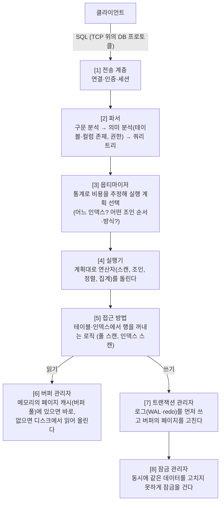
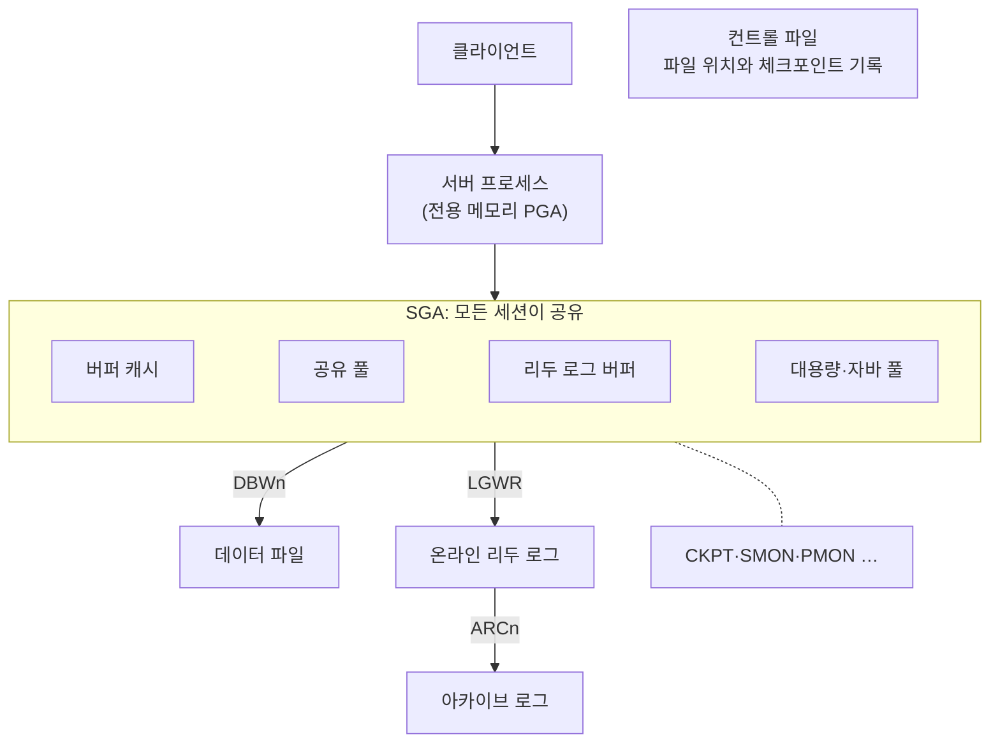
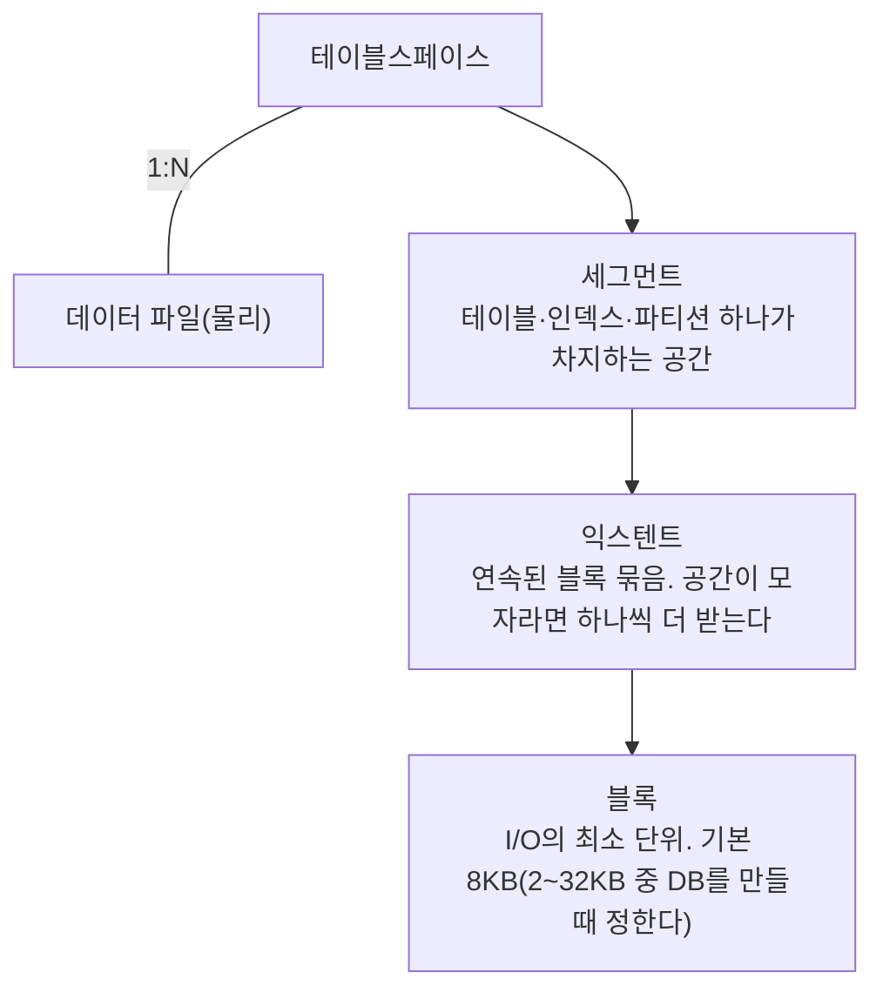
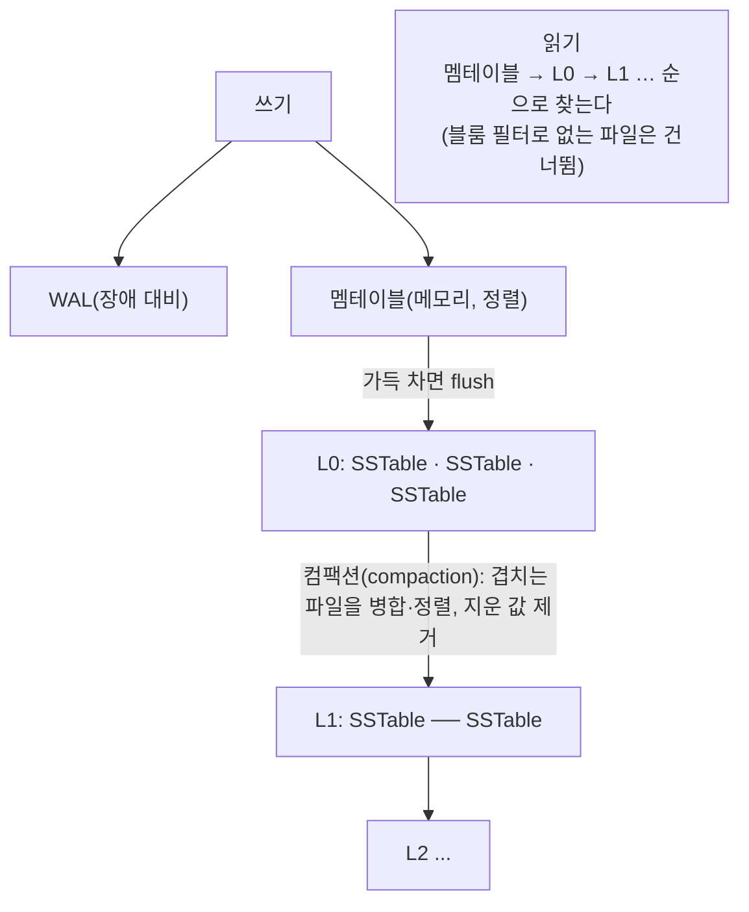

> ByteByteGo의 System Design 101 가이드 「[How is a SQL Statement Executed in the Database?](https://bytebytego.com/guides/how-is-a-sql-statement-executed-in-the-database)」, 「[8 Data Structures That Power Your Databases](https://bytebytego.com/guides/8-data-structures-that-power-your-databases)」, 「[B-Tree vs. LSM-Tree](https://bytebytego.com/guides/b-tree-vs)」, 「[B+ 트리는 어쩌다 인덱스로 간택되었을까?](https://hugehoo-blog.vercel.app/blog/Database/B%20tree%20as%20Index)」를 바탕으로 재구성한 노트다. 스토리지 엔진, 규칙·비용 기반 옵티마이저, B-트리와 B+트리 비교, 공간 인덱스, PostgreSQL 인덱스 종류는 「[fru1tworld/cs-basic 모의 면접 질문 목록](https://github.com/fru1tworld/cs-basic/blob/main/interview/cs/db.md)」의 질문을 실마리로 MySQL·PostgreSQL 공식 문서로 확인해 보강했다.
> Oracle 인스턴스의 메모리·프로세스·파일 구성과 논리 저장 구조는 고려사이버대학교 「데이터베이스 설계구축」(2023-2학기) 강의 내용으로 보강했다.

## SQL 문장이 실행되는 과정

DB마다 구조는 다르지만 큰 흐름은 비슷하다. 앞쪽은 **무엇을 할지 정하는 단계**, 뒤쪽은 **실제로 데이터를 만지는 단계**다. SQL이 관계대수로 바뀌는 논리적 단계와 절의 평가 순서는 [[sql-and-relational-algebra|관계대수와 DB 설계]]에 있고, 여기서는 엔진 내부의 구성 요소를 따라간다.



| 단계 | 알아 둘 점 |
| --- | --- |
| 파서 | 같은 SQL을 반복하면 파싱·계획 결과를 재사용할 수 있다. Prepared statement가 이 비용을 줄인다 |
| 옵티마이저 | 비용 기반 옵티마이저는 **통계**에 의존한다. 통계가 낡으면 엉뚱한 계획을 고른다. `EXPLAIN`으로 고른 계획을 확인한다 |
| 버퍼 관리자 | 대부분의 읽기는 디스크가 아니라 메모리 버퍼에서 끝난다. 버퍼 적중률이 성능을 좌우한다 |
| 트랜잭션 관리자 | **WAL(Write-Ahead Logging)**: 데이터 페이지보다 로그를 먼저 디스크에 남겨, 장애 뒤에도 커밋된 변경을 되살린다 |
| 잠금 관리자 | 격리 수준과 ACID의 격리성을 지킨다. 잠금 종류와 MVCC는 [[transaction\|트랜잭션과 회복]]에 있다 |

### 스토리지 엔진

[5]~[8]처럼 **데이터를 실제로 디스크에 어떻게 놓고, 읽고, 쓰고, 잠그고, 장애에서 되살릴지**를 맡는 층을 스토리지 엔진(storage engine)이라 한다. 그 위의 SQL 층(파서·옵티마이저·실행기)은 「무엇을 원하나」를 해석하고, 엔진은 「행 하나 주세요」, 「이 행을 바꿔 주세요」 같은 요청을 처리한다.

| 엔진이 정하는 것 | 예 |
| --- | --- |
| 저장 형식 | 행을 클러스터드 B+트리에 둘까(InnoDB), 힙 파일에 쌓을까(PostgreSQL), LSM 트리로 쓸까(RocksDB) |
| 인덱스 구조 | 어떤 인덱스를 지원하나 |
| 트랜잭션·잠금 | 트랜잭션 지원 여부, 잠금 단위(행·테이블), MVCC |
| 회복 | redo·undo 로그, 크래시 복구 |
| 캐시 | 버퍼 풀을 직접 관리하나, OS 페이지 캐시에 맡기나 |

MySQL은 이 층을 **플러그인처럼 갈아 끼우는** 구조라 테이블마다 엔진을 고른다(`CREATE TABLE ... ENGINE=InnoDB`). 기본값인 InnoDB는 트랜잭션·행 잠금·크래시 복구를 갖췄고, 옛 MyISAM은 트랜잭션이 없고 테이블 잠금만 한다. 그 밖에 MEMORY, 그리고 RocksDB를 쓰는 MyRocks가 있다. PostgreSQL은 엔진이 하나로 정해져 있다(12부터 테이블 접근 방식 API로 다른 저장 방식을 붙일 수는 있다). MongoDB의 WiredTiger처럼 NoSQL도 같은 개념의 층을 가진다.

### 옵티마이저: 규칙 기반과 비용 기반

| 구분 | 규칙 기반(RBO, Rule-Based Optimizer) | 비용 기반(CBO, Cost-Based Optimizer) |
| --- | --- | --- |
| 계획을 고르는 법 | 접근 경로마다 정해진 우선순위를 따른다. 「기본 키로 한 행 > 인덱스 범위 > 풀 스캔」처럼 | 후보 계획마다 I/O·CPU 비용을 추정해 가장 싼 것을 고른다 |
| 쓰는 정보 | 쿼리 모양과 인덱스 존재 여부 | **통계**: 행 수, 페이지 수, 컬럼의 고유값 수, 값 분포(히스토그램) |
| 장점 | 결과가 예측 가능하고 늘 같다 | 데이터에 맞는 계획을 고른다. 행이 많이 걸리면 인덱스 대신 풀 스캔을 고르는 판단이 가능하다 |
| 단점 | 데이터 분포를 몰라 인덱스가 오히려 느린 경우에도 인덱스를 쓴다 | 통계가 낡거나 추정이 틀리면 엉뚱한 계획을 고른다. 데이터가 바뀌면 계획도 바뀔 수 있다 |

지금 주요 DBMS(MySQL, PostgreSQL, Oracle, SQL Server)는 모두 비용 기반이다. Oracle의 RBO는 10g부터 지원이 끝났다. 그래서 통계를 최신으로 유지하는 것(`ANALYZE TABLE`, PostgreSQL의 autovacuum이 함께 돌리는 ANALYZE)이 성능 관리의 일부다. 실행 계획을 읽는 법과 풀 스캔을 고르는 이유는 [[index-design|인덱스 설계와 쿼리 튜닝]]에 있다.

## 엔진의 몸체: Oracle로 보는 메모리·프로세스·파일

위 흐름의 버퍼 관리자·트랜잭션 관리자가 실제로 어떤 부품인지는 엔진 하나를 뜯어 보면 잘 보인다. Oracle은 부품마다 이름이 붙어 있어 예로 쓰기 좋다. 부품이 노리는 목표는 셋이다. **디스크를 덜 읽고, 커밋을 빨리 끝내고, 죽어도 되살린다.** MySQL·PostgreSQL도 같은 목표를 비슷한 부품으로 푼다.

Oracle에서 **인스턴스**와 **데이터베이스**는 다른 말이다. 인스턴스는 메모리와 백그라운드 프로세스의 묶음이라 시작할 때 생기고 종료하면 사라진다. 데이터베이스는 디스크의 파일 묶음이라 인스턴스가 꺼져도 남는다. 인스턴스가 데이터베이스를 마운트해서 연다. 보통 1:1이고, RAC(Real Application Clusters)에서는 여러 서버의 인스턴스가 한 데이터베이스를 함께 연다.



### 메모리: SGA와 PGA

| 영역 | 담는 것 | MySQL·PostgreSQL의 대응 |
| --- | --- | --- |
| 버퍼 캐시(SGA) | 데이터 파일에서 올린 블록. LRU 계열로 자주 쓰는 블록을 남긴다 | InnoDB 버퍼 풀, `shared_buffers` |
| 공유 풀(SGA) | 파싱된 SQL·PL/SQL과 실행 계획(라이브러리 캐시), 테이블·권한 메타데이터(데이터 사전 캐시), 결과 캐시 | MySQL에는 실행 계획을 세션끼리 공유하는 캐시가 없다 |
| 리두 로그 버퍼(SGA) | 어느 블록이 어떻게 바뀌었나. 곧 리두 로그 파일로 내려간다 | InnoDB 로그 버퍼, WAL 버퍼 |
| 대용량·자바 풀(SGA) | 백업·병렬 처리용 큰 메모리, JVM 메모리 | - |
| PGA | 서버 프로세스마다 따로 갖는 정렬·해시 조인 작업 공간과 세션 정보. 모자라면 임시 테이블스페이스(디스크)로 넘친다 | `work_mem`, InnoDB의 정렬 버퍼 |

공유 풀은 문장 모양이 같은 SQL의 실행 계획을 재사용한다(소프트 파싱). 값을 문자열로 이어 붙이면 문장이 매번 달라 캐시를 못 쓰므로, Oracle에서는 바인드 변수가 인젝션 방어에 더해 성능에도 크게 듣는다([[sql-basics#파라미터 바인딩과 Prepared Statement|Prepared Statement]]).

### 백그라운드 프로세스

| 프로세스 | 하는 일 |
| --- | --- |
| 서버 프로세스 | 사용자 대신 SQL을 실행한다. 버퍼 캐시에 없는 블록은 직접 읽어 올린다. 연결당 하나가 기본(전용 서버)이다 |
| DBWn | 버퍼 캐시의 고친(dirty) 블록을 데이터 파일에 쓴다. 커밋과 무관하게 나중에 몰아서 쓴다 |
| LGWR | 리두 로그 버퍼를 리두 로그 파일에 쓴다. **커밋은 이 쓰기가 끝나야 완료다** |
| CKPT | 체크포인트(여기까지는 데이터 파일에 다 내려갔다는 표시)를 기록하고 DBWn을 깨운다 |
| SMON | 비정상 종료 뒤 재시작할 때 인스턴스 복구, 임시 세그먼트 정리 |
| PMON | 죽은 세션의 트랜잭션을 롤백하고 잠금·자원을 푼다 |
| ARCn | 다 쓴 리두 로그를 아카이브 로그로 복사한다(아카이브 모드) |
| RECO | 끊긴 분산 트랜잭션을 커밋이나 롤백으로 마무리한다 |
| MMON 등 | 성능 통계를 모아 AWR에 쌓는다 |

연결마다 프로세스를 두는 것은 PostgreSQL도 같고, MySQL은 연결마다 스레드를 둔다. 어느 쪽이든 연결이 비싸 앞단에 [[connection-pool|커넥션 풀]]을 둔다.

커밋은 리두 로그만 **순차로 덧붙이고** 끝낸다. 흩어진 데이터 블록을 제자리에 쓰는 무거운 일은 DBWn이 미룬다. 그 사이에 죽으면 재시작 때 리두로 커밋된 변경을 다시 적용하고(롤 포워드), 언두 세그먼트의 이전 값으로 커밋 안 된 변경을 되돌린다. 체크포인트가 잦으면 복구할 리두가 짧아지는 대신 쓰기가 는다. WAL과 재시작 복구의 일반 원리는 [[transaction|트랜잭션과 회복]]에 있다.

### 물리 파일

| 파일 | 역할 |
| --- | --- |
| 데이터 파일 | 테이블·인덱스의 실제 데이터 |
| 온라인 리두 로그 | 변경 기록. 여러 그룹을 돌려 쓰고, 차면 다음 그룹으로 넘어간다(로그 스위치) |
| 아카이브 리두 로그 | 덮어쓰기 전에 떠 둔 리두 사본. 시점 복구(PITR)에 쓴다 |
| 컨트롤 파일 | DB 이름, 데이터 파일·리두 로그 위치, 체크포인트 정보. 잃으면 DB를 못 열어 여러 벌 둔다 |
| 파라미터 파일(spfile) | 메모리 크기 같은 인스턴스 설정 |

### 논리 저장 구조

SQL이 보는 테이블과 디스크 파일 사이에는 네 겹의 논리 단위가 있다.



- **블록**이 크면 한 번에 많이 읽어 I/O 횟수가 줄지만, 몇 행만 필요할 때 낭비가 생기고 같은 블록을 두고 다투는 일이 는다. 분석용은 크게, OLTP는 기본값 근처를 쓴다. InnoDB의 페이지(기본 16KB)가 같은 개념이다.
- **익스텐트**는 블록을 연속으로 묶어 줘서 데이터가 흩어지지 않고 순차 읽기가 빨라진다.
- **세그먼트**는 한 테이블스페이스 안에 있지만 그 안의 여러 데이터 파일에 걸칠 수 있다.
- **테이블스페이스**는 관리 단위다. 테이블과 인덱스를 다른 디스크의 테이블스페이스에 두어 I/O를 나누거나, 오래된 데이터를 읽기 전용 테이블스페이스로 옮겨 백업 대상을 줄인다. 기본으로 SYSTEM·SYSAUX(데이터 사전), UNDO(롤백과 읽기 일관성용 이전 값), TEMP(메모리에 못 담은 정렬 중간 결과), USERS(사용자 객체 기본 위치)가 있다.

```sql
CREATE TABLESPACE ts_orders
  DATAFILE '/u01/oradata/orders01.dbf' SIZE 100M AUTOEXTEND ON NEXT 10M;

ALTER TABLESPACE ts_orders
  ADD DATAFILE '/u02/oradata/orders02.dbf' SIZE 100M;   -- 다른 디스크로 넓히기

-- 안의 객체, 걸린 참조 제약, 실제 파일까지 지운다. 되돌릴 수 없다
DROP TABLESPACE ts_orders INCLUDING CONTENTS AND DATAFILES CASCADE CONSTRAINTS;
```

Oracle의 **스키마는 사용자 계정과 1:1**이다. `HR` 사용자가 만든 객체는 `HR` 스키마에 속하고, 다른 사용자는 `HR.EMPLOYEES`처럼 접두어를 붙이거나 동의어를 만들어 쓴다([[sql-basics#동의어|동의어]]). 테이블 저장 방식은 순서 없이 쌓는 힙 테이블이 기본이고, 기본 키 순서의 B-트리에 행을 넣는 인덱스 구조 테이블(IOT)을 고를 수도 있다([[index-design#클러스터드 인덱스와 보조 인덱스|클러스터드 인덱스]]).

에디션은 무료이고 CPU·메모리·용량 상한이 있는 Express Edition(XE), 중소 규모용 Standard Edition 2, 모든 기능을 갖춘 Enterprise Edition으로 나뉜다. 파티셔닝은 Enterprise Edition의 별도 유료 옵션이다. 12c부터는 컨테이너 DB(CDB) 하나에 플러그형 DB(PDB) 여럿을 담는 멀티테넌트 구조를 쓴다.

## 인덱스 자료 구조

어떤 자료 구조가 맞는지는 **데이터가 메모리에 있나 디스크에 있나, 값의 형태(숫자·문자열·좌표·문서)가 무엇인가, 쓰기가 많나 읽기가 많나**에 달렸다.

| 자료 구조 | 위치 | 원리 | 강점 | 쓰는 곳 |
| --- | --- | --- | --- | --- |
| **B-트리 (B+트리)** | 디스크 | 정렬된 키를 고정 크기 페이지에 담은 균형 트리. 루트에서 키 범위를 따라 내려간다 | 읽기·쓰기 성능이 고르다. 범위 조회 | 거의 모든 관계형 DB의 기본 인덱스 |
| **해시 인덱스** | 메모리·디스크 | 키의 해시로 위치를 바로 찾는다 | 같음(`=`) 조회가 O(1) | 키-값 저장소, PostgreSQL `hash` 인덱스 |
| **스킵 리스트** | 메모리 | 여러 층의 연결 리스트로 일부 노드를 건너뛰며 찾는다. 정렬을 유지한다 | 구현이 단순하고 동시성 처리에 유리하다 | Redis 정렬 집합(sorted set), LSM 트리의 멤테이블 |
| **SSTable** | 디스크 | 키로 정렬된 **불변** 파일 | 순차 쓰기, 병합이 쉽다 | LSM 트리의 디스크 계층 |
| **LSM 트리** | 메모리 + 디스크 | 멤테이블(스킵 리스트 등)에 쓰고, 차면 SSTable로 내린 뒤 백그라운드에서 병합한다 | 쓰기 처리량이 높다 | Cassandra, RocksDB, LevelDB, ScyllaDB |
| **역색인(inverted index)** | 디스크 | 단어 → 그 단어가 든 문서 목록 | 전문 검색 | Lucene(Elasticsearch, OpenSearch), PostgreSQL `GIN` |
| **접미사 트리** | 메모리 | 문자열의 모든 접미사를 트리로 만든다 | 부분 문자열·패턴 검색 | 문자열 검색, 생물 정보학 |
| **R-트리** | 디스크 | 공간 객체를 감싸는 사각형(MBR)을 계층으로 묶는다 | 다차원 범위 조회, 가장 가까운 이웃 | 공간 DB(PostGIS의 GiST 인덱스) |

### 왜 B+트리인가

같은 균형 트리라도 레드-블랙 트리·AVL 트리는 노드 하나에 키 하나, 자식 둘이다. 디스크에서는 **노드 하나를 읽을 때마다 페이지 하나만큼 I/O**가 생기므로, 트리 높이가 곧 디스크 접근 횟수다.

| 항목 | 이진 균형 트리 | B+트리 |
| --- | --- | --- |
| 노드당 키 | 1개 | 페이지(InnoDB 기본 16KB)를 채울 만큼 수백 개 |
| 높이 | log₂N | log_M N (M은 차수, 수백) |
| 범위·순차 조회 | 중위 순회가 필요하다 | 정렬된 리프가 연결 리스트로 이어져 옆으로 훑으면 된다 |
| 데이터 위치 | 모든 노드 | 리프에만. 내부 노드는 길잡이 키만 담아 더 많은 키가 들어간다 |

M차 B+트리의 노드는 최소 ⌈M/2⌉개의 자식을 가지므로, 높이 h에서 담을 수 있는 키가 (M/2)^h 이상으로 늘어난다. 차수가 수백이면 수억 건도 높이 3~4 안에 들어가고, 루트와 상위 노드는 버퍼 풀에 상주하므로 실제 디스크 읽기는 한두 번이다. 모든 리프가 같은 깊이에 있어 어떤 키든 같은 비용으로 찾는다. 키가 길면 한 페이지에 들어가는 키 수가 줄어 트리가 높아지므로 **인덱스 키는 짧을수록 좋다.** 인덱스를 어떻게 설계할지는 [[index-design|인덱스 설계와 쿼리 튜닝]]에 있다.

**B-트리와 B+트리**는 같은 계열이지만 데이터를 두는 곳이 다르다.

| 항목 | B-트리 | B+트리 |
| --- | --- | --- |
| 값(또는 행 포인터) 위치 | 모든 노드 | 리프에만. 내부 노드는 길잡이 키만 둔다 |
| 키 중복 | 키가 트리에 한 번만 나온다 | 내부 노드의 키가 리프에 다시 나온다 |
| 점 조회 | 찾는 키가 위쪽 노드에 있으면 일찍 끝난다 | **늘 리프까지** 내려간다. 대신 비용이 일정하다 |
| 범위·순차 조회 | 트리를 위아래로 오가며 순회해야 한다 | 리프의 연결 리스트를 옆으로 훑는다 |
| 팬아웃 | 내부 노드에 값도 담아 작다 | 내부 노드에 키만 담아 크다. 트리가 더 낮다 |

**B+트리가 늘 낫지는 않다.** 무작위 점 조회만 있는 작업에서는 위쪽에서 끝날 수 있는 B-트리가 유리할 수 있고, 내부 노드에 키를 한 번 더 저장하는 공간이 든다. 같음 조회만 필요하면 해시 인덱스가 더 빠르다. 그래도 DB는 범위 조회·정렬·순차 스캔이 흔하고 높이가 낮을수록 디스크 I/O가 줄어서 B+트리를 기본으로 쓴다. 현업에서 「B-트리 인덱스」라고 부르는 것도 실제로는 대부분 B+트리다.

### 공간 인덱스: R-트리와 지오해시

B+트리는 값을 **한 줄로 정렬**해야 쓸 수 있다. 위도·경도는 두 값이 함께 가까워야 「가까운 곳」이므로, 한쪽으로 정렬하면 다른 쪽 조건은 거르지 못한다. 그래서 공간 데이터는 따로 처리한다.

| 방법 | 원리 | 쓰는 곳 |
| --- | --- | --- |
| **R-트리** | 가까운 객체들을 감싸는 최소 사각형(MBR)을 노드로 삼고, 그 사각형들을 다시 큰 사각형으로 묶는 균형 트리. 질의 영역과 겹치지 않는 사각형의 하위 트리는 통째로 건너뛴다 | MySQL InnoDB `SPATIAL INDEX`, PostGIS(GiST 위의 R-트리), 반경·영역 검색, 최근접 이웃 |
| **지오해시(Geohash)** | 위도·경도 범위를 번갈아 반으로 나눈 비트를 섞어(interleave) base32 문자열로 만든다. 접두사가 같으면 같은 칸 안이다 | 2차원을 1차원 문자열로 바꾸므로 **일반 B+트리·키-값 저장소로 공간 검색**을 할 수 있다. Redis GEO는 52비트 지오해시를 정렬 집합의 점수로 쓴다 |
| 쿼드트리, S2, H3 | 공간을 4분할하거나 구면 셀·육각형 격자로 나눈 셀 ID를 키로 쓴다 | 지도 서비스, 차량 배차 |

지오해시는 칸 경계 문제가 있다. 바로 옆이라도 경계 건너편이면 접두사가 전혀 다를 수 있어서, 반경 검색은 내 칸과 **주변 8칸**을 함께 조회한 뒤 실제 거리로 다시 거른다. 칸 길이(문자열 자릿수)는 검색 반경에 맞춰 고른다.

### PostgreSQL의 인덱스 종류

PostgreSQL은 접근 방식(access method)을 골라 인덱스를 만든다(`CREATE INDEX ... USING gin (...)`).

| 종류 | 구조 | 유리한 경우 |
| --- | --- | --- |
| B-tree (기본) | 균형 트리 | `=`, `<`, `>`, `BETWEEN`, `IN`, 정렬, 접두사 `LIKE 'abc%'`(C 콜레이션이나 `text_pattern_ops`) |
| Hash | 해시 버킷 | `=`만. 키가 길 때 B-tree보다 작을 수 있다. 10부터 WAL에 기록돼 복제·복구에 안전하다 |
| GiST | 범용 균형 트리 틀. R-트리 같은 구조를 그 위에 구현한다 | 기하·지리(PostGIS), 범위 타입의 겹침(`&&`), 최근접 이웃 정렬(`<->`), 배제 제약(예약 시간 겹침 금지) |
| SP-GiST | 균형이 아닌 공간 분할 트리(쿼드트리, k-d 트리, 기수 트리) | 고르게 퍼지지 않은 데이터, 점 데이터, IP 주소, 전화번호 같은 접두사 |
| GIN | 역색인. 값 하나가 여러 키(원소)를 가질 때 「키 → 행 목록」 | 배열 포함(`@>`), `jsonb` 검색, 전문 검색(`tsvector`), `pg_trgm`과 함께 쓰면 `LIKE '%abc%'`. 갱신이 느려 대기 목록(`fastupdate`)에 모았다가 반영한다 |
| BRIN | 블록 범위마다 최솟값·최댓값 같은 요약만 저장 | 아주 크고 **물리 순서와 값 순서가 맞는** 테이블(추가만 하는 로그의 시각 컬럼). 인덱스가 B-트리보다 훨씬 작지만 정확도는 블록 범위 단위다 |

확장으로 더 붙는다. pgvector는 벡터 유사도 검색용 HNSW·IVFFlat 인덱스를 더한다.

이 밖에 열 단위 저장에 쓰는 비트맵 인덱스, 「없음」을 빠르게 판정하는 블룸 필터, 벡터 유사도 검색용 HNSW 같은 그래프 인덱스도 있다.

## B-트리와 LSM 트리

디스크 기반 저장 엔진의 두 갈래다.

B-트리: 제자리 갱신


LSM 트리: 추가 후 병합



| 항목 | B-트리 | LSM 트리 |
| --- | --- | --- |
| 쓰기 | 페이지를 찾아 제자리에서 고친다. 임의 I/O | 메모리에 쓰고 디스크에는 순차로 쓴다. **쓰기가 빠르다** |
| 읽기 | 트리 높이만큼 페이지를 읽으면 끝. **읽기가 빠르고 예측 가능하다** | 여러 계층을 뒤질 수 있다. 블룸 필터와 캐시로 보완한다 |
| 공간 | 페이지 분할로 빈 공간이 생긴다 | 병합 전에는 같은 키의 옛 버전이 여러 파일에 남는다 |
| 숨은 비용 | 페이지 분할, 단편화 | 컴팩션이 CPU·디스크 대역폭을 쓰고, 그동안 지연이 튈 수 있다 |
| 맞는 곳 | 읽기 위주, 범위 조회, 트랜잭션 | 쓰기 위주(로그, 이벤트, 메시지, 시계열) |

세 가지 증폭으로 비교하면 정리가 쉽다. **읽기 증폭**(한 번 읽으려고 몇 번 디스크를 보나), **쓰기 증폭**(한 번 쓴 데이터가 디스크에 몇 번 다시 쓰이나), **공간 증폭**(실제 데이터 대비 디스크를 얼마나 쓰나). B-트리는 읽기 증폭이 작고, LSM 트리는 쓰기 처리량을 위해 읽기·공간 증폭을 받아들인다. 와이드 컬럼 DB에서 LSM 트리가 쓰이는 방식은 [[wide-column-database|와이드 컬럼 DB와 대규모 메시지 저장]]에 있다.

## 정리

- SQL은 파싱 → 최적화 → 실행 → 버퍼·트랜잭션·잠금 관리 순으로 처리된다. 느린 쿼리는 대개 옵티마이저가 고른 계획에서 원인이 보인다.
- 쓰기는 WAL로 먼저 기록하고, 읽기는 버퍼 풀에서 끝나는 것이 보통이다.
- Oracle로 보면 인스턴스(공유 메모리 SGA + 프로세스 전용 PGA + 백그라운드 프로세스)가 파일 묶음인 데이터베이스를 연다. 커밋은 LGWR의 리두 쓰기로 끝나고 데이터 블록은 DBWn이 나중에 내린다. 저장은 테이블스페이스 → 세그먼트 → 익스텐트 → 블록이다.
- 인덱스 자료 구조는 값의 형태와 읽기·쓰기 비율로 고른다. 범위 조회는 B-트리, 전문 검색은 역색인, 공간은 R-트리다.
- B-트리는 읽기에, LSM 트리는 쓰기에 강하다.

관련 노트: [[transaction|트랜잭션과 회복]], [[database-scaling|데이터베이스 확장과 성능 최적화]], [[wide-column-database|와이드 컬럼 DB와 대규모 메시지 저장: Cassandra·ScyllaDB]], [[search-engine-basics|검색엔진의 원리: 역인덱스와 랭킹]], [[tree|트리와 이진 탐색 트리]], [[connection-pool|DB 커넥션 풀]]
