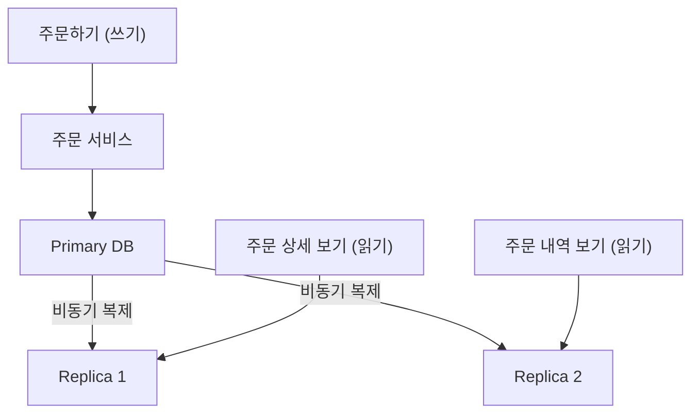

> ByteByteGo의 System Design 101 가이드 「[7 Must-Know Strategies to Scale Your Database](https://bytebytego.com/guides/7-must-know-strategies-to-scale-your-database)」, 「[A Cheatsheet on Database Performance](https://bytebytego.com/guides/a-cheatsheet-on-database-performance)」, 「[Read Replica Pattern](https://bytebytego.com/guides/read-replica-pattern)」, 「[How to Implement Read Replica Pattern](https://bytebytego.com/guides/how-to-implement-read-replica-pattern)」, 「[Database Middleware](https://bytebytego.com/guides/database-middleware)」을 바탕으로 재구성한 노트다. 복제 구조와 동기화 방식, 클러스터링 구조는 「[fru1tworld/cs-basic 모의 면접 질문 목록](https://github.com/fru1tworld/cs-basic/blob/main/interview/cs/db.md)」의 DB·[시스템 설계](https://github.com/fru1tworld/cs-basic/blob/main/interview/etc/system_design.md) 질문을 실마리로 보강했다.

## 순서가 중요하다

DB 성능 문제의 해법은 많지만 **비용과 복잡도가 크게 다르다.** 위에서부터 써 보고, 안 풀릴 때 아래로 내려간다.

| 단계 | 수단 | 효과 | 대가 |
| --- | --- | --- | --- |
| 0 | **모니터링** | 느린 쿼리, 응답 시간, CPU, 디스크 I/O, 커넥션 수를 본다. 무엇이 병목인지 모르고 고치지 않는다 | 거의 없다 |
| 1 | **인덱스** | 실제 쿼리 패턴(WHERE, JOIN, ORDER BY)에 맞는 인덱스로 읽기를 빠르게 한다 | 인덱스가 많으면 쓰기가 느려지고 공간을 먹는다. 안 쓰는 인덱스는 정기적으로 지운다 |
| 2 | **쿼리 튜닝** | `EXPLAIN`으로 실행 계획을 확인하고, `SELECT *`를 피하고, 인덱스를 탈 수 있는 WHERE 조건을 쓴다. N+1 쿼리를 없앤다 | 코드 수정 |
| 3 | **커넥션 풀** | 연결 수립 비용을 없애고, DB가 감당할 수 있는 동시 연결 수로 제한한다 | 풀 크기를 잘못 잡으면 대기나 DB 과부하 |
| 4 | **캐시** | 자주 읽는 결과를 Redis 같은 빠른 저장소에 둬 DB 부하를 줄인다 | 무효화와 정합성 관리. [[caching-strategies\|캐시 전략]] |
| 5 | **구체화된 뷰** | 무거운 집계·조인 결과를 미리 계산해 저장한다 | 갱신 주기만큼 데이터가 낡는다 |
| 6 | **반정규화** | 자주 함께 읽는 데이터를 한 테이블에 둬 조인을 줄인다 | 중복 데이터를 함께 갱신해야 한다. [[normalization\|정규화와 반정규화]] |
| 7 | **수직 확장** | CPU·RAM·빠른 SSD를 늘린다. 작업 데이터가 메모리에 다 들어가면 효과가 크다 | 비용이 가파르게 오르고 상한이 있다. 단일 장애점은 그대로다 |
| 8 | **읽기 복제본** | 쓰기는 원본, 읽기는 복제본으로 나눠 읽기를 늘린다. 장애 대비(고가용성)도 된다 | 복제 지연. 쓰기는 늘지 않는다 |
| 9 | **파티셔닝** | 한 서버 안에서 큰 테이블을 날짜·키 범위로 나눠, 쿼리가 필요한 조각만 보게 하고 오래된 조각은 통째로 지운다 | 파티션 키를 조건에 넣지 않는 쿼리는 이득이 없다 |
| 10 | **샤딩** | 여러 서버에 행을 나눠 **쓰기와 용량**까지 늘린다 | 샤드 간 조인·트랜잭션이 어렵고 운영이 복잡하다. [[database-sharding\|데이터베이스 샤딩]] |

복제와 샤딩을 고르는 기준은 간단하다. **읽기가 많으면 복제, 쓰기나 데이터 양이 한 서버를 넘으면 샤딩**이다.

### 구체화된 뷰

일반 뷰는 조회할 때마다 정의된 쿼리를 다시 실행한다. **구체화된 뷰(materialized view)** 는 결과를 실제로 디스크에 저장해 두고, 정해진 때에 다시 계산한다. 대시보드, 리포트처럼 무거운 집계를 자주 읽는 곳에 맞는다.

```sql
-- PostgreSQL
CREATE MATERIALIZED VIEW daily_sales AS
SELECT order_date, SUM(amount) AS total
FROM orders
GROUP BY order_date;

CREATE UNIQUE INDEX ON daily_sales (order_date);
REFRESH MATERIALIZED VIEW CONCURRENTLY daily_sales;  -- 읽기를 막지 않고 갱신 (유니크 인덱스 필요)
```

MySQL에는 구체화된 뷰가 없어 요약 테이블을 만들고 배치나 이벤트로 갱신한다. 과거 MySQL이 제공하던 DB 수준 쿼리 캐시는 쓰기가 많으면 오히려 경합을 일으켜 8.0에서 제거되었다. 그래서 캐시는 애플리케이션 계층(Redis 등)에 둔다.

## 복제와 클러스터링

**복제(replication)** 는 같은 데이터를 여러 서버에 복사해 두는 것이다. 목적은 둘이다. 하나는 **가용성**이다. 서버 하나가 죽어도 다른 복제본이 데이터를 갖고 있어 서비스를 이어 가고, 지역을 나눠 두면 재해에도 견딘다. 다른 하나는 **읽기 확장성**이다. 조회를 복제본으로 나눠 처리량을 늘리고, 사용자 가까운 곳의 복제본으로 지연을 줄인다. 쓰기 처리량과 저장 용량은 복제로 늘지 않는다. 그것은 [[database-sharding|샤딩]]의 몫이다.

여러 DB 서버를 묶는 방식은 **누가 쓰기를 받나**와 **저장소를 공유하나**로 나뉜다.

| 복제 구조 | 동작 | 예 | 대가 |
| --- | --- | --- | --- |
| **단일 리더**(primary-replica) | 쓰기는 리더 하나가 받고, 변경 로그를 복제본이 받아 다시 적용한다 | MySQL 바이너리 로그 복제, PostgreSQL 스트리밍 복제, MongoDB 레플리카 셋, Redis | 쓰기는 늘지 않는다. 리더 장애 때 승격(failover)이 필요하다 |
| **다중 리더**(multi-primary) | 여러 노드가 쓰기를 받아 서로에게 전달한다 | MySQL Group Replication의 다중 기본 모드, Galera Cluster, DynamoDB 글로벌 테이블처럼 리전마다 쓰기를 받는 구성 | 같은 행을 동시에 고치면 충돌이 난다. 인증·거절이나 마지막 쓰기 승리 같은 충돌 해결 규칙이 필요하다 |
| **리더 없음**(leaderless) | 클라이언트(또는 조정 노드)가 여러 복제본에 직접 쓰고 읽는다. 쓰기 W개, 읽기 R개 응답으로 성공을 판단하고 W + R > N이면 최신 값을 하나 이상 만난다 | Cassandra, ScyllaDB, Riak, Amazon의 Dynamo 논문 설계 | 최종 일관성. 어긋난 복제본은 읽기 복구·안티 엔트로피로 맞춘다 |

| 클러스터 구조 | 뜻 | 예 |
| --- | --- | --- |
| 비공유(shared-nothing) | 노드마다 자기 디스크와 데이터를 가진다. 복제·샤딩으로 데이터를 나눈다 | 대부분의 RDB 복제, MongoDB, Cassandra, 분산 SQL |
| 공유 디스크(shared-disk) | 여러 계산 노드가 같은 저장소를 본다. 노드를 늘려도 데이터를 옮기지 않는다 | Oracle RAC, Amazon Aurora(공유 분산 스토리지 위에 쓰기 노드 하나 + 읽기 노드 여러 개) |

### 단일 리더: 동기화 방식과 쓰기 병목

단일 리더 복제에서 리더가 복제본을 얼마나 기다리느냐가 지속성과 지연을 맞바꾼다.

| 방식 | 커밋 응답 시점 | 장점 | 장애 시 |
| --- | --- | --- | --- |
| 비동기 | 리더가 자기 로그에 쓰면 바로 | 쓰기가 가장 빠르고, 복제본이 느리거나 죽어도 리더는 멈추지 않는다 | 승격된 복제본에 최근 커밋이 없을 수 있다. 기본값 |
| 반동기(MySQL semi-sync) | 복제본 하나 이상이 변경을 **받아 기록했다**는 확인 뒤 | 복제본 전체가 아니라 하나만 기다려 지연이 작다 | 받은 복제본으로 승격하면 잃지 않는다. 시간 안에 확인이 없으면 비동기로 내려간다 |
| 동기(PostgreSQL `synchronous_standby_names`) | 지정한 복제본이 기록(또는 적용)했다는 확인 뒤 | 커밋된 데이터가 최소 두 곳에 있다 | 잃지 않는다. 복제본이 느리거나 죽으면 커밋이 멈춘다 |

반동기는 비동기의 「승격하면 커밋이 사라진다」와 동기의 「복제본 하나가 느리면 전체 쓰기가 멈춘다」 사이의 절충이다. 복제본 하나에라도 로그가 닿았음을 보장하고, 그 복제본이 응답하지 않으면 가용성을 위해 비동기로 물러난다.

MySQL 바이너리 로그는 SQL 문장(statement)이나 바뀐 행(row, 기본값)을 담는다. 문장 방식은 작지만 `NOW()`, `UUID()`처럼 실행할 때마다 결과가 다른 함수가 복제본에서 다르게 나올 수 있어 행 방식을 쓴다. PostgreSQL은 WAL을 그대로 보내는 물리 복제와 행 변경으로 풀어 보내는 논리 복제가 있다([[transaction|트랜잭션과 회복]]의 WAL). 자동 승격은 MongoDB 레플리카 셋처럼 내장된 선거로 하거나, MySQL InnoDB Cluster, PostgreSQL Patroni 같은 도구가 맡는다. 승격 과정의 스플릿 브레인과 데이터 유실은 [[high-availability-redundancy|고가용성 이중화 구조와 장애 감지]]에 있다.

| 단일 리더의 장점 | 단일 리더의 단점 |
| --- | --- |
| 모든 쓰기가 한 곳에서 순서가 정해져 **쓰기 충돌이 없다** | 쓰기 처리량이 리더 한 대에 묶인다 |
| 구조가 단순하고 거의 모든 RDB가 기본 지원한다 | 리더가 죽으면 승격까지 쓰기가 멈추고, 비동기면 최근 쓰기를 잃을 수 있다 |
| 읽기는 복제본을 늘려 쉽게 확장한다 | 복제본 읽기는 복제 지연만큼 낡을 수 있다 |
| 리더에서 읽으면 강한 일관성을 얻는다 | 리더가 먼 리전에 있으면 쓰기 지연이 크다 |

리더로 쓰기가 몰려 병목이 생기면 다음 순서로 푼다.

| 방법 | 효과 | 대가 |
| --- | --- | --- |
| 수직 확장, 쿼리·인덱스 정리 | 불필요한 인덱스와 긴 트랜잭션을 줄이면 쓰기 비용 자체가 준다 | 한계가 있다 |
| 쓰기 줄이기 | 여러 건을 모아 한 번에 쓰거나(배치), 큐에 넣어 비동기로 쓰거나, 카운터처럼 자주 바뀌는 값은 캐시에서 모아 주기적으로 반영한다 | 반영이 늦고 장애 때 큐·캐시의 내용을 잃지 않게 해야 한다 |
| 수직 분할 | 도메인별로 DB를 떼어 리더를 여러 개로 만든다 | 도메인 간 조인·트랜잭션이 끊긴다 |
| 샤딩 | 샤드마다 자기 리더를 둬 쓰기를 키 단위로 나눈다. 리더가 샤드 수만큼 생긴다 | [[database-sharding\|샤딩]]의 운영 복잡도 |
| 다중 리더·리더 없음 | 여러 노드가 같은 데이터의 쓰기를 받는다 | 쓰기 충돌을 해결해야 한다 |

### 다중 리더: 쓰임과 쓰기 충돌

다중 리더가 단일 리더보다 나은 경우는 **쓰기를 받는 곳이 서로 멀거나 자주 끊길 때**다.

| 쓰임 | 이유 |
| --- | --- |
| 여러 데이터센터·리전 | 각 리전이 가까운 리더에 써서 쓰기 지연이 짧다. 리전 하나가 끊겨도 다른 리전은 계속 쓴다 |
| 오프라인 작업 클라이언트 | 휴대폰 캘린더·메모 앱처럼 기기마다 로컬 DB가 리더 역할을 하고, 연결되면 서로 동기화한다 |
| 실시간 공동 편집 | 편집자마다 로컬 사본에 바로 쓰고 변경을 주고받는다([[collaborative-editing\|실시간 공동 편집: OT와 CRDT]]) |

대가는 **쓰기 충돌(write conflict)** 이다. 두 리더가 같은 행을 거의 동시에 고치면 각자는 성공을 응답하고, 복제가 서로에게 닿은 뒤에야 충돌이 드러난다. 단일 리더라면 두 번째 쓰기가 기다리거나 실패했을 상황을 비동기로는 막을 수 없다.

| 단계 | 방법 |
| --- | --- |
| 피하기 | 레코드마다 담당 리더(홈 리전)를 정해 그 레코드의 쓰기는 늘 한 리더로 보낸다. 가장 흔하고 효과적이다. 담당 리더가 바뀌는 순간에는 충돌이 다시 생길 수 있다 |
| 감지 | 각 쓰기에 버전을 붙이고, 복제를 받을 때 내 버전과 같은 출발점에서 나온 다른 버전인지 비교한다. 인과 관계는 **버전 벡터**(노드별 카운터 배열)로 판별한다. 한쪽이 다른 쪽을 포함하면 덮어쓰기이고, 어느 쪽도 포함하지 않으면 동시 쓰기, 즉 충돌이다 |
| 자동 해결 | 마지막 쓰기 승리(LWW), 노드 ID 같은 고정 우선순위, 값 병합(집합의 합집합, CRDT) |
| 앱이 해결 | 충돌한 값을 모두 보관(형제 값, siblings)했다가 읽을 때 앱이나 사용자가 고르게 하거나, 쓰기 시점에 충돌 처리 함수를 실행한다 |
| 동기 인증 | MySQL Group Replication·Galera처럼 커밋 전에 그룹이 트랜잭션 순서에 합의해 충돌한 쪽을 거절한다. 사실상 동기 조율이라 지연이 붙는다 |

**마지막 쓰기 승리(LWW, Last Write Wins)** 는 타임스탬프가 큰 값을 남기는 가장 단순한 자동 해결이고 문제가 많다.

- 동시에 일어난 쓰기 중 하나를 **조용히 버린다.** 두 쓰기 모두 성공을 응답받았는데 하나는 사라진다.
- 노드마다 시계가 어긋나 있으면 실제로 나중에 일어난 쓰기가 더 작은 타임스탬프를 받아 진다. NTP 보정과 시계 역행도 같은 일을 만든다.
- 「동시」와 「순서대로」를 구분하지 못한다. 앞선 쓰기를 보고 고친 값과 서로 모르고 고친 값을 똑같이 처리한다.
- 그래서 LWW는 키를 한 번만 쓰고 바꾸지 않거나(불변 키, UUID 키), 잃어도 되는 데이터(캐시, 최신 위치)에만 맞는다. 시계와 논리 시계의 원리는 [[distributed-time-and-failure|분산 시스템의 시간과 장애]]에 있다.

### 리더 없음: 쿼럼과 복구

리더 없는 복제는 **어느 복제본이든 쓰기를 받고, 쓰기 순서를 정하는 노드가 없다.** 다중 리더는 각 리더가 쓰기를 받은 뒤 나중에 비동기로 다른 리더에 퍼뜨리지만, 리더 없음은 클라이언트나 조정 노드가 쓰기를 처음부터 **N개 복제본에 동시에** 보내고 W개의 확인을 기다린다. 리더가 없으니 장애 때 승격이 없고, 복제본 일부가 죽어도 W·R개만 응답하면 계속 동작한다. 일관성 조절의 기준인 `W + R > N` 정족수는 [[high-availability-redundancy|고가용성 이중화 구조와 장애 감지]]에 있다.

쓰기를 놓친 복제본은 다음 방법으로 따라잡는다.

| 방법 | 동작 |
| --- | --- |
| 읽기 복구(read repair) | 읽기 때 여러 복제본의 응답을 비교해, 낡은 값을 돌려준 복제본에 최신 값을 다시 쓴다. 자주 읽히는 키만 고쳐진다 |
| 안티 엔트로피(anti-entropy) | 백그라운드에서 복제본끼리 데이터를 비교해 차이를 맞춘다. 머클 트리로 다른 구간만 찾아 옮긴다(Cassandra의 `nodetool repair`) |
| 힌트 전달(hinted handoff) | 대상 복제본이 죽어 있으면 다른 노드가 쓰기를 「힌트」로 대신 보관했다가, 대상이 돌아오면 넘겨준다. 쓰기 가용성을 높이지만 힌트만 있는 동안은 정족수 읽기가 최신 값을 못 볼 수 있다(sloppy quorum) |

동시에 같은 키를 쓴 충돌은 다중 리더와 같은 방식으로 다룬다. Cassandra는 셀(컬럼) 단위 타임스탬프로 LWW를 적용하고, Riak과 Dynamo 논문 설계는 버전 벡터로 동시 쓰기를 감지해 형제 값을 남긴 뒤 앱이 병합하게 한다.

## 읽기 복제본 패턴

**읽기 복제본(read replica)** 패턴은 삽입·수정·삭제를 원본(primary) DB로 보내고, 조회는 복제본으로 보낸다. 대부분의 서비스는 읽기가 쓰기보다 훨씬 많아 효과가 크다.



### 문제: 복제 지연

복제는 보통 비동기라서, 네트워크 지연이나 원본 과부하가 있으면 복제본이 몇 초에서 몇 분 늦을 수 있다. 주문 직후 상태를 조회했는데 복제본에 아직 없으면 **방금 한 주문이 안 보인다.** 내가 쓴 것은 바로 읽을 수 있어야 한다는 **쓴 뒤 읽기 일관성(read-after-write consistency)** 이 깨진 것이다.

| 대책 | 방법 |
| --- | --- |
| 지연에 민감한 읽기는 원본으로 | 결제 결과, 잔액처럼 최신 값이 꼭 필요한 조회 |
| 쓰기 직후의 읽기는 원본으로 | 사용자가 쓴 뒤 몇 초 동안은 그 사용자의 읽기를 원본으로 보낸다(세션·쿠키에 마지막 쓰기 시각 기록) |
| 복제본이 따라왔는지 확인 | 원본의 로그 위치(PostgreSQL LSN, MySQL GTID)를 기억해 두고, 복제본이 그 위치를 지났을 때만 읽는다. 아니면 원본에서 읽거나 실패시킨다 |
| 동기·반동기 복제 | 커밋 때 복제본 하나 이상의 확인을 기다린다. 지연은 줄지만 쓰기가 느려진다 |

### 누가 읽기·쓰기를 나누나

애플리케이션이 쓰기용·읽기용 연결을 따로 들고 쿼리마다 고르거나(ORM·프레임워크의 읽기/쓰기 분리 기능), DB 프로토콜을 그대로 말하는 미들웨어(ProxySQL, Pgpool-II, ShardingSphere-Proxy)에 맡긴다. 앞쪽은 한 홉이 적고 쿼리별로 세밀하게 고를 수 있고, 뒤쪽은 앱 코드가 DB 구성을 몰라도 되는 대신 미들웨어의 고가용성과 지연을 감당해야 한다. 클라우드 관리형 DB는 읽기 전용 엔드포인트를 따로 준다(Amazon Aurora의 reader endpoint 등).

| 비교 | 앱에서 라우팅 | DB 미들웨어 |
| --- | --- | --- |
| 앱 코드 | DB 구성(어디가 원본인지)을 알아야 한다 | DB 구성을 몰라도 된다. 연결 하나만 안다 |
| 라우팅 규칙 | 코드나 ORM 설정으로 구현 | 사용자·스키마·SQL 문장별 규칙을 설정으로 둔다 |
| 호환성 | 언어·프레임워크마다 따로 구현 | DB 표준 프로토콜을 쓰므로 호환 클라이언트면 무엇이든 붙고, DB 이전이 쉬워진다 |
| 비용 | 추가 홉이 없다 | 모든 쿼리가 지나는 계층이라 고가용성 구성과 높은 성능이 필요하고, 한 홉만큼 지연이 붙는다 |

어느 쪽이든 복제 지연은 같다. 쓰기 직후의 읽기는 원본으로 보낸다.

## 정리

- 모니터링으로 병목을 찾고, 인덱스·쿼리 튜닝·커넥션 풀처럼 싼 수단부터 쓴다.
- 캐시·구체화된 뷰·반정규화는 「미리 계산해 둔 결과」로 읽기를 줄이고, 대신 낡은 데이터를 관리해야 한다.
- 읽기가 많으면 복제본을, 쓰기와 데이터 양이 한 서버를 넘으면 샤딩을 쓴다.
- 복제는 가용성과 읽기 확장을 준다. 단일 리더는 충돌이 없는 대신 쓰기가 리더 한 대에 묶이고, 다중 리더·리더 없음은 쓰기를 나누는 대신 쓰기 충돌을 감지·해결해야 한다. LWW는 동시 쓰기를 조용히 버린다.
- 읽기 복제본은 복제 지연 때문에 쓴 뒤 읽기 일관성이 깨질 수 있다. 중요한 읽기와 쓰기 직후 읽기는 원본으로 보낸다.

관련 노트: [[index-design|인덱스 설계와 쿼리 튜닝]], [[connection-pool|DB 커넥션 풀]], [[database-sharding|데이터베이스 샤딩]], [[database-internals|DB 내부 구조: 쿼리 실행과 인덱스 자료 구조]], [[db-fetching-patterns|빠르고 유지보수하기 좋은 DB 조회 패턴]], [[web-scalability-components|웹 확장성의 구성 요소: 한 장으로 보는 웹 아키텍처]], [[normalization|정규화와 반정규화]], [[distributed-data-patterns|데이터 관리 패턴: CDC, 이벤트 소싱, CQRS, 최종 일관성]], [[distributed-time-and-failure|분산 시스템의 시간과 장애: 8가지 착각부터 논리 시계까지]], [[high-availability-redundancy|고가용성 이중화 구조와 장애 감지]]
