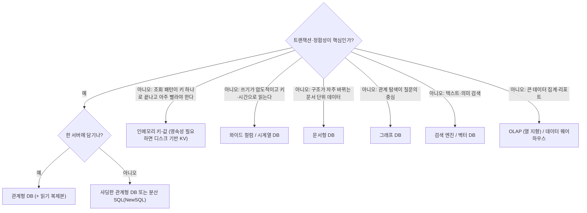
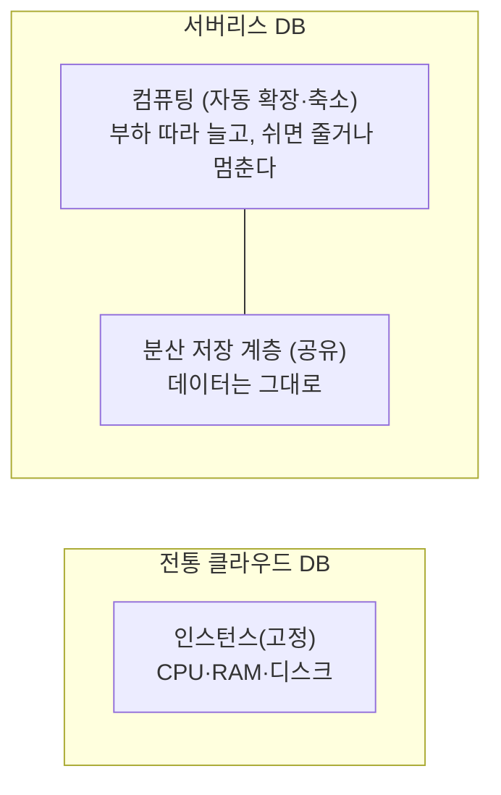

> ByteByteGo의 System Design 101 가이드 「[Types of Databases](https://bytebytego.com/guides/types-of-databases)」, 「[Understanding Database Types](https://bytebytego.com/guides/understanding-database-types)」, 「[How do you Decide Which Type of Database to Use?](https://bytebytego.com/guides/how-do-you-decide-which-type-of-database-to-use)」, 「[How to Choose the Right Database](https://bytebytego.com/guides/how-to-choose-the-right-database)」, 「[iQIYI Database Selection Trees](https://bytebytego.com/guides/iqiyi-database-selection-trees)」, 「[Top 10 Most Popular Open-Source Databases](https://bytebytego.com/guides/top-10-most-popular-open-source-databases)」, 「[Cloud Database Cheat Sheet](https://bytebytego.com/guides/cloud-database-cheat-sheet)」, 「[Time-Series DB in 20 Lines](https://bytebytego.com/guides/time-series-db-tsdb-in-20-lines)」, 「[Is PostgreSQL Eating the Database World?](https://bytebytego.com/guides/is-postgresql-eating-the-database-world)」, 「[PostgreSQL Use Cases](https://bytebytego.com/guides/why-is-postgresql-voted-as-the-most-loved-database-by-stackoverflow-2022-developer-survey)」, 「[What is Serverless DB?](https://bytebytego.com/guides/what-is-serverless-db)」를 바탕으로 재구성한 노트다.

## 질문으로 나누기

DB는 수백 종이 있지만, **어떤 질문에 빨리 답하도록 데이터를 배치했나**로 나누면 몇 갈래로 줄어든다. 관계형·NoSQL·NewSQL이라는 큰 분류와 NoSQL 네 유형의 정의는 [[database-models|데이터베이스 모델]]에 있다.

| 유형 | 잘 답하는 질문 | 저장 방식의 핵심 | 대표 |
| --- | --- | --- | --- |
| **관계형(OLTP)** | 「주문 7번을 결제 완료로 바꿔라」 짧은 읽기·쓰기를 정확하게 | 행 단위 저장, ACID 트랜잭션, 조인 | PostgreSQL, MySQL, MariaDB, SQLite, Oracle |
| **분석형(OLAP)** | 「지난 1년 지역별 매출 합계」 큰 데이터를 훑는 집계 | **열 단위 저장**과 압축. 필요한 컬럼만 읽는다 | ClickHouse, DuckDB, BigQuery, Redshift, Snowflake |
| 인메모리 키-값 | 「세션 ID abc의 값」 키 하나를 매우 빠르게 | 메모리에 해시·정렬 집합 | Redis, Valkey, Memcached |
| 문서형 | 「이 사용자 프로필 전체」 한 덩어리로 읽고 쓰는 데이터 | JSON류 문서, 문서마다 다른 구조 | MongoDB, Couchbase |
| 와이드 컬럼 | 「채널 X의 최근 메시지 50개」 거대한 쓰기 위주 데이터를 키로 | 파티션 키로 분산, LSM 트리 | Cassandra, ScyllaDB, HBase |
| 그래프 | 「친구의 친구 중 같은 회사」 여러 단계 관계 탐색 | 노드와 엣지를 직접 저장 | Neo4j |
| 전문 검색 | 「'무선 이어폰'과 비슷한 상품」 텍스트 관련도 | 역색인, 랭킹 | Elasticsearch, OpenSearch |
| **시계열** | 「서버 A의 지난 1시간 CPU 5분 평균」 시간 구간 집계 | 시간으로 정렬·분할, 압축, 보존 기간 | InfluxDB, TimescaleDB, Prometheus |
| 벡터 | 「이 문장과 의미가 가까운 문서」 임베딩 유사도 | 근사 최근접 이웃(ANN) 인덱스(HNSW 등) | pgvector, Milvus, Qdrant, Pinecone |
| 공간(geospatial) | 「내 위치 반경 1km 안의 가게」 | R-트리 계열 공간 인덱스, 지오해시 | PostGIS, MongoDB 지리 인덱스 |
| 오브젝트 스토리지 | 「이 동영상 파일」 큰 비정형 파일 | 평평한 키 공간, HTTP API | S3 호환 스토리지. [[block-file-object-storage\|블록·파일·오브젝트 스토리지]] |

널리 쓰이는 오픈 소스 DB(MySQL, PostgreSQL, MariaDB, SQLite, Redis, MongoDB, Cassandra, Neo4j, CockroachDB, Couchbase)도 이 표의 한 칸씩에 들어간다. 저장 엔진이 이런 차이를 어떻게 만드는지는 [[database-internals|DB 내부 구조]]에 있다.

## 고르는 순서

1. **기본값은 관계형 DB다.** 거의 모든 문제를 풀 수 있고, 팀이 익숙하고, 트랜잭션과 조인이 있다.
2. 관계형으로 **측정 가능한 한계**가 보일 때만 특수 DB를 더한다. 「언젠가 커질 것 같다」는 이유는 근거가 아니다.
3. 특수 DB는 원본을 대체하기보다 **원본 옆에 붙는 파생 저장소**로 쓰는 경우가 많다. 검색 인덱스, 분석 웨어하우스, 캐시는 CDC로 원본에서 채운다. [[distributed-data-patterns|데이터 관리 패턴]]
4. DB를 하나 늘릴 때마다 백업, 모니터링, 보안, 장애 대응도 하나씩 늘어난다는 운영 비용을 함께 센다.

CAP 정리 한 줄로 DB를 고르지 않는다. 채팅 메시지 저장에 Cassandra를 쓰는 이유는 「AP라서」가 아니라 쓰기 처리량, 파티션 키 단위 조회, 선형 확장 같은 특성 묶음 때문이다.

### 결정 트리

대규모 서비스들이 쓰는 선택 트리를 일반화하면 다음과 같다.

## 시계열 DB

**시계열 DB(TSDB)** 는 시각이 찍힌 측정값을 대량으로 받아 시간 구간으로 집계하는 데 최적화한 DB다. 사용자에게는 관계형 테이블처럼 보여도 내부 배치가 다르다.

| 요소 | 뜻 | 예: 날씨 |
| --- | --- | --- |
| 측정(measurement) | 테이블에 해당 | `weather` |
| 태그(tag) | 인덱스되는 분류 값. 집계·필터 기준 | `city=Seoul` |
| 필드(field) | 측정값. 인덱스하지 않는다 | `temperature=21.5` |
| 타임스탬프 | 시각 | `2026-10-21T09:00:00Z` |

InfluxDB는 `측정 + 태그 조합`을 하나의 시리즈로 보고, 시리즈별 값을 시간순으로 붙여 TSM(Time-Structured Merge Tree)이라는 LSM 계열 구조에 압축 저장한다. 그래서 「태그로 고르고 시간으로 자르는」 집계가 빠르다.

| 기법 | 이유 |
| --- | --- |
| 시간 기준 분할 | 최근 데이터만 자주 읽고, 오래된 조각은 통째로 지운다 |
| 열 단위 압축 | 인접한 시각·값이 비슷해 델타 인코딩으로 크게 줄어든다 |
| 다운샘플링 | 오래된 데이터는 1분 → 1시간 평균으로 줄여 보관한다 |
| 보존 정책 | 일정 기간이 지나면 자동 삭제한다 |

쓰임: 서버·애플리케이션 지표(APM), 시세·체결 데이터, IoT 센서, 네트워크 트래픽, 클릭 스트림, 이벤트 로그.

## PostgreSQL 하나로 넓히기

PostgreSQL은 **확장(extension)** 으로 기능을 붙일 수 있게 설계되어, 별도 DB를 늘리지 않고 여러 용도를 덮는 선택지가 된다. 「확신이 없으면 PostgreSQL」이라는 말이 나오는 이유다.

| 용도 | 확장·방법 |
| --- | --- |
| OLTP | 기본 기능. ACID, MVCC, 풍부한 인덱스(B-트리, GIN, GiST, BRIN) |
| 시계열 | TimescaleDB: 시간 기준 자동 분할(hypertable), 압축, 연속 집계 |
| 벡터 검색 | pgvector: 임베딩 컬럼과 HNSW·IVFFlat 인덱스 |
| 공간 | PostGIS: 지리 타입과 공간 함수·인덱스 |
| 전문 검색 | 내장 `tsvector`·GIN 인덱스, 다국어 검색은 PGroonga 같은 확장 |
| 분산·분석 | Citus: 테이블을 여러 노드에 나눠 분산 쿼리. 열 지향 저장 |
| 다른 DB 조회 | FDW(Foreign Data Wrapper): MySQL, MongoDB, 파일 등을 외부 테이블로 붙여 SQL로 조회 |
| 그래프 | Apache AGE: openCypher 그래프 쿼리 |
| 문서 | `jsonb` 타입과 GIN 인덱스 |

PostgreSQL 프로토콜·문법을 따르는 파생 DB(CockroachDB, YugabyteDB, AlloyDB, Neon 등)와 PostgreSQL 위에 서비스를 얹은 플랫폼(Supabase)도 많아, 배운 것이 여러 제품으로 이어진다. 다만 확장은 전용 DB만큼 극단적인 규모를 감당하지 못할 수 있다. **규모가 전용 엔진을 요구하기 전까지는 하나로 버티는 쪽이 운영이 싸다.**

## 서버리스 DB

**서버리스 DB** 는 인스턴스 크기를 미리 정하지 않고, 부하에 따라 용량이 자동으로 늘고 줄며 쓴 만큼 과금되는 DB다.

서버리스 DB는 **컴퓨팅과 저장을 분리**한다. 데이터는 분산 저장 계층에 두고, 쿼리를 처리하는 컴퓨팅만 부하에 맞춰 붙였다 뗀다. 그래서 과금을 더 잘게 나누고, 일부 제품은 쓰지 않을 때 0까지 줄인다(Amazon Aurora Serverless v2, Neon 등).

| 맞는 곳 | 맞지 않는 곳 |
| --- | --- |
| 트래픽이 들쭉날쭉하거나 예측하기 어렵다 (행사, 신규 서비스) | 부하가 늘 일정하게 높다. 고정 인스턴스가 더 싸다 |
| 개발·테스트 환경, 쓰지 않는 시간이 길다 | 0에서 깨어나는 콜드 스타트 지연을 견딜 수 없다 |
| 용량 계획에 손을 덜 쓰고 싶다 | 비용 상한을 엄격히 지켜야 한다. 상한 설정 없이 두면 폭주한다 |

## 클라우드 관리형 대응

직접 운영할지, 관리형을 쓸지는 운영 인력과 비용으로 정한다. 같은 역할의 서비스가 클라우드마다 있다. 세부 기능과 가격은 자주 바뀌므로 공식 문서를 확인한다. 데이터베이스 밖의 서비스까지 포함한 대응표는 [[cloud-services-map|클라우드 서비스 지도: AWS·Azure·GCP 대응표]]에 있다.

| 용도 | 오픈 소스(직접 운영) | AWS | Google Cloud |
| --- | --- | --- | --- |
| 관계형 | PostgreSQL, MySQL | RDS, Aurora | Cloud SQL, AlloyDB |
| 전역 분산 SQL | CockroachDB, YugabyteDB | Aurora DSQL | Spanner |
| 키-값·문서 | Redis·Valkey, MongoDB | ElastiCache, DynamoDB, DocumentDB | Memorystore, Firestore |
| 와이드 컬럼 | Cassandra, HBase | Keyspaces | Bigtable |
| 분석 | ClickHouse, Spark | Redshift | BigQuery |
| 검색 | OpenSearch, Elasticsearch | OpenSearch Service | (마켓플레이스·자체 운영) |
| 그래프 | Neo4j | Neptune | (마켓플레이스·자체 운영) |

## 정리

- DB는 「어떤 질문에 빨리 답하나」로 고른다. 트랜잭션은 관계형, 집계는 열 지향, 키 조회는 KV, 시간 구간은 시계열, 의미 검색은 벡터다.
- 기본값은 관계형 DB이고, 측정된 한계가 있을 때 특수 DB를 원본 옆의 파생 저장소로 더한다.
- PostgreSQL은 확장으로 시계열·벡터·공간·검색까지 덮어, DB 수를 늘리지 않는 선택지가 된다.
- 서버리스 DB는 컴퓨팅과 저장을 분리해 부하가 들쭉날쭉한 곳에서 비용을 줄인다.

관련 노트: [[database-models|데이터베이스 모델: RDB, NoSQL, NewSQL]], [[database-internals|DB 내부 구조: 쿼리 실행과 인덱스 자료 구조]], [[database-scaling|데이터베이스 확장과 성능 최적화]], [[wide-column-database|와이드 컬럼 DB와 대규모 메시지 저장: Cassandra·ScyllaDB]], [[search-engine-basics|검색엔진의 원리: 역인덱스와 랭킹]], [[aws-cloud-basics|AWS 클라우드 기초: 인프라, 컴퓨팅, 보안 그룹]]
