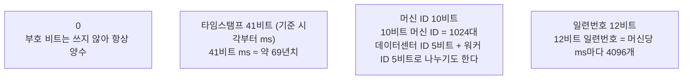

> ByteByteGo의 System Design 101 가이드 「[Explaining 5 Unique ID Generators](https://bytebytego.com/guides/explaining-5-unique-id-generators-in-distributed-systems)」, 「[Unique ID Generator](https://bytebytego.com/guides/unique-id-generator)」를 바탕으로, UUID 버전은 [RFC 9562](https://www.rfc-editor.org/rfc/rfc9562)로 확인해 재구성한 노트다. Snowflake의 설계 배경은 Twitter의 「[Announcing Snowflake](https://blog.twitter.com/2010/announcing-snowflake)」(2010)와 「[twitter/snowflake](https://github.com/twitter/snowflake/)」 저장소로 보강했다.

## 왜 어려운가

DB 한 대라면 자동 증가 컬럼이 ID를 알아서 만든다. 그런데 DB를 샤딩하거나 여러 서버가 동시에 레코드를 만들면 **각자 1부터 세서 ID가 겹친다.** 분산 ID 생성기는 중앙 조율을 최소로 하면서 겹치지 않는 ID를 만드는 방법이다.

## 흔한 요구 사항

| 요구 사항 | 이유 |
| --- | --- |
| 전역 고유 | 샤드·서버를 넘어 겹치면 안 된다 |
| 대략 시간순 정렬 | 최근 글 목록처럼 ID 순서가 곧 생성 순서면 정렬 컬럼이 따로 필요 없다 |
| 숫자, 64비트 | `bigint` 하나에 들어가 인덱스가 작고 비교가 빠르다 |
| 높은 확장성, 낮은 지연 | ID 생성이 쓰기 경로의 병목이 되면 안 된다 |

## 다섯 가지 방식

| 방식 | 만드는 법 | 장점 | 단점 |
| --- | --- | --- | --- |
| UUID | 128비트 값을 각 서버가 혼자 만든다 | 네트워크 호출 없이 어디서나 만든다 | 무작위 UUID(v4)는 순서가 없어 B-트리 인덱스에 흩어져 들어가고 페이지 분할이 잦다. 128비트라 크다 |
| Snowflake | 타임스탬프 + 머신 ID + 일련번호를 비트로 이어 붙인 64비트 | 호출 없이 빠르고, 시간순으로 정렬된다 | 머신 ID를 겹치지 않게 배정해야 한다. 서버 시계가 뒤로 가면 ID가 겹칠 수 있다 |
| DB 자동 증가 | DB의 identity·sequence 컬럼 | DB 트랜잭션이 동시성을 처리해 테이블 안에서 확실히 고유하다 | ID마다 DB를 거친다. DB가 단일 장애점이다. 연속 번호가 밖에 보이면 가입자 수 같은 사업 정보가 드러난다 |
| DB 세그먼트 | ID 서버가 DB에서 번호 구간(예: 1~1000)을 한 번에 받아 메모리에서 하나씩 나눠 준다 | DB 호출이 구간당 한 번으로 줄어든다 | 서버가 재시작하면 남은 구간이 버려져 번호에 구멍이 생긴다. 서버 간에는 엄격한 순서가 없다 |
| Redis | `INCR`로 원자적으로 증가시킨다 | 메모리에서 처리해 DB보다 빠르다 | Redis가 장애점이다. 영속성 설정에 따라 재시작 뒤 번호가 되돌아갈 수 있다 |

### Snowflake의 비트 배치

구현마다 비트 배분은 다르지만, 상위 비트에 시간을 둬서 정렬되게 하고 중간에 머신 ID를 둬서 서로 겹치지 않게 하는 점은 같다. 시계가 뒤로 가면(NTP 보정 등) 생성을 잠시 멈추거나 오류를 내도록 만든다.

Twitter가 Snowflake를 만든 요구 사항이 이 방식의 성격을 그대로 보여 준다. MySQL에서 Cassandra·샤딩 MySQL로 옮기면서 DB의 자동 증가 ID를 잃었고, **초당 수만 개를 고가용으로, 대략 시간순으로, 64비트 안에** 만들어야 했다. 트윗 ID를 한 번 넓혀 본 경험상, 코드베이스 수만 개가 쓰는 ID의 비트 수는 다시 바꾸기 어렵다.

| 검토한 대안 | 탈락 이유 |
| --- | --- |
| MySQL 티켓 서버(Flickr 방식) | 여러 대를 두면 순서 보장을 위해 재동기화 장치가 필요하다 |
| UUID | 128비트라 64비트에 들어가지 않는다 |
| ZooKeeper 순차 노드 | 필요한 처리량이 나오지 않는다 |

그래서 **조율 없이** 각 서버가 「타임스탬프 + 워커 번호 + 순번」을 조합한다. 워커 번호만 시작할 때 ZooKeeper로 받는다(설정 파일로도 줄 수 있다). 결과는 완전 정렬이 아니라 **k-정렬**이다. 1초 안에 만든 트윗끼리는 ID도 1초 범위 안에 있다는 정도의 보장이다. 2010년 공개판은 은퇴했고, Twitter 내부판은 자체 인프라에 묶인 재작성 버전이다.

## 시간순 UUID

UUID의 인덱스 문제는 **UUIDv7**로 대부분 풀린다. RFC 9562(2024)가 정의한 UUIDv7은 상위 48비트에 Unix 밀리초 타임스탬프를, 나머지에 무작위 값을 넣는다. 그래서 조율 없이 만들면서도 대략 시간순으로 정렬되어 인덱스 끝에 차곡차곡 쌓인다. 비슷한 목적의 ULID도 있다.

| 비교 | UUIDv4 | UUIDv7 | Snowflake |
| --- | --- | --- | --- |
| 크기 | 128비트 | 128비트 | 64비트 |
| 정렬 | 없음 | 시간순 | 시간순 |
| 조율 | 필요 없음 | 필요 없음 | 머신 ID 배정 필요 |
| 생성 시각 노출 | 없음 | 있음 | 있음 |

## 고르는 기준

- 저장 공간과 조인 성능이 중요하고 64비트 숫자가 필요하면 **Snowflake 계열**.
- 조율 없이 어디서나 만들어야 하고 128비트를 감당할 수 있으면 **UUIDv7**.
- 테이블 하나에 쓰기가 많지 않으면 **DB 자동 증가**로 충분하다. 외부에 노출할 ID는 따로 둔다.
- ID에서 생성 시각이 드러나면 안 되는 곳(추측 가능한 공개 URL 등)에는 무작위 ID를 쓴다.

## 정리

- 분산 환경에서 각자 1부터 세면 ID가 겹친다. 생성기는 조율을 줄이면서 고유성을 지킨다.
- Snowflake는 시간·머신·일련번호를 64비트에 담아 빠르고 정렬되지만 머신 ID와 시계를 관리해야 한다.
- 무작위 UUID는 인덱스에 불리하다. 시간순이 필요하면 UUIDv7을 쓴다.
- 연속 번호는 사업 정보를 드러낸다. 외부에 보이는 ID는 따로 설계한다.

관련 노트: [[database-sharding|데이터베이스 샤딩]], [[wide-column-database|와이드 컬럼 DB와 대규모 메시지 저장]], [[system-design-fundamentals|시스템 설계의 품질 속성과 트레이드오프]]
