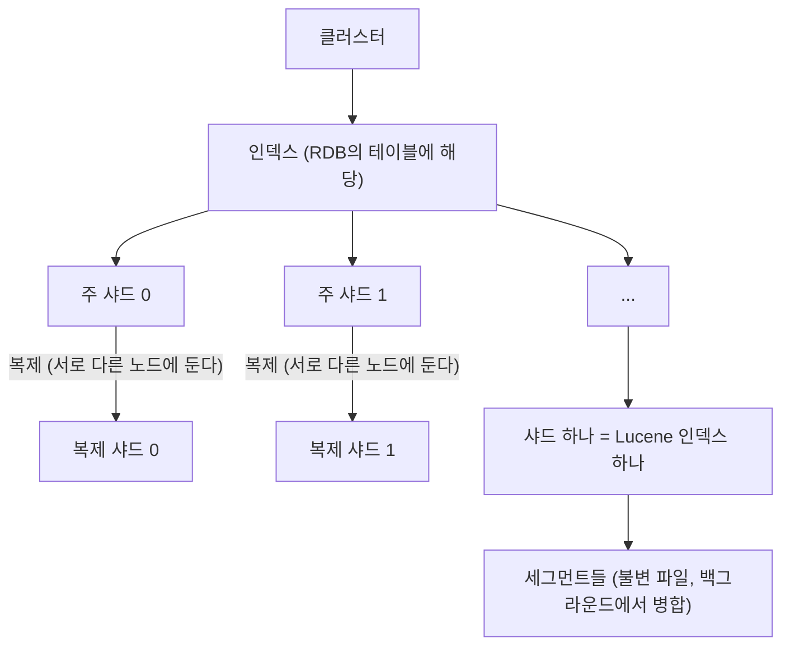
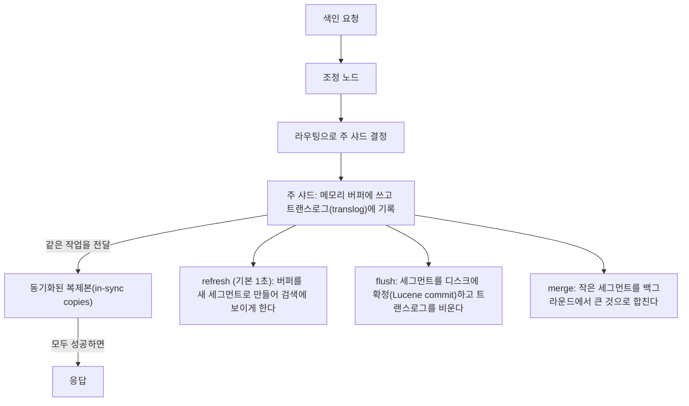

> ByteByteGo의 System Design 101 가이드 「[How to Learn Elasticsearch](https://bytebytego.com/guides/how-do-we-learn-elasticsearch)」, 「[Top 6 Elasticsearch Use Cases](https://bytebytego.com/guides/top-6-elasticsearch-use-cases)」, 「[What is ELK Stack and Why is it Popular?](https://bytebytego.com/guides/what-is-elk-stack-and-why-is-it-so-popular-for-log-management)」을 바탕으로 재구성한 노트다. 노드 역할, 쓰기 경로와 일관성, 인덱스 수명 주기, 백업, 운영 진단, 보안은 「[fru1tworld/cs-basic 모의 면접 질문 목록](https://github.com/fru1tworld/cs-basic/blob/main/interview/database/elasticsearch.md)」의 질문을 실마리로 Elastic 공식 문서로 확인해 보강했다.

## Elasticsearch란

Elasticsearch는 **Apache Lucene 검색 라이브러리를 여러 서버에 나눠 돌리는 분산 검색·분석 엔진**이다. 스키마를 미리 정하지 않아도 되는 JSON 문서를 HTTP API로 넣고 꺼낸다.

세 가지 성격을 함께 가진다.

| 성격 | 의미 |
| --- | --- |
| 전문 검색 엔진 | 문장을 단어로 쪼개 역인덱스로 찾고, 관련도 순으로 정렬한다 |
| 분석 엔진 | 집계(aggregation)로 그룹별 개수·평균·분포·시계열을 계산한다 |
| 분산 Lucene | 인덱스를 샤드로 나눠 여러 노드에 두고 복제본으로 가용성을 높인다 |

역인덱스·토큰화·BM25 같은 검색의 원리는 [[search-engine-basics|검색엔진의 원리: 역인덱스와 랭킹]]에, 매핑·분석기·Query DSL·집계 같은 검색 기능은 [[elasticsearch-search|Elasticsearch 검색: 매핑·분석기·Query DSL]]에 있다. 이 노트는 Elasticsearch가 데이터를 어떻게 나누고 복제하고 운영하는지와 어디에 쓰는지를 다룬다.

## 구조

### 구성 요소

| 구성 요소 | 뜻 | RDB에 빗대면 |
| --- | --- | --- |
| 클러스터(cluster) | 같은 `cluster.name`으로 묶인 노드 집합. 데이터와 요청을 함께 처리한다 | DB 서버 묶음 |
| 노드(node) | Elasticsearch 프로세스 하나. 맡은 역할(role)이 있다 | 서버 하나 |
| 인덱스(index) | 같은 구조의 문서 모음. 매핑(필드 정의)과 설정을 가진다 | 테이블 |
| 문서(document) | JSON 객체 하나. `_id`로 식별하고 원본은 `_source`에 저장된다 | 행 |
| 샤드(shard) | 인덱스를 나눈 조각. 하나가 독립된 Lucene 인덱스다 | 파티션 |
| 세그먼트(segment) | 샤드 안의 불변 파일 | - |

인덱스는 문서를 담는 논리적 이름이고, 실제 저장은 샤드 단위로 노드에 흩어진다. 문서가 어느 주 샤드로 갈지는 `hash(_routing) % 주 샤드 수`로 정한다. `_routing`의 기본값은 `_id`다. 이 식 때문에 **주 샤드 수는 인덱스를 만들 때 정하면 바꿀 수 없다**(바꾸려면 split·shrink API나 재색인).



### 주 샤드와 복제 샤드

| 구분 | 주 샤드(primary) | 복제 샤드(replica) |
| --- | --- | --- |
| 역할 | 문서 쓰기를 먼저 받아 처리하고 복제본에 전달한다 | 주 샤드의 사본. 주 샤드가 죽으면 승격된다 |
| 개수 | 인덱스 생성 때 고정(`number_of_shards`, 기본 1) | 언제든 바꾼다(`number_of_replicas`, 기본 1) |
| 읽기 | 처리한다 | 처리한다. 복제본을 늘리면 **검색 처리량**이 늘어난다 |
| 배치 | - | 같은 샤드의 주와 복제본은 같은 노드에 두지 않는다 |

주 샤드 수는 데이터를 나누는 단위(쓰기·용량 확장)이고, 복제 샤드 수는 가용성과 읽기 확장 수단이다.

### 노드 역할

노드는 `node.roles`로 역할을 정한다. 작은 클러스터는 한 노드가 여러 역할을 겸하고, 커지면 나눈다.

| 역할 | 하는 일 |
| --- | --- |
| `master` (마스터 후보) | 클러스터 상태(인덱스·매핑·샤드 배치) 관리. 후보 중 하나가 선출돼 마스터가 된다. 무거운 검색·색인을 맡기지 않는다 |
| `data` 계열 | 샤드를 저장하고 색인·검색·집계를 실제로 수행한다. 티어별로 `data_hot`, `data_warm`, `data_cold`, `data_frozen`, `data_content`로 나눌 수 있다 |
| `ingest` | 색인 전에 문서를 변환하는 수집 파이프라인을 실행한다 |
| 조정 전용 (`node.roles: []`) | 역할이 없는 노드. 요청을 받아 샤드에 흩뿌리고 결과를 모은다. 옛 이름은 클라이언트 노드 |
| 그 밖 | `ml`(머신 러닝), `transform`, `remote_cluster_client`, `voting_only` |

모든 노드는 기본적으로 **조정 노드**(coordinating node) 역할도 한다. 요청을 받은 노드가 관련 샤드에 일을 나눠 주고(scatter), 결과를 합쳐(gather) 응답한다. 마스터 후보는 **3개 이상(홀수)** 둔다. 7.0부터 마스터 선출은 과반 투표 구성으로 자동 관리되므로, 네트워크가 갈라져도 과반을 가진 쪽만 마스터를 뽑아 두 마스터가 생기는 분할 뇌(split brain)를 막는다.

### 쓰기 경로와 세그먼트



- 문서가 들어오면 메모리 버퍼에 모였다가 **refresh**(기본 1초)로 새 세그먼트가 되어 검색에 보인다. 그래서 「실시간」이 아니라 **거의 실시간**(near real-time)이다. `refresh_interval`을 따로 정하지 않은 인덱스는 30초 넘게 검색이 없으면 다음 검색 때까지 refresh를 미룬다.
- **트랜스로그**는 refresh·flush 전의 변경을 장애에서 되살리는 로그다. 기본값(`index.translog.durability: request`)은 요청마다 fsync한 뒤 응답한다. DB의 WAL과 같은 역할이다.
- **세그먼트는 한 번 쓰면 바꾸지 않는다.** 수정은 새 문서를 쓰고 옛 문서에 삭제 표시를 하는 방식이다. 쓰기를 순차 추가로 바꾸고 나중에 합치는 발상은 LSM 트리와 같다.
- 각 세그먼트의 **용어 사전**(term dictionary)은 정렬된 용어 목록이고, 그 앞에 접두사를 압축한 FST(유한 상태 변환기) 색인을 둬서 메모리에 올린 채 빠르게 찾는다.

### 복제와 일관성 모델

Elasticsearch는 **주-백업(primary-backup) 복제**다. 쓰기는 주 샤드가 먼저 처리하고, 마스터가 관리하는 「동기화된 사본 목록」의 모든 복제본에 보낸 뒤 응답한다. 응답하지 않는 복제본은 목록에서 빠지고 나중에 따라잡는다.

| 측면 | 동작 |
| --- | --- |
| 쓰기 지속성 | 응답을 받은 쓰기는 동기화된 모든 사본의 트랜스로그에 있다. `wait_for_active_shards`(기본 1, 주 샤드만)로 쓰기 전에 살아 있어야 할 사본 수를 정한다 |
| 검색 가시성 | refresh 전에는 보이지 않는다. 사본마다 refresh 시점이 달라 **같은 검색이 어느 사본에 가느냐에 따라 잠깐 다른 결과**를 낼 수 있다(최종 일관성). `preference`로 같은 사용자를 같은 사본에 보내면 결과가 흔들리지 않는다 |
| ID 조회 | `GET /index/_doc/id`는 실시간이다. refresh 전이라도 최신 값을 돌려준다 |
| 쓰기 직후 검색 | 꼭 보여야 하면 `?refresh=wait_for`로 다음 refresh까지 응답을 미룬다. 매번 강제 refresh는 작은 세그먼트를 양산해 성능을 해친다 |

**트랜잭션은 없다.** 문서 하나의 쓰기만 원자적이고, 여러 문서·인덱스에 걸친 원자적 갱신이나 롤백은 없다. 대신 문서 단위 **낙관적 동시성 제어**를 한다. 모든 문서는 `_seq_no`와 `_primary_term`을 가지며, `if_seq_no`·`if_primary_term`을 붙여 쓰면 그사이 누가 바꿨을 때 `409 Conflict`로 실패한다. 원본 DB의 버전 번호를 그대로 쓰려면 `version_type=external`을 쓴다. 여러 저장소에 걸친 정합성은 원본 DB를 기준으로 CDC나 재색인으로 맞춘다([[distributed-data-patterns|데이터 관리 패턴]]).

## 어디에 쓰나

| 쓰임 | 이유 |
| --- | --- |
| **전문 검색** | 상품 검색, 문서·위키·Q&A 사이트 검색. 오타 허용(fuzzy), 동의어, 형태소 분석, 관련도 정렬 |
| **자동 완성 · 맞춤법 제안** | 접두사 질의, n-gram, suggester |
| **실시간 분석 대시보드** | 사용자 활동, 거래, 센서 값 같은 시계열을 집계해 바로 그린다 |
| **로그·이벤트 분석** | 여러 서버의 로그를 한곳에 모아 검색하고 장애 원인을 찾는다. 아래 ELK 스택 |
| **보안 이벤트 분석 (SIEM)** | 보안 로그를 모아 실시간으로 위협 패턴을 찾는다 |
| **위치 기반 검색** | `geo_point` 필드로 반경·영역 안의 장소를 찾는다 |
| **이상 탐지 · 벡터 검색** | 머신 러닝 기능으로 시계열의 이상치를 찾고, 임베딩 벡터의 근접 이웃 검색(kNN)으로 의미 검색을 한다 |

**주 데이터베이스로 쓰지 않는다.** 트랜잭션이 없고, 색인이 거의 실시간이며, 매핑을 바꾸려면 재색인이 필요하다. 원본은 RDB 등에 두고 Elasticsearch에는 검색용 사본을 동기화하는 구성이 기본이다. 그래서 검색엔진의 색인은 캐시의 한 형태로 볼 수 있다([[caching-strategies|캐시 전략]]).

## 인덱스 관리

### 인덱스 설정과 템플릿

인덱스 하나는 **설정(settings)** 과 **매핑(mappings)** 을 가진다. 매핑은 필드 타입과 분석 방법이고([[elasticsearch-search|Elasticsearch 검색]]), 설정은 인덱스를 어떻게 저장·운영할지다.

| 설정 | 바꿀 수 있나 | 뜻 |
| --- | --- | --- |
| `number_of_shards` | 생성 때만(정적) | 주 샤드 수 |
| `number_of_replicas` | 언제든(동적) | 복제 샤드 수 |
| `refresh_interval` | 동적 | refresh 주기. `-1`이면 끈다 |
| `analysis` | 닫힌 인덱스에서만 | 사용자 정의 분석기·토크나이저·필터 |
| `index.lifecycle.name`, `index.routing.allocation.*` | 동적 | ILM 정책, 샤드를 둘 노드 조건 |

로그처럼 인덱스가 계속 새로 생기면 매번 설정·매핑을 줄 수 없다. **인덱스 템플릿**은 이름 패턴에 맞는 새 인덱스에 설정·매핑·별칭을 자동으로 입힌다.

```json
PUT _component_template/logs-mappings
{ "template": { "mappings": { "properties": { "@timestamp": { "type": "date" }, "message": { "type": "text" } } } } }

PUT _index_template/logs
{
  "index_patterns": ["logs-app-*"],
  "data_stream": {},
  "composed_of": ["logs-mappings"],
  "priority": 200,
  "template": { "settings": { "number_of_shards": 1, "index.lifecycle.name": "logs-policy" } }
}
```

재사용 조각인 **컴포넌트 템플릿**을 조합해 **조합형 인덱스 템플릿**(`_index_template`)을 만든다. 여러 템플릿이 겹치면 `priority`가 높은 하나만 적용된다. 옛 `_template` API는 지원이 끝나 가는 방식이다. 템플릿은 인덱스가 **만들어질 때만** 적용되므로, 바꾼 템플릿은 다음 인덱스부터 반영된다.

### 시간 기반 인덱스와 롤오버

로그·지표·이벤트처럼 시간순으로 쌓이고 오래될수록 덜 읽는 데이터는 **시간 단위로 인덱스를 나눈다**(`logs-2026.10.30`).

- 오래된 데이터는 인덱스를 **통째로 지운다.** 문서를 하나씩 지우는 것보다 훨씬 싸다(아래 「데이터 삭제」).
- 최근 인덱스에만 쓰기가 몰리므로 그 인덱스만 좋은 하드웨어에 두고, 지난 인덱스는 읽기 전용으로 병합·압축한다.
- 검색은 와일드카드(`logs-*`)나 별칭으로 여러 인덱스를 함께 묻는다.

날짜로만 자르면 하루 양이 들쭉날쭉할 때 샤드 크기가 고르지 않다. **롤오버(rollover)** 는 조건을 만족하면 쓰기 대상을 새 인덱스로 넘긴다.

| 조건 | 예 |
| --- | --- |
| `max_primary_shard_size` | 주 샤드 하나가 50GB에 닿으면 |
| `max_age` | 만든 지 30일이 지나면 |
| `max_docs`, `max_primary_shard_docs` | 문서 수 기준 |

요즘은 **데이터 스트림(data stream)** 이 이 구조를 감싼다. 이름 하나(`logs-app-default`)로 쓰고 읽으면, 실제로는 숨은 백업 인덱스(`.ds-logs-app-default-2026.10.30-000001`)들이 롤오버로 이어진다. 데이터 스트림은 추가 전용이라 `@timestamp` 필드가 있어야 하고, 개별 문서 수정은 백업 인덱스를 직접 지정해서 한다.

### ILM과 데이터 티어(Hot-Warm-Cold)

**ILM(Index Lifecycle Management)** 은 인덱스가 나이를 먹으며 거칠 단계와 단계마다 할 일을 정책으로 정해 자동으로 실행한다. 사람이 cron으로 지우고 옮기던 일을 대신한다.

| 단계(phase) | 데이터 상태 | 주로 하는 일 |
| --- | --- | --- |
| hot | 쓰기와 잦은 검색 | 롤오버 |
| warm | 쓰기 없음, 가끔 검색 | 읽기 전용, `forcemerge`로 세그먼트 병합, `shrink`로 샤드 수 줄이기, 복제본 축소 |
| cold | 드물게 검색 | 싼 노드로 이동, 검색 가능한 스냅숏(searchable snapshot)으로 복제본 없이 보관 |
| frozen | 거의 검색 안 함 | 스냅숏 저장소(S3 등)에서 필요할 때만 일부를 캐시로 읽는다 |
| delete | 보관 기간 끝 | 인덱스 삭제 |

**Hot-Warm-Cold 아키텍처**는 이 단계를 하드웨어로 나눈 구성이다. 노드에 `data_hot`(빠른 NVMe·많은 CPU), `data_warm`(큰 HDD·적은 CPU), `data_cold`·`data_frozen`(가장 싼 저장소) 역할을 주고, ILM이 단계를 옮길 때 인덱스의 `_tier_preference`를 바꿔 샤드를 해당 티어 노드로 자동 이동한다. 최신 데이터는 빠르게, 오래된 데이터는 싸게 둔다. 검색 가능한 스냅숏과 frozen 티어는 유료 구독 기능이다.

### 데이터 삭제

| 방법 | 동작 | 주의 |
| --- | --- | --- |
| 문서 삭제(`DELETE /idx/_doc/1`) | 세그먼트에 삭제 표시만 한다. 공간은 병합 때 돌아온다 | 많이 지우면 삭제 표시 문서가 쌓여 디스크와 검색 비용이 그대로다 |
| `_delete_by_query` | 조건에 맞는 문서를 스냅숏 기준으로 찾아 하나씩 지운다 | 오래 걸리고 부하가 크다. 도중에 바뀐 문서는 버전 충돌이 난다(`conflicts=proceed`). `slices`로 병렬화하고 작업 API로 진행을 본다 |
| 인덱스 삭제 | 파일을 통째로 지운다 | 가장 싸다. 시간 기반 인덱스로 설계하면 보관 기간 처리가 이것으로 끝난다 |

삭제 표시가 많은 읽기 전용 인덱스는 `_forcemerge?only_expunge_deletes=true`로 정리한다. 쓰기 중인 인덱스에 강제 병합하면 거대한 세그먼트가 생겨 이후 병합이 꼬이므로 하지 않는다. 실수로 지우는 것을 막으려면 `action.destructive_requires_name`(기본 true)으로 와일드카드 삭제를 막아 둔다.

### 재색인(Reindex)

매핑의 필드 타입, 분석기, 주 샤드 수는 기존 인덱스에서 바꿀 수 없으므로 **새 인덱스를 만들어 데이터를 옮긴다.**

```json
POST _reindex?slices=auto&wait_for_completion=false
{ "source": { "index": "products-v1" }, "dest": { "index": "products-v2" } }
```

- 원본을 스냅숏 기준으로 묶음 단위로 읽어 대상에 색인한다. 설정·매핑은 복사하지 않으므로 대상 인덱스를 먼저 만든다. `script`로 옮기며 필드를 바꾸고, `remote`로 다른 클러스터에서 가져오고, 버전 업그레이드 때 옛 인덱스를 새 형식으로 다시 쓰는 데도 쓴다.
- 무중단 교체는 **별칭(alias)** 으로 한다. 앱은 `products` 별칭만 보고, 재색인이 끝나면 별칭을 v1에서 v2로 한 번에 바꾼다. 재색인 중 들어온 변경은 원본 DB 기준으로 다시 반영하거나 이중 쓰기를 둔다.
- 대량 재색인 동안 대상 인덱스는 refresh를 끄고 복제본을 0으로 두면 빠르다. 끝나면 되돌린다.

### 스냅숏과 복원

복제본은 노드 장애를 막을 뿐, 실수로 지운 인덱스나 클러스터 전체 손실은 막지 못한다. **유일하게 믿을 수 있는 백업은 스냅숏**이다. 데이터 디렉터리를 파일 복사하는 백업은 일관성을 보장하지 않는다.

| 구성 | 내용 |
| --- | --- |
| 저장소(repository) | 스냅숏을 둘 곳. 공유 파일 시스템(`fs`, `path.repo`에 등록), S3, GCS, Azure 등. 여러 클러스터가 같은 저장소에 쓰면 손상되므로 쓰는 클러스터는 하나만 두고 나머지는 읽기 전용으로 등록한다 |
| 스냅숏 | **세그먼트 단위로 증분**이다. 이전 스냅숏에 있는 세그먼트는 다시 올리지 않는다. 그래서 자주 찍어도 부담이 작다 |
| SLM(Snapshot Lifecycle Management) | 「매일 새벽 1시, 30일 보관, 최소 5개 유지」 같은 일정과 보관 규칙을 정해 자동으로 찍고 지운다 |
| 복원 | 인덱스 단위로 고른다. 같은 이름의 열린 인덱스가 있으면 닫거나 지우거나 `rename_pattern`으로 다른 이름으로 복원한다 |

백업 전략은 SLM 정기 스냅숏 + 다른 리전·계정의 저장소 + **주기적인 복원 연습**이다. 스냅숏은 같은 메이저나 직전 메이저 버전의 클러스터에만 복원된다.

## 확장과 튜닝

### 스케일 아웃

| 수단 | 효과 | 한계 |
| --- | --- | --- |
| 데이터 노드 추가 | 마스터가 샤드를 새 노드로 자동 재배치한다 | 샤드 수보다 노드가 많으면 남는 노드는 놀게 된다 |
| 복제본 늘리기 | 검색 처리량과 가용성이 늘어난다 | 쓰기 비용과 디스크가 복제본 수만큼 늘어난다 |
| 샤드 수 조정 | 새 인덱스(롤오버)부터 바꾸거나, split(배수로 늘림)·shrink(약수로 줄임) API를 쓴다 | 기존 인덱스의 주 샤드 수는 그대로다 |
| 역할 분리 | 전용 마스터·조정·수집 노드, 데이터 티어 | 노드 수와 운영 부담이 는다 |
| 클러스터 나누기 | 교차 클러스터 검색(CCS)·복제(CCR)로 여러 클러스터를 묶는다 | 유료 기능과 운영 복잡도 |

**샤드 크기**는 대략 10~50GB, 샤드당 문서 2억 개 미만이 권장 범위다. 샤드가 너무 작고 많으면 샤드마다 드는 메모리·클러스터 상태·검색 조정 비용이 커지고(over-sharding), 너무 크면 복구와 재배치가 오래 걸린다.

### 지연 시간과 처리량 튜닝

| 목표 | 설정과 방법 |
| --- | --- |
| 색인 처리량 | Bulk API로 묶어 보낸다. `refresh_interval`을 늘린다(30s, 초기 적재 중엔 `-1`). 초기 적재 동안 복제본을 0으로 둔다. 자동 생성 `_id`를 쓴다(ID 중복 검사를 건너뛴다). 필요 없는 필드는 `index: false` |
| 검색 지연 | 점수가 필요 없는 조건은 `filter` 문맥에 둔다(캐시된다). 깊은 페이지네이션을 피한다. 앞쪽 와일드카드·정규식·스크립트를 줄인다. 자주 함께 거르는 필드로 인덱스 정렬(`index.sort.*`)을 둔다 |
| 검색 처리량 | 복제본을 늘린다. `preference`로 같은 사용자의 요청을 같은 사본에 보내 캐시 적중을 높인다. 샤드 수를 줄여 요청당 작업 수를 줄인다 |
| 메모리 | JVM 힙은 물리 메모리의 절반 이하(그리고 약 31GB 미만, 압축 포인터 유지)로 두고 나머지는 OS 파일 캐시에 남긴다. Lucene은 파일 캐시에 크게 의존한다. 스왑은 끈다 |

### 인덱스·문서 크기 줄이기

| 방법 | 효과 | 대가 |
| --- | --- | --- |
| 명시적 매핑 | 동적 매핑이 문자열마다 `text` + `keyword` 둘을 만드는 것을 막는다 | 매핑을 관리해야 한다 |
| 검색 안 하는 필드는 `index: false`, 집계·정렬 안 하면 `doc_values: false` | 역인덱스·열 저장을 만들지 않는다 | 그 필드로 검색·집계를 못 한다 |
| `index.codec: best_compression` | 저장 필드(`_source`)를 더 강하게 압축 | 읽기에 CPU를 조금 더 쓴다 |
| 합성 `_source`(synthetic source)·LogsDB 모드 | 원본 JSON을 따로 저장하지 않고 필드 값에서 재구성한다 | 원본의 필드 순서·형식이 보존되지 않는다. 라이선스에 따라 다르다 |
| 읽기 전용 인덱스 `forcemerge` | 세그먼트를 줄여 오버헤드와 삭제 표시를 없앤다 | 쓰기 중인 인덱스에는 하지 않는다 |
| 숫자 ID를 `keyword`로 | 범위 검색이 없는 식별자는 `keyword`가 같음 검색에 빠르다 | 범위 질의는 느리다 |

## 모니터링과 장애 진단

### 클러스터 상태와 지표

`GET _cluster/health`의 상태는 **샤드 배치**만 말해 준다.

| 상태 | 뜻 | 영향 |
| --- | --- | --- |
| green | 모든 주·복제 샤드가 배치됐다 | 정상 |
| yellow | 주 샤드는 모두 있으나 **복제 샤드 일부가 미배치** | 검색·색인은 되지만, 그 주 샤드가 있는 노드가 죽으면 데이터를 잃는다 |
| red | 주 샤드 일부가 미배치 | 그 샤드의 데이터는 검색되지 않고 쓰기도 실패한다 |

| 볼 것 | API·지표 |
| --- | --- |
| 노드 자원 | `_cat/nodes`(힙·CPU·부하·디스크), `_nodes/stats`의 JVM 힙 사용률·GC 시간 |
| 스레드 풀 | `_cat/thread_pool`의 `search`·`write` 대기열 길이와 **거절(rejected) 수** |
| 지연 | `_nodes/stats`의 검색·색인 누적 시간 ÷ 횟수, 인덱스별 검색 슬로 로그(`index.search.slowlog.threshold.*`) |
| 샤드 | `_cat/shards`, 미배치 원인은 `_cluster/allocation/explain` |
| 디스크 | `_cat/allocation`의 디스크 사용률(아래 워터마크) |
| 도구 | Kibana의 Stack Monitoring(Elastic Agent·Metricbeat로 수집, 별도 모니터링 클러스터에 보내는 것이 권장), Prometheus exporter |

**복제본이 부족할 때**: 노드가 하나뿐이면 복제 샤드를 같은 노드에 둘 수 없어 영원히 yellow다. 노드를 늘리거나 단일 노드 개발 환경이면 복제본을 0으로 둔다. 노드 장애 뒤의 yellow는 남은 노드에 복제본이 다시 만들어지면 green이 된다. 원인을 모르겠으면 `_cluster/allocation/explain`이 디스크 워터마크, 배치 규칙, 노드 속성 불일치 같은 이유를 알려 준다. 복제본이 0인데 노드를 잃으면 red가 되고 스냅숏에서 복원해야 한다.

### green인데 검색이 느릴 때

green은 「모든 샤드가 어딘가에 있다」는 뜻일 뿐 성능과는 무관하다.

| 확인할 것 | 원인 후보 |
| --- | --- |
| 검색 스레드 풀 대기열·거절 | 동시 검색이 처리 능력을 넘는다. 샤드가 너무 많아 요청 하나가 수백 개 작업으로 쪼개진다 |
| JVM 힙·GC | 힙이 높게 유지되며 긴 GC가 반복된다. 큰 집계, 텍스트 필드의 fielddata, 너무 많은 샤드 |
| 느린 질의 | 슬로 로그와 Profile API(`"profile": true`)로 어느 단계가 느린지 본다. 앞쪽 와일드카드, 정규식, 스크립트 점수, 깊은 페이지네이션, 큰 `terms` 집계 |
| 핫 스팟 | 특정 노드에 큰 샤드나 인기 인덱스가 몰렸다. `_cat/shards`와 노드별 CPU |
| 디스크 I/O·파일 캐시 | 데이터가 파일 캐시에 안 들어가 디스크를 읽는다. 병합·재배치가 I/O를 쓰고 있다 |
| 캐시 | 질의 캐시·요청 캐시 적중률. refresh가 잦으면 캐시가 계속 무효화된다 |
| 무엇이 CPU를 쓰나 | `_nodes/hot_threads` |

### Bulk 색인 중 429

`429 Too Many Requests`(`es_rejected_execution_exception`)는 노드의 **write 스레드 풀 대기열이 가득 차서** 새 작업을 거절했다는 뜻이다. 일시적인 역압(backpressure) 신호이고, 클러스터가 고장 났다는 뜻은 아니다. 색인 압력(indexing pressure)의 메모리 한도를 넘어도 같은 응답이 온다.

| 원인 | 대응 |
| --- | --- |
| 클라이언트가 처리 능력보다 빨리 보낸다 | 거절된 항목만 **지수 백오프로 재시도**한다. Bulk 응답은 항목별 성공·실패가 섞여 오므로 전체를 다시 보내지 않는다 |
| 동시 Bulk 요청이 너무 많다 | 동시성을 줄인다. 대기열 크기를 키우는 것은 메모리만 쓰고 근본 해결이 아니다 |
| 특정 노드에 쓰기가 몰린다 | 주 샤드가 고르게 퍼졌는지, 라우팅이 한쪽으로 쏠리지 않았는지 본다 |
| 색인 자체가 느리다 | refresh 간격, 복제본 수, 매핑의 불필요한 필드, 수집 파이프라인 비용, 디스크 속도 |

**Bulk 요청 크기**는 문서 수보다 바이트로 잡는다. 수 MB~수십 MB에서 시작해 처리량이 더 늘지 않는 지점을 측정으로 찾는다. 너무 크면 메모리를 압박하고 하나의 실패가 큰 재시도가 된다.

### 디스크 워터마크

디스크 사용률이 기준을 넘으면 마스터가 샤드 배치와 쓰기를 제한한다.

| 워터마크 | 기본값 | 효과 |
| --- | --- | --- |
| low | 85% | 그 노드에 **새 샤드**(새 인덱스의 복제본, 재배치)를 두지 않는다. 새 인덱스의 주 샤드는 예외 |
| high | 90% | 그 노드의 샤드를 **다른 노드로 옮기기** 시작한다 |
| flood_stage | 95% | 그 노드에 샤드가 있는 모든 인덱스에 **읽기 전용 블록**(`index.blocks.read_only_allow_delete`)을 건다. 색인이 실패한다 |

- 큰 디스크에서는 비율 대신 남은 용량 상한(`max_headroom`, 기본 low 200GB·high 150GB·flood 100GB)이 적용돼 여유를 과하게 남기지 않는다.
- flood_stage 블록은 사용률이 high 아래로 내려가면 **자동으로 풀린다.** 그 전에 공간을 확보해야 한다. 오래된 인덱스 삭제, 복제본 축소, 노드 추가.
- 모든 노드가 high를 넘으면 옮길 곳이 없어 결국 쓰기가 멈춘다. 디스크 사용률 경보는 low 아래에서 울리게 둔다.

### 장애와 복구 전략

| 장애 | 동작과 대응 |
| --- | --- |
| 데이터 노드 하나 장애 | 남은 복제본이 주로 승격되고, 다른 노드에 새 복제본을 만든다. 잠깐 재시작이면 `index.unassigned.node_left.delayed_timeout`(기본 1분)만큼 재배치를 미뤄 불필요한 복사를 막는다 |
| 마스터 장애 | 남은 마스터 후보 과반이 새 마스터를 뽑는다. 후보가 과반 미만이면 클러스터가 멈춘다. 그래서 후보는 3개 이상 |
| 네트워크 분할 | 과반 쪽만 마스터를 유지한다. 소수 쪽 노드는 쓰기를 받지 않는다 |
| 메모리 폭주 | 서킷 브레이커가 큰 요청을 거절해 노드가 메모리 부족으로 죽는 것을 막는다(`circuit_breaking_exception`) |
| red 상태 | `_cluster/allocation/explain`으로 원인을 보고, 사본이 모두 사라졌으면 스냅숏에서 그 인덱스를 복원한다 |
| 디스크 가득 | 위 워터마크 대응 |

## 보안

8.0부터 **보안이 기본으로 켜진다.** 처음 시작할 때 TLS 인증서와 `elastic` 사용자 비밀번호를 자동으로 만들고, 노드 간·HTTP 통신을 TLS로 암호화한다. 기본 보안(인증, RBAC, TLS)은 무료 라이선스에 포함된다. 과거 X-Pack Security라 부르던 기능이다.

| 기능 | 내용 |
| --- | --- |
| 인증 | 내장 사용자, 네이티브 사용자, API 키, 서비스 계정 토큰(Kibana·Fleet용), LDAP·SAML·OIDC 연동 |
| RBAC | 역할(role)에 클러스터 권한(`monitor`, `manage_ilm`)과 인덱스 권한(인덱스 패턴별 `read`, `write`, `create_doc`, `manage`)을 담고 사용자에게 붙인다 |
| 문서·필드 수준 보안 | 역할 안에서 **어떤 문서**(질의로 정의)와 **어떤 필드**만 보이게 한다. 자체 운영에서는 유료 라이선스 기능이다 |
| 감사 로그 | 누가 무엇을 했는지 기록한다 |

| 구분 | RBAC | 문서 수준 보안(DLS) |
| --- | --- | --- |
| 단위 | 클러스터·인덱스 단위로 어떤 **작업**을 할 수 있나 | 인덱스 안의 **어떤 문서**를 볼 수 있나 |
| 정의 | 권한 이름 + 인덱스 패턴 | 역할의 `query`(예: `tenant_id`가 자기 값인 문서만) |
| 쓰임 | 서비스·팀별 접근 범위 | 한 인덱스를 여러 고객이 나눠 쓸 때 |

**로그 수집기와 검색 API의 권한을 나누는 예**: 수집기에는 쓰기만, 검색 API에는 읽기만 준다.

```json
POST _security/role/log_writer
{ "indices": [ { "names": ["logs-*"], "privileges": ["create_doc", "auto_configure"] } ] }

POST _security/role/search_reader
{ "indices": [ { "names": ["products", "logs-app-*"], "privileges": ["read", "view_index_metadata"] } ] }
```

- 수집기는 `create_doc`(새 문서 추가만, 덮어쓰기·삭제 불가)과 데이터 스트림 자동 생성(`auto_configure`)만 받는다. 검색 API는 `read`만 받아 색인·삭제를 못 한다.
- 각 역할로 **API 키**를 발급해 서비스에 준다. 키는 만료 시간을 두고 개별로 폐기할 수 있어 사용자 비밀번호보다 관리가 쉽다. Elastic Agent는 Fleet이 출력 전용 API 키를 자동으로 발급한다.
- `elastic` 초사용자는 초기 설정에만 쓰고 서비스에 넘기지 않는다.

### 멀티테넌시

한 클러스터를 여러 고객(테넌트)이 나눠 쓰는 방법은 셋이다.

| 방식 | 장점 | 단점 |
| --- | --- | --- |
| 테넌트마다 인덱스 | 격리·삭제·매핑 분리가 쉽다. 인덱스 패턴 권한으로 접근을 막는다 | 테넌트가 많으면 샤드가 폭증한다 |
| 공유 인덱스 + `tenant_id` 필드 | 샤드 수가 일정하다. `tenant_id`를 라우팅 값으로 쓰면 한 테넌트의 문서가 한 샤드에 모여 검색이 그 샤드만 본다 | 모든 질의에 테넌트 조건을 강제해야 한다. 필터 별칭(filtered alias)이나 DLS로 강제한다. 큰 테넌트가 샤드를 치우치게 한다 |
| 테넌트마다 클러스터 | 완전한 격리, 성능 간섭 없음 | 비용과 운영 부담이 가장 크다 |

보통은 큰 고객은 전용 인덱스, 작은 고객 다수는 공유 인덱스로 섞는다. Kibana의 Spaces는 대시보드·저장 객체를 나누는 기능이고 데이터 격리 장치는 아니다.

## 버전 업그레이드

- **같은 메이저 안**에서는 노드를 하나씩 내렸다 올리는 롤링 업그레이드로 무중단 업그레이드한다. 시작 전에 샤드 재배치를 잠시 끄고(`cluster.routing.allocation.enable: primaries`), 끝나면 켠다.
- **메이저 업그레이드**는 직전 메이저의 마지막 마이너에서만 한다(8.x 마지막 마이너 → 9.x). Kibana의 업그레이드 도우미(Upgrade Assistant)가 사용 중단된 설정·API와, 너무 옛 버전에서 만들어 재색인이 필요한 인덱스를 알려 준다.
- 각 메이저는 직전 메이저에서 만든 인덱스까지만 읽는다. 더 오래된 인덱스는 업그레이드 전에 재색인한다.
- 업그레이드 전에 **스냅숏을 찍는다.** 업그레이드한 노드는 이전 버전으로 되돌릴 수 없다. 클라이언트 라이브러리, Kibana, Beats·Logstash의 호환 버전도 함께 맞춘다. 순서는 Elasticsearch를 먼저, Kibana를 그다음에 올린다.

## ELK 스택: 로그 파이프라인

ELK는 **Elasticsearch, Logstash, Kibana**의 머리글자다. 수집기 Beats가 더해진 뒤로는 Elastic Stack이라고도 부른다.

| 구성 요소 | 역할 |
| --- | --- |
| **Beats · Elastic Agent** | 각 서버에 설치하는 가벼운 수집 에이전트. Filebeat(로그 파일), Winlogbeat(윈도 이벤트 로그), Metricbeat(지표), Packetbeat(네트워크 트래픽). Elastic Agent는 이들을 하나로 묶고 Fleet으로 중앙 관리한다 |
| **Logstash** | 여러 입력을 받아 필터로 파싱·변환·보강하고 여러 목적지로 보낸다(input → filter → output) |
| **Elasticsearch** | 로그를 색인·저장한다 |
| **Kibana** | 검색, 대시보드, 시각화, 그리고 클러스터 관리(ILM·보안·Dev Tools) 화면 |


- 로그 양이 많으면 Beats와 Logstash 사이에 **메시지 큐를 끼워** 생산자와 소비자를 분리한다. Logstash가 잠시 밀려도 로그를 잃지 않는다.
- 변환이 단순하면 Logstash 없이 Beats(또는 Elastic Agent)가 Elasticsearch로 바로 보내고, 파싱은 Elasticsearch의 수집 파이프라인에서 한다.
- **Kibana는 Elasticsearch의 REST API를 부르는 웹 애플리케이션**이다. 자체 저장소가 없고 대시보드·설정 같은 저장 객체도 Elasticsearch의 시스템 인덱스에 둔다. 연결은 `kibana.yml`의 `elasticsearch.hosts`와 서비스 계정 토큰으로 하고, 8.x에서는 등록 토큰(enrollment token)으로 TLS 신뢰와 인증을 한 번에 맞춘다. Kibana와 Elasticsearch는 같은 버전으로 맞춘다.

### 수집 파이프라인(Ingest Pipeline)

Elasticsearch 안에서 문서를 색인하기 직전에 변환하는 처리기(processor)의 연쇄다. `ingest` 역할 노드에서 돈다.

```json
PUT _ingest/pipeline/nginx-logs
{
  "processors": [
    { "grok":   { "field": "message", "patterns": ["%{IP:client.ip} %{WORD:http.method} %{URIPATHPARAM:url.path} %{NUMBER:http.status:int}"] } },
    { "date":   { "field": "ts", "formats": ["ISO8601"], "target_field": "@timestamp" } },
    { "geoip":  { "field": "client.ip" } },
    { "remove": { "field": "ts" } }
  ],
  "on_failure": [ { "set": { "field": "error.message", "value": "{{ _ingest.on_failure_message }}" } } ]
}
```

- 대표 처리기: `grok`·`dissect`(문자열 파싱), `date`, `rename`·`set`·`remove`, `convert`, `geoip`, `user_agent`, `enrich`(다른 인덱스 값으로 보강), `script`.
- 색인 요청에 `?pipeline=이름`을 붙이거나 인덱스 설정 `index.default_pipeline`으로 지정한다.
- Logstash와 비교하면 별도 서버가 필요 없지만, 변환 비용이 데이터 노드 CPU를 쓰므로 양이 많으면 전용 ingest 노드를 둔다. 여러 목적지로 보내거나 복잡한 상태 처리가 필요하면 Logstash가 맞다.

**OpenSearch**(+ OpenSearch Dashboards)도 같은 구조로 쓴다. 2021년 Elastic이 라이선스를 비공개 쪽(SSPL·Elastic License)으로 바꾸자 AWS가 갈라낸 포크이고, 2024년 9월부터 리눅스 재단 산하 OpenSearch Software Foundation이 관리한다. Elasticsearch도 2024년 8월 AGPL을 라이선스 선택지에 다시 넣어 오픈소스로 돌아왔다. 지표·트레이스까지 묶은 관측성(observability) 도구로는 Grafana 계열(Loki·Prometheus) 같은 대안도 흔하다.

## 정리

- Elasticsearch는 Lucene을 샤드 단위로 분산한 검색·분석 엔진이다. 주 샤드 수는 고정이고 복제본 수는 언제든 바꾼다.
- 세그먼트는 불변이고 refresh로 거의 실시간에 검색된다. 쓰기는 주 샤드 → 복제본 순으로 동기 전달되지만, 검색 가시성은 최종 일관성이고 트랜잭션은 없다.
- 시간순 데이터는 데이터 스트림·롤오버·ILM으로 hot → warm → cold → delete로 흘려보내고, 백업은 SLM 스냅숏으로 한다.
- green은 성능을 말해 주지 않는다. 스레드 풀 거절, 힙·GC, 슬로 로그, 디스크 워터마크를 본다. 429는 역압 신호이므로 백오프 재시도한다.
- 원본 저장소가 아니라 **검색용 사본**으로 둔다. ELK는 Beats(수집) → Logstash(변환) → Elasticsearch(색인) → Kibana(시각화)다.

관련 노트: [[elasticsearch-search|Elasticsearch 검색: 매핑·분석기·Query DSL]], [[search-engine-basics|검색엔진의 원리: 역인덱스와 랭킹]], [[web-search-engine|웹 검색 엔진]], [[web-scalability-components|웹 확장성의 구성 요소]], [[caching-strategies|캐시 전략]], [[wide-column-database|와이드 컬럼 데이터베이스]], [[database-sharding|데이터베이스 샤딩]]
