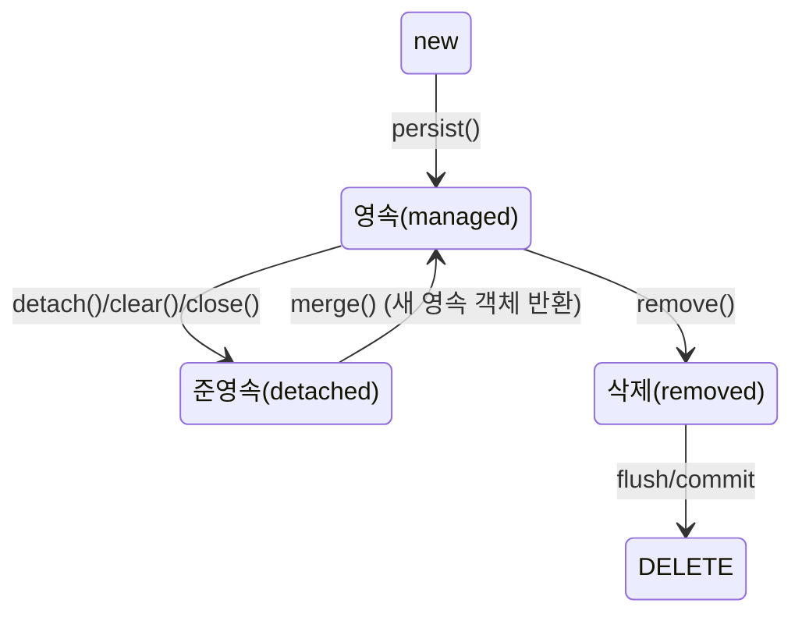

> 「[Ksug2015 - JPA 소개](https://www.slideshare.net/zipkyh/ksug2015-jpa1-jpa-51213397)」, 「[JPA 기본 개념](http://tinkerbellbass.tistory.com/24)」, 「[Spring-Jpa Best Practices](https://github.com/cheese10yun/spring-jpa-best-practices)」, 「[JPA N+1 발생원인과 해결방법](https://github.com/cheese10yun/blog-sample/tree/master/jpa-n-plus-1)」, 「[Spring Batch와 Querydsl](https://techblog.woowahan.com/2662/)」을 바탕으로, 명세 이름과 Hibernate 동작은 Jakarta EE·Hibernate 문서로 확인해 재구성한 노트다.

## JPA란

**JPA(Jakarta Persistence, 옛 Java Persistence API)는 Java의 ORM 표준 명세다.** 명세는 인터페이스와 규칙의 묶음이고, 실제 동작은 구현체(Hibernate, EclipseLink)가 한다. Spring Data JPA는 그 위에 리포지토리 추상화를 얹은 것이다. JPA 3.0부터 패키지가 `javax.persistence`에서 `jakarta.persistence`로 바뀌었다.

애플리케이션은 객체를 다루고, JPA가 그 사이에서 SQL을 만들어 JDBC로 실행한다. ORM 자체의 장단점은 [[orm-queryset|Django ORM과 QuerySet]]에도 있다.

### 패러다임 불일치

SQL 중심으로 개발하면 필드 하나를 추가할 때 INSERT·SELECT·UPDATE를 모두 고쳐야 하고, 객체가 어디까지 채워졌는지 SQL을 열어 봐야 안다. 근본 원인은 객체와 테이블의 모델이 다르다는 데 있다.

| 차이 | 객체 | 관계형 DB | JPA의 대응 |
| --- | --- | --- | --- |
| 상속 | `extends` | 슈퍼타입·서브타입 테이블 설계 | `@Inheritance` 전략(JOINED, SINGLE_TABLE, TABLE_PER_CLASS) |
| 연관 | 참조(`member.getTeam()`), 방향이 있다 | 외래 키와 조인, 방향이 없다 | `@ManyToOne`, `@OneToMany`와 연관관계 주인 |
| 그래프 탐색 | 참조를 따라 어디든 간다 | 처음 SQL에 조인한 만큼만 있다 | 지연 로딩(프록시) |
| 동일성 | `==`(같은 인스턴스) | 기본 키 값 | 같은 영속성 컨텍스트에서 같은 키는 같은 인스턴스 |

**ORM을 써도 SQL과 DB 설계는 알아야 한다.** JPA가 어떤 SQL을 만드는지 늘 로그로 확인한다.

## 영속성 컨텍스트

**영속성 컨텍스트(persistence context)는 엔티티를 식별자(`@Id`)로 관리하는 1차 저장소다.** `EntityManager`를 통해 다루며, 스프링에서는 보통 트랜잭션 하나에 하나가 붙는다.

### 엔티티의 네 가지 상태

| 상태 | 뜻 |
| --- | --- |
| 비영속(new) | 만들기만 했고 컨텍스트가 모른다 |
| 영속(managed) | 컨텍스트가 관리한다. 변경이 추적된다 |
| 준영속(detached) | 한때 관리됐지만 지금은 아니다. 지연 로딩이 안 된다 |
| 삭제(removed) | 커밋 때 삭제될 예정이다 |

`merge()`는 넘긴 객체를 영속으로 바꾸지 않는다. 값을 복사한 **새 영속 객체를 돌려주므로** 반환값을 써야 한다. 수정은 `merge`보다 영속 엔티티를 조회해 값을 바꾸는 변경 감지로 하는 편이 의도가 분명하다.

### 핵심 동작

| 기능 | 동작 | 효과 |
| --- | --- | --- |
| 1차 캐시 | 조회한 엔티티를 식별자로 보관하고, 같은 키를 다시 찾으면 DB에 가지 않는다 | 같은 트랜잭션 안에서 반복 조회 비용과 동일성 문제가 사라진다 |
| 쓰기 지연(write-behind) | INSERT·UPDATE·DELETE를 모아 두었다가 flush 때 실행한다 | JDBC 배치로 묶을 수 있다 |
| 변경 감지(dirty checking) | 처음 읽었을 때의 스냅샷과 비교해 바뀐 필드를 UPDATE한다 | `update()` 호출이 필요 없다 |
| 지연 로딩 | 연관 엔티티 자리에 프록시를 두고, 실제로 쓸 때 조회한다 | 필요한 만큼만 읽는다. 대신 N+1의 원인이 된다 |

flush는 보통 커밋 직전과 JPQL 실행 직전에 자동으로 일어난다. flush는 SQL을 보내는 것이지 커밋이 아니다.

## N+1 문제

**목록 1번 조회 후, 각 항목의 연관 데이터를 항목 수(N)만큼 따로 조회하는 현상이다.** 회원 100명을 읽고 각자의 주문을 읽으면 쿼리가 101번 나간다.

- `EAGER`로 바꿔도 해결되지 않는다. JPQL(`findAll` 포함)은 글로벌 페치 전략을 보지 않고 쿼리를 그대로 실행한 뒤, 즉시 로딩 연관을 엔티티마다 따로 채운다.
- `LAZY`는 조회 순간의 N+1은 막지만, 루프에서 연관을 건드리면 똑같이 N번 나간다.
- **연관은 기본적으로 모두 `LAZY`로 두고**, 필요한 조회마다 함께 가져올 범위를 정한다.

| 해결 | 방법 | 한계 |
| --- | --- | --- |
| 페치 조인 | `select m from Member m join fetch m.orders` | 컬렉션을 페치 조인하면 **페이징을 DB가 아니라 메모리에서** 한다(Hibernate가 경고). 컬렉션 둘 이상을 동시에 페치 조인하면 카테시안 곱과 `MultipleBagFetchException` |
| 배치 크기 | `@BatchSize(size = 100)` 또는 `hibernate.default_batch_fetch_size` | 연관을 `IN (...)` 묶음으로 읽어 쿼리가 1 + N/크기 번이 된다. 페이징과 함께 쓸 수 있다 |
| 엔티티 그래프 | `@EntityGraph(attributePaths = "orders")` | 페치 조인을 어노테이션으로 선언한다. 한계도 같다 |
| DTO 직접 조회 | JPQL·Querydsl로 필요한 컬럼만 DTO로 | 엔티티 변경 감지를 쓰지 못한다. 화면 전용 조회에 맞다 |

실무 조합은 보통 **`*ToOne`은 페치 조인, 컬렉션은 배치 크기**다. 그러면 페이징도 DB에서 한다. 컬렉션을 `List`에서 `Set`으로 바꿔 예외를 피하는 것은 도메인 모델을 왜곡하므로 권하지 않는다. N+1을 애플리케이션 계층에서 배치로 푸는 일반 패턴은 [[db-fetching-patterns|빠르고 유지보수하기 좋은 DB 조회 패턴]]에 있다.

## 엔티티 설계 관례

| 관례 | 이유 |
| --- | --- |
| 기본 생성자는 `protected` | JPA 프록시에는 필요하지만, 필수 값 없는 객체를 외부에서 만들지 못하게 한다 |
| setter를 열지 않는다 | 상태 변경은 `changeEmail()`처럼 의도가 드러나는 메서드로 하고 거기서 검증한다 |
| 값 타입은 `@Embeddable` | 주소·비밀번호·금액처럼 함께 다니는 필드를 묶고 검증 로직을 담는다 |
| enum은 `@Enumerated(EnumType.STRING)` | 순서 번호 저장은 상수 추가 때 데이터 의미가 바뀐다 |
| 연관은 `LAZY`, 양방향은 꼭 필요할 때만 | 연관관계 편의 메서드로 양쪽을 함께 맞춘다 |
| API 응답에 엔티티를 직접 쓰지 않는다 | 엔티티 변경이 API 스펙 변경이 되고, 지연 로딩·순환 참조 문제가 생긴다. DTO로 변환한다 |
| 동적 쿼리·복잡한 조회는 Querydsl 등으로 리포지토리를 확장한다 | 메서드 이름 쿼리는 조건이 늘면 읽기 어렵다 |

Lombok 사용 기준은 [[spring-application-design|스프링 애플리케이션 설계]]의 「Lombok 사용 기준」에 있다.

## 대량 데이터 읽기: 배치와 no-offset

Spring Batch의 `JpaPagingItemReader`는 `LIMIT ... OFFSET ...`으로 페이지를 읽는다. **OFFSET은 건너뛸 행을 모두 읽고 버리므로 뒤 페이지일수록 느려진다.** 수십만 건을 넘으면 마지막 페이지 하나에 수 초가 걸린다.

| 방식 | 다음 페이지 조건 | 성능 | 제약 |
| --- | --- | --- | --- |
| 오프셋 페이징 | `OFFSET (page × size)` | 페이지가 뒤로 갈수록 느려진다 | 없음 |
| no-offset(키셋) | 직전 페이지 마지막 키보다 큰(작은) 것: `WHERE id > :lastId ORDER BY id LIMIT :size` | 인덱스를 타서 페이지 위치와 무관하게 일정하다 | 고유하고 인덱스가 있는 정렬 키가 필요하다. 복잡한 정렬·그룹핑에는 맞지 않는다 |
| 커버링 인덱스 | 인덱스만으로 id를 먼저 페이징한 뒤 본 데이터를 조인 | 오프셋보다 빠르다 | 여전히 오프셋을 쓴다 |

- 첫 페이지는 조건 없이 전체 정렬하지 말고, 정렬 키의 최솟값(최댓값)부터 시작한다.
- Querydsl을 쓰려면 `AbstractPagingItemReader`를 확장해 쿼리 생성 부분만 `JPAQueryFactory` 람다로 받게 만든다.
- 청크 크기와 페이지 크기는 같게 둔다. 다르면 한 청크가 여러 페이지에 걸치거나 영속성 컨텍스트가 엉뚱한 시점에 비워진다.
- 같은 원리를 API 수준에서 다룬 것이 [[api-pagination|API 페이지네이션]]의 키셋·커서 방식이다.

## 정리

- JPA는 명세, Hibernate는 구현이다. 생성되는 SQL은 늘 확인한다.
- 영속성 컨텍스트는 1차 캐시·쓰기 지연·변경 감지로 객체를 다루듯 DB를 다루게 한다.
- 연관은 모두 `LAZY`로 두고, N+1은 `*ToOne` 페치 조인 + 컬렉션 배치 크기로 푼다.
- 엔티티는 protected 생성자, setter 없음, 값 타입, STRING enum, DTO 변환으로 지킨다.
- 대량 읽기는 오프셋 대신 키를 기준으로 다음 페이지를 찾는다.

관련 노트: [[spring-application-design|스프링 애플리케이션 설계]], [[db-fetching-patterns|빠르고 유지보수하기 좋은 DB 조회 패턴]], [[orm-queryset|Django ORM과 QuerySet]], [[prisma|Prisma]], [[api-pagination|API 페이지네이션]], [[transaction|트랜잭션]], [[dto-vo-dao-repository|DTO, VO, DAO, Repository]]
