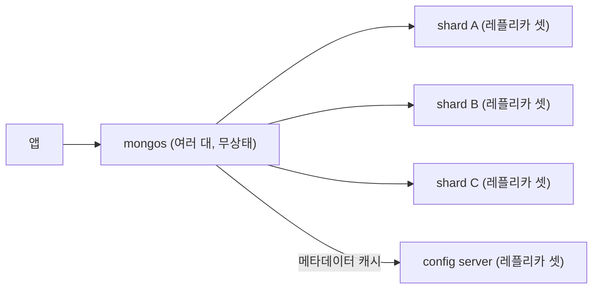

> 개인 학습 기록을 바탕으로 정리한 노트다. 샤딩 구조는 「[fru1tworld/cs-basic 모의 면접 질문 목록](https://github.com/fru1tworld/cs-basic/blob/main/interview/etc/system_design.md)」의 질문을 실마리로 MongoDB 공식 문서를 바탕으로 덧붙였다.

MongoDB는 데이터를 JSON과 비슷한 **문서(document, 내부적으로 BSON)** 단위로 저장하는 NoSQL DB다. 문서들이 모여 **컬렉션(collection)을**, 컬렉션들이 모여 **데이터베이스**를 이룬다. RDB에 대응하면 테이블 ≈ 컬렉션, 행 ≈ 문서, 열 ≈ 필드다.

## Atlas(클라우드)로 시작하기

MongoDB Atlas는 MongoDB를 직접 설치하지 않고 클라우드에서 쓰는 관리형 서비스다. 무료 클러스터로 충분히 실습할 수 있다.

1. 회원가입 → Organization·Project 생성 → **무료(Free/M0) 클러스터** 생성
2. **Network Access**: 접속을 허용할 IP 등록. 실습에서는 *Allow access from anywhere*(`0.0.0.0/0`)를 쓰기도 하지만, 운영에서는 서버 IP만 허용한다.
3. **Database Access**: DB 사용자(아이디·비밀번호) 생성
4. **Connect**: 접속 방법 선택
   - *Compass*: 공식 GUI 클라이언트. 접속 문자열을 붙여 넣어 데이터를 눈으로 확인·편집
   - *Drivers*: 애플리케이션용 접속 문자열 `mongodb+srv://<user>:<password>@<cluster-host>/<db>?retryWrites=true&w=majority`

접속 문자열에는 비밀번호가 들어가므로 코드에 쓰지 말고 [환경 변수](Backend/NestJS/config-env)로 관리한다.

## 기본 CRUD (mongosh)

```javascript
use cats                                   // DB 선택 (없으면 첫 저장 시 생성)

// Create
db.users.insertOne({ name: 'blue', age: 8 })
db.users.insertMany([{ name: 'som', age: 4 }, { name: 'lean', age: 6 }])

// Read
db.users.find()                            // 전체
db.users.find({ age: { $gte: 5 } })        // 조건 (age >= 5)
db.users.findOne({ name: 'blue' })

// Update
db.users.updateOne({ name: 'blue' }, { $set: { age: 9 } })

// Delete
db.users.deleteOne({ name: 'lean' })
```

- 문서마다 고유한 `_id`(ObjectId)가 자동으로 붙는다.
- 비교 연산자는 `$gt`, `$gte`, `$lt`, `$lte`, `$in` 등, 수정 연산자는 `$set`, `$inc`, `$push` 등을 쓴다.
- Compass에서도 같은 작업을 GUI로 할 수 있다.

## 애플리케이션에서: Mongoose

Node.js에서는 보통 **Mongoose**(ODM)를 쓴다. 스키마를 정의해 문서 구조와 검증 규칙을 정하고, 조회한 문서를 JavaScript 객체로 다룬다.

```javascript
const cat = await Cat.create({ email, name, password });
const found = await Cat.findOne({ email });
const exists = await Cat.exists({ email });   // { _id } 또는 null
```

NestJS에서의 사용법은 [Mongoose 스키마](Backend/NestJS/mongoose-schema) 노트에 정리했다.

## 샤딩: mongos, config server, shard

MongoDB는 샤딩을 DB 안에 내장한다. 샤딩된 클러스터(sharded cluster)는 세 구성 요소로 이뤄진다.

| 구성 요소 | 역할 |
| --- | --- |
| **shard** | 컬렉션 데이터의 일부를 담는다. 각 샤드는 그 자체로 레플리카 셋(primary 1 + secondary 여러 대)이라 샤드 단위로 고가용성을 갖는다 |
| **config server** | 클러스터 메타데이터(어떤 샤드 키 구간이 어느 샤드에 있나, 클러스터 설정)를 저장한다. 레플리카 셋으로 운영한다. 8.0부터는 config server가 애플리케이션 데이터도 담는 config shard 구성이 가능하다 |
| **mongos** | 쿼리 라우터. 애플리케이션은 mongos에만 접속한다. config server의 메타데이터를 캐시해, 쿼리에 샤드 키가 있으면 해당 샤드로만 보내고(targeted), 없으면 모든 샤드에 보내 결과를 합친다(scatter-gather) |



샤드 키는 범위(ranged) 또는 해시(hashed)로 고른다. 범위는 범위 조회가 한 샤드에서 끝나지만 단조 증가 키면 쓰기가 마지막 샤드로 몰리고, 해시는 고르게 퍼지는 대신 범위 조회가 모든 샤드로 간다. 샤드 키를 고르는 기준은 [[database-sharding|데이터베이스 샤딩]]에 있다. 잘못 고른 키는 `reshardCollection`(5.0부터)으로 무중단으로 바꿀 수 있지만, 컬렉션 전체를 다시 쓰는 무거운 작업이다.

### 청크와 밸런서

- **청크(chunk)** 는 샤드 키 값의 연속된 구간(하한 이상, 상한 미만)과 그 구간의 문서 묶음이다. 데이터를 샤드 사이로 옮기는 단위이고, config server가 「청크 → 샤드」 매핑을 관리한다. 기본 크기는 128MB다.
- **밸런서(balancer)** 는 config server 레플리카 셋의 primary에서 도는 백그라운드 프로세스다. 샤드 사이의 **데이터 양 차이**가 임계값을 넘으면 많은 샤드에서 적은 샤드로 구간을 옮긴다(chunk migration). 옮기는 동안 원본 샤드가 계속 읽기·쓰기를 받고, 복사가 끝나면 메타데이터를 바꿔 전환한다.
- 6.0부터 밸런서는 청크 개수가 아니라 데이터 크기로 균형을 맞추고, 청크를 크기만 보고 미리 쪼개는 자동 분할도 하지 않는다. 구간은 옮겨야 할 때 쪼갠다.
- 마이그레이션은 디스크·네트워크를 쓰므로 밸런싱 시간대(balancing window)를 정해 한산한 시간에만 돌릴 수 있다. 샤드를 추가하면 밸런서가 새 샤드로 데이터를 채운다.
- 한 샤드 키 값에 문서가 몰리면 그 값은 더 쪼갤 수 없는 거대 청크(jumbo chunk)가 되어 옮겨지지 않는다. 카디널리티 높은 샤드 키가 필요한 이유다.

## 핵심 정리

- MongoDB = DB > 컬렉션 > 문서(BSON). 스키마가 유연하다.
- Atlas: 클러스터 생성 → IP 허용 → DB 사용자 → 접속 문자열.
- CRUD: `insertOne/find/updateOne($set)/deleteOne`.
- 샤딩: 앱은 mongos에 붙고, mongos는 config server의 메타데이터로 샤드(각각 레플리카 셋)를 고른다. 밸런서가 샤드 간 데이터 양 차이를 청크 이동으로 맞춘다.

관련 노트: [[database-models|데이터베이스 모델: RDB, NoSQL, NewSQL]], [[mongoose-schema|Mongoose 스키마]], [[database-sharding|데이터베이스 샤딩]]
