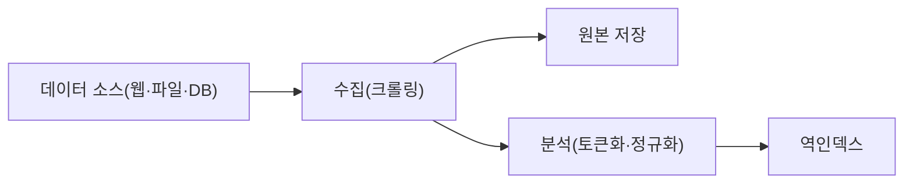
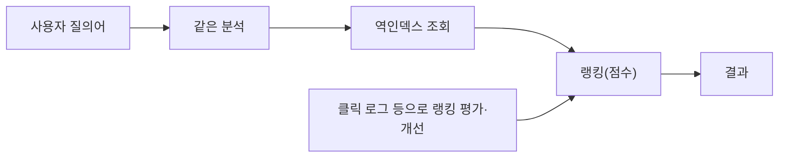

> 강대명의 「간단한 검색엔진의 원리」(BoB 보안개발트랙 강의 자료, 2022)를 바탕으로 재구성하고, 「DB 검색의 한계」는 blurfx의 「[검색 엔진은 어떻게 작동하는가](https://xo.dev/articles/how-search-engine-works)」(2023.04)로 보강한 노트다. 크롤러·PageRank·질의 의도 같은 웹 검색엔진 전체 흐름은 [[web-search-engine|웹 검색엔진의 동작: 크롤링, 색인, 랭킹, 질의 처리]]에 있다.

## 검색엔진이란

검색엔진은 **어떤 단어가 들어간 문서를 빠르게 찾고, 관련도 순으로 정렬해 돌려주는 시스템**이다. DB의 `LIKE '%단어%'`는 인덱스를 타지 못해 전체 행을 훑고, 결과의 순서(랭킹)도 정해 주지 않는다. 이 두 가지가 필요해지면 검색엔진을 쓴다.

### DB 검색의 한계

| 방법 | 동작 | 한계 |
| --- | --- | --- |
| 문서마다 부분 문자열 비교 | 질의어가 본문에 있는지 하나씩 본다 | 문서 수 × 길이만큼 걸린다. `apple juice`를 단어로 나누면 단어 수만큼 더 느려진다 |
| `LIKE '%단어%'`, `REGEXP` | 패턴 일치 | 앞에 `%`가 붙으면 B-트리 인덱스를 못 탄다 |
| `FULLTEXT` 인덱스 (MySQL `MATCH … AGAINST`, PostgreSQL `tsvector`) | DB 안의 역인덱스 | 대부분의 경우 충분히 빠르지만, 오타 허용·랭킹 조정·한국어 분석·비정형 데이터 처리가 약하다 |

이 한계를 넘는 기능(퍼지 검색, 분석기, 점수 조정)을 갖춘 것이 Elasticsearch·OpenSearch·Solr 같은 전용 검색엔진이다.

**검색엔진은 직접 만들지 않는다.** 색인·질의·랭킹·분산·장애 처리를 모두 구현하는 비용이 크고, 직접 만든 것은 버그가 많다. 서비스에서는 Elasticsearch나 OpenSearch(둘 다 Apache Lucene 기반)를 쓰고, 원리는 튜닝과 문제 해결을 위해 이해한다.

## 두 과정: 색인과 질의

색인(Indexing)



질의(Query)



**질의어도 색인과 똑같은 분석 과정을 거쳐야 한다.** 색인할 때 소문자로 바꿨다면 질의어도 소문자로 바꿔야 일치한다.

수집(크롤링)은 대부분 필요 없다. 서비스는 자기 DB를 색인하고, Elasticsearch도 크롤러를 포함하지 않는다. 외부 사이트를 수집할 때의 robots.txt 규칙은 [[seo-basics|SEO 기초: 크롤링부터 메타 태그까지]]에 있다.

## 역인덱스 만들기

일반 인덱스가 "문서 → 단어"라면, **역인덱스(Inverted Index)는 "단어 → 그 단어가 든 문서 목록"이다.** 책 뒤의 찾아보기와 같다.

세 문서로 만들어 보면 이렇다.

```text
DOC1: The bright blue butterfly hangs on the breeze.
DOC2: It's best to forget the great sky and to retire from every wind.
DOC3: Under blue sky, in bright sunlight, one need not search around.
```

| 단계 | 하는 일 | 예 |
| --- | --- | --- |
| 1. 토큰화(Tokenizing) | 문장을 단어로 쪼갠다 | `The`, `bright`, `blue`, … |
| 2. 정규화 | 특수문자 제거, 소문자 변환 | `breeze.` → `breeze`, `The` → `the` |
| 3. 불용어 제거 | 너무 흔해 검색 가치가 없는 단어를 뺀다 | `the`, `a`, `and`, `to`, `in` … |
| 4. 어간 추출(Stemming) | 어미를 떼고 어간만 남긴다 | `hangs` → `hang` |
| 5. 정렬·병합 | 단어순으로 정렬하고 같은 단어의 문서 목록을 합친다 | `blue: 1, 3` |

결과 역인덱스의 일부는 다음과 같다.

| 단어 | 문서 |
| --- | --- |
| blue | 1, 3 |
| bright | 1, 3 |
| hang | 1 |
| sky | 2, 3 |
| wind | 2 |

이제 질의는 목록 조회와 집합 연산이다. `sky`는 {2, 3}, `blue`는 {1, 3}이므로 `blue AND sky`는 교집합 {3}이다. 불용어로 검색하면 인덱스에 없으므로 결과가 나오지 않는다.

실제 역인덱스는 문서 번호와 함께 **단어의 위치(position)** 도 저장한다. `blue sky`처럼 구(phrase)로 검색할 때 두 단어가 붙어 있는 문서를 더 높게 칠 수 있다.

단어 사전은 해시 테이블이나 B+ 트리로도 담을 수 있지만, Lucene은 FST(Finite State Transducer)라는 압축 오토마타로 저장해 접두사 검색과 메모리 효율을 함께 얻는다.

## 한국어 색인

한국어는 띄어쓰기 단위(어절)에 조사·어미가 붙어 있어 공백 토큰화만으로는 같은 단어가 모이지 않는다. `보안개발트랙입니다`와 `보안개발트랙에서는`은 다른 토큰이 되고, 영어처럼 `-s`, `-ing`를 떼는 규칙으로는 어미를 걷어낼 수 없다.

| 방법 | 원리 | 장점 | 단점 |
| --- | --- | --- | --- |
| 형태소 분석 | 사전으로 명사·조사·어미를 나눈다 (`보안개발트랙` + `에서` + `는`) | 색인이 작고 정확하다 | 사전에 없는 신조어·복합어를 놓친다 |
| N-gram | 언어 지식 없이 N글자씩 자른다 (2-gram: 보안, 안개, 개발, 발트, 트랙) | `개발트랙`처럼 부분 문자열도 찾는다 | 색인이 커지고 `안개` 같은 엉뚱한 일치가 생긴다 |

- Elasticsearch·OpenSearch는 공식 한국어 분석기 **Nori**(mecab-ko-dic 사전 기반)를 제공한다. 사용자 사전으로 복합어를 등록하고 `decompound_mode`로 분해 수준을 정한다.
- 파이썬에서는 KoNLPy(Mecab·Komoran·Okt 래퍼)나 Kiwi(`kiwipiepy`)를 쓴다.
- 실무에서는 형태소 분석 필드와 N-gram 필드를 함께 두고 점수를 합치는 경우가 많다.

## 랭킹

`apple`처럼 수많은 문서에 들어 있는 단어는 결과가 너무 많다. 어떤 문서를 먼저 보여 줄지 정하는 것이 랭킹이다. 신호는 단어 중요도(TF-IDF, BM25) 외에도 단어 위치(검색어끼리 가까운가), 신선도, 링크 구조(PageRank) 등이 있다. 웹 검색의 랭킹 신호와 다단계 랭킹은 [[web-search-engine|웹 검색엔진의 동작]]에 있고, 여기서는 단어 중요도 점수만 다룬다.

### 랭킹 점수: TF-IDF에서 BM25로

기본 직관은 **한 문서에 자주 나오지만 전체 문서에서는 드문 단어가 그 문서의 핵심어**라는 것이다. TF-IDF가 이를 그대로 식으로 옮겼다.

```text
TF-IDF  w(i, j) = tf(i, j) × log(N / df(i))

BM25    score(D, Q) = Σ IDF(qᵢ) × f(qᵢ, D) × (k1 + 1)
                                 ─────────────────────────────────────────
                                 f(qᵢ, D) + k1 × (1 − b + b × |D| / avgdl)
        IDF(qᵢ) = ln(1 + (N − n(qᵢ) + 0.5) / (n(qᵢ) + 0.5))
```

| 요소 | 의미 | 효과 |
| --- | --- | --- |
| `tf`, `f(qᵢ, D)` | 문서 안의 단어 빈도 | TF-IDF는 선형으로 오르고, BM25는 **k1 근처에서 포화**한다 |
| `df`, `n(qᵢ)` | 그 단어가 나온 **문서 수**(전체 출현 횟수가 아니다) | 거의 모든 문서에 있는 단어는 IDF가 0에 가까워, 불용어를 따로 안 정해도 약해진다 |
| `k1` | tf 포화 속도 (기본 1.2) | 클수록 반복 횟수가 더 오래 점수에 반영된다 |
| `|D| / avgdl` | 문서 길이 ÷ 평균 문서 길이 | 평균보다 짧은 문서에서 일치할수록 점수가 높다 |
| `b` | 길이 보정 강도 (0~1, 기본 0.75) | 0이면 길이를 무시하고, 1이면 길이로 완전히 나눈다 |

예를 들어 문서 10개 중 `카드뉴스`가 3개, `오늘`이 9개에 있으면 IDF(log₁₀)는 0.52와 0.046이다. TF-IDF의 약점은 **tf가 선형으로 커진다**는 것이다. 같은 단어를 네 번 반복하면 점수가 네 배가 되고, 긴 문서가 유리하다. BM25(Okapi BM25)는 tf 포화와 문서 길이 보정으로 이 둘을 고쳤고, Elasticsearch·OpenSearch·Lucene의 기본 유사도다.

## 한계와 확장

- 역인덱스는 **글자가 일치해야** 찾는다. `자동차`로 `차량`을 찾으려면 동의어 사전이 필요하다.
- 의미가 비슷한 문서를 찾는 벡터 검색(임베딩 + kNN)이 이 빈틈을 메운다. Elasticsearch·OpenSearch도 벡터 필드를 지원하며, BM25 점수와 벡터 점수를 섞는 하이브리드 검색이 흔하다.
- 오타는 역인덱스에서 그대로 빗나간다. 편집 거리 기반 퍼지 검색으로 비슷한 단어까지 찾는다.
- 랭킹 공식은 출발점이다. 실서비스는 클릭 로그로 결과를 평가하고 가중치를 조정한다.

## 정리

- 검색엔진 = 색인(문서 → 역인덱스) + 질의(같은 분석 → 조회 → 랭킹).
- 역인덱스는 토큰화 → 정규화 → 불용어 제거 → 어간 추출 → 정렬·병합으로 만든다.
- 한국어는 형태소 분석(Nori 등)과 N-gram을 상황에 맞게 섞는다.
- 랭킹의 기본은 BM25다. TF-IDF에 tf 포화와 문서 길이 보정을 더한 것이다.
- 원리를 알고, 구현은 Elasticsearch·OpenSearch에 맡긴다.

관련 노트: [[web-search-engine|웹 검색엔진의 동작: 크롤링, 색인, 랭킹, 질의 처리]], [[text-similarity|문자열·문서 유사도: 편집 거리와 코사인 유사도]], [[seo-basics|SEO 기초: 크롤링부터 메타 태그까지]], [[database-models|데이터베이스 모델: RDB, NoSQL, NewSQL]], [[sql-basics|SQL 기초]], [[elasticsearch|Elasticsearch와 ELK 스택]]
