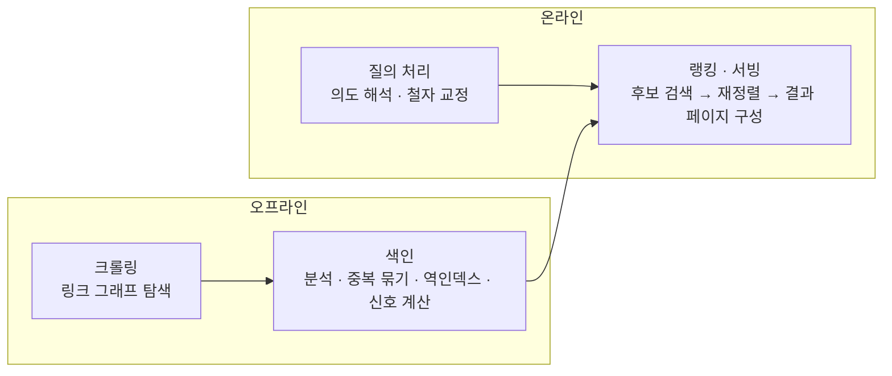
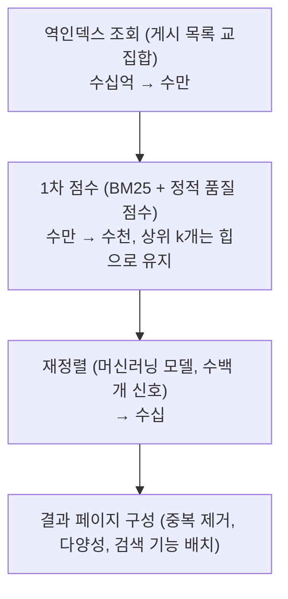

> TALI.KR의 「구글이 직접 말하는 검색엔진의 원리」(2023.08), blurfx의 「[검색 엔진은 어떻게 작동하는가](https://xo.dev/articles/how-search-engine-works)」(2023.04), idLAB의 「네이버 검색엔진의 특징과 알고리즘」(2020.12), 네이버의 「네이버 통합검색의 원리」(2007, 블로그 재게시본)를 바탕으로 재구성하고, 구글 검색 센터 문서와 네이버 보도자료(2024.02)로 최신화한 노트다. 크롤링·색인·서빙의 3단계 뼈대는 ByteByteGo의 System Design 101 가이드 「[How Do Search Engines Work?](https://bytebytego.com/guides/how-do-search-engines-work)」를 함께 참고했다. 역인덱스를 만드는 과정과 TF-IDF·BM25 공식은 [[search-engine-basics|검색엔진의 원리: 역인덱스와 랭킹]]에 있다.

## 웹 검색엔진이란

웹 검색엔진은 **누구의 것도 아닌 웹 전체를 스스로 모아서** 색인하고, 질의마다 가장 쓸모 있는 페이지를 골라 보여 주는 시스템이다. 서비스 안의 검색(자기 DB를 Elasticsearch로 색인)과 원리는 같지만, 세 가지가 다르다.

| 구분 | 서비스 내부 검색 | 웹 검색엔진 |
| --- | --- | --- |
| 문서 수집 | 자기 DB를 그대로 색인한다 | 크롤러가 링크를 따라 직접 찾아야 한다 |
| 문서 품질 | 대체로 믿을 수 있다 | 중복·스팸·조작이 섞여 있어 걸러야 한다 |
| 규모 | 수백만~수억 건 | 수천억 페이지, 100PB 이상(구글 기준) |

전체 흐름은 네 단계다. 앞의 둘은 질의와 무관하게 미리 돌고(오프라인), 뒤의 둘은 질의가 올 때마다 1초 안에 끝나야 한다(온라인).



## 1. 크롤링: 웹이라는 그래프 탐색

웹에는 페이지 목록을 모아 둔 중앙 등록부가 없다. 그래서 크롤러는 **이미 아는 페이지의 링크와 제출된 사이트맵**에서 새 URL을 발견한다. 페이지를 노드, 링크를 간선으로 보면 크롤링은 거대한 그래프의 [[bfs|너비 우선 탐색 (BFS)]]이다. 다만 그래프가 끝없이 커지고 계속 바뀌므로 「다 돌면 끝」이 아니다.

| 구성 요소 | 자료구조·알고리즘 | 하는 일 |
| --- | --- | --- |
| URL 프런티어(frontier) | [[heap-priority-queue\|힙과 우선순위 큐]] + 호스트별 큐 | 다음에 방문할 URL을 중요도·갱신 주기 순으로 꺼낸다 |
| 방문 확인 | 해시 집합, 블룸 필터 | 이미 본 URL을 다시 넣지 않는다. 블룸 필터는 메모리를 아끼는 대신 약간의 오탐을 허용한다. 실제 크롤러의 자료 구조 배치는 [[web-crawler-at-scale\|대규모 웹 크롤러 설계]]에 있다 |
| URL 정규화 | 문자열 규칙 | 대소문자, 끝 `/`, 추적 파라미터를 정리해 같은 페이지를 하나로 본다 |
| 예의(politeness) | 호스트별 대기열과 지연 | 한 서버에 요청이 몰리지 않게 한다. 5xx 응답이 늘면 속도를 늦춘다 |
| 규칙 준수 | robots.txt 파싱 | 막힌 경로는 가져오지 않는다 ([[seo-basics\|SEO 기초: 크롤링부터 메타 태그까지]]) |
| 렌더링 | 헤드리스 브라우저 | 구글은 최신 Chrome으로 JS를 실행한 뒤의 DOM을 본다 |

- **재크롤링이 일의 대부분이다.** 웹은 계속 바뀌므로 뉴스처럼 자주 바뀌는 페이지는 자주, 거의 안 바뀌는 페이지는 드물게 다시 가져온다. 변경 이력을 보고 주기를 알고리즘으로 정한다.
- 크롤링 빈도는 돈으로 살 수 없다. 모든 사이트에 같은 기준이 적용된다.
- 로그인이 필요한 페이지, 서버 오류, robots.txt 차단은 크롤링을 막는 대표 원인이다.

## 2. 색인: 무엇을 저장하나

가져온 페이지는 분석을 거쳐 색인에 들어간다. 색인은 책 뒤의 찾아보기처럼 **단어 → 그 단어가 든 페이지 목록**인 역인덱스가 중심이다. 하지만 웹 검색엔진은 단어 외에도 많은 것을 함께 저장한다.

| 저장하는 것 | 예 | 쓰임 |
| --- | --- | --- |
| 본문 토큰과 위치 | 단어, 등장 위치, `title`·제목·`alt` 여부 | 일치 여부와 구(phrase) 검색 |
| 문서 속성 | 언어, 대상 국가, 작성·갱신일 | 사용자 언어·지역에 맞추기, 신선도 |
| 링크 정보 | 들어오는 링크와 앵커 텍스트 | PageRank, 「남들이 이 페이지를 뭐라고 부르나」 |
| 품질 신호 | 모바일 사용성, 스팸 점수 | 랭킹 보정 |

### 중복 묶기와 대표 URL

웹에는 거의 같은 페이지가 여러 URL로 존재한다. 색인 단계에서 비슷한 페이지를 **클러스터로 묶고 하나를 대표(canonical)로 고른다.** 나머지는 대체 URL로 남아 모바일 등 다른 맥락에서 쓰인다. 내용이 거의 같은지는 페이지 전체를 비교하지 않고 SimHash·MinHash 같은 지문(fingerprint)으로 빠르게 판정한다. 사이트 쪽에서 `rel="canonical"`로 의도를 알릴 수 있다.

**색인은 보장되지 않는다.** 크롤링한 페이지라도 품질이 낮거나 `noindex`가 있으면 빠진다.

### 규모의 문제

한 대에 다 들어가지 않으므로 색인을 **샤드(shard)로 나눈다.**

- **문서 기준 분할**이 보통이다. 각 샤드가 문서 일부의 역인덱스를 갖고, 질의는 모든 샤드에 동시에 보낸 뒤 각자의 상위 결과를 합친다(scatter-gather). 샤드마다 복제본을 둬 장애와 부하를 나눈다.
- 자주 찾는 문서는 빠른 저장소에, 오래되어 드물게 찾는 문서는 느리고 싼 저장소에 두는 **계층화(tiering)** 를 한다. 그래도 가끔 찾히므로 지울 수는 없다.
- 실시간 인기 검색어처럼 질의가 몰리는 경우는 결과 캐시로 따로 처리한다.

## 3. 질의 처리: 단어가 아니라 의도

구글 기준으로 **하루 검색어의 약 15%는 처음 나오는 검색어**다. 그래서 과거 질의와 맞추는 것만으로는 부족하고, 질의를 해석해야 한다.

| 단계 | 하는 일 | 예 |
| --- | --- | --- |
| 분석 | 색인과 같은 방식으로 토큰화·정규화 | 한국어는 형태소 분석 ([[search-engine-basics\|검색엔진의 원리: 역인덱스와 랭킹]]) |
| 철자 교정 | 편집 거리([[text-similarity\|문자열·문서 유사도: 편집 거리와 코사인 유사도]])와 질의 로그로 오타·없는 단어를 고친다 | `갤럭시 s26 울트로` → `울트라` |
| 확장 | 동의어·관련 개념을 붙인다 | `차량` 질의에 `자동차` 문서도 찾는다 |
| 의도 분류 | 정보·탐색·거래·지역 같은 의도와 주제를 가린다 | `사과`가 과일인지 회사인지, 뜻을 찾는지 뉴스를 찾는지 |
| 결과 유형 선택 | 의도에 맞는 결과 모양을 정한다 | 사전 뜻 질의엔 정의, 시사 질의엔 뉴스, 장소 질의엔 지도 |

의도 해석에는 언어 모델이 쓰인다. 구글은 단어와 개념을 잇는 RankBrain, 단어 조합의 의미를 읽는 BERT, 질의와 페이지의 개념을 맞추는 신경망 매칭(neural matching)을 랭킹 시스템으로 공개해 두었다. 검색어가 문서에 그대로 없어도 찾히는 이유다.

## 4. 랭킹: 후보를 뽑고 다시 줄 세운다

수천억 문서 전부에 무거운 모델을 돌릴 수 없다. 그래서 랭킹은 **싼 단계에서 후보를 줄이고 비싼 단계에서 정밀하게 다시 매기는** 다단계 구조다.



- 게시 목록(posting list)은 문서 번호순으로 정렬돼 있어, `A AND B`는 두 목록을 **병합하듯 한 번 훑어** 교집합을 구한다. 건너뛰기 포인터(skip pointer)로 긴 목록을 빨리 지난다.
- 상위 k개만 필요하므로 전체를 정렬하지 않고 크기 k의 최소 힙을 유지한다. 시간은 O(n log k)다([[big-o|빅오 표기법과 시간 복잡도]]).
- PageRank처럼 질의와 무관한 점수는 색인할 때 미리 계산해 두고(정적 점수), 질의 시점에는 더하기만 한다.

### 랭킹 신호

구글이 밝힌 순위 요소는 다섯 갈래로 묶인다.

| 갈래 | 보는 것 |
| --- | --- |
| 의미 | 질의가 무엇을 묻는가. 위의 질의 처리 |
| 관련성 | 키워드 포함을 넘어 **콘텐츠가 실제로 그 질문에 답하는가** |
| 품질 | 출처의 전문성·권위·신뢰. 신뢰받는 페이지들이 링크한 페이지인가 |
| 사용성 | 점수가 비슷할 때 모바일 친화성, 로딩 속도 같은 페이지 경험 |
| 맥락 | 사용자 위치, 언어, 기기, 검색 설정 |

구글 검색 센터는 이를 실제로 구현한 **이름 있는 랭킹 시스템**을 공개한다. 신선도(freshness), 링크 분석과 PageRank, 문서 안의 한 구절만 따로 평가하는 구절 랭킹(passage ranking), 원본 콘텐츠 우대, 리뷰 시스템, 같은 사이트 결과를 상위에서 대개 2개로 제한하는 사이트 다양성, 거의 같은 결과를 숨기는 중복 제거, SpamBrain 같은 스팸 탐지가 있다. 과거의 Panda(저품질 콘텐츠), Penguin(링크 스팸), 유용한 콘텐츠 시스템(helpful content, 2024년 3월)은 모두 핵심 랭킹 시스템에 흡수돼 별도 시스템이 아니다.

### PageRank: 링크로 매기는 중요도

PageRank는 **중요한 페이지가 많이 링크한 페이지가 중요하다**는 재귀적 정의를 계산하는 알고리즘이다. 링크를 무작위로 따라가다 가끔 아무 페이지로 순간이동하는 사용자를 상상하면, 그 사용자가 오래 머무는 비율이 그 페이지의 점수다.

```text
PR(p) = (1 − d) / N  +  d × Σ PR(q) / L(q)      q: p를 링크한 페이지
                                                 L(q): q의 나가는 링크 수
                                                 d: 감쇠 계수 (보통 0.85), N: 전체 페이지 수
```

- 모든 PR을 1/N로 두고 식을 반복 적용하면 값이 수렴한다(거듭제곱 반복법, power iteration). 링크 행렬의 고유벡터를 구하는 것과 같다.
- 나가는 링크가 많은 페이지는 점수를 그만큼 나눠 준다. 아무 데로도 링크하지 않는 페이지(dangling node)의 점수는 전체에 고르게 나눈다.
- 링크를 사고팔거나 링크 농장을 만드는 조작을 부른다. 그래서 오늘의 검색엔진은 PageRank를 여러 신호 중 하나로만 쓰고, 링크 스팸은 따로 탐지해 무시한다.

### 랭킹은 실험으로 바꾼다

랭킹 공식은 사람이 한 번 정해서 끝나지 않는다. 바꿀 후보를 평가자 테스트, 두 결과를 나란히 비교하는 실험, 실제 트래픽 일부에 적용하는 A/B 실험으로 검증하고, **개선이 입증된 것만 반영한다.** 구글은 2023년 한 해에 품질 평가자 테스트 약 72만 건, 비교 실험 약 12만 건, 실트래픽 실험 약 1만 7천 건을 거쳐 4,781건을 반영했다. 검색 순위는 돈으로 바뀌지 않고 광고는 별도 영역에 표시된다.

## 5. 네이버 통합검색: 컬렉션과 블록

구글이 웹 문서 목록을 중심으로 결과를 만든다면, 네이버 통합검색은 **여러 수직 검색(vertical search) 결과를 한 화면에 묶는 방식**으로 발전했다.

| 개념 | 하는 일 |
| --- | --- |
| 컬렉션(collection) | 뉴스·이미지·지식iN·블로그·카페·지도·웹문서처럼 성격별로 나눈 검색 단위. 컬렉션마다 별도 색인을 갖는다 |
| 멀티 랭킹 | 컬렉션마다 다른 랭킹 모델을 쓴다. 뉴스는 최신성을, 지식iN은 유사도와 최신성에 답변자 신뢰도를 더 본다. 컬렉션끼리 결과가 겹치지 않게 조율한다 |
| 컬렉션 랭킹 | 문서뿐 아니라 **컬렉션의 노출 순서도 랭킹한다.** 같은 질의를 한 사용자들이 어느 컬렉션에서 답을 찾았는지 행동 데이터로 순서를 정한다. 용어 뜻을 묻는 질의엔 사전·지식iN이, 인물 질의엔 인물 정보가 위로 온다 |
| 스마트블록 | 같은 질의 안에서도 **세부 의도마다 블록을 따로 만든다.** 2024년 2월 VIEW 영역이 「인기글」 같은 주제별 스마트블록으로 바뀌었고, 상단 VIEW 탭은 블로그 탭과 카페 탭으로 다시 나뉘었다 |

블로그 같은 사용자 생산 문서에는 출처와 문서를 나눠 보는 모델을 공개해 왔다.

| 모델 | 평가 대상 | 보는 것 |
| --- | --- | --- |
| C-Rank (Creator Rank) | 출처(블로그) | 한 주제에 집중해(Context) 좋은 글을(Content) 꾸준히 쓰고, 그 글이 읽히고 퍼지는가(Chain). 출처의 주제별 신뢰도·인기도 |
| D.I.A.(Deep Intent Analysis), D.I.A.+ | 문서 | 주제 적합도, 직접 경험, 정보의 충실성, 독창성, 적시성, 어뷰징 정도. D.I.A.+는 가격·후기처럼 경험을 찾는 질의의 의도를 더 깊이 맞춘다 |

출처 단위 신뢰도(C-Rank)는 PageRank의 「누가 보증하나」와, 문서 단위 의도 적합도(D.I.A.)는 관련성 신호와 대응한다. 두 검색엔진 모두 **출처의 신뢰 + 문서의 관련성 + 질의 의도**를 조합한다.

## 한계와 과제

- **조작과의 경쟁**: 신호가 알려지면 그 신호를 노린 스팸이 생긴다. 랭킹 신호를 공개하는 범위가 제한되는 이유다.
- **원본 판정**: 복사본이 원본보다 먼저 크롤링되거나 신호가 강하면 원본을 놓칠 수 있다. 플랫폼 밖 문서에서 canonical 같은 장치가 없으면 더 어렵다.
- **최신성 대 안정성**: 재크롤링을 자주 할수록 비용이 늘고, 드물게 하면 결과가 낡는다.
- **생성형 요약**: 결과 목록 위에 AI 요약(구글 AI 개요, 네이버 AI 브리핑)이 붙으면서, 문서를 찾아 주는 일에 더해 여러 문서를 근거로 답을 만드는 일이 겹쳐지고 있다. 이때도 근거 문서를 고르는 단계는 위의 검색·랭킹이다.

## 정리

- 웹 검색엔진 = 오프라인(크롤링 → 색인) + 온라인(질의 처리 → 랭킹·서빙).
- 크롤러는 우선순위 큐로 된 URL 프런티어로 링크 그래프를 탐색하고, 호스트별 예의와 재크롤링 주기를 지킨다.
- 색인은 중복을 묶어 대표 URL을 고르고, 샤딩된 역인덱스에 문서 속성·링크·품질 신호를 함께 담는다.
- 랭킹은 역인덱스 교집합 → BM25·정적 점수 → 모델 재정렬의 다단계이며, PageRank는 그중 링크 신호 하나다.
- 네이버는 컬렉션·스마트블록 단위로 결과를 묶고 블록 순서까지 랭킹한다. 구글과 네이버 모두 신뢰·관련성·의도를 조합한다.

더 읽을거리: 「[쉽게 설명한 구글의 페이지 랭크 알고리즘](https://sungmooncho.com/2012/08/26/pagerank/)」

관련 노트: [[search-engine-basics|검색엔진의 원리: 역인덱스와 랭킹]], [[seo-basics|SEO 기초: 크롤링부터 메타 태그까지]], [[google-search-operators|구글 검색 연산자]], [[bfs|너비 우선 탐색 (BFS)]], [[graph-basics|그래프의 기본과 표현 방법]], [[heap-priority-queue|힙과 우선순위 큐]], [[text-similarity|문자열·문서 유사도: 편집 거리와 코사인 유사도]], [[web-crawler-at-scale|대규모 웹 크롤러 설계]]
