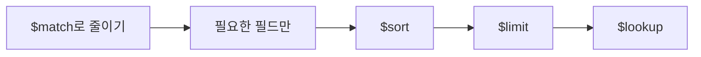
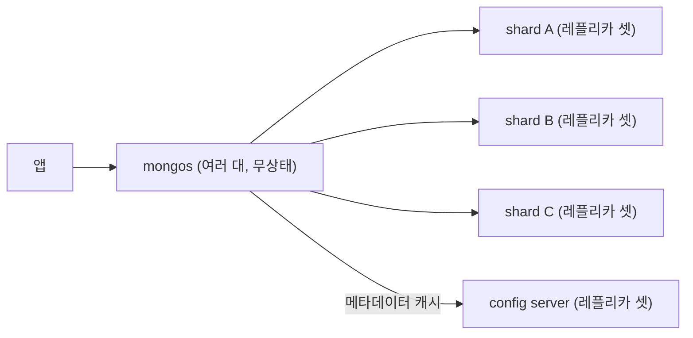

> 개인 학습 기록을 바탕으로 정리한 노트다. 샤딩 구조는 「[fru1tworld/cs-basic 모의 면접 질문 목록](https://github.com/fru1tworld/cs-basic/blob/main/interview/etc/system_design.md)」의 질문을 실마리로 MongoDB 공식 문서를 바탕으로 덧붙였다.
>
> Phil Factor의 「[14 Things I Wish I'd Known When Starting with MongoDB](https://www.infoq.com/articles/Starting-With-MongoDB/)」(InfoQ, 2018.09)를 바탕으로 스키마·보안·조회·쓰기 내구성을 보강했다.

MongoDB는 데이터를 JSON과 비슷한 **문서(document, 내부적으로 BSON)** 단위로 저장하는 NoSQL DB다. 문서들이 모여 **컬렉션(collection)을**, 컬렉션들이 모여 **데이터베이스**를 이룬다. RDB에 대응하면 테이블 ≈ 컬렉션, 행 ≈ 문서, 열 ≈ 필드다. 관계형과의 갈래는 [[database-models|데이터베이스 모델: RDB, NoSQL, NewSQL]], SQL로 같은 일을 표현하는 법은 [[sql-basics|SQL 기초]]에 있다.

스키마를 강제하지 않는다는 것은 스키마가 필요 없다는 뜻이 아니다. 문서마다 모양이 달라도 저장은 되지만, 조회·인덱스·검증은 예상한 필드 이름을 전제로 한다.

## 스키마는 강제되지 않아도 설계한다

같이 읽는 데이터는 한 문서에 넣고, 서로 다른 생명주기를 가진 데이터는 컬렉션을 나눈다.

문서로 규칙을 남기려면 컬렉션에 `$jsonSchema` 밸리데이터(JSON Schema draft 4)를 둔다. `validationLevel` 기본값은 `strict`라 삽입과 갱신 모두 검사하고, `validationAction` 기본값은 `error`라 어긋나면 쓰기를 거부한다. `warn`은 로그만 남기고 통과시킨다. 9.0의 `constraint`는 컬렉션의 모든 문서가 규칙을 만족한다고 보장한다. 이미 어긋난 문서가 있으면 이 수준으로 올리지 못한다.

```javascript
db.createCollection("users", {
  validator: {
    $jsonSchema: {
      bsonType: "object",
      required: ["name"],
      properties: { name: { bsonType: "string" } }
    }
  }
})
```

**BSON 문서 상한은 16MiB다.** 그 한도는 문서 하나가 메모리와 전송을 다 쓰지 않게 하려는 것이다. 상한까지 키우는 설계는 캐시에 불리하고, 그보다 큰 파일은 GridFS로 나눈다. 실무에서는 넓은 SQL 행에 가깝게, 수 KB 안에 두는 편이 맞다.

배열은 원소가 수천 개로 자라기 전에 다른 컬렉션(참조)이나 구간으로 쪼갠 버킷으로 뺀다. 이건 서버가 거는 개수 제한이 아니다. 배열 필드에 인덱스를 두면 **원소마다 인덱스 엔트리**(멀티키 인덱스)가 생겨, 배열이 늘수록 인덱스 갱신도 원소 수만큼 커진다. 과거 MMAPv1은 문서가 커져 디스크에서 이사하는 비용을 줄이려고 padding factor로 빈칸을 남겨 두었다. 그 저장 엔진과 `paddingFactor` 옵션은 4.2에서 빠졌다.

## Atlas(클라우드)로 시작하기

MongoDB Atlas는 MongoDB를 직접 설치하지 않고 클라우드에서 쓰는 관리형 서비스다. 무료 클러스터로 충분히 실습할 수 있다. Atlas는 데이터베이스 사용자 인증을 요구하고, 저장 중 암호화가 기본으로 켜져 있다.

1. 회원가입 → Organization·Project 생성 → **무료(Free/M0) 클러스터** 생성
2. **Network Access**: 접속을 허용할 IP 등록. 실습에서는 *Allow access from anywhere*(`0.0.0.0/0`)를 쓰기도 하지만, 운영에서는 서버 IP만 허용한다.
3. **Database Access**: DB 사용자(아이디·비밀번호) 생성
4. **Connect**: 접속 방법 선택
   - *Compass*: 공식 GUI 클라이언트. 접속 문자열을 붙여 넣어 데이터를 눈으로 확인·편집
   - *Drivers*: 애플리케이션용 접속 문자열 `mongodb+srv://<user>:<password>@<cluster-host>/<db>?retryWrites=true&w=majority`

접속 문자열에는 비밀번호가 들어가므로 코드에 쓰지 말고 [환경 변수](Backend/NestJS/config-env)로 관리한다. `w=majority`의 뜻은 아래 「쓰기 내구성」에 있다.

## 자체 서버를 열 때의 보안

`mongod`와 `mongos`는 **기본적으로 로컬호스트만** 리스닝한다. 접근 제어(`security.authorization`)도 **기본으로 꺼져 있어**, 바인드 주소를 사설망이나 `0.0.0.0`으로 여는 순간 인증 없는 서버가 그 네트워크에 노출된다. 개발 서버라고 예외가 아니다. 공식 [보안 체크리스트](https://www.mongodb.com/docs/manual/administration/security-checklist/)가 같은 항목을 운영 전에 확인하라고 적는다.

```yaml
net:
  bindIp: 10.0.0.8
security:
  authorization: enabled
  javascriptEnabled: false
```

- 인증을 켜기 전이나, 켠 직후 로컬호스트 예외로 **사용자 관리자**를 먼저 만든다. 기본 메커니즘은 SCRAM(아이디·비밀번호)이다. X.509는 클라이언트와 레플리카 셋 멤버 인증에 쓴다. LDAP 인증·인가는 8.0부터 폐기 예정이다.
- 서버 쪽 JavaScript(`$where`, `$function`, `$accumulator`)는 8.0부터 폐기 예정이고, `mapReduce`는 5.0부터 폐기 예정이다. 쓰지 않으면 `security.javascriptEnabled: false`(또는 `--noscripting`)로 끈다. 기본값은 켜짐이다. 같은 일은 집계 파이프라인으로 표현한다.
- Community의 데이터 파일은 서버가 암호화하지 않는다. 디스크 암호화는 OS나 스토리지가 맡고, `mongod`는 데이터 파일을 소유한 전용 OS 계정으로 띄운다. Enterprise는 WiredTiger 저장 암호화(AES-256)를 제공한다. 필드 값은 클라이언트에서 암호화해 넣을 수도 있다(CSFLE, Queryable Encryption).
- 기본 포트는 27017이다. 포트를 바꾸는 것은 인증과 바인드 주소를 대신하지 못한다. 버전은 올려 두고, 로그에서 인증 실패가 반복되는지 본다.

## 기본 CRUD (mongosh)

```javascript
use cats                                   // DB 선택 (없으면 첫 저장 시 생성)

// Create
db.users.insertOne({ name: 'blue', age: 8 })
db.users.insertMany([{ name: 'som', age: 4 }, { name: 'lean', age: 6 }])

// Read
db.users.find()                            // 전체
db.users.find({ age: { $gte: 5 } })        // 조건 (age >= 5)
db.users.findOne({ name: 'blue' })

// Update
db.users.updateOne({ name: 'blue' }, { $set: { age: 9 } })
db.users.updateMany({ age: { $lt: 5 } }, { $set: { young: true } })

// Delete
db.users.deleteOne({ name: 'lean' })
```

- 문서마다 고유한 `_id`(ObjectId)가 자동으로 붙는다. `_id`는 항상 문서의 첫 필드다.
- 비교 연산자는 `$gt`, `$gte`, `$lt`, `$lte`, `$in` 등, 수정 연산자는 `$set`, `$inc`, `$push` 등을 쓴다.
- `updateOne`은 맞는 문서 하나만, `updateMany`는 맞는 문서를 모두 고친다. 서버 `update` 명령의 `multi`는 기본이 false라, 옛 `update()`에 `multi: true`를 빼먹으면 한 건만 바뀐다. `updateMany`는 문서마다 원자적이지만 배치 전체는 한 트랜잭션이 아니다. 중간에 밸리데이터 등으로 한 건이 실패하면 이미 쓴 문서는 남고 나머지는 멈춘다.
- Compass에서도 같은 작업을 GUI로 할 수 있다.

## 문자열 비교와 콜레이션

기본 문자열 비교는 **binary collation**(`locale: "simple"`)이다. 코드 포인트 순서라 대소문자와 악센트를 다른 문자로 본다. `Motorbike`와 `motorbike`는 같지 않다. SQL 쪽 콜레이션 차이는 [[sql-basics#대소문자와 날짜 조건|SQL 기초]]에 있다.

콜레이션은 데이터베이스가 아니라 **컬렉션을 만들 때** 지정한다. `insert`로 컬렉션이 저절로 생기면 simple이 붙고, **한 번 정한 컬렉션 기본 콜레이션은 나중에 바꿀 수 없다.** 바꾸려면 원하는 콜레이션으로 컬렉션을 새로 만들어 데이터를 옮긴다.

대소문자와 악센트를 무시하려면 `strength: 1`(기본 문자만 비교)이다. 로케일만 지정하면 `strength` 기본값이 3이라 대소문자와 악센트를 여전히 구분한다.

```javascript
db.createCollection("users", {
  collation: { locale: "ko", strength: 1 }
})
```

컬렉션 기본 콜레이션은 인덱스와 연산이 물려받는다. 쿼리가 다른 콜레이션을 지정하면 그 인덱스로 문자열 비교를 못 한다. 텍스트 인덱스와 2d 인덱스는 simple만 지원한다.

## 조회와 집계

`find`는 쿼리 플래너가 인덱스를 고른다. 집계에는 파이프라인 옵티마이저가 있어, 계산 결과에 기대지 않는 `$match`를 프로젝션 앞으로 옮기고, 붙어 있는 `$sort`와 `$limit`를 합쳐 상위 n개만 유지한다. 9.0부터는 뒤쪽 `$match`가 앞 단계와 무관한 계산 필드를 거를 때, 그 계산과 조건을 `$lookup`보다 앞으로 당기기도 한다.

**그래도 SQL 옵티마이저처럼 조인 순서까지 마음대로 다시 짜지는 않는다.** 줄일 수 있는 `$match`와 `$project`는 앞에 두고, 정렬과 `$lookup`은 문서가 줄어든 뒤에 둔다. 실행 순서는 `explain`으로 확인한다. 최적화는 버전마다 바뀐다.



```javascript
db.orders.aggregate([
  { $match: { status: "open" } },
  { $project: { customerId: 1, total: 1 } },
  { $sort: { total: -1 } },
  { $limit: 20 },
  { $lookup: {
      from: "customers",
      localField: "customerId",
      foreignField: "_id",
      as: "customer"
  } }
])
```

### 정렬과 조인

정렬이 인덱스를 타지 못하면 메모리에서 정렬한다. **6.0부터 파이프라인 단계의 메모리 한도는 100MB**이고, `allowDiskUseByDefault`(기본 true) 때문에 넘치면 임시 파일을 디스크에 쓴다. `{ allowDiskUse: false }`면 그 한도에서 오류가 난다. 6.0 전에는 메모리 정렬 한도가 32MB였고, 넘으면 오류였다. 9.0부터는 쿼리 하나 전체의 메모리 상한도 있다. 기본은 1GB와 서버 프로세스가 쓸 수 있는 메모리의 20% 중 큰 값이다. 인덱스 접두사와 ESR 순서는 [[index-design#MongoDB|인덱스 설계]]에 있다.

`$lookup`은 같은 데이터베이스의 다른 컬렉션을 왼쪽 외부 조인처럼 붙인다. **등호 매치 한 번이면 `foreignField`에 인덱스가 있어야** 빠르다. `_id`는 그 인덱스가 이미 있고, 다른 필드는 직접 만든다. 인덱스가 없으면 큰 컬렉션에서 단계가 느려진다. explain에서는 슬롯 기반 실행일 때 `EQ_LOOKUP`으로 인덱스 사용이 보인다. `$lookup`으로 해결하려다 문서가 커지면, 위의 스키마처럼 함께 읽는 값을 한 문서에 넣는 쪽을 먼저 본다.

### 임베디드 문서의 필드 순서

BSON 필드는 순서가 있다. 임베디드 문서 **전체**를 등호로 비교하면 필드 집합과 순서가 같아야 맞는다.

```javascript
db.users.find({ name: { first: "Ada", last: "Lovelace" } })
// { name: { last: "Lovelace", first: "Ada" } } 와는 맞지 않는다
```

필드마다 점 표기로 비교하면 순서는 상관없다. `"name.first"`와 `"name.last"`를 같이 조건에 넣으면 된다. `$project`, `$addFields`, `$set`, `$unset`은 결과의 필드 순서를 바꿀 수 있으니, 조회 결과의 키 순서에 의존하지 않는다. 쓰기에서는 `_id`가 맨 앞인 것을 빼고 입력 순서를 유지한다. 필드 이름 변경(`$rename`)은 순서를 바꿀 수 있다.

### null과 없는 필드

`{ nickname: null }`은 값이 null인 문서와 **필드가 없는 문서**를 모두 맞춘다. 배열이면 null 원소가 하나라도 있으면 맞는다. null만 고르려면 `{ nickname: { $type: "null" } }`를 쓴다.

BSON `undefined`는 폐기된 타입이다. mongosh와 최근 드라이버는 삽입·갱신 때 JavaScript `undefined`를 null로 저장한다. 8.0부터 `{ field: null }`은 남아 있는 `undefined` 값을 맞추지 않는다. 예전 셸이 넣어 둔 `undefined`는 null로 옮긴다.

### limit와 결정적 결과

`$limit`만 있으면 저장 순서에 의존하고, 그 순서는 안정적이지 않다. 같은 쿼리가 실행할 때마다 다른 문서를 앞에 둘 수 있어 페이지가 흔들린다. **고유한 필드로 `$sort`한 뒤에 `$limit`한다.** 바로 붙은 `$sort`와 `$limit`는 상위 n개만 유지하도록 합쳐질 수 있다. 무작위 표본은 `$sample`을 쓴다. 페이지를 넘기는 방식은 [[api-pagination|API 페이지네이션]]에 있다.

## 쓰기 내구성

write concern을 생략하면 기본은 **`w: "majority"`** 다. 저널링이 켜져 있으면 majority는 저널이 디스크에 기록된 뒤에 응답한다. `writeConcernMajorityJournalDefault`의 기본값은 true다.

아비터가 있고, 데이터를 가진 투표 멤버 수가 투표 과반 이하이면 기본이 `{ w: 1 }`로 떨어진다. 프라이머리·세컨더리·아비터 각 한 대인 PSA가 이 경우다. `w: 1`은 메모리에 적용되면 응답한다. 저널 버퍼는 `storage.journal.commitIntervalMs`(기본 100ms)마다, 또는 그 쓰기가 `j: true`일 때 바로 디스크에 내려간다. 100ms 안에 프로세스가 죽으면 이미 응답한 `w: 1` 쓰기가 사라질 수 있다.

`{ w: 0 }`은 서버가 쓰기를 적용하기 전에 반환한다. 빨라 보이지만 크래시나 페일오버에서 유실된다. 잃어선 안 되는 데이터에는 쓰지 않는다.

**6.1부터 저널링은 항상 켜져 있어** `storage.journal.enabled`, `--journal`, `--nojournal`은 없다. 4.2에서 MMAPv1이 제거된 뒤 디스크 저장 엔진은 WiredTiger다. WiredTiger는 체크포인트와 저널로 복구하고, 저널이 없으면 마지막 체크포인트 이후 쓰기를 잃는다. Enterprise 인메모리 엔진만 디스크 저널이 없다.

한 문서의 쓰기는 원자적이다. 여러 문서에 걸친 원자적 쓰기는 트랜잭션이다. 레플리카 셋은 4.0, 샤딩된 클러스터는 4.2부터 다중 문서 트랜잭션을 지원한다. `transactionLifetimeLimitSeconds`(기본 60초)를 넘기면 서버가 그 트랜잭션을 중단한다. ACID와 회복의 일반 개념은 [[transaction|트랜잭션과 회복]]에 있다.

## 애플리케이션에서: Mongoose

Node.js에서는 보통 **Mongoose**(ODM)를 쓴다. 스키마를 정의해 문서 구조와 검증 규칙을 정하고, 조회한 문서를 JavaScript 객체로 다룬다.

```javascript
const cat = await Cat.create({ email, name, password });
const found = await Cat.findOne({ email });
const exists = await Cat.exists({ email });   // { _id } 또는 null
```

NestJS에서의 사용법은 [Mongoose 스키마](Backend/NestJS/mongoose-schema) 노트에 정리했다.

## 샤딩: mongos, config server, shard

MongoDB는 샤딩을 DB 안에 내장한다. 샤딩된 클러스터(sharded cluster)는 세 구성 요소로 이뤄진다.

| 구성 요소 | 역할 |
| --- | --- |
| **shard** | 컬렉션 데이터의 일부를 담는다. 각 샤드는 그 자체로 레플리카 셋(primary 1 + secondary 여러 대)이라 샤드 단위로 고가용성을 갖는다 |
| **config server** | 클러스터 메타데이터(어떤 샤드 키 구간이 어느 샤드에 있나, 클러스터 설정)를 저장한다. 레플리카 셋으로 운영한다. 8.0부터는 config server가 애플리케이션 데이터도 담는 config shard 구성이 가능하다 |
| **mongos** | 쿼리 라우터. 애플리케이션은 mongos에만 접속한다. config server의 메타데이터를 캐시해, 쿼리에 샤드 키가 있으면 해당 샤드로만 보내고(targeted), 없으면 모든 샤드에 보내 결과를 합친다(scatter-gather) |



샤드 키는 범위(ranged) 또는 해시(hashed)로 고른다. 범위는 범위 조회가 그 구간의 청크를 가진 샤드에만 가지만 단조 증가 키면 쓰기가 마지막 샤드로 몰리고, 해시는 고르게 퍼지는 대신 범위 조회가 모든 샤드로 간다. 샤드 키를 고르는 기준은 [[database-sharding|데이터베이스 샤딩]]에 있다. 잘못 고른 키는 `reshardCollection`(5.0부터)으로 무중단으로 바꿀 수 있지만, 컬렉션 전체를 다시 쓰는 무거운 작업이다.

### 청크와 밸런서

- **청크(chunk)** 는 샤드 키 값의 연속된 구간(하한 이상, 상한 미만)과 그 구간의 문서 묶음이다. 데이터를 샤드 사이로 옮기는 단위이고, config server가 「청크 → 샤드」 매핑을 관리한다. 기본 크기는 128MB다.
- **밸런서(balancer)** 는 config server 레플리카 셋의 primary에서 도는 백그라운드 프로세스다. 샤드 사이의 **데이터 양 차이**가 임계값을 넘으면 많은 샤드에서 적은 샤드로 구간을 옮긴다(chunk migration). 옮기는 동안 원본 샤드가 계속 읽기·쓰기를 받고, 복사가 끝나면 메타데이터를 바꿔 전환한다.
- 6.0부터 밸런서는 청크 개수가 아니라 데이터 크기로 균형을 맞추고, 청크를 크기만 보고 미리 쪼개는 자동 분할도 하지 않는다. 구간은 옮겨야 할 때 쪼갠다.
- 마이그레이션은 디스크·네트워크를 쓰므로 밸런싱 시간대(balancing window)를 정해 한산한 시간에만 돌릴 수 있다. 샤드를 추가하면 밸런서가 새 샤드로 데이터를 채운다.
- 한 샤드 키 값에 문서가 몰리면 그 값은 더 쪼갤 수 없는 거대 청크(jumbo chunk)가 되어 옮겨지지 않는다. 카디널리티 높은 샤드 키가 필요한 이유다.

## 핵심 정리

- MongoDB = DB > 컬렉션 > 문서(BSON). 스키마를 강제하지 않아도 필드 모양은 설계하고, 필요하면 `$jsonSchema`로 막는다. 문서 상한은 16MiB다.
- 자체 `mongod`는 로컬호스트만 듣고 인증이 꺼져 있다. 바깥에 열 때는 인증, 바인드 주소, 서버 쪽 JavaScript 비활성화를 먼저 한다. Atlas는 사용자 인증을 요구한다.
- CRUD: `insertOne` / `find` / `updateOne`·`updateMany` / `deleteOne`. 문자열 비교가 대소문자를 무시해야 하면 컬렉션 콜레이션을 만들 때 정한다.
- 집계는 `$match`로 먼저 줄이고, 정렬·`$lookup`·`$limit`은 그 뒤에 둔다. 정렬과 `$lookup`은 인덱스가 있어야 한다.
- 기본 write concern은 `w: "majority"`다. `w: 0`과, 아비터 때문에 기본이 된 `w: 1`은 디스크에 남기 전에 응답할 수 있다.
- 샤딩: 앱은 mongos에 붙고, mongos는 config server의 메타데이터로 샤드(각각 레플리카 셋)를 고른다. 밸런서가 샤드 간 데이터 양 차이를 청크 이동으로 맞춘다.

관련 노트: [[database-models|데이터베이스 모델: RDB, NoSQL, NewSQL]], [[sql-basics|SQL 기초]], [[index-design|인덱스 설계와 쿼리 튜닝]], [[transaction|트랜잭션과 회복]], [[mongoose-schema|Mongoose 스키마]], [[database-sharding|데이터베이스 샤딩]], [[api-pagination|API 페이지네이션]]
