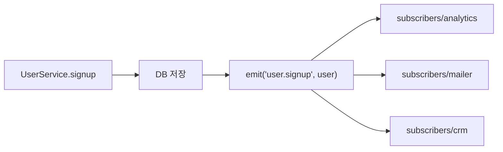

> 「[견고한 node.js 프로젝트 설계하기](https://velog.io/@hopsprings2/%EA%B2%AC%EA%B3%A0%ED%95%9C-node.js-%ED%94%84%EB%A1%9C%EC%A0%9D%ED%8A%B8-%EC%95%84%ED%82%A4%ED%85%8D%EC%B3%90-%EC%84%A4%EA%B3%84%ED%95%98%EA%B8%B0)」를 바탕으로, 순환 의존은 「[Node.js의 순환 의존성](https://blog.outsider.ne.kr/1283?category=24)」을 더해 재구성한 노트다.

## 왜 구조를 직접 정하나

**Express는 라우팅과 미들웨어만 준다.** 코드를 어디에 둘지는 정하지 않는다. 처음엔 라우트 핸들러 하나에 검증·DB 쿼리·메일 발송을 다 넣어도 돌아가지만, 기능이 늘면 같은 로직이 여러 핸들러에 복사되고 테스트하려면 `req`·`res`를 흉내 내야 한다. NestJS는 이 구조를 프레임워크가 강제하고, Express는 팀이 정한다. 아래 구조는 NestJS의 모듈·프로바이더 구조와 거의 같다([[project-structure|NestJS 프로젝트 구조]]).

## 폴더 구조

```text
src/
├── app.ts          # 앱 생성 → 로더 호출 → listen 만
├── api/            # 라우트(컨트롤러): 경로, 입력 검증, 응답 변환
├── services/       # 비즈니스 로직
├── models/         # DB 모델 (데이터 접근)
├── subscribers/    # 이벤트 구독자: 부수 작업
├── jobs/           # 예약·반복 작업 정의
├── loaders/        # 시작 과정을 단계별 모듈로
├── config/         # 환경 변수를 읽어 구조화한 설정
└── types/          # 타입 선언
```

## 3계층과 각 층의 경계

| 층 | 맡는 일 | 몰라야 하는 것 |
| --- | --- | --- |
| 라우트(컨트롤러) | 경로 매핑, 입력 검증 미들웨어, 서비스 호출, 결과를 HTTP 응답으로 변환 | 비즈니스 규칙 |
| 서비스 | 비즈니스 규칙. 순수한 데이터를 받아 결과를 돌려준다 | `req`·`res`·상태 코드 같은 HTTP 개념, SQL |
| 데이터 접근 | 쿼리와 모델 조작 | 비즈니스 규칙 |

**서비스가 `req`·`res`를 받지 않는 것이 핵심이다.** 그래야 같은 서비스를 HTTP가 아닌 곳(CLI, 배치 작업, 메시지 소비자)에서도 부르고, 테스트에서 HTTP 객체 없이 호출할 수 있다. 라우터에서 핸들러를 서비스 파일로 옮기기만 하고 핸들러가 여전히 `res.send`를 부른다면 파일만 나뉜 것이다([[singleton-service-pattern|Express 싱글톤 패턴과 서비스 패턴]]).

```typescript
// api/routes/user.ts: HTTP를 아는 유일한 층
route.post('/signup', validate(signupSchema), async (req, res, next) => {
  try {
    const { user, token } = await userService.signup(req.body);
    res.status(201).json({ user, token });
  } catch (e) {
    next(e);                       // 에러 처리 미들웨어로
  }
});
```

응답을 보낸 뒤에도 핸들러가 다른 일을 이어 가면 흐름이 흐려진다. 응답 이후의 일은 아래 이벤트로 넘긴다.

## 부수 작업은 이벤트 구독자로

가입 한 번에 분석 이벤트 전송, 환영 메일, 외부 CRM 등록이 따라붙으면 `signup`이 비대해지고 단일 책임 원칙을 어긴다. 서비스는 **핵심 작업을 끝낸 뒤 이벤트만 발행**하고, 부수 작업은 구독자가 각자 맡는다.



- 구독자는 각자 에러를 처리한다. 한 구독자의 실패가 가입 자체를 실패시키지 않는다.
- 비동기 구독자의 예외는 `try/catch`로 잡고, 놓친 것은 프로세스의 `unhandledRejection` 핸들러에서 기록한다.
- 프로세스 안의 `EventEmitter`는 재시작하면 잃는다. 반드시 실행돼야 하는 일은 메시지 큐로 옮긴다([[message-queue-kafka|메시지 큐와 Kafka]]).

## 의존성 주입

서비스가 모델·로거·이벤트 발행기를 **안에서 만들지 않고 생성자로 받는다.** 테스트에서 가짜 객체를 넣을 수 있고, 구현을 바꿔도 서비스는 그대로다.

```typescript
export class UserService {
  constructor(
    private userModel: UserModel,
    private events: EventEmitter,
  ) {}
}

// 테스트: 실제 DB 없이
const service = new UserService(fakeUserModel, fakeEmitter);
```

의존성이 많아지면 손으로 엮기 번거로우므로 DI 컨테이너(TypeDI, tsyringe, InversifyJS)를 쓴다. 아무 데서나 컨테이너에서 꺼내 쓰는 **서비스 로케이터**는 의존성을 숨기는 안티패턴이다. 원칙은 [[frontend-solid|SOLID]]의 의존성 역전과 같다.

## 설정과 비밀 값

- 설정은 환경 변수로 받는다([[twelve-factor-app|Twelve-Factor App]]). 개발 중에는 `.env`를 읽고, `.env`는 커밋하지 않고 예시 파일(`.env.example`)만 둔다. Node.js 20.6부터는 `node --env-file=.env`로 dotenv 없이 읽는다.
- `config/index.ts` 한곳에서 `process.env`를 읽어 타입이 붙은 객체로 내보낸다. 코드 곳곳에 `process.env.XXX`가 흩어지지 않고, 빠진 값은 시작할 때 바로 실패하게 할 수 있다.

## 예약·반복 작업

`setTimeout`·`setInterval`로 「10분 뒤 메일」을 구현하면 프로세스가 재시작될 때 작업이 사라지고, 실패해도 재시도할 수 없다. 작업 상태를 DB나 Redis에 저장하는 작업 큐(BullMQ, Agenda)를 쓴다. 인스턴스가 여러 대여도 한 번만 실행되고, 실패한 작업을 추적·재시도할 수 있다.

## 로더: 시작 과정 쪼개기

Express 미들웨어 등록, DB 연결, 작업 큐 시작, 의존성 주입 설정을 각각 로더 파일로 나누고 `loaders/index.ts`가 순서대로 부른다.

```typescript
// app.ts
async function start() {
  const app = express();
  await loaders.init({ app });     // db → di → jobs → express 순
  app.listen(config.port);
}
```

진입점은 세 줄로 줄고, 테스트는 `listen` 없이 로더를 거친 `app`만 받아 HTTP 테스트를 한다.

## 순환 의존을 피한다

계층을 나누다 보면 두 모듈이 서로를 부르는 순환이 생긴다. CommonJS `require`는 **동기로 실행하고 결과를 캐시**하기 때문에, 순환 고리에서 아직 실행이 끝나지 않은 모듈을 다시 부르면 **채워지기 전의 빈 `module.exports`** 를 받는다.

| 증상 | 원인 | 해결 |
| --- | --- | --- |
| 로딩은 조용히 되고, 나중에 `x is not a function` | 순환 상대가 빈 객체를 받았다 | 공통 부분을 제3의 모듈로 빼 순환을 끊는다(최우선) |
| 엔트리의 `require` 순서만 바꿔도 에러 위치가 바뀐다 | 누가 먼저 실행되느냐에 따라 빈 객체를 받는 쪽이 달라진다 | `madge --circular src`로 순환을 미리 찾는다. 린트 규칙 `import/no-cycle`로 막는다 |
| 테스트는 통과하고 실제 실행에서만 깨진다 | 테스트가 모듈을 다른 순서로 불러온다 | 위와 같다 |

`module.exports = {...}`로 통째로 갈아 끼우는 대신 `exports.fn = ...`으로 속성을 붙이거나 `require`를 함수 안으로 미루면 증상은 사라진다. 다만 로딩 순서에 기대는 우회라 구조 문제를 숨긴다. ES 모듈은 바인딩이 살아 있어 나중에 채워진 값이 보이지만, 모듈 최상위에서 바로 쓰면 초기화 전 접근(`ReferenceError`)이 난다([[es-modules|모듈: export와 import]]). 순환은 대개 관심사가 잘못 나뉘었다는 신호다.

## 정리

- 라우트는 HTTP, 서비스는 규칙, 데이터 접근은 쿼리만 안다. **서비스가 `req`·`res`를 모르게** 하는 것이 분리의 기준이다.
- 핵심 작업 뒤의 부수 작업은 이벤트 구독자로, 반드시 실행돼야 하면 큐로 보낸다.
- 의존성은 생성자로 받고, 설정은 한 모듈에서 환경 변수로 읽고, 예약 작업은 저장소가 있는 작업 큐에 맡긴다.
- 시작 과정은 로더로 쪼개 진입점을 얇게 유지한다.
- 순환 의존은 우회하지 말고 모듈 경계를 다시 긋는다.

관련 노트: [[singleton-service-pattern|Express 싱글톤 패턴과 서비스 패턴]], [[express-middleware|Express 미들웨어]], [[routing-crud|Express 라우팅과 CRUD API]], [[module|NestJS Module과 Provider]], [[software-architecture-patterns|소프트웨어 아키텍처 패턴]], [[twelve-factor-app|Twelve-Factor App]]
