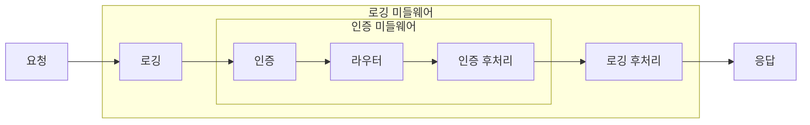

> 「[Frontend_TIL: koa 기본](https://github.com/AI-Dev-Lex-Kim/Frontend_TIL/blob/master/koa/koa%20%EA%B8%B0%EB%B3%B8.md)」, 「[Frontend_TIL: nodemon, koa router](https://github.com/AI-Dev-Lex-Kim/Frontend_TIL/blob/master/koa/nodemon%2C%20koa%20router.md)」을 바탕으로 [Koa 공식 문서](https://koajs.com/)와 [@koa/router](https://github.com/koajs/router) 기준으로 재구성한 노트다.

## Koa란

Koa는 Express를 만든 팀이 새로 설계한 Node.js 웹 프레임워크다. Express를 고치면 내부 구조가 통째로 바뀌어야 해서 별도 프레임워크로 나왔다. 2026년 기준 최신 메이저는 Koa 3이다.

**코어에는 미들웨어 실행기와 `ctx`만 있다.** 라우팅, 바디 파싱, 정적 파일 같은 기능은 모두 별도 패키지로 붙인다. 필요한 것만 조립하므로 코어가 가볍다.

| 항목 | Express | Koa |
| --- | --- | --- |
| 내장 기능 | 라우터, `express.json()`, `express.static()` 내장 | 미들웨어 실행기만. 라우터·파서는 패키지로 |
| 미들웨어 시그니처 | `(req, res, next)` | `(ctx, next)` |
| 요청·응답 객체 | Node의 `req`·`res`를 확장 | 둘을 감싼 `ctx` 하나. `ctx.body`, `ctx.status`, `ctx.query` |
| `next()` | 다음 미들웨어를 부르고 끝 | **Promise를 돌려준다.** `await next()` 뒤에 후처리를 쓸 수 있다 |
| 비동기 에러 | Express 5부터 async 핸들러의 거부를 에러 미들웨어로 넘긴다(4까지는 직접 `next(err)`) | 처음부터 async 기반이라 바깥 미들웨어의 `try/catch`로 잡는다 |

과거에는 「Express는 콜백, Koa는 async/await」로 구분했지만 Express 5가 Promise를 지원하면서 차이는 줄었다. 지금 남는 차이는 **코어의 크기와 양파 모델**이다.

## 미들웨어와 ctx

```js
import Koa from 'koa';

const app = new Koa();

app.use(async (ctx, next) => {
  if (ctx.query.authorized !== '1') {
    ctx.status = 401;   // next()를 부르지 않으면 뒤 미들웨어는 실행되지 않는다
    return;
  }
  await next();
});

app.use((ctx) => {
  ctx.body = 'hello world';   // 마지막 미들웨어는 next가 필요 없다
});

app.listen(4000);
```

- `ctx`(Context)는 요청과 응답 정보를 함께 담는다. `ctx.request`·`ctx.response`의 자주 쓰는 속성은 `ctx`에서 바로 접근한다.
- 미들웨어는 `app.use`로 **등록한 순서대로** 실행된다.
- `next()`를 부르지 않으면 체인이 거기서 끝난다. 인증 실패처럼 조건에 따라 뒤를 건너뛸 때 쓴다.

### 양파 모델

`await next()`는 **뒤의 미들웨어가 모두 끝날 때까지 기다린다.** 그래서 미들웨어 하나가 요청을 들어갈 때와 나올 때 두 번 처리할 수 있다.

```js
app.use(async (ctx, next) => {
  const start = Date.now();
  await next();                       // 안쪽 미들웨어 전부 실행
  ctx.set('X-Response-Time', `${Date.now() - start}ms`);   // 나오면서 후처리
});
```



응답 시간 측정, 에러를 잡아 응답 형식으로 바꾸기, 응답 헤더 추가처럼 「앞뒤를 감싸는」 일이 자연스럽다. 가장 바깥에 `try { await next() } catch (err) { ... }` 미들웨어를 두면 안쪽 어디서 던진 에러든 한곳에서 처리한다.

## 라우팅: @koa/router

코어에 라우터가 없어서 공식 패키지 `@koa/router`를 쓴다. 옛 `koa-router` 패키지는 지원이 끝났다(deprecated).

```js
import Koa from 'koa';
import Router from '@koa/router';
import { bodyParser } from '@koa/bodyparser';

const app = new Koa();
const router = new Router();

router.get('/about/:name', (ctx) => {
  ctx.body = `이름은 ${ctx.params.name}`;   // 경로 파라미터
});
router.get('/posts', (ctx) => {
  ctx.body = `id는 ${ctx.query.id}`;        // 쿼리는 객체로 파싱돼 있다
});

app.use(bodyParser());                       // 라우터보다 먼저
app.use(router.routes()).use(router.allowedMethods());
app.listen(4000);
```

| 항목 | 쓰는 법 |
| --- | --- |
| 메서드별 등록 | `router.get`·`post`·`put`·`patch`·`delete(경로, 핸들러)` |
| 경로 파라미터 | `'/about/:name'` → `ctx.params.name` |
| 선택 파라미터 | `'/user{/:id}'` (v14부터 중괄호 문법. 옛 `:id?`와 정규식 파라미터는 지원하지 않는다) |
| 쿼리 | `ctx.query`(객체), 원문 문자열은 `ctx.querystring` |
| 요청 바디 | `@koa/bodyparser`를 붙인 뒤 `ctx.request.body` |
| `allowedMethods()` | `OPTIONS`에 허용 메서드로 답하고, 없는 메서드엔 405·501을 돌려준다 |

`@koa/router` 최신판은 Node.js 20 이상을 요구하고 문서 예제는 ESM(`import`) 기준이다.

### 라우트 모듈화와 컨트롤러

파일 하나에 모든 라우트를 쓰지 않고 경로별 라우터를 나눠 **`router.use(접두사, 하위.routes())`로 중첩**한다.

```text
src/
├── index.js                 app + 최상위 router: router.use('/api', api.routes())
└── api/
    ├── index.js             api.use('/posts', posts.routes())
    └── posts/
        ├── index.js         posts.get('/', ctrl.list); posts.post('/', ctrl.write) …
        └── posts.ctrl.js    라우트 처리 함수(컨트롤러)
```

라우트 정의 파일에는 경로와 함수의 연결만 두고, 처리 로직은 **컨트롤러 파일**로 뺀다. 그래야 라우트 목록이 한눈에 보인다. 이 구조는 Express의 3계층 구조와 같다([[express-project-architecture|Express 프로젝트 구조]]).

```js
// posts.ctrl.js
export const write = (ctx) => {
  const { title, body } = ctx.request.body;
  const post = { id: nextId++, title, body };
  posts.push(post);
  ctx.status = 201;
  ctx.body = post;
};
```

## 개발 중 자동 재시작

코드를 고칠 때마다 서버를 다시 띄우지 않으려면 파일 변경을 감시해 재시작한다.

| 방법 | 설정 |
| --- | --- |
| Node 내장 | `node --watch src/index.js` (Node 22부터 안정). `--watch-path=src`로 감시 범위를 정한다 |
| nodemon | `npm i -D nodemon` 후 `"start:dev": "nodemon --watch src/ src/index.js"`. 감시 확장자·무시 경로 설정이 더 세밀하다 |

과거에는 nodemon이 사실상 표준이었지만 지금은 내장 `--watch`로 충분한 경우가 많다([[nodejs-runtime|Node.js 런타임]]).

## 정리

- Koa는 코어에 미들웨어와 `ctx`만 두고 나머지는 패키지로 조립한다.
- `await next()`는 안쪽 미들웨어가 끝날 때까지 기다린다. 앞뒤를 감싸는 양파 모델이 핵심이다.
- 라우팅은 `@koa/router`, 바디 파싱은 `@koa/bodyparser`. 파서는 라우터보다 먼저 등록한다.
- 라우터는 접두사별로 중첩하고, 처리 로직은 컨트롤러 파일로 분리한다.

관련 노트: [[express-middleware|Express 미들웨어]], [[routing-crud|Express 라우팅과 CRUD API]], [[express-project-architecture|Express 프로젝트 구조]], [[nodejs-runtime|Node.js 런타임]]
