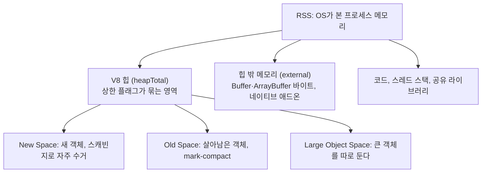

> Platformatic의 「[We cut Node.js memory in half](https://blog.platformatic.dev/we-cut-nodejs-memory-in-half)」(emewjin 번역 「[Node.js 메모리 사용량을 절반으로 줄였습니다](https://emewjin.github.io/node-js-cut-memory/)」, 2026.03)와 Node.js 25.9 릴리스의 `--max-heap-size`를 바탕으로, 플래그는 Node.js 공식 CLI 문서로 확인해 재구성한 노트다.

## Node.js 프로세스의 메모리

운영 대시보드가 보여 주는 메모리(RSS)와 V8이 관리하는 JavaScript 힙은 같은 값이 아니다. **힙 상한 플래그는 JavaScript 객체가 사는 V8 힙만 묶는다.** `Buffer`·`ArrayBuffer`의 실제 바이트, 네이티브 애드온이 잡은 메모리, 컴파일된 코드, 스레드 스택은 그 밖에서 RSS를 키운다.



`process.memoryUsage()`가 이 구분을 그대로 돌려준다.

| 필드 | 뜻 |
| --- | --- |
| `rss` | 프로세스가 실제로 차지한 물리 메모리 전체 |
| `heapTotal` | V8이 힙으로 확보한 크기 |
| `heapUsed` | 그중 살아 있는 객체가 쓰는 크기 |
| `external` | V8 객체에 묶인 C++ 객체 메모리(Buffer 바이트 포함) |
| `arrayBuffers` | `ArrayBuffer`·`SharedArrayBuffer`(Buffer 포함)에 할당된 바이트. `external`에 포함된다 |

`heapUsed`는 안정적인데 `rss`만 오르면 힙 밖(버퍼, 애드온)을 의심한다. 공간별 세부 값은 `v8.getHeapSpaceStatistics()`로 본다. 세대별 수집의 원리는 [[garbage-collection|가비지 컬렉션과 메모리 누수]]에 있다.

## 힙 상한 정하기

| 플래그 | 단위 | 묶는 범위 | 비고 |
| --- | --- | --- | --- |
| `--max-old-space-size=SIZE` | MiB | Old Space | 가장 오래 쓰인 방식. 상한에 가까워지면 V8이 GC를 더 자주 돌리다 결국 `heap out of memory`로 죽는다 |
| `--max-old-space-size-percentage=N` | % | Old Space | 가용 시스템 메모리 대비 비율(0 초과 100 이하). `--max-old-space-size`와 함께 주면 이쪽이 이긴다 |
| `--max-heap-size=SIZE` | MB | 프로세스의 힙 전체 | Node.js 25.9에서 추가됐다 |
| `--max-semi-space-size=SIZE` | MiB | New Space의 반쪽(semi-space) | 키우면 스캐빈지가 줄어 처리량이 늘 수 있지만 메모리를 더 쓴다 |

세 상한 플래그는 모두 `NODE_OPTIONS`로 넘길 수 있어 이미지나 배포 설정에서 코드 수정 없이 바꾼다.

```bash
node --max-old-space-size=1536 server.js          # 2GiB 머신: 나머지는 OS와 힙 밖 메모리 몫
NODE_OPTIONS="--max-old-space-size-percentage=75" node server.js
NODE_OPTIONS="--max-heap-size=750" node server.js
```

### 컨테이너 한도와의 관계

플래그를 주지 않으면 V8이 가용 메모리를 보고 기본 상한을 정한다. Node.js는 컨테이너의 cgroup 메모리 **한도(limit)** 를 읽어 V8에 알려 주므로, 요청(request)이 아니라 한도가 기준이다. Red Hat의 Node.js 20 측정에서는 한도의 약 절반(1Gi → 520Mi, 2Gi → 1,040Mi)이 기본 힙이었고, 4Gi를 넘으면 약 2Gi에서 더 늘지 않았다.

| 상황 | 처리 |
| --- | --- |
| 한도가 큰데 힙이 기본값에 묶여 OOM이 난다 | 상한을 명시해 올린다. 비율 플래그를 쓰면 한도를 바꿀 때 다시 계산하지 않아도 된다 |
| 힙 상한을 한도와 같게 줬다 | 힙 밖 메모리까지 더해 한도를 넘으면 V8의 친절한 OOM 대신 커널 OOM killer가 프로세스를 죽인다. 힙 밖 몫을 남긴다(공식 문서 예시는 2GiB에 1536MiB) |
| 쓸수록 메모리가 계속 오른다 | 상한을 올리면 누수로 죽는 시점이 늦어질 뿐이다. 힙 스냅샷으로 원인을 찾는다 |

## 포인터 압축과 4GB 케이지

64비트 프로세스에서 힙 안의 포인터는 8바이트다. **포인터 압축(pointer compression)** 은 힙을 4GB 크기의 연속 영역(케이지, cage) 안에 두고, 포인터를 「케이지 기준 주소로부터의 32비트 오프셋」으로 저장한다. 객체 필드의 절반 가까이가 포인터라서 힙이 크게 준다. Chrome은 2020년부터 켜 왔다.


Node.js가 이것을 기본으로 켜지 않은 이유는 둘이었다. 예전에는 케이지 하나를 **프로세스 전체가 공유**해 모든 워커 스레드를 합쳐 힙이 4GB를 넘을 수 없었고, 압축·해제에 드는 CPU 비용도 걱정거리였다. V8에 아이솔레이트마다 따로 케이지를 주는 IsolateGroups가 들어오면서(Cloudflare 후원, Igalia 구현) 첫 문제가 풀렸고, 2025년 10월 Node.js 쪽 연결이 들어갔다.

| 항목 | 내용 |
| --- | --- |
| 효과 | 실제 서비스형 부하(Next.js SSR 포함)에서 힙 약 50% 감소, 코드 수정 없음 |
| CPU 비용 | 평균 지연 2~4% 증가. 반면 객체가 작아져 GC 표시·복사가 줄어 p99 지연은 오히려 낮아졌다(약 7%) |
| 오해하기 쉬운 측정 | I/O 없이 힙 접근만 하는 hello world 페이지에서는 해제 비용이 두드러져 56% 느려 보였다. 실제 부하로 잰다 |
| 상한 | 아이솔레이트(메인 스레드, 워커 각각)마다 힙 4GB. 큰 인메모리 캐시, ML 모델, 대량 ETL처럼 한 스레드에서 4GB 넘게 쓰는 서비스에는 맞지 않는다 |
| 케이지 밖 | `ArrayBuffer` 백킹 스토어와 네이티브 애드온 할당은 4GB 한도에 들지 않는다 |
| 애드온 호환 | V8 내부에 직접 기대는 NAN 기반 애드온은 ABI가 달라져 깨진다. Node-API 애드온(sharp, bcrypt 등)은 영향이 없다. `npm ls nan`으로 확인한다 |

공식 Node.js 빌드에는 아직 꺼져 있다. 소스를 `--experimental-enable-pointer-compression`으로 빌드하거나, Platformatic이 그렇게 빌드해 올린 `platformatic/node-caged` 이미지로 Dockerfile의 베이스 이미지만 바꾼다. 스테이징에서 메모리와 p99가 SLO 안에 드는지 확인한 뒤 올린다.

## OOM 진단 플래그

| 플래그·API | 하는 일 |
| --- | --- |
| `--heapsnapshot-near-heap-limit=N` | 힙이 상한에 가까워지면 힙 스냅샷을 최대 N개 디스크에 쓴다. OOM으로 죽기 직전의 상태를 남긴다 |
| `--heapsnapshot-signal=SIGUSR2` | 그 시그널을 받으면 힙 스냅샷을 쓴다. 운영 중인 프로세스를 멈추지 않고 뜬다 |
| `--heap-prof` | 시작부터 힙 프로파일러를 켜고 종료 때 `.heapprofile`을 쓴다 |
| `v8.writeHeapSnapshot()` | 코드에서 원하는 시점에 스냅샷을 쓴다 |

스냅샷 파일은 Chrome DevTools 메모리 패널에서 열어 비교한다([[devtools-performance|DevTools로 성능·메모리 분석하기]]). 스냅샷을 쓰는 동안 프로세스가 멈추고 힙 크기만큼 메모리를 더 쓰므로, 한도가 빠듯한 컨테이너에서는 그 여유까지 계산한다.

## 정리

- 힙 상한 플래그는 V8 힙만 묶는다. RSS와 heapUsed를 함께 보고 힙 밖 메모리를 따로 의심한다.
- 컨테이너에서는 한도를 기준으로 상한을 정하되 힙 밖 몫을 남긴다. 비율 플래그(`--max-old-space-size-percentage`)나 힙 전체 상한(`--max-heap-size`, 25.9+)을 `NODE_OPTIONS`로 준다.
- 포인터 압축은 힙을 약 절반으로 줄이는 대신 아이솔레이트마다 4GB 상한과 NAN 애드온 비호환을 받아들인다. 대부분 1GB 미만을 쓰는 웹 서비스에 맞는다.
- OOM은 상한을 올려 덮지 말고 `--heapsnapshot-near-heap-limit`로 직전 스냅샷을 남겨 원인을 찾는다.

관련 노트: [[nodejs-runtime|Node.js 런타임: 구조·이벤트 루프·운영과 OS 차이]], [[garbage-collection|가비지 컬렉션과 메모리 누수]], [[js-engine-v8|JavaScript는 인터프리터 언어일까, 컴파일 언어일까]], [[devtools-performance|DevTools로 성능·메모리 분석하기]]
