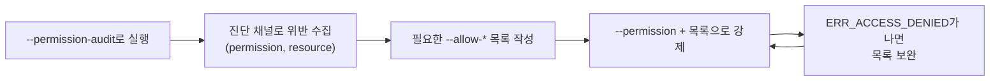

> Node Weekly #614 「Node 25.8 adds permission model audit mode」(2026.03)가 소개한 `--permission-audit`를 출발점으로, Node.js 공식 문서 「[Permissions](https://nodejs.org/api/permissions.html)」와 「[Command-line API](https://nodejs.org/api/cli.html)」를 바탕으로 재구성한 노트다.

## 권한 모델이란

Node.js 프로세스는 기본적으로 실행한 사용자가 할 수 있는 모든 일을 한다. 파일을 읽고 쓰고, 네트워크에 붙고, 다른 프로그램을 띄운다. **권한 모델(Permission Model)** 은 `--permission` 플래그로 켜는 런타임 기능으로, 이런 능력을 기본 차단하고 시작할 때 준 `--allow-*` 플래그만큼만 연다. 22.13·23.5부터 안정(Stability 2) 단계다.

```bash
$ node --permission index.js
Error: Access to this API has been restricted
  code: 'ERR_ACCESS_DENIED',
  permission: 'FileSystemRead',
  resource: '/home/user/index.js'
```

진입점 파일과 `-r`로 미리 불러온 파일은 자동으로 읽기 허용 목록에 들어간다. 위 오류는 그 밖의 파일을 읽으려 할 때 난다.

### 위치: 샌드박스가 아니라 안전벨트

공식 문서는 이 기능이 **악성 코드를 막지 않는다**고 못 박는다. Node.js 보안 정책은 실행하라고 받은 코드를 신뢰한다. 권한 모델은 믿는 코드가 실수로, 또는 버그 때문에 허락하지 않은 파일을 고치거나 자원을 쓰는 일을 막는 안전벨트(seat belt)다. 악의적인 코드는 우회해 임의 코드를 실행할 수 있고, 실제로 우회 취약점이 여러 번 보고되고 패치됐다.

| 막는 것 | 막지 못하는 것 |
| --- | --- |
| 설정 실수로 엉뚱한 경로에 쓰기, 예상하지 못한 자식 프로세스 실행 | 의도적으로 우회하는 악성 패키지 |
| 의존성이 몰래 네트워크·파일에 접근하는 것을 **드러내기**(감사 모드) | 같은 OS 사용자 권한으로 할 수 있는 OS 수준의 일 전부 |

신뢰할 수 없는 코드를 돌린다면 컨테이너, 별도 OS 사용자, VM 같은 OS 수준 격리를 쓰고 권한 모델은 그 위에 한 겹 더 두는 층으로 본다. 패키지 설치 스크립트 실행을 막아도 의존성 코드는 `import` 때 실행되므로, 그 코드가 할 수 있는 일을 줄이는 층으로 권한 모델이 함께 거론된다.

## 플래그

| 능력 | 허용 플래그 | 비고 |
| --- | --- | --- |
| 파일 읽기 | `--allow-fs-read=<경로>` | 여러 경로는 플래그를 반복한다. `*`는 전부 |
| 파일 쓰기 | `--allow-fs-write=<경로>` | 쉼표로 여러 경로를 잇는 방식은 더 이상 받지 않는다 |
| 네트워크 | `--allow-net` | 25.0에서 추가. 켜고 끄는 스위치이고 호스트별로 좁히지는 못한다 |
| 자식 프로세스 | `--allow-child-process` | |
| 워커 스레드 | `--allow-worker` | |
| 네이티브 애드온 | `--allow-addons` | 없으면 `ERR_DLOPEN_DISABLED` |
| WASI | `--allow-wasi` | |
| 인스펙터 | `--allow-inspector` | 없으면 `SIGUSR1` 리스너도 만들지 않는다 |

```bash
node --permission \
  --allow-fs-read=./config/ --allow-fs-read=./node_modules/ \
  --allow-fs-write=/tmp/ \
  --allow-net \
  server.js
```

### 경로 규칙

| 규칙 | 예 |
| --- | --- |
| 상대 경로는 현재 작업 디렉터리 기준으로 풀린다 | `--allow-fs-read=./data` |
| `*`는 접두사 매칭이고 그 뒤 글자는 무시된다 | `/home/test*`는 `/home/test/a`와 `/home/test2`를 함께 연다. `/home/*.js`는 `/home/*`와 같다 |
| 시작 시점에 있는 디렉터리는 자동으로 하위 전체(`/*`)가 붙는다 | `/srv/files` → `/srv/files/*` |
| 아직 없는 디렉터리는 `*`를 직접 붙여야 한다 | `--allow-fs-write=/srv/cache/*` |

권한 모델이 켜지면 `fsync`·`fchmod`·`fchown`·`futimes`처럼 파일 디스크립터로 동작하는 일부 `fs` 함수(와 `FileHandle`의 같은 메서드)는 경로를 검사할 수 없어 아예 `ERR_ACCESS_DENIED`를 던진다.

## 런타임 API: `process.permission`

권한 모델이나 감사 모드가 켜졌을 때만 `process.permission`이 생긴다.

```javascript
import fs from 'node:fs'

process.permission.has('fs.write')                       // 쓰기 권한이 어딘가에 있나
process.permission.has('fs.read', '/etc/myapp/secret')   // 이 경로를 읽을 수 있나

// 시작할 때만 필요한 권한은 초기화 뒤에 버린다 (되돌릴 수 없다)
const config = fs.readFileSync('/etc/myapp/config.json', 'utf8')
process.permission.drop('fs.read', '/etc/myapp')
process.permission.drop('child')                          // 범위 전체를 버린다
```

- `has`로 기능을 조건부로 켜면, 권한 없이 실행돼도 오류 대신 대체 동작을 고를 수 있다.
- `drop`은 이후의 검사에만 적용된다. 이미 연 파일 디스크립터, 소켓, 자식 프로세스, 워커는 그대로 살아 있으니 직접 닫는다.
- `drop`의 대상은 허용할 때 준 값과 정확히 같아야 한다. `*`로 열었으면 범위 전체만, 디렉터리로 열었으면 그 디렉터리만 버릴 수 있다.

## 감사 모드: `--permission-audit`

Node.js 25.8에서 추가된 감사 모드는 권한 검사를 똑같이 하되 **막지 않는다.** 위반은 `node:diagnostics_channel`로 발행되고 실행은 계속된다. 권한 모델을 바로 강제하면 어디서 깨질지 모르는 기존 앱에, 필요한 `--allow-*` 목록을 먼저 뽑는 데 쓴다.



```javascript
import diagnostics_channel from 'node:diagnostics_channel'

diagnostics_channel.channel('node:permission-model:fs').subscribe((msg) => {
  console.warn(`권한 위반: ${msg.permission} ${msg.resource}`)
})
```

채널은 범위마다 따로 있다: `node:permission-model:fs`, `:net`, `:child`, `:worker`, `:inspector`, `:wasi`, `:addon`. `--allow-*`와 함께 주면 허용하지 않은 범위만 기록하고, `--permission`과 함께 주면 `--permission`이 이겨 강제 모드가 된다.

## 한계

| 한계 | 내용 |
| --- | --- |
| 워커 상속 | 기본 `Worker`는 부모의 CLI 플래그(권한 포함)를 받지만, `execArgv`를 주면(빈 배열이어도) 대체되므로 권한을 다시 적어야 한다 |
| 심볼릭 링크 | 허용 경로 안의 링크가 밖을 가리켜도 따라간다(알려진 문제). 허용 경로에 링크가 없게 한다 |
| 기존 파일 디스크립터 | 이미 열린 디스크립터를 `fs`로 쓰면 검사를 거치지 않는다 |
| 시작 단계 플래그 | 권한 모델은 환경 설정 뒤에 켜지므로 `--env-file`, `--openssl-config`는 검사 대상이 아니다 |
| 환경 변수 | 읽기를 제한하는 범위가 없다 |
| 다른 Node 프로세스 | `process._debugProcess(pid)`는 어떤 권한에도 걸리지 않아, 같은 OS 사용자의 다른 Node 프로세스 인스펙터를 열게 할 수 있다. OS 사용자를 나눠 막는다 |

`npx`로 띄운 패키지에 적용하려면 `npx --node-options="--permission --allow-fs-read=$(npm config get cache)" <패키지>`처럼 설치 위치 읽기를 함께 열어 준다.

## Deno 권한과 비교

| 항목 | Node.js | Deno |
| --- | --- | --- |
| 기본값 | 플래그가 없으면 **전부 허용**. `--permission`을 줘야 차단 | 기본 **전부 차단** |
| 파일 | `--allow-fs-read`·`--allow-fs-write` + 경로 | `--allow-read`·`--allow-write` + 경로 |
| 네트워크 | `--allow-net` 켜기·끄기 | `--allow-net=api.example.com`처럼 호스트·포트 단위 |
| 환경 변수·하위 프로그램 | 환경 변수 범위 없음. 자식 프로세스는 전부 또는 없음 | `--allow-env=VAR`, `--allow-run=git`처럼 이름 단위 |
| 거부 우선 | `process.permission.drop`으로 실행 중 버리기 | `--deny-*` 플래그로 허용 범위 안에서 일부를 다시 막기 |

Node의 권한 모델은 기존 생태계를 깨지 않으려고 **옵트인**이고 단위가 굵다. 출발점이 다른 Deno의 설계 배경은 [[nodejs-runtime#Node 이후의 런타임: Deno와 Bun|Node 이후의 런타임]]에 있다.

## 정리

- `--permission`은 파일·네트워크·프로세스·워커·애드온·WASI·인스펙터를 막고, `--allow-*`로 필요한 것만 연다.
- 악성 코드 방어용 샌드박스가 아니라 믿는 코드의 실수를 막는 안전벨트다. 신뢰할 수 없는 코드는 OS 수준에서 격리한다.
- 기존 앱은 `--permission-audit`(25.8+)로 위반을 모아 허용 목록을 만든 뒤 강제 모드로 옮긴다.
- 시작 때만 필요한 권한은 `process.permission.drop`으로 버리고, 워커의 `execArgv`·심볼릭 링크·기존 디스크립터 같은 빈틈을 따로 챙긴다.

관련 노트: [[nodejs-runtime|Node.js 런타임: 구조·이벤트 루프·운영과 OS 차이]], [[nodejs-memory-tuning|Node.js 메모리 구조와 튜닝]]
