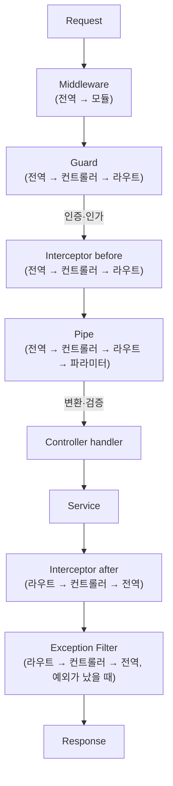

NestJS는 TypeScript를 기본으로 지원하는 Node.js 서버 애플리케이션 프레임워크다. 내부적으로는 Express(기본) 또는 Fastify를 HTTP 엔진으로 쓰면서, 그 위에 **Module · Controller · Provider(DI)** 라는 구조와 데코레이터 문법을 제공해 확장 가능하고 유지보수하기 쉬운 서버를 만들게 돕는다. Spring처럼 객체지향·DI 중심이라 Java 개발자에게 익숙하고, Express 개념(미들웨어·라우터·서비스 분리)을 알면 금방 적응할 수 있다.

> 인프런 「탄탄한 백엔드 NestJS, 기초부터 심화까지」 강의 필기를 바탕으로 재구성한 노트 묶음이다.

2026년 10월 기준 최신은 **NestJS 12**다. 코어 패키지가 ESM으로 배포되고 Node.js 20.19+ 또는 22.12+가 필요하다(CLI는 22.22+·24.15+·26+). 기존 CommonJS 앱도 Node의 `require(esm)` 덕분에 대부분 그대로 동작한다. Module·Controller·Provider·DI와 요청 생명주기 같은 핵심 API는 초기 버전부터 거의 같다. ([마이그레이션 가이드](https://docs.nestjs.com/migration-guide))

HTTP 엔진은 `@nestjs/platform-fastify` 어댑터로 Fastify로 바꿀 수 있다. 이때 `express-basic-auth`처럼 Express 전용 미들웨어는 Fastify용으로 대체해야 한다.

## 요청 생명주기 한눈에 보기

요청이 컨트롤러에 도달하기 전후로 여러 "끼어들 수 있는 지점"이 있다. 각 노트는 이 순서 중 한 단계를 다룬다.

## 노트 목록

| 구분 | 노트 |
| --- | --- |
| 기본 구조 | [프로젝트 구조](Backend/NestJS/project-structure), [Controller](Backend/NestJS/controller), [Module과 Provider(DI)](Backend/NestJS/module) |
| 요청 파이프라인 | [Middleware와 Interceptor(AOP)](Backend/NestJS/interceptor-aop), [Exception Filter와 Pipe](Backend/NestJS/exception-filter-pipe) |
| 데이터 계층 | [설정과 환경 변수](Backend/NestJS/config-env), [Mongoose 스키마](Backend/NestJS/mongoose-schema), [DTO와 Validation](Backend/NestJS/dto-validation), [Repository 패턴](Backend/NestJS/repository-pattern) |
| 기능 구현 | [JWT·Passport 인증](Backend/NestJS/auth-jwt-passport), [Swagger 문서화](Backend/NestJS/swagger), [파일 업로드(Multer)](Backend/NestJS/file-upload-multer) |

먼저 [Express](Backend/Express/routing-crud) 노트로 미들웨어·라우터·서비스 분리를 익혀 두면 비교하며 읽기 좋다.
