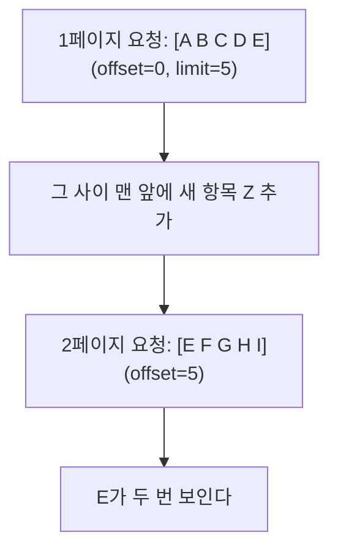

> ByteByteGo의 System Design 101 가이드 「[How do we Perform Pagination in API Design?](https://bytebytego.com/guides/how-do-we-perform-pagination-in-api-design)」을 바탕으로 재구성한 노트다.

## 페이지네이션이란

페이지네이션(pagination)은 **큰 목록을 한 번에 다 주지 않고 조각으로 나눠 주는** API 설계다. 주문 100만 건을 한 응답에 담으면 DB, 네트워크, 클라이언트 메모리가 모두 버티지 못한다. 그래서 목록 API는 처음부터 "어디서부터, 몇 개"를 받는 형태로 만든다.

방식은 **"다음 조각의 시작점을 무엇으로 표현하나"** 로 갈린다. 몇 개를 건너뛸지(숫자)로 표현하면 오프셋 계열, 마지막으로 본 항목(값)으로 표현하면 커서·키셋 계열이다.

## 여섯 가지 방식

| 방식 | 요청 예 | 시작점 | 장점 | 단점 |
| --- | --- | --- | --- | --- |
| 오프셋(offset) | `GET /orders?offset=40&limit=20` | 건너뛸 개수 | 가장 단순하다. 임의 위치로 바로 간다 | 깊은 페이지일수록 느리다. 데이터가 바뀌면 중복·누락이 생긴다 |
| 페이지 번호(page) | `GET /items?page=3&size=20` | 페이지 번호 | 화면의 페이지 번호와 그대로 맞는다 | 내부적으로 오프셋이라 같은 문제를 가진다 |
| 커서(cursor) | `GET /orders?cursor=eyJpZCI6MTAyfQ` | 서버가 준 불투명한 토큰 | 깊이와 상관없이 빠르다. 내부 구현을 숨기고 바꿀 수 있다 | 특정 페이지로 바로 못 간다. 구현이 조금 복잡하다 |
| 키셋(keyset) | `GET /items?after_id=102&limit=20` | 마지막 항목의 정렬 키 값 | 인덱스를 타서 빠르다. 중간 삽입에도 안정적이다 | 고유하고 인덱스가 있는 정렬 키가 필요하다 |
| 시간 기반 | `GET /events?start_time=…&end_time=…` | 시각 범위 | 로그·피드처럼 시간순 데이터에 자연스럽다 | 타임스탬프가 정확하고 일관돼야 한다. 같은 시각의 항목을 따로 다뤄야 한다 |
| 혼합(hybrid) | `GET /events?cursor=abc&start_time=…` | 둘 이상 조합 | 시간 범위 안에서 커서로 넘기는 식으로 장점을 섞는다 | 설계와 테스트가 복잡해진다 |

커서와 키셋은 같은 아이디어의 두 얼굴이다. **키셋은 정렬 키 값을 그대로 노출**하고, **커서는 그 값을 인코딩한 불투명 토큰으로 감싼다.** 대부분의 커서 구현은 내부적으로 키셋 쿼리를 쓴다.

## 오프셋이 느려지는 이유

```sql
-- 오프셋: 앞의 100000행을 읽고 버린 뒤 20행을 준다
SELECT * FROM orders ORDER BY created_at DESC, id DESC
LIMIT 20 OFFSET 100000;

-- 키셋: 인덱스에서 마지막으로 본 위치를 바로 찾아 20행만 읽는다
SELECT * FROM orders
WHERE (created_at, id) < ('2026-10-20 12:00:00', 98765)
ORDER BY created_at DESC, id DESC
LIMIT 20;
```

오프셋은 DB가 **건너뛸 행을 실제로 읽어야** 하므로 페이지가 깊어질수록 비용이 선형으로 늘어난다. 키셋은 인덱스에서 시작 위치를 찾아 필요한 만큼만 읽는다.

## 데이터가 바뀔 때

목록을 넘기는 사이에 새 항목이 들어오거나 지워지면 오프셋 계열은 어긋난다.



삭제가 일어나면 반대로 한 항목을 건너뛴다. 키셋·커서는 "E 다음부터"를 값으로 기억하므로 이런 중복·누락이 없다. **무한 스크롤 피드처럼 계속 바뀌는 목록에는 커서 계열이 맞다.**

## 설계 규칙

- **정렬은 결정적이어야 한다.** `created_at`만으로 정렬하면 같은 시각의 항목 순서가 요청마다 바뀔 수 있다. 고유한 키(`id`)를 마지막 정렬 기준으로 덧붙여 동점을 깬다.
- **정렬 키에 맞는 복합 인덱스**를 둔다. 키셋의 속도는 인덱스에서 나온다.
- **`limit`에 상한**을 둔다. 클라이언트가 `limit=100000`을 보내면 페이지네이션이 무력해진다.
- **전체 개수는 선택 사항으로.** `COUNT(*)`는 큰 테이블에서 비싸다. 꼭 필요한 화면에서만 따로 요청하게 하거나 근사치를 쓴다.
- **응답에 다음 위치를 실어 준다.** 클라이언트가 커서를 직접 계산하게 하지 않는다.

```json
{
  "data": [ ... ],
  "page_info": { "next_cursor": "eyJpZCI6OTg3NjV9", "has_next": true }
}
```

HTTP 헤더로 알리려면 `Link: <https://api.example.com/orders?cursor=…>; rel="next"`를 쓴다.

## 고르는 기준

| 상황 | 방식 |
| --- | --- |
| 관리자 화면처럼 데이터가 작고 페이지 번호로 이동해야 한다 | 페이지 번호·오프셋 |
| 무한 스크롤, 피드, 큰 테이블 | 커서(내부는 키셋) |
| 로그·이벤트를 기간으로 조회 | 시간 기반, 기간 안에서는 커서 |
| 외부 공개 API | 커서. 내부 정렬 키가 바뀌어도 토큰 모양은 유지된다 |

## 정리

- 페이지네이션은 시작점을 **개수**로 표현하느냐(오프셋·페이지), **값**으로 표현하느냐(키셋·커서)로 나뉜다.
- 오프셋은 단순하지만 깊은 페이지에서 느리고, 변경 중에 중복·누락이 생긴다.
- 키셋·커서는 인덱스를 타서 빠르고 안정적이지만 임의 페이지 이동이 어렵다.
- 정렬에 고유 키를 덧붙이고, `limit` 상한을 두고, 다음 커서를 응답에 실어 준다.

관련 노트: [[rest-api|REST API 설계]], [[prisma|Prisma]], [[sql-basics|SQL 기초]], [[database-sharding|데이터베이스 샤딩]], [[api-architectural-styles|API 아키텍처 스타일]]
