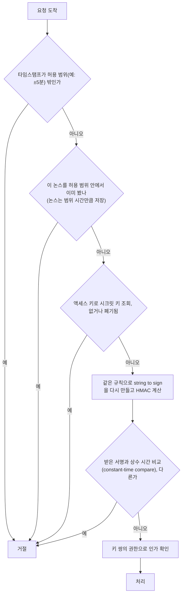

> ByteByteGo의 System Design 101 가이드 「[A cheat sheet for API designs](https://bytebytego.com/guides/a-cheat-sheet-for-api-designs)」, 「[How to Design Secure Web API Access](https://bytebytego.com/guides/how-to-design-secure-web-api-access-for-your-website)」를 바탕으로 재구성한 노트다.

## 왜 요청에 서명하나

API를 외부에 열면 **매 요청이 정말 그 클라이언트가 보낸 것인지** 확인해야 한다. 사람이 로그인하는 웹 화면은 비밀번호로 토큰을 받아 쓰면 되지만, 서버가 서버를 부르는 연동(결제, 오픈 API, 웹훅)에는 로그인 절차가 없다.

HMAC(Hash-based Message Authentication Code) 서명은 **비밀키를 네트워크로 보내지 않고도** 그 키를 가졌다는 사실과 요청이 바뀌지 않았다는 사실을 함께 증명한다. 클라이언트와 서버가 같은 비밀키로 같은 문자열의 해시를 계산해, 결과가 같으면 통과시킨다.

## 키의 구성

| 키 | 공개 여부 | 역할 |
| --- | --- | --- |
| 앱 ID(App ID) | 공개 | 어떤 클라이언트(앱)인지 식별 |
| 액세스 키(Access Key) | 공개. 요청에 실어 보낸다 | 어떤 키 쌍을 썼는지 알려 준다 |
| 시크릿 키(Secret Key) | **비공개.** 클라이언트와 서버만 안다 | 서명을 계산하는 데만 쓴다. 절대 전송하지 않는다 |

클라이언트마다 앱 ID를 하나 주고, **권한별로 키 쌍을 따로 발급**한다. 예를 들어 읽기 전용 키 쌍과 읽기·쓰기 키 쌍을 나눠 두면, 조회만 하는 배치 서버에 쓰기 권한이 딸려 가지 않는다. 키가 새도 피해 범위가 그 권한으로 한정된다.

## 서명 만들기

```text
1. 재료 모으기
   메서드, 경로, 쿼리 파라미터, 본문 해시, 타임스탬프, 논스, 액세스 키

2. 서명할 문자열(string to sign) 만들기
   정해진 순서와 형식으로 이어 붙인다 (파라미터는 이름순 정렬, 인코딩 통일)
   "POST\n/v1/orders\namount=100&currency=KRW\n<본문 SHA-256>\n1761022800\n9f3c...a1"

3. 해시
   signature = HMAC-SHA256(secret_key, string_to_sign)

4. 전송
   Authorization: HMAC access_key=AK123, ts=1761022800, nonce=9f3c...a1, signature=...
```

**정규화(canonicalization)가 핵심이다.** 클라이언트와 서버가 바이트 하나까지 같은 문자열을 만들어야 서명이 일치한다. 파라미터 순서, 공백, URL 인코딩 규칙을 문서로 못 박는다.

## 요청에 들어가는 것

| 항목 | 이유 |
| --- | --- |
| 인증 정보 (액세스 키, 서명) | 누가 보냈는지와 위변조 여부 |
| 타임스탬프 | 오래된 요청을 거절해 **재전송 공격(replay attack)** 을 막는다 |
| 논스(nonce) | 요청마다 새로 만드는 무작위 문자열. 허용 시간 안에서도 같은 요청이 두 번 처리되지 않게 한다 |
| 요청 데이터 | 처리에 필요한 사용자 ID, 거래 정보, 검색어 등. 서명 대상에 포함해야 변조를 막는다 |

## 서버의 검증 순서



서명 비교는 `==` 대신 **상수 시간 비교**를 쓴다. 일반 비교는 앞에서부터 다른 글자를 만나면 바로 끝나서, 응답 시간 차이로 서명을 한 글자씩 맞혀 가는 타이밍 공격에 노출된다. 해시 함수는 SHA-256 이상을 쓰고 MD5·SHA-1은 쓰지 않는다.

## 토큰 방식과 비교

| 항목 | 토큰 기반 | HMAC 서명 |
| --- | --- | --- |
| 흐름 | 비밀번호로 인증 서버에서 만료 있는 토큰을 받고, 이후 요청 헤더에 토큰을 싣는다 | 미리 받은 시크릿 키로 요청마다 서명을 계산해 싣는다 |
| 비밀이 네트워크를 지나나 | 토큰 자체가 지나간다. 탈취되면 만료 전까지 재사용된다 | 시크릿 키는 지나가지 않는다. 서명은 그 요청에만 유효하다 |
| 요청 무결성 | 보장하지 않는다 (HTTPS에 기댄다) | 서명 대상이 바뀌면 검증이 실패한다 |
| 구현 부담 | 낮다. 표준 라이브러리가 많다 | 정규화 규칙, 시계 동기화, 논스 저장이 필요하다 |
| 어울리는 곳 | 사용자가 로그인하는 웹·앱 | 서버 간 연동, 오픈 API, 웹훅 검증 |

토큰 방식의 자세한 흐름은 [[session-vs-token-auth|세션 기반 인증과 토큰 기반 인증]]에 있다. AWS의 Signature Version 4, 결제사들의 웹훅 서명이 HMAC 서명 방식의 대표적인 예다.

## 정리

- HMAC 서명은 시크릿 키를 보내지 않고 "키를 가졌다"와 "요청이 안 바뀌었다"를 함께 증명한다.
- 키 쌍은 권한별로 나눠 발급해 유출 피해를 줄인다.
- 타임스탬프는 오래된 요청을, 논스는 허용 시간 안의 중복 요청을 막는다.
- 서버는 같은 규칙으로 서명을 다시 계산하고 **상수 시간으로 비교**한다.
- 사용자 로그인에는 토큰, 서버 간 연동에는 서명이 기본 선택지다.

관련 노트: [[api-security|API 보안 체크리스트]], [[session-vs-token-auth|세션 기반 인증과 토큰 기반 인증]], [[webhook|웹훅과 폴링]], [[telegram-mini-app-auth|텔레그램 미니 앱 인증]], [[https|HTTPS와 TLS]]
