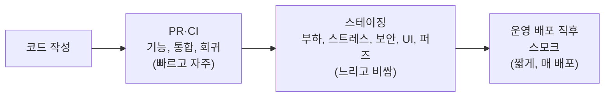

> ByteByteGo의 System Design 101 가이드 「[Explaining 9 Types of API Testing](https://bytebytego.com/guides/explaining-9-types-of-api-testing)」을 바탕으로 재구성한 노트다.

## API 테스트란

API 테스트는 화면을 거치지 않고 **요청을 직접 보내 응답과 부수 효과를 확인**하는 테스트다. 상태 코드, 응답 본문의 모양과 값, 응답 시간, DB에 남은 결과를 본다. UI보다 빠르고 덜 깨지므로 백엔드 검증의 중심이 된다.

종류가 많은 이유는 **묻는 질문이 다르기 때문**이다. "돌아가나?", "맞게 하나?", "다른 것과 함께 되나?", "버티나?", "뚫리나?"는 서로 다른 테스트가 답한다.

## 아홉 가지 테스트

| 종류 | 답하는 질문 | 하는 일 |
| --- | --- | --- |
| 스모크(smoke) | 일단 살아 있나 | 개발·배포 직후 핵심 엔드포인트 몇 개만 불러 크게 깨진 것이 없는지 본다 |
| 기능(functional) | 요구 사항대로 동작하나 | 기능 명세로 테스트 계획을 세우고 실제 응답을 기대 결과와 비교한다 |
| 통합(integration) | 여러 호출과 서비스가 함께 맞물리나 | 여러 API 호출을 이어 하나의 시나리오를 끝까지 돌리고, 서비스 간 통신과 데이터 전달을 확인한다 |
| 회귀(regression) | 고치거나 더한 뒤에도 기존 동작이 그대로인가 | 기존 테스트 묶음을 변경마다 다시 돌린다 |
| 부하(load) | 예상 트래픽에서 얼마나 버티나 | 여러 수준의 부하를 흉내 내 응답 시간과 처리량을 재고 수용량을 계산한다 |
| 스트레스(stress) | 한계를 넘기면 어떻게 되나 | 일부러 감당 못 할 부하를 걸어 무너지는 지점과 무너지는 방식, 회복 여부를 본다 |
| 보안(security) | 외부 위협에 뚫리나 | 인증 우회, 권한 상승, 인젝션, 민감 정보 노출을 시도한다 |
| UI | 화면이 API 데이터를 제대로 보여 주나 | UI와 API의 상호작용을 확인해 데이터가 올바르게 표시되는지 본다 |
| 퍼즈(fuzz) | 이상한 입력에 죽지 않나 | 잘못되거나 예상 밖의 입력을 대량으로 넣어 API를 넘어뜨리려 시도하고, 그 과정에서 취약점을 찾는다 |

## 언제 돌리나

빠르고 결정적인 테스트는 변경마다, 느리고 환경이 필요한 테스트는 스테이징에서 주기적으로 돌린다. 스모크 테스트는 배포 직후 운영 환경에서도 돌려 배포 자체가 성공했는지 확인한다.

## 헷갈리는 쌍

| 쌍 | 차이 |
| --- | --- |
| 부하 vs 스트레스 | 부하는 **예상 범위 안**에서 성능을 잰다. 스트레스는 **범위를 넘겨** 한계와 무너지는 방식을 본다. 좋은 시스템은 한계에서 전부 죽지 않고 일부 요청을 거절하며 버틴다 |
| 기능 vs 통합 | 기능은 API 하나가 명세대로 하는지, 통합은 여러 API·서비스가 이어져 시나리오가 완성되는지 본다 |
| 스모크 vs 회귀 | 스모크는 넓고 얕게 "켜지나"만, 회귀는 기존 동작 전체를 깊게 확인한다 |
| 보안 vs 퍼즈 | 보안은 알려진 공격 유형을 의도적으로 시도한다. 퍼즈는 무작위·변형 입력으로 예상하지 못한 실패를 찾는다. 퍼즈는 보안 테스트의 한 기법으로도 쓰인다 |

## 정리

- API 테스트는 화면 없이 요청과 응답으로 백엔드를 검증한다.
- 테스트 종류는 질문으로 고른다. 살아 있나(스모크), 맞나(기능), 함께 되나(통합), 그대로인가(회귀), 버티나(부하·스트레스), 뚫리나(보안·퍼즈).
- 빠른 것은 매 변경마다, 비싼 것은 스테이징에서, 스모크는 매 배포 직후에 돌린다.

관련 노트: [[frontend-test-types|프론트엔드 테스트의 종류와 도구]], [[software-testing|소프트웨어 테스트]], [[api-security|API 보안 체크리스트]], [[api-architectural-styles|API 아키텍처 스타일]]
