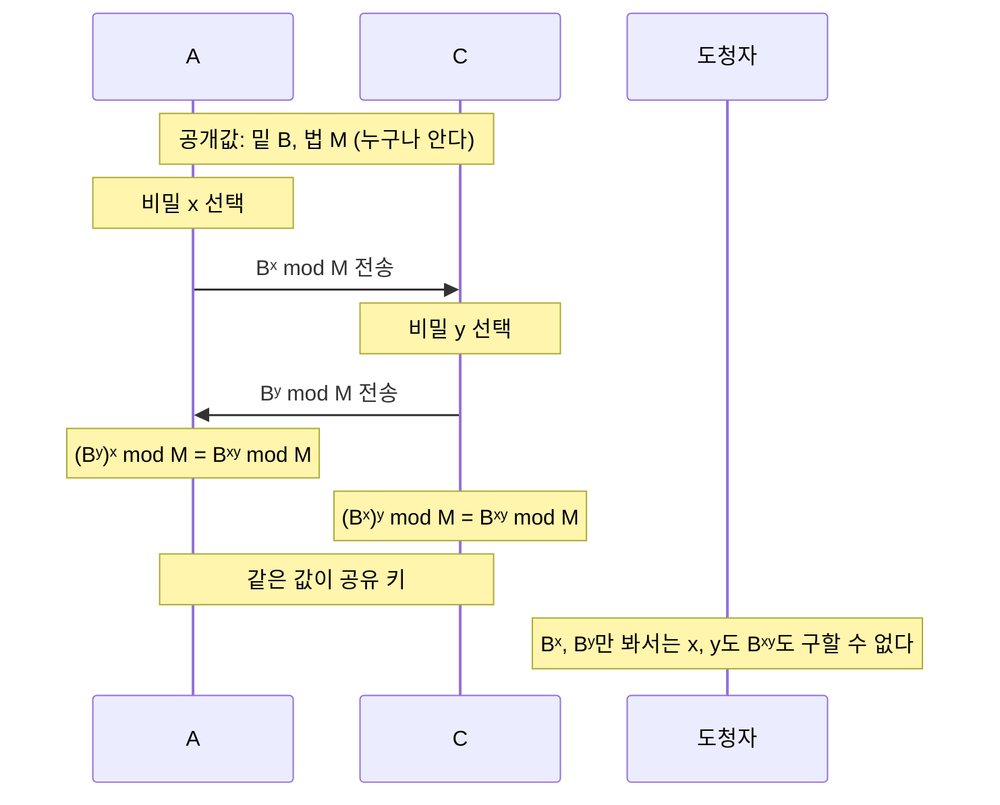
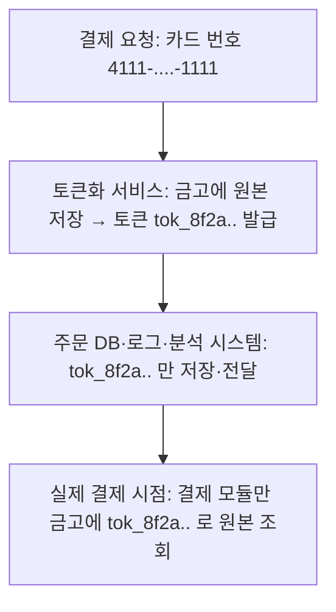
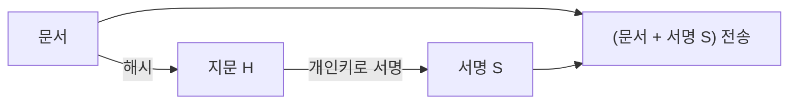
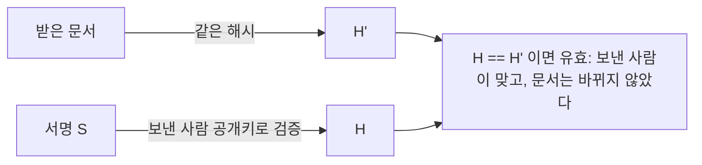

> ByteByteGo의 System Design 101 가이드 「[Encoding vs Encryption vs Tokenization](https://bytebytego.com/guides/encoding-vs-encryption-vs-tokenization)」, 「[Symmetric vs Asymmetric Encryption](https://bytebytego.com/guides/symmetric-encryption-vs-asymmetric-encryption)」, 「[How Digital Signatures Work](https://bytebytego.com/guides/how-digital-signatures-work)」을 바탕으로, 암호 부품의 조합 원칙은 「[고수준에서 암호학 이해하기](https://gist.github.com/lifthrasiir/84a546e8fa080d843a93)」로 보강해 재구성한 노트다. 용도별 선택과 조합의 함정은 Thomas Ptacek의 「[Cryptographic Right Answers](https://gist.github.com/tqbf/be58d2d39690c3b366ad)」, Paragon Initiative의 「[An Open Letter to Developers Everywhere (About Cryptography)](https://gist.github.com/paragonie-scott/e9319254c8ecbad4f227)」, Loup Vaillant의 「[Rolling Your Own Crypto](http://loup-vaillant.fr/articles/rolling-your-own-crypto)」, 명령줄 예시는 Integralist의 「[Hashing, Encryption and Encoding](https://web.archive.org/web/2020/https://www.integralist.co.uk/posts/hashing-and-encryption/)」을 바탕으로 보강하고, 포스트 양자 표준은 NIST [FIPS 203](https://csrc.nist.gov/pubs/fips/203/final)으로 확인했다.
> 대칭키·공개키 비교와 RSA 키 생성 절차는 GitHub 자료 모음 「[Subjective-studies_OS-CN-DBMS](https://github.com/avgspacelover/Subjective-studies_OS-CN-DBMS)」의 네트워크 면접 정리를, 「키 길이와 전수 조사」·「디피-헬만 키 교환」 절은 CrashCourse의 「Crash Course Computer Science」 강의를 바탕으로 보강했다.

## 네 가지 변환은 목적이 다르다

민감한 데이터를 다룰 때 가장 흔한 실수는 **목적이 다른 변환을 보안 수단으로 착각하는 것**이다. Base64로 감춘 비밀번호, 해시만 한 카드 번호가 대표적이다.

| 변환 | 목적 | 되돌리기 | 키 | 예 |
| --- | --- | --- | --- | --- |
| 인코딩(encoding) | 다른 채널·형식으로 옮기기 | 누구나 같은 규칙으로 되돌린다 | 없다 | Base64, URL 인코딩, UTF-8 |
| 암호화(encryption) | 기밀성: 키가 있는 사람만 읽게 | 키가 있으면 복호화 | 있다 | AES, ChaCha20, RSA |
| 해시(hash) | 무결성·비교: 같은 입력이면 같은 지문 | 불가능(일방향) | 없다(HMAC은 키 사용) | SHA-256, 비밀번호용 Argon2·bcrypt |
| 토큰화(tokenization) | 원본을 시스템 밖으로 빼고 대체값만 돌리기 | 토큰 금고(vault)에 물어야만 원본 조회 | 금고 접근 권한 | 결제 카드 번호 토큰 |

- **인코딩은 보안이 아니다.** 키가 없으므로 디코딩 규칙만 알면 누구나 되돌린다. JWT의 Payload가 Base64URL이라 누구나 읽히는 것과 같은 이유다 → [[base64-encoding|Base64 인코딩]]
- **해시는 암호화가 아니다.** 복호화가 없으므로 "원본을 다시 써야 하는 값"에는 맞지 않고, 비교만 하면 되는 값(비밀번호, 파일 무결성)에 쓴다 → [[password-storage|비밀번호 저장과 비밀번호 관리자]]

## 암호화: 대칭과 비대칭

암호화는 키 하나로 잠그고 여는 **대칭키 암호**와, 공개키로 잠그고 개인키로 여는 **공개키(비대칭) 암호**로 나뉜다.

| 방식 | 원리 | 속도와 쓰임 | 예 | 약점 |
| --- | --- | --- | --- | --- |
| 대칭키(비밀키) | 보내는 쪽과 받는 쪽이 **같은 키** 하나로 암호화·복호화한다 | 빠르다. 대용량 데이터에 맞아 TLS 본문 암호화, 저장 데이터(대량 개인정보) 암호화에 쓴다 | AES, ChaCha20. 과거의 DES는 56비트 키라 깨졌다 | 키를 상대에게 안전하게 건넬 방법이 없고, 상대마다 키가 따로 필요하다(n명이면 n(n-1)/2개). 키를 아는 쪽이 늘수록 유출 위험도 는다 |
| 공개키(비대칭) | 각자 **공개키와 개인키** 한 쌍을 갖는다. 공개키로 잠근 것은 개인키로만 연다 | 연산이 무겁다. 키 교환, 디지털 서명처럼 작은 데이터에만 쓴다 | RSA, 타원 곡선(ECDH·ECDSA) | 느리다. 받은 공개키가 정말 상대 것인지 확인할 수단(인증서)이 따로 필요하다 |

해시는 키가 없어서 공격자가 내용과 해시를 함께 바꿀 수 있다. 그래서 무결성을 지킬 때는 해시만 보내지 않고 키를 넣은 HMAC이나 디지털 서명과 묶는다(아래 「암호 부품과 조합 원칙」).

실무 시스템은 **둘을 섞는다(하이브리드 암호).** 비대칭 방식으로 대칭 키를 안전하게 합의하고, 실제 데이터는 대칭 키로 암호화한다. TLS가 그렇다 → [[https|HTTPS와 TLS]]. 저장 데이터도 데이터를 데이터 키(대칭)로 암호화하고, 데이터 키를 다시 KMS의 마스터 키로 감싸는 **봉투 암호화(envelope encryption)** 를 쓴다.

### 키 길이와 전수 조사

현대 암호는 알고리즘이 공개돼 있으므로 남는 공격은 키를 맞히는 것이다. 키가 n비트면 가능한 키는 2ⁿ개이고, **1비트 늘 때마다 전수 조사 시간이 두 배**가 된다.

- DES의 56비트 키(약 7.2×10¹⁶개)는 1977년 표준이 될 때는 충분했다. 1998년 약 25만 달러짜리 전용 기계(EFF의 Deep Crack)가 며칠 만에 키를 찾아내면서 안전하지 않게 됐다.
- AES-128의 2¹²⁸개는 지구의 모든 컴퓨터를 동원해도 전수 조사할 수 없다.
- AES는 데이터를 16바이트 블록으로 나누고, 키에서 만든 라운드 키로 치환·전치·섞기를 여러 번 되풀이한다(128비트 키는 10라운드, 192비트 12라운드, 256비트 14라운드). 라운드와 키를 무한정 늘리지 않는 것은 **성능과 안전의 균형** 때문이다. 연결 하나 맺는 데 몇 분이 걸리는 암호는 아무도 쓰지 않는다.

### RSA

**RSA**는 큰 수를 소인수분해하기 어렵다는 점에 안전성을 건 공개키 암호다. 키 만들기와 암호화·복호화는 다음 순서다(수학적 근거인 오일러 정리는 [[number-theory-basics|정수론 기초: 소수·최대공약수·합동식]]).

```text
1. 큰 소수 p, q를 고르고 n = p × q, φ(n) = (p-1)(q-1)을 구한다
2. φ(n)과 서로소인 e를 고른다 (보통 65537)
3. e × d ≡ 1 (mod φ(n))인 d를 구한다 (확장 유클리드 호제법)
4. 공개키 (n, e), 개인키 (n, d). p, q, φ(n)은 버린다
암호화 c = m^e mod n,  복호화 m = c^d mod n

작은 예: p=3, q=11 → n=33, φ=20, e=3, d=7 (3×7=21≡1)
  m=4 → c = 4³ mod 33 = 31 → 31⁷ mod 33 = 4
```

실제 키는 n이 2048비트 이상이다. RSA는 지금 주로 **서명**(인증서)에 쓰이고, TLS 1.3은 RSA로 세션 키를 보내는 키 교환을 없앴다([[web-pki-evolution|웹 PKI의 변천]]).

### 디피-헬만 키 교환

대칭키는 양쪽이 같은 키를 가져야 하는데, 인터넷에서는 키를 미리 건넬 방법이 없고 키를 그냥 보내면 도청당한다. **키 교환**(key exchange)은 키 자체를 보내지 않고 양쪽이 같은 키를 계산해 내게 한다. 바탕은 **일방향 함수**(one-way function), 즉 계산은 쉽지만 거꾸로 풀기는 어려운 함수다. 물감 두 색을 섞기는 쉬워도 섞인 색에서 원래 색을 알아내기 어려운 것과 같다.

디피-헬만(Diffie-Hellman, DH)의 일방향 함수는 **모듈러 거듭제곱**이다. `3⁵ mod 31`은 243을 31로 나눈 나머지 26으로 바로 나오지만, "3을 몇 제곱해 31로 나눴더니 7이 남았다"에서 지수를 찾으려면 하나씩 대입해야 한다(이산 로그 문제). 수가 수백 자리면 사실상 풀 수 없다.



이렇게 얻은 공유 키로 AES 같은 대칭 암호를 쓴다. 다만 이 계산만으로는 상대가 누구인지 모르므로 인증서·서명과 함께 쓴다. 세션마다 새 키를 만드는 방식이 주는 전방 비밀성은 [[web-pki-evolution|웹 PKI의 변천]]에 있다.

## 토큰화

토큰화는 민감한 값을 **아무 의미 없는 대체값(토큰)** 으로 바꾸고, 원본과 토큰의 대응표는 별도의 **토큰 금고**에만 둔다.



- 토큰은 원본에서 계산한 값이 아니므로 **토큰만 훔쳐서는 원본을 알아낼 수 없다.** 암호문은 키가 새면 풀리지만 토큰은 금고가 뚫려야 풀린다.
- 원본을 다루는 시스템이 금고 하나로 줄어든다. 카드 데이터 보안 표준(PCI DSS)의 심사 범위를 줄이는 대표 수단이다.
- 형식 보존 토큰(마지막 네 자리 유지 등)을 쓰면 기존 화면·스키마를 거의 바꾸지 않아도 된다.

## 디지털 서명

디지털 서명은 **"이 문서를 누가 보냈고, 오는 동안 바뀌지 않았다"** 를 증명한다. 해시와 비대칭 키를 함께 쓴다.

[보내는 쪽]



[받는 쪽]



- 문서 전체가 아니라 **해시에 서명**한다. 비대칭 연산은 무거우므로 고정 길이의 지문만 다룬다.
- 개인키는 서명자만 가지므로 서명은 **부인 방지(non-repudiation)** 효과도 있다.
- "개인키로 해시를 암호화한다"는 설명은 RSA에서만 대략 맞다. ECDSA·EdDSA는 암호화가 아닌 별도의 서명 알고리즘이다. 개념으로는 **개인키로 서명, 공개키로 검증**이라고 기억한다.
- 받은 공개키가 정말 그 사람 것인지는 서명만으로 알 수 없다. 공개키에 신원을 묶어 주는 것이 인증서와 CA다 → [[https|HTTPS와 TLS]]
- 쓰임: TLS 인증서, JWT 서명([[session-vs-token-auth|세션 기반 인증과 토큰 기반 인증]]), 코드·패키지 서명, Git 커밋 서명, 패스키 로그인([[two-factor-totp-passkey|2단계 인증: TOTP와 패스키]]).

## 암호 부품과 조합 원칙

실제 보안은 개별 알고리즘의 강도보다 **부품을 어떻게 조합했는가**에서 깨진다. 부품마다 보장하는 것이 다르다.

| 부품 | 보장하는 것 | 보장하지 않는 것 | 지금 쓰는 것 |
| --- | --- | --- | --- |
| 대칭 암호 | 기밀성 | 변조 탐지. 운용 모드를 잘못 고르면(ECB 등) 패턴이 샌다 | AES, ChaCha20 |
| 암호학적 해시 | 원본 역산·충돌 찾기가 어렵다 | 비밀 없음. 누구나 같은 해시를 계산한다 | SHA-256, SHA-3, BLAKE2/3 |
| MAC | 공유 키를 가진 쪽이 만든 메시지이고 바뀌지 않았다 | 기밀성, 부인 방지(키를 양쪽이 가진다) | HMAC-SHA-256 |
| **인증된 암호화(AEAD)** | 기밀성 + 무결성을 한 번에 | 같은 키로 nonce를 재사용하면 무너진다 | AES-GCM, ChaCha20-Poly1305 |
| 키 교환 | 도청자 앞에서 공유 비밀 만들기 | **상대가 누구인지.** 인증 없는 DH는 중간자 공격에 그대로 당한다 | X25519, ECDHE (+ 서명·인증서로 인증) |
| 디지털 서명 | 서명자와 무결성, 부인 방지 | 기밀성 | Ed25519, ECDSA, RSA-PSS |
| 키 유도 함수(KDF) | 비밀 하나에서 용도별 키 여러 개 | 입력이 약하면 결과도 약하다 | HKDF |
| 비밀번호 해시(키 스트레칭) | 예측 가능한 비밀번호의 대입 비용을 올린다 | - | Argon2id, scrypt, bcrypt → [[password-storage\|비밀번호 저장]] |
| CSPRNG | 예측할 수 없는 난수(키, nonce, 솔트, 토큰) | - | OS 제공 난수(`/dev/urandom`, `crypto.getRandomValues`, `secrets`) |

- **암호화와 무결성을 따로 조립하지 않는다.** 직접 조합한다면 암호화한 뒤 암호문에 MAC을 붙이는(encrypt-then-MAC) 순서가 안전하지만, 처음부터 AEAD를 쓰는 편이 실수가 없다.
- 해시 출력이 n비트면 생일 역설 때문에 충돌 공격은 약 n/2비트 강도다. 128비트 해시는 짧다. MD5·SHA-1은 충돌이 실제로 만들어졌으므로 보안 용도로 쓰지 않는다.
- 빠른 범용 해시는 비밀번호 저장에 맞지 않는다. 일부러 느리게 만든 비밀번호 해시를 쓴다.
- 일반 난수 함수(`Math.random`, `rand`)로 키·토큰을 만들지 않는다.
- **알고리즘·프로토콜을 직접 설계하지 않는다.** 검증된 상위 구성(TLS, AEAD, libsodium·Tink 같은 고수준 라이브러리)을 쓴다. 검토한 사람이 만든 사람 한 명뿐인 암호는 대개 깨져 있다.

### 용도별로 고르는 법

| 용도 | 쓸 것 | 피할 것 |
| --- | --- | --- |
| 데이터 암호화 | libsodium 기본값, ChaCha20-Poly1305(XChaCha20), AES-GCM 같은 AEAD | AES-ECB, IV를 고정한 CBC, MAC 없는 CTR, 64비트 블록 암호(Blowfish, 3DES), RC4 |
| 대칭 키 길이 | 256비트 | 128비트 미만, 여러 암호를 겹친 「캐스케이드」 |
| API 요청 인증(암호화 없이 무결성만) | HMAC-SHA-256 + 상수 시간 비교 | 직접 만든 「키 붙인 해시」 `sha256(key + msg)`, HMAC-MD5, CRC |
| 해시 | SHA-2(길이 확장 공격을 피하려면 SHA-512/256), SHA-3, BLAKE2/3 | MD5, SHA-1 |
| 난수·ID | OS 난수에서 뽑은 128~256비트 | 사용자 공간 PRNG, `srand(time())` |
| 비밀번호 | Argon2id, scrypt, bcrypt | 소금 없는·빠른 해시(SHA-2 그대로, MD5) |
| 공개키 암호화 | libsodium sealed box, HPKE(RFC 9180) | RSA를 직접 쓰기, 특히 RSA PKCS#1 v1.5 패딩(1998년 Bleichenbacher 공격) |
| 서명 | Ed25519 같은 결정적 서명, ECDSA는 RFC 6979(결정적 nonce)로 | 난수 nonce를 재사용할 수 있는 ECDSA·DSA |
| 키 교환 | X25519, TLS 1.3의 하이브리드 X25519MLKEM768 | 매개변수를 협상하는 고전 DH, 직접 만든 핸드셰이크 |
| 클라이언트-서버 전송 | TLS 1.3(직접 배포하는 앱이면 인증서를 고정해도 된다) | 직접 설계한 암호 전송 프로토콜, 검증을 끈 TLS |

양자 컴퓨터에 대비한 **포스트 양자 암호**도 표준이 됐다. NIST는 2024년 키 캡슐화 ML-KEM(FIPS 203)과 서명 ML-DSA(FIPS 204)를 확정했고, TLS 키 교환에 X25519와 ML-KEM-768을 섞은 하이브리드 방식(X25519MLKEM768)은 Chrome·Edge 131, Firefox 132(데스크톱), Safari 26부터 기본값이고 Cloudflare 같은 CDN도 지원한다([Cloudflare PQC 지원 현황](https://developers.cloudflare.com/ssl/post-quantum-cryptography/pqc-support/)). 지금 가로챈 암호문을 나중에 양자 컴퓨터로 푸는 「지금 수집, 나중에 해독」 공격 때문이다.

### 조합에서 생기는 함정

| 함정 | 원리 | 막는 법 |
| --- | --- | --- |
| 메타데이터 노출 | 암호화는 내용만 숨긴다. 크기·시각·송수신자는 그대로 보인다. 가변 비트레이트로 압축한 VoIP는 패킷 크기만으로 대화 내용과 화자를 추정당한다 | 고정 크기·고정 주기 전송, 패딩 |
| 변조 가능성(malleability) | 스트림 암호는 `암호문 = 키스트림 XOR 평문`이라, 평문 일부를 아는 공격자가 비트를 뒤집어 원하는 평문으로 바꿀 수 있다. 「복호화하니 말이 된다」는 진짜라는 증거가 아니다 | AEAD나 encrypt-then-MAC. 검증 실패 시 아무 정보도 돌려주지 않는다(패딩 오라클 방지) |
| 재전송(replay) | 가로챈 정상 메시지는 MAC도 정상이다 | 메시지 번호·타임스탬프·nonce를 MAC 범위에 넣는다 |
| nonce 재사용 | 같은 키·nonce로 두 메시지를 암호화하면 `C1 XOR C2 = P1 XOR P2`가 되어 둘 다 풀린다. ECDSA에서 nonce를 재사용하면 개인키가 계산된다(PlayStation 3 서명 키 유출) | 카운터나 192비트 난수 nonce(XChaCha20), 결정적 서명 |
| 같은 키를 여러 용도로 | 암호화 키와 MAC 키를 같이 쓰면 한쪽의 약점이 다른 쪽으로 번진다 | HKDF로 용도별 키를 유도한다 |
| 비밀번호를 그대로 키로 | 사람이 고른 문자열은 엔트로피가 낮다 | 비밀번호 해시(Argon2id)로 키를 유도하거나 무작위 키를 쓴다 |
| 하드코딩한 키 | 배포한 앱에서 누구나 꺼낸다 | 키는 KMS·비밀 저장소에, 클라이언트에는 두지 않는다 |
| 작은 값을 해시로 숨기기 | 전화번호·주민번호처럼 경우의 수가 적으면 전부 해시해 대조한다 | 키가 있는 HMAC이나 토큰화 |
| 일반 비교로 MAC 검사 | `==`는 첫 다른 바이트에서 멈춰 시간 차로 정답이 샌다 | 상수 시간 비교(`crypto.timingSafeEqual`, `hmac.compare_digest`) |

암호 부품을 꼭 직접 구현해야 한다면(교육 목적이 아니라면 드물다) **혼자 하지 않고 공개 검토를 받으며, 공식 테스트 벡터와 결과를 대조한다.** 암·복호화가 서로 맞아도 키스트림이 원래 알고리즘과 다르면 검증되지 않은 다른 암호가 된다.

### 명령줄로 확인하기

```bash
echo -n "foobar" | shasum -a 512                       # SHA-512 지문
echo -n "message" | openssl dgst -sha256 -hmac "secret" # HMAC-SHA-256
openssl rand -hex 32                                    # 256비트 난수
openssl rand -base64 32
```

## 정리

- 인코딩은 형식 변환, 암호화는 기밀성, 해시는 지문, 토큰화는 원본 격리다. 목적에 맞는 것을 고른다.
- 대칭 키는 빠르고 비대칭 키는 키 배포를 푼다. 실제 시스템은 둘을 섞는다.
- 토큰화는 원본을 금고 한 곳에 가두어 나머지 시스템을 민감 데이터에서 떼어 낸다.
- 디지털 서명은 해시 + 개인키로 무결성과 서명자를 함께 증명한다. 공개키의 주인은 인증서가 보증한다.

관련 노트: [[base64-encoding|Base64 인코딩]], [[https|HTTPS와 TLS]], [[password-storage|비밀번호 저장과 비밀번호 관리자]], [[privacy-encryption|프라이버시를 위한 암호화: 전송·저장·종단 간]], [[security|정보 시스템 보안]]
