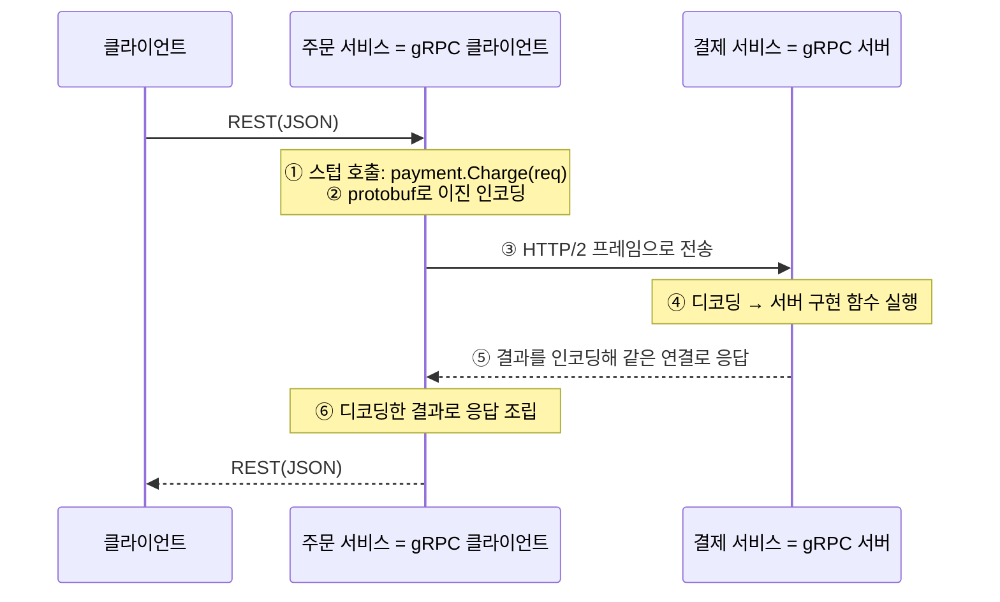

> ITWorld의 「REST의 현실적인 대안, gRPC 프로토콜의 이해」(2023.08)를 바탕으로 재구성한 노트다. 호출 흐름은 ByteByteGo의 System Design 101 가이드 「[What is gRPC?](https://bytebytego.com/guides/what-is-grpc)」, 「[How does gRPC work?](https://bytebytego.com/guides/how-does-grpc-work)」로 보강했다. Protocol Buffers의 직렬화 방식은 공식 문서 「[Encoding](https://protobuf.dev/programming-guides/encoding/)」을 바탕으로, 「[fru1tworld/cs-basic 모의 면접 질문 목록](https://github.com/fru1tworld/cs-basic/blob/main/interview/cs/network.md)」의 질문을 기준으로 보강했다.

## gRPC란

gRPC는 구글이 오픈소스로 공개한 **원격 프로시저 호출(RPC, Remote Procedure Call)** 프레임워크다. 다른 서버의 메서드를 로컬 비동기 함수처럼 부른다. 메시지는 **Protocol Buffers(protobuf)** 로 직렬화한 이진 데이터이고, 전송은 **HTTP/2** 위에서 한다. 연결 하나에서 여러 요청을 동시에 주고받고 양방향 스트리밍을 할 수 있다.

gRPC에서는 **계약이 먼저**다. 서비스 정의 파일(`.proto`)이 곧 API 표면이고, 서버와 클라이언트는 그 정의에서 생성한 코드(스텁, stub)로 통신한다. 스텁이 직렬화와 I/O를 맡으므로 개발자는 비즈니스 로직만 쓴다.

## 호출 흐름

RPC가 「원격」인 이유는 호출하는 쪽과 실행하는 쪽이 **다른 서버**에 있기 때문이다. 그래도 호출하는 코드에서는 로컬 함수처럼 보인다. 흔한 구성은 바깥에는 REST를, 서비스끼리는 gRPC를 쓰는 것이다.



인코딩·전송·디코딩은 모두 생성된 스텁과 gRPC 런타임이 맡는다. 이진 인코딩과 HTTP/2의 연결 재사용 덕분에 같은 데이터를 JSON over HTTP/1.1로 보낼 때보다 메시지가 작고 빠르다. 인증, 로드 밸런싱, 타임아웃(deadline) 전파 같은 기능도 프레임워크가 제공한다.

## 서비스 정의

```protobuf
syntax = "proto3";
package myservice;

service NumberSquarer {
  rpc SquareNumber (Number) returns (Number);
}

message Number {
  int32 value = 1;
}
```

필드 뒤 숫자(`= 1`)는 이진 인코딩에 쓰는 필드 번호다. 한 번 배포한 번호는 바꾸지 않아야 이전 버전 클라이언트와 호환된다.

### Protocol Buffers의 직렬화 방식

protobuf 메시지는 **필드 이름 없이 「태그 + 값」 쌍을 이어 붙인** 바이트열이다. 태그는 `(필드 번호 << 3) | 와이어 타입` 하나의 정수다.

| 와이어 타입 | 값 | 쓰는 타입 |
| --- | --- | --- |
| 0 VARINT | 가변 길이 정수 | `int32`, `int64`, `uint`, `bool`, `enum` |
| 1 I64 | 고정 8바이트 | `fixed64`, `double` |
| 2 LEN | 길이 + 바이트 | `string`, `bytes`, 중첩 메시지, packed repeated |
| 5 I32 | 고정 4바이트 | `fixed32`, `float` |

**varint**는 바이트마다 7비트에 값을 담고 맨 위 비트로 「뒤에 더 있다」를 표시한다. 작은 수는 1바이트로 끝난다. 음수가 잦은 필드는 `sint32`를 쓰면 지그재그 인코딩으로 작은 절댓값을 짧게 담는다(`int32`의 음수는 10바이트가 된다).

```text
message Number { int32 value = 1; }   value = 150

JSON  {"value":150}          13바이트
proto 08 96 01                3바이트
      08    = 태그 (1 << 3) | 0   → 필드 1, VARINT
      96 01 = 150: 두 바이트의 아래 7비트(0010110, 0000001)를 순서를 뒤집어 이으면 0000001 0010110
```

| 기준 | Protocol Buffers | JSON |
| --- | --- | --- |
| 크기 | 필드 이름 대신 번호, 숫자는 varint라 작다 | 이름이 매번 반복되고 숫자도 문자열이다 |
| 속도 | 스키마로 생성한 코드가 바로 읽고 써서 빠르다 | 텍스트 파싱과 타입 변환이 든다 |
| 스키마 | `.proto`가 필수다. 타입이 컴파일 시점에 검사된다 | 없어도 된다. 형식 검증은 JSON Schema 등을 따로 붙인다 |
| 호환성 | 모르는 필드 번호는 건너뛰어 앞뒤 호환이 된다. 번호 재사용·타입 변경만 피하면 된다(지운 번호는 `reserved`) | 관대한 읽기로 비슷하게 하지만 규칙은 팀 약속이다 |
| 사람이 읽기 | 스키마 없이는 해석할 수 없다. `protoc --decode`나 디버깅 도구가 필요하다 | 그대로 읽고 고친다 |
| 브라우저·생태계 | 브라우저 기본 지원이 없어 라이브러리가 필요하다 | 어디서나 기본 지원 |
| 표현력 | 기본값(0, 빈 문자열)은 전송하지 않아 「값이 0」과 「값 없음」이 구분되지 않는다. 구분하려면 `optional`이나 래퍼 타입을 쓴다 | `null`과 필드 없음을 구분할 수 있다 |

내부 서비스 간 통신처럼 양쪽이 스키마를 공유하고 성능이 중요하면 protobuf, 공개 API·브라우저·사람이 직접 보는 데이터는 JSON이 맞는다. protobuf는 JSON과 서로 바꾸는 표준 매핑도 있어, 게이트웨이에서 JSON으로 노출하기 쉽다.

## 네 가지 호출 방식

| 방식 | 요청 | 응답 | 쓰임 |
| --- | --- | --- | --- |
| 단항(Unary) | 1개 | 1개 | 일반적인 요청·응답. REST 호출과 비슷하다 |
| 서버 스트리밍 | 1개 | 여러 개 | 실시간 피드, 큰 결과를 나눠 받기 |
| 클라이언트 스트리밍 | 여러 개 | 1개 | 업로드, 측정값 모아 보내기 |
| 양방향 스트리밍 | 여러 개 | 여러 개 | 채팅, 실시간 협업 |

```protobuf
rpc Watch (Query) returns (stream Event);          // 서버 스트리밍
rpc Chat (stream Message) returns (stream Message); // 양방향
```

## Node.js 예제

JavaScript는 빌드 단계 없이 런타임에 `.proto`를 읽을 수 있다. 패키지는 `@grpc/grpc-js`와 `@grpc/proto-loader`를 쓴다.

```javascript
// server.js
const grpc = require('@grpc/grpc-js');
const protoLoader = require('@grpc/proto-loader');

const def = protoLoader.loadSync('myservice.proto');
const { myservice } = grpc.loadPackageDefinition(def);

function squareNumber(call, callback) {
  const n = call.request.value;
  callback(null, { value: n * n });
}

const server = new grpc.Server();
server.addService(myservice.NumberSquarer.service, { squareNumber });
server.bindAsync('0.0.0.0:50051', grpc.ServerCredentials.createInsecure(), () => {
  console.log('listening on 50051');
});
```

```javascript
// client.js: 정의를 불러오는 앞부분은 server.js와 같다
const client = new myservice.NumberSquarer('localhost:50051', grpc.credentials.createInsecure());
client.squareNumber({ value: Number(process.argv[2]) }, (err, res) => {
  console.log(res.value); // node client.js 7 → 49
});
```

`createInsecure()`는 TLS 없는 평문 연결이라 로컬 개발용이다. 운영에서는 `createSsl()`로 TLS를 건다. Java·Go처럼 정적 타입 언어는 `protoc`(또는 Gradle·Maven의 protobuf 플러그인, `buf generate`)로 빌드 단계에서 코드를 생성한다.

## REST와 비교

| 항목 | REST | gRPC |
| --- | --- | --- |
| 단위 | 리소스(URI) + HTTP 메서드 | 서비스의 메서드 |
| 계약 | 느슨하다. OpenAPI로 보강 | `.proto`로 엄격하다. 타입이 생성된다 |
| 데이터 | 주로 JSON 텍스트 | protobuf 이진. 작고 빠르다 |
| 전송 | HTTP/1.1·2 | HTTP/2 필수 |
| 스트리밍 | SSE·WebSocket을 따로 | 기본 제공 |
| 브라우저 | 바로 쓴다 | 프록시나 별도 프로토콜이 필요하다 |
| 디버깅 | curl·브라우저로 바로 본다 | grpcurl·Postman 같은 전용 도구 |
| 설정 부담 | 낮다 | 코드 생성과 정의 파일 관리가 든다 |

API 스타일 전체(SOAP·REST·GraphQL·gRPC·WebSocket·Webhook) 비교는 [[api-architectural-styles|API 아키텍처 스타일]]에 있다.

## 브라우저에서 쓰기

gRPC는 HTTP 트레일러(trailers)로 상태를 전달하는데, 브라우저는 JavaScript에 트레일러를 노출하지 않는다. 그래서 브라우저가 gRPC 서버를 직접 부를 수 없다.

| 방법 | 방식 |
| --- | --- |
| gRPC-Web | 브라우저용 변형 프로토콜. Envoy 같은 프록시가 gRPC로 변환한다 |
| Connect RPC | 같은 `.proto`로 브라우저가 일반 HTTP로 직접 부르는 프로토콜을 쓴다. 서버는 gRPC·gRPC-Web·Connect를 함께 받는다 |
| gRPC-Gateway / JSON 트랜스코딩 | 게이트웨이가 REST+JSON을 받아 gRPC로 바꾼다 |

## 언제 쓰나

- **잘 맞는다**: 서비스가 많은 마이크로서비스 내부 통신, 다언어 환경, 높은 처리량·낮은 지연이 중요한 곳, 스트리밍이 필요한 곳. 명시적 계약이 팀 간 경계를 지켜 준다.
- **덜 맞는다**: 외부에 공개하는 API, 브라우저가 주 소비자인 API, 빠르게 실험하는 작은 팀. 코드 생성·정의 관리·학습 비용이 이득보다 크다.
- 도입 전에 추가 구성을 감당할 수 있는지, 성능상 필요가 실제로 있는지, 팀의 학습·채용 비용을 따진다.

## 정리

- gRPC는 `.proto` 계약 → 스텁 생성 → 로컬 함수처럼 호출하는 RPC 프레임워크다.
- protobuf 이진 직렬화와 HTTP/2 덕분에 빠르고, 네 가지 스트리밍 방식을 기본으로 준다.
- 대가는 코드 생성 단계와 정의 파일 관리, 그리고 브라우저 제약이다.
- **내부 서비스 간 통신은 gRPC, 공개·브라우저 API는 REST**가 기본 선택지다.

관련 노트: [[api-architectural-styles|API 아키텍처 스타일]], [[rest-api|REST API 설계]], [[backend-developer-roadmap|백엔드 개발자 로드맵]], [[http-web-architecture|웹 앱의 요청·응답 구조]]
