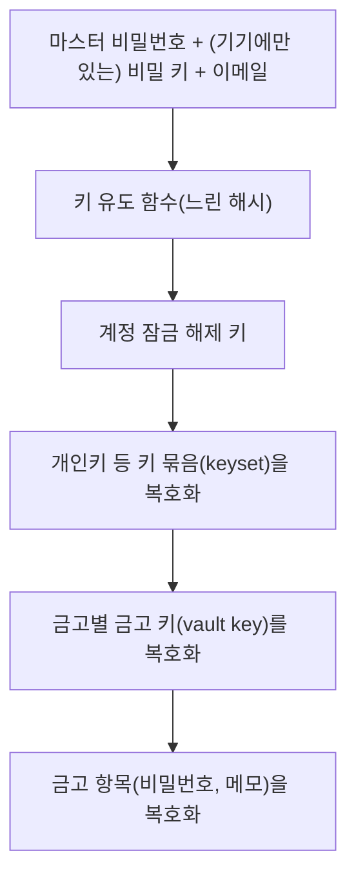

> ByteByteGo의 System Design 101 가이드 「[Storing Passwords Safely](https://bytebytego.com/guides/how-to-store-passwords-in-the-database)」, 「[How Password Managers Work](https://bytebytego.com/guides/how-does-a-password-manager-such-as-1password-or-lastpass-work)」를 바탕으로, 알고리즘 권장은 OWASP Password Storage Cheat Sheet로 확인해 재구성한 노트다. 해시의 두 약점과 흔한 실수는 「[안전한 패스워드 저장](https://d2.naver.com/helloworld/318732)」, 「[비밀번호 해시에 소금치기 - 바르게 쓰기](https://starplatina.tistory.com/entry/%EB%B9%84%EB%B0%80%EB%B2%88%ED%98%B8-%ED%95%B4%EC%8B%9C%EC%97%90-%EC%86%8C%EA%B8%88%EC%B9%98%EA%B8%B0-%EB%B0%94%EB%A5%B4%EA%B2%8C-%EC%93%B0%EA%B8%B0)」로 보강했다.

## 서버에 비밀번호를 저장하는 법

비밀번호는 **다시 꺼내 쓸 필요가 없다.** 로그인할 때 "입력값이 저장된 것과 같은가"만 확인하면 된다. 그래서 복호화가 가능한 암호화가 아니라 **일방향 해시**로 저장한다([[encoding-encryption-hashing|인코딩·암호화·해시·토큰화와 디지털 서명]]).

| 저장 방식 | 문제 |
| --- | --- |
| 평문 | DB를 볼 수 있는 내부자·유출 한 번에 전부 노출 |
| 암호화 | 키가 같이 새면 전부 복호화된다. 비밀번호에는 복호화가 필요 없다 |
| 단순 해시(SHA-256 등) | 같은 비밀번호는 같은 해시가 된다. 미리 계산한 표(**레인보우 테이블**)로 역추적되고, GPU로 초당 수십억 번 대입할 수 있다 |
| **솔트 + 느린 해시** | 권장 방식 |

### 솔트

**솔트(salt)** 는 사용자마다 무작위로 만들어 비밀번호에 섞는 값이다.

- 같은 비밀번호라도 사용자마다 해시가 달라진다. 미리 계산한 표가 쓸모없어지고, 공격자는 사용자 한 명씩 따로 대입해야 한다.
- **솔트는 비밀이 아니다.** 해시 옆에 평문으로 저장한다. 목적은 숨기는 것이 아니라 결과를 사용자마다 고유하게 만드는 것이다.
- 모든 사용자에게 같은 값을 쓰면 솔트가 아니다. 반드시 사용자마다 새로 만든다.
- 추가로 DB 밖(KMS, 환경 변수)에 두는 비밀값 **페퍼(pepper)** 를 섞으면 DB만 유출됐을 때 대입을 막는다. 선택 사항이다.

### 느린 해시

SHA-256 같은 범용 해시는 **빠르게 계산되도록** 설계됐다. 비밀번호에는 그 속도가 공격자에게 유리하다. 비밀번호 전용 해시는 일부러 느리고 메모리를 많이 쓰게 만들어 대입 비용을 올린다.

| 알고리즘 | 특징 | 쓰는 때 |
| --- | --- | --- |
| **Argon2id** | 메모리·반복·병렬도를 조절. GPU 대입에 강하다 | 새로 만든다면 첫 선택 |
| scrypt | 메모리를 많이 쓰게 해 하드웨어 대입을 어렵게 한다 | Argon2id를 쓸 수 없을 때 |
| bcrypt | 오래 검증됐다. 입력이 72바이트에서 잘린다 | 레거시 시스템 |
| PBKDF2 | 반복 횟수만 조절. 메모리 강화가 없다 | FIPS 인증이 필요할 때 |

반복 횟수·메모리 같은 비용 인자는 하드웨어가 빨라지면 올린다. 저장 형식에 알고리즘과 인자를 함께 적어 두면(`$argon2id$v=19$m=...`) 로그인 성공 시 새 인자로 다시 해시해 점진적으로 올릴 수 있다.

### 저장과 검증 흐름

```text
[가입]
솔트 = 무작위 바이트
해시 = Argon2id(비밀번호, 솔트, 비용 인자)
DB 저장: { user_id, 알고리즘·인자, 솔트, 해시 }

[로그인]
DB에서 그 사용자의 솔트·인자·해시 H2 조회
H1 = Argon2id(입력 비밀번호, 솔트, 인자)
H1 == H2 (상수 시간 비교) → 성공
```

- 비교는 **상수 시간 비교** 함수로 한다. 일반 문자열 비교는 앞에서부터 다른 글자에서 멈춰 응답 시간으로 정보가 샌다.
- 실제로는 라이브러리가 솔트 생성·형식·비교까지 맡는다. 직접 조립하지 않는다.
### 흔한 실수

단순 해시의 약점은 두 가지로 요약된다. 같은 입력은 늘 같은 해시라서 미리 계산한 표로 알아보는 **인식 가능성**, 그리고 원래 빨리 검색하려고 만든 함수라서 대입이 빠른 **속도**다. 솔트가 앞의 것을, 느린 해시(키 스트레칭)가 뒤의 것을 막는다. 아래는 그 장치를 잘못 쓰는 경우다.

| 실수 | 왜 문제인가 | 대신 |
| --- | --- | --- |
| 짧은 솔트, 모든 사용자에 같은 솔트 | 솔트별 표를 미리 만들 수 있다 | CSPRNG로 사용자마다, 비밀번호를 바꿀 때마다 새로 만든다. 16바이트 이상 |
| `md5(sha1(pw))`, `sha1(pw + salt)`를 여러 번 섞기 | 느려지지도 않고 검증도 안 된 조합이다 | 검증된 비밀번호 해시 하나를 쓴다 |
| 클라이언트에서만 해시하기 | 그 해시값이 곧 비밀번호가 된다. 탈취한 해시로 그대로 로그인한다 | 서버에서 해시한다. 전송 구간 보호는 HTTPS의 몫이다 |
| 로그인 실패 메시지로 "없는 아이디"와 "틀린 비밀번호"를 구분 | 유효한 계정 목록을 알려 준다 | 항상 "아이디 또는 비밀번호가 맞지 않습니다" |
| 직접 만든 해시 방식 | 검토한 사람이 만든 사람뿐이다 | 언어·프레임워크의 표준 라이브러리 |

- 비밀번호 규칙(길이, 유출 목록 대조)은 [[sign-in-sign-up-forms|로그인·가입 폼과 인증 입력]]의 NIST 기준을 따른다.

## 비밀번호 관리자는 어떻게 금고를 지키나

비밀번호 관리자는 **서버에 금고를 저장하지만 서버는 내용을 읽을 수 없게** 설계한다. 이를 영지식(zero-knowledge) 구조라고 부른다. 키를 사용자 기기에서만 만들기 때문에 가능한 구조다.



| 설계 요소 | 이유 |
| --- | --- |
| 키를 기기에서 유도 | 서버로 가는 것은 암호화된 금고뿐이다. 서버가 털려도 평문이 없다 |
| 기기에만 있는 비밀 키 | 1Password의 Secret Key처럼 무작위 고엔트로피 값을 섞으면, 서버의 암호문을 훔쳐도 약한 마스터 비밀번호만으로는 대입할 수 없다 |
| 인증용 값과 복호화 키 분리 | SRP 같은 프로토콜로 로그인하면 서버는 마스터 비밀번호에서 나온 복호화 키를 받지 않는다 |
| 금고 키를 계층으로 | 팀 공유 금고는 금고 키를 각 멤버의 공개키로 감싸 나눠 준다. 멤버를 빼면 그 사람의 사본만 지운다 |

**마스터 비밀번호를 잊으면 서버도 복구할 수 없다.** 이것이 영지식 설계의 대가다. 그래서 복구 키를 따로 인쇄해 두게 한다.

## 정리

- 비밀번호는 암호화가 아니라 해시로, 그것도 사용자별 솔트를 섞은 느린 해시(Argon2id 우선)로 저장한다.
- 솔트는 비밀이 아니라 고유성을 위한 값이다. 비밀이 필요하면 페퍼를 DB 밖에 둔다.
- 비교는 상수 시간으로, 구현은 검증된 라이브러리로 한다.
- 비밀번호 관리자는 키를 기기에서 유도해 서버가 금고를 읽지 못하게 한다. 대신 마스터 비밀번호를 잃으면 되돌릴 수 없다.

관련 노트: [[encoding-encryption-hashing|인코딩·암호화·해시·토큰화와 디지털 서명]], [[sign-in-sign-up-forms|로그인·가입 폼과 인증 입력]], [[two-factor-totp-passkey|2단계 인증: TOTP와 패스키]], [[session-vs-token-auth|세션 기반 인증과 토큰 기반 인증]], [[security|정보 시스템 보안]]
