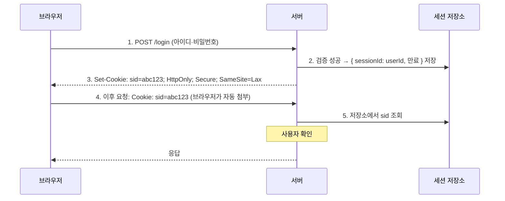
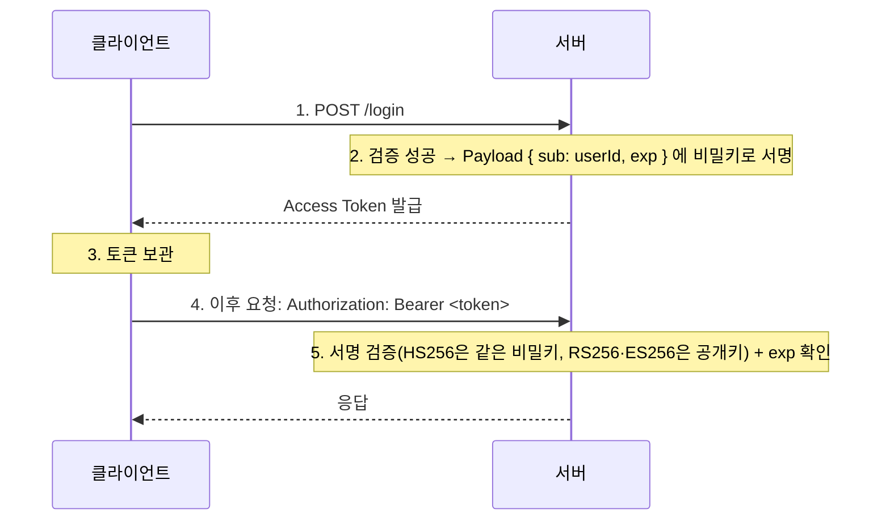

> 팔만코딩경(42Seoul 커뮤니티 위키)의 「세션과 토큰 기반 인증방식」을 바탕으로 재구성하고, G마켓 기술 블로그의 「[인증/인가는 어디에 어떻게 구현해야 할까?](https://dev.gmarket.com/45)」(2022.09)로 다중 서버 세션 부분을 보탠 노트다.
> 신원 관리 방식의 계보, JWT 서명 방식, PASETO 부분은 ByteByteGo의 System Design 101 가이드 「[Token, Cookie, Session](https://bytebytego.com/guides/token-cookie-session)」, 「[JWT 101](https://bytebytego.com/guides/jwt-101-key-to-stateless-authentication)」, 「[Cookies vs Sessions vs JWT vs PASETO](https://bytebytego.com/guides/cookies-vs-sessions-vs-jwt-vs-paseto)」 등을 바탕으로 재구성해 보탰다.
> 무상태 HTTP와 세션의 관계, 서명 계산식, 토큰 탈취 대응은 「fru1tworld/cs-basic 모의 면접 질문 목록」([네트워크](https://github.com/fru1tworld/cs-basic/blob/main/interview/cs/network.md), [기타](https://github.com/fru1tworld/cs-basic/blob/main/interview/cs/etc.md))의 질문을 기준으로 빠진 개념을 보강했다.

## 왜 인증 방식이 필요한가

HTTP는 상태가 없다(stateless). 요청마다 "이 사람이 아까 로그인한 그 사람"이라는 증거를 다시 보내야 한다. 그 증거를 **어디에 저장하고 무엇으로 검증하느냐**에 따라 세션 방식과 토큰 방식이 갈린다.

쿠키 자체의 동작(속성, 수명, 퍼스트·서드파티)은 [[cookie-session|쿠키와 세션]]에 있다. 이 노트는 서버 쪽에서 두 방식을 고르는 기준을 다룬다.

| 구분 | 세션 기반 | 토큰 기반(JWT) |
| --- | --- | --- |
| 상태 저장 위치 | 서버(메모리, Redis, DB) | 토큰 자체(클라이언트가 보관) |
| 클라이언트가 보내는 것 | 의미 없는 세션 ID(보통 쿠키) | 사용자 정보와 서명이 담긴 토큰(`Authorization: Bearer` 또는 쿠키) |
| 서버 검증 방법 | 세션 저장소 조회 | 서명과 만료 시각 검증, 저장소 조회 없음 |
| 강제 로그아웃 | 저장소에서 지우면 즉시 끝 | 만료 전까지는 어렵다(별도 차단 목록 필요) |
| 수평 확장 | 서버 간 세션 공유 필요(Redis 등) | 비밀키·공개키만 공유하면 된다 |
| 요청 크기 | 작다 | 토큰이 길어 요청마다 수백 바이트 이상 |
| 잘 맞는 곳 | 같은 도메인의 웹 앱, 즉시 무효화가 중요한 서비스 | 모바일 앱, 여러 서비스가 같은 신원을 쓰는 API, MSA |

### 신원 관리 방식의 계보

로그인은 세 단계로 나뉜다. **식별(identification)** 은 "나는 누구다"라고 밝히는 것, **인증(authentication)** 은 그 주장이 맞는지 확인하는 것, **인가(authorization)** 는 확인된 사용자에게 권한을 주는 것이다. 아래 방식들은 대부분 앞의 둘을 다루고, OAuth 2.0만 인가 위임을 다룬다. 단순한 것부터 차례로 쌓였다.

| 방식 | 동작 | 해결한 것 | 남은 한계 |
| --- | --- | --- | --- |
| HTTP Basic (`WWW-Authenticate`) | 브라우저가 띄운 창에 아이디·비밀번호를 넣고, 요청마다 Base64로 실어 보낸다 | 가장 단순한 인증 | 로그아웃·만료 같은 로그인 수명 주기를 서버가 제어할 수 없다. 내부 도구 외에는 거의 쓰지 않는다 |
| 세션-쿠키 | 서버가 세션을 저장하고 브라우저는 세션 ID만 쿠키로 든다 | 로그인 수명을 서버가 제어 | 쿠키는 브라우저 중심이라 모바일 앱·여러 도메인에서 다루기 번거롭다 |
| 토큰 | 신원을 담은 토큰을 클라이언트가 들고 `Authorization` 헤더로 보낸다 | 브라우저 밖 클라이언트와 호환 | 토큰 형식·검증 방식이 제각각이다 |
| JWT | 토큰 형식을 표준화하고 서명을 토큰 안에 넣는다 | 서버가 세션 저장 없이 검증 | 즉시 무효화가 어렵다(아래 대책 참고) |
| SSO | 중앙 인증 서버 한 곳에 로그인하면 여러 서비스가 그 결과를 믿는다 | 한 번 로그인으로 여러 사이트 | 중앙 서버가 단일 장애점이 된다 → [[oauth2\|OAuth 2.0]]의 SSO 섹션 |
| OAuth 2.0 | 비밀번호 대신 범위가 제한된 토큰으로 다른 서비스의 자원 접근을 위임 | 제3자 앱에 비밀번호를 주지 않는다 | 인증은 그 위의 OIDC가 맡는다 → [[oauth2\|OAuth 2.0]] |
| QR 코드 로그인 | PC 화면의 QR에 일회용 난수 토큰을 담고, 이미 로그인된 휴대폰이 스캔해 그 토큰을 승인한다 | PC에서 비밀번호를 치지 않는다 | 토큰 수명을 짧게, 승인 화면에 어느 기기·위치의 요청인지 보여 줘야 피싱을 막는다 |

## 세션 기반 인증



**세션은 HTTP의 무상태성과 모순되지 않는다.** 무상태는 HTTP **프로토콜**이 요청 사이를 기억하지 않는다는 뜻이고, 세션은 그 위의 **응용**이 상태를 따로 저장하는 것이다. 요청은 여전히 세션 ID라는 필요한 정보를 매번 담고 오며, 서버는 그 ID로 저장소를 찾아 처리한다. 대가는 무상태가 주던 장점 일부를 다시 내주는 것이다. 웹 서버 자체는 무상태로 두고 상태를 공용 세션 저장소 한 곳에 모으면, 서버를 늘리는 자유는 지키고 저장소의 가용성만 따로 책임지면 된다. 토큰 방식은 상태를 클라이언트 쪽 토큰에 넣어 저장소마저 없앤 것이지만, 즉시 무효화를 위해 결국 일부 상태(차단 목록, 리프레시 토큰)를 다시 둔다.

- 세션 ID는 무작위 문자열이라 **유출돼도 개인정보는 드러나지 않는다.** 다만 탈취하면 그 사용자로 위장할 수 있다(세션 하이재킹).
- 로그인 직후 세션 ID를 새로 발급해 **세션 고정(session fixation)** 공격을 막는다.
- 사용자마다 저장소 항목이 생기므로 동시 접속자가 많으면 저장소가 부담이 된다.
- 세션 ID 대신 **아이디·비밀번호를 쿠키에 담아 매번 보내는 방식은 쓰지 않는다.** 저장소가 필요 없고 확장도 쉽지만, 요청마다 자격 증명이 오가므로 쿠키 하나만 새도 계정이 넘어간다. 세션은 이 문제를 「의미 없는 식별자」로 바꾼 것이다.

### 서버가 여러 대일 때

세션 저장소가 서버 메모리에 있으면(예: 톰캣의 기본 세션 관리자), 로드밸런서가 요청을 다른 서버로 보내는 순간 세션을 찾지 못한다.

| 방법 | 동작 | 대가 |
| --- | --- | --- |
| 스티키 세션(sticky session) | 로드밸런서가 같은 사용자를 늘 같은 서버로 보낸다 | 그 서버가 죽으면 세션이 사라진다. 부하가 고르게 퍼지지 않는다 |
| 세션 복제(session replication) | 서버끼리 세션을 서로 복사해 똑같이 유지한다 | 서버가 늘수록 복제 트래픽과 메모리가 커진다 |
| **공용 세션 저장소** | Redis 같은 외부 저장소 하나를 모든 서버가 함께 쓴다 | 저장소의 부하와 가용성만 신경 쓰면 된다. 가장 흔한 선택이다 |

## 토큰 기반 인증 (JWT)

JWT(JSON Web Token)는 `header.payload.signature` 세 부분을 `.`으로 이은 문자열이다.

| 부분 | 내용 |
| --- | --- |
| Header | 토큰 타입(`JWT`)과 서명 알고리즘(`HS256`, `RS256` 등). Base64URL 인코딩 |
| Payload | 클레임(key-value). Base64URL 인코딩. 대표 클레임은 `sub`(대상, 보통 사용자 ID), `exp`(만료 시각), `iat`(발급 시각), `jti`(토큰 ID) |
| Signature | Header + Payload를 서버의 키로 서명한 값. 위변조 검증용 |

Header와 Payload는 **인코딩**일 뿐이라 누구나 디코딩해 읽을 수 있다([jwt.io](https://jwt.io/)). 위변조를 막는 것은 Signature뿐이다. NestJS에서 Passport로 구현하는 방법은 [[auth-jwt-passport|NestJS JWT 인증과 Passport]]에 있다.



서명은 Header와 Payload를 **각각 Base64URL로 인코딩해 `.`으로 이은 문자열**에 서명 알고리즘을 적용하고, 그 결과를 다시 Base64URL로 인코딩해 만든다.

```text
signingInput = base64url(header) + "." + base64url(payload)
HS256:  signature = base64url( HMAC-SHA256(signingInput, 비밀키) )
RS256:  signature = base64url( RSA-PKCS1-v1_5-Sign(SHA-256(signingInput), 개인키) )
ES256:  signature = base64url( ECDSA-P256-Sign(SHA-256(signingInput), 개인키) )
JWT = signingInput + "." + signature
```

- **서명은 복호화하는 것이 아니라 검증하는 것**이다. 서버는 받은 Header·Payload로 서명을 다시 계산해 일치하는지 본다. 비밀키가 없으면 Payload를 고친 뒤 맞는 서명을 만들 수 없다.
- Payload는 암호화되지 않는다. 비밀번호, 개인정보는 넣지 않는다.
- 서버가 상태를 갖지 않으므로 확장이 쉽고, 여러 서비스가 같은 공개키로 토큰을 검증할 수 있다.

### 클레임의 종류

| 종류 | 의미 | 예 |
| --- | --- | --- |
| 등록된 클레임(registered) | 표준(RFC 7519)이 이름과 뜻을 정해 둔 것. 선택 사항이지만 쓰면 뜻을 지킨다 | `iss`(발급자), `sub`, `aud`(대상 서비스), `exp`, `nbf`(이전엔 무효), `iat`, `jti` |
| 공개 클레임(public) | 여러 시스템이 함께 쓰려고 IANA에 등록하거나 URI로 충돌을 피한 이름 | OIDC의 `email`, `name` |
| 비공개 클레임(private) | 발급자와 소비자가 합의해 쓰는 이름 | `role`, `tenantId` |

검증하는 쪽은 서명뿐 아니라 `exp`·`nbf`·`iss`·`aud`까지 확인한다. 특히 `aud`를 보지 않으면 다른 서비스용으로 발급된 토큰이 내 서비스에서 통한다.

### 서명 방식: 대칭과 비대칭

| 방식 | 알고리즘 예 | 서명 키 / 검증 키 | 맞는 상황 |
| --- | --- | --- | --- |
| 대칭 서명 | HS256 (HMAC-SHA256) | 같은 비밀키 하나 | 발급과 검증을 같은 서버(또는 신뢰하는 한 팀)가 할 때. 검증하는 모든 곳이 비밀키를 가져야 하므로 그중 하나만 새도 토큰을 위조할 수 있다 |
| 비대칭 서명 | RS256(RSA), ES256(ECDSA), EdDSA | 개인키로 서명, 공개키로 검증 | 인증 서버 한 곳이 발급하고 여러 서비스가 검증할 때. 공개키는 JWKS(`/.well-known/jwks.json`)로 배포하고 `kid`로 키를 교체한다 |

**검증할 알고리즘은 서버가 정해 둔다.** 토큰 Header의 `alg`를 그대로 믿으면 `alg: none`(서명 없음)이나, RS256 공개키를 HS256 비밀키로 착각하게 만드는 **알고리즘 혼동(algorithm confusion)** 공격에 뚫린다. 라이브러리에 허용 알고리즘 목록을 명시한다.

## PASETO: 설정 실수를 줄인 대안

**PASETO(Platform-Agnostic Security Tokens)** 는 JWT의 이런 함정을 없애려고 만든 토큰 형식이다. 알고리즘을 Header에서 고르게 하지 않고 **버전(`v4`)과 용도(`local`·`public`)가 암호 방식을 고정**한다.

| 구분 | JWT(JOSE) | PASETO |
| --- | --- | --- |
| 알고리즘 선택 | 토큰의 `alg`로 지정. 선택지가 많아 잘못 고르거나 검증을 빼먹기 쉽다 | 버전이 정한다. 예: `v4.local`은 대칭 암호화, `v4.public`은 Ed25519 서명 |
| 페이로드 | 서명만 하면 누구나 읽는다(암호화하려면 JWE를 따로 쓴다) | `local`은 암호화까지 하므로 내용이 숨겨진다 |
| `none` 같은 위험한 선택지 | 표준에 있다 | 없다 |
| 생태계 | OIDC·OAuth와 맞물려 사실상 표준 | 라이브러리·IdP 지원이 JWT보다 좁다 |

토큰을 자체 시스템 안에서만 주고받는다면 PASETO가 실수 여지를 줄인다. OIDC처럼 외부 표준과 맞물리는 곳에서는 JWT를 쓰되 허용 알고리즘을 고정한다.

## 토큰 방식의 약점과 대책

토큰은 **발급하면 만료될 때까지 유효**하다. 탈취당하면 서버가 막을 방법이 없다는 것이 가장 큰 약점이다. 그래서 실무에서는 아래 대책을 조합한다.

| 대책 | 방법 | 대가 |
| --- | --- | --- |
| 짧은 만료 | Access Token 수명을 수 분~수십 분으로 | 혼자 쓰면 로그인이 너무 잦다 |
| 슬라이딩 세션 | 활동 중인 사용자에게 만료를 자동 연장(글쓰기·결제 시작 때 재발급) | 계속 쓰는 탈취자도 연장된다 |
| 리프레시 토큰 | 짧은 Access Token + 긴 Refresh Token. Access가 만료되면 Refresh로 재발급 | Refresh Token을 서버에 저장·관리해야 한다 |
| 리프레시 토큰 회전 | 재발급할 때마다 Refresh Token도 새로 주고 옛것은 폐기. **이미 쓴 토큰이 다시 오면 탈취로 보고 그 계열 전체를 무효화** | 구현이 복잡하다 |
| 차단 목록 | 로그아웃·비밀번호 변경 시 토큰 ID(`jti`)를 만료 때까지 차단 | 결국 서버 저장소 조회가 생긴다 |
| 서명 키 교체 | 키가 샜거나 대량 탈취가 의심되면 서명 키를 바꿔(`kid` 교체) 그 키로 발급한 토큰을 한꺼번에 무효화 | 모든 사용자가 다시 로그인한다 |
| 발신자 제약 토큰 | 토큰을 클라이언트의 키에 묶는다. **DPoP**(RFC 9449)는 요청마다 클라이언트 개인키로 서명한 증명을 함께 보내게 해, 토큰만 훔쳐서는 쓸 수 없게 한다. 서버 간에는 mTLS 인증서에 묶는다 | 클라이언트가 키를 관리해야 하고 지원하는 인가 서버가 아직 적다 |

리프레시 토큰을 서버에 두는 순간 "완전한 무상태"라는 JWT의 장점은 일부 사라진다. 대신 **원할 때 강제로 로그아웃시킬 수 있다.** 대부분의 서비스는 이 거래를 받아들인다.

탈취된 토큰의 종류에 따라 대응 순서가 다르다.

| 탈취된 것 | 피해 범위 | 대응 |
| --- | --- | --- |
| Access Token | 남은 수명(수 분~수십 분) 동안 그 권한(scope)으로 API 호출 | 수명이 짧아 피해 시간이 제한된다. 급하면 `jti` 차단 목록에 올리고, 그 사용자의 리프레시 토큰 계열을 끊어 재발급을 막는다. 대량이면 서명 키를 교체한다 |
| Refresh Token | 새 Access Token을 계속 발급받아 오래 위장 | 서버가 저장한 리프레시 토큰을 폐기하고 사용자의 모든 세션을 끊는다. **회전과 재사용 감지**가 있으면 정상 사용자와 공격자 중 늦게 쓴 쪽의 요청이 「이미 쓴 토큰」으로 걸려 계열 전체가 자동 폐기된다. 비밀번호 변경을 유도하고, 리프레시 토큰은 HttpOnly 쿠키·기기 바인딩으로 애초에 꺼내기 어렵게 둔다 |

공통으로, 이상 징후(다른 국가·기기에서의 재발급, 짧은 시간의 대량 호출)를 감지해 재인증을 요구하는 장치가 탈취를 알아채는 계기가 된다.

## 토큰을 어디에 보관하나 (브라우저)

| 보관 위치 | XSS | CSRF | 비고 |
| --- | --- | --- | --- |
| `localStorage` | 스크립트가 읽을 수 있어 취약 | 자동 전송이 없어 안전 | 구현은 가장 쉽다 |
| 메모리(JS 변수) | 새로고침하면 사라짐, 탈취 범위가 좁다 | 안전 | Refresh Token 쿠키와 함께 쓴다 |
| `HttpOnly; Secure; SameSite` 쿠키 | 스크립트가 못 읽는다 | `SameSite`와 CSRF 토큰으로 방어 | 브라우저 앱에서 권장되는 기본값 |

흔한 조합은 **Access Token은 메모리, Refresh Token은 HttpOnly 쿠키**다. 브라우저 전용 웹 앱이라면 처음부터 세션 쿠키를 쓰는 편이 단순하고 안전한 경우도 많다.

실제로 어디에 무엇이 저장됐는지(쿠키의 `HttpOnly`·`Secure`·`SameSite`, `localStorage`의 토큰)는 Chrome DevTools의 Application 패널에서 확인한다 → [[devtools-application|DevTools Application 패널]].

## 정리

- 세션은 상태를 서버에, 토큰은 상태를 토큰 안에 둔다. 차이는 **즉시 무효화**와 **확장성** 사이의 거래다.
- 세션 ID는 의미 없는 열쇠라 유출돼도 정보는 안전하지만, 열쇠 자체를 훔치면 위장할 수 있다.
- JWT의 Payload는 누구나 읽는다. 서명은 위변조 검증용이지 암호화가 아니다.
- 검증 쪽은 허용 알고리즘을 고정하고 `exp`·`iss`·`aud`까지 확인한다. 설정 실수를 구조적으로 막고 싶으면 PASETO를 검토한다.
- 토큰을 쓰면 짧은 Access Token과 회전하는 Refresh Token을 함께 쓰고, 브라우저에서는 HttpOnly 쿠키를 우선 고려한다.
- 같은 도메인의 웹 앱만 있다면 세션, 모바일·다중 서비스 API라면 토큰이 기본 선택이다.

관련 노트: [[cookie-session|쿠키와 세션]], [[auth-jwt-passport|NestJS JWT 인증과 Passport]], [[oauth2|OAuth 2.0]], [[web-security|웹 보안: CSRF와 XSS]], [[api-security|API 보안 체크리스트]], [[auth-user|Django User와 인증]], [[auth-placement|인증·인가 로직은 어디에 두나: 필터, 인터셉터, API 게이트웨이]]
