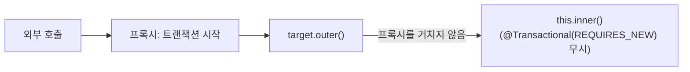
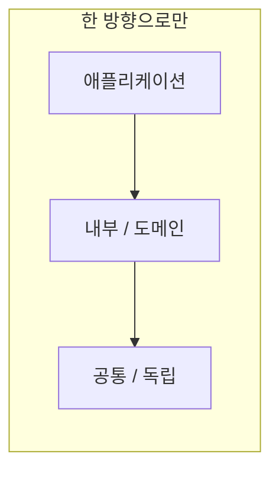

> 「[IoC, DI란 무엇일까](https://biggwang.github.io/2019/08/31/Spring/IoC,%20DI란%20무엇일까/)」, 「[생성자 주입을 사용해야 하는 이유](https://yaboong.github.io/spring/2019/08/29/why-field-injection-is-bad/)」, 「[Service, ServiceImpl 구조에 대한 고찰](https://github.com/cheese10yun/blog-sample/tree/master/service)」, 「[스프링 예제로 보는 SOLID](https://github.com/cheese10yun/spring-SOLID)」, 「[스프링 실전 가이드](https://www.slideshare.net/ssuser565d51/spring-guide-202753526)」, 「[실무에서 Lombok 사용법](https://github.com/cheese10yun/blog-sample/tree/master/lombok)」, 「[동일한 Bean에서 @Transactional 동작 방식](https://cheese10yun.github.io/spring-transacion-same-bean/)」, 「[멀티모듈 설계 이야기 with Spring, Gradle](https://techblog.woowahan.com/2637/)」, 「[Spring 웹 애플리케이션에서 사용하지 않는 API를 찾아보자](https://techblog.woowahan.com/2610/)」, 「[Spring WebFlux와 Armeria를 이용하여 Microservice에 필요한 Reactive + RPC 동시에 잡기](https://d2.naver.com/helloworld/6080222)」 등을 바탕으로, 동작은 Spring 공식 문서로 확인해 재구성한 노트다.

## IoC와 DI

**제어의 역전(IoC, Inversion of Control)은 객체의 생성·연결·생명주기를 개발자 코드가 아니라 프레임워크(컨테이너)가 맡는 것이다.** 스프링 고유 개념은 아니다. 템플릿 메서드 패턴처럼 "프레임워크가 내 코드를 부른다"는 구조 전반을 가리킨다.

**의존성 주입(DI, Dependency Injection)은 IoC를 구현하는 방법 중 하나다.** 객체가 협력 객체를 직접 `new`로 만들지 않고 외부(스프링 컨테이너)에서 받는다. 인터페이스 타입으로 받으면 구현을 바꿔 끼울 때 사용하는 쪽 코드를 고치지 않는다.

### 생성자 주입을 기본으로

| 비교 | 생성자 주입 | 필드 주입(`@Autowired` 필드) |
| --- | --- | --- |
| 필수 의존성 누락 | 객체를 만들 수 없으니 바로 드러난다 | 의존성 없이도 만들어져 호출할 때 NPE |
| 불변성 | `final` 필드 가능 | `final` 불가 |
| 테스트 | 생성자에 가짜 객체를 넘기면 된다 | 컨테이너나 리플렉션 없이는 넣을 방법이 없다 |
| 설계 신호 | 매개변수가 많아지면 책임 과다가 눈에 보인다 | 의존성이 얼마든지 늘어도 티가 안 난다 |

- 생성자가 하나면 `@Autowired`를 생략할 수 있다. Lombok `@RequiredArgsConstructor`와 `final` 필드 조합이 흔하다.
- Spring Boot 2.6부터 빈 사이의 **순환 참조는 주입 방식과 무관하게 기본으로 금지**되어 구동 시점에 실패한다. 순환이 생기면 설정을 풀지 말고 책임을 다시 나눈다.

## Service와 ServiceImpl

`MemberService` 인터페이스 + `MemberServiceImpl` 구현을 습관처럼 짝지어 만드는 관행이 있다. 인터페이스의 가치는 구현을 숨기고 여러 구현을 바꿔 끼우는 데 있으므로, 구현이 영원히 하나라면 이득이 거의 없다.

- 인터페이스는 **책임 하나**를 표현할 때 의미가 있다. 예를 들어 `ChangePasswordService`에 "인증 코드로 변경", "기존 비밀번호로 변경" 두 구현이 있는 경우다.
- 조회·수정·삭제를 모두 담은 거대한 `XxxService`는 인터페이스로 감싸도 결합도가 줄지 않는다. 먼저 `MemberFindService`, `MemberUpdateService`처럼 작은 클래스로 쪼갠다.
- 결제 수단처럼 구현이 늘어날 게 분명한 도메인은 처음부터 인터페이스를 둔다. 그렇지 않으면 구체 클래스로 시작하고 필요할 때 추출한다. IDE로 인터페이스 추출은 어렵지 않다.

## 스프링 코드에 SOLID 적용하기

| 원칙 | 스프링 코드에서의 모습 |
| --- | --- |
| SRP | 책임은 **변경을 요구하는 주체(actor)** 단위로 나눈다. 국내 결제와 해외 결제가 다른 부서의 요구로 바뀐다면 다른 클래스다 |
| OCP | 결제 수단별 `if` 분기 대신 전략 인터페이스와 구현 빈을 두고, `Map<String, PaymentStrategy>`로 주입받아 고른다. 새 수단은 빈 추가로 끝난다 |
| LSP | 하위 타입이 상위 타입 자리에서 그대로 동작해야 한다. `instanceof`로 특정 하위 타입을 골라 다르게 처리하면 위반 신호다 |
| ISP | 쓰지 않는 메서드에 의존하지 않도록 인터페이스를 쪼갠다 |
| DIP | 서비스는 구체 클래스가 아니라 추상화에 의존한다. 요청 DTO도 특정 구현(카드사)에 묶이지 않게 설계한다 |

객체에게 데이터를 꺼내 판단하지 말고 일을 시킨다(Tell, Don't Ask). 원칙 자체의 설명은 [[frontend-solid|프론트엔드에 적용하는 SOLID]], 패턴은 [[gof-design-patterns|GoF 디자인 패턴]]에 있다.

### 패키지 구조

| 방식 | 모양 | 특징 |
| --- | --- | --- |
| 계층형 | `controller/`, `service/`, `repository/` | 작은 프로젝트에 단순하다. 기능 하나를 고치려면 여러 폴더를 오간다 |
| 도메인형 | `member/{api,application,domain,dao,dto}`, `global/`, `infra/` | 기능이 한곳에 모인다. 도메인 사이 의존을 관리하기 쉽다 |

도메인형에서 `global`에는 공통 설정·예외 처리·공통 응답, `infra`에는 외부 시스템 연동을 둔다.

## Lombok 사용 기준

| 어노테이션 | 기준 |
| --- | --- |
| `@Data` | **쓰지 않는다.** `@Setter`, `@EqualsAndHashCode`, `@ToString`까지 한꺼번에 붙어 부작용이 많다 |
| `@Setter` | 엔티티에는 두지 않는다. 상태 변경은 의도가 드러나는 메서드(`changePassword`)로 한다 |
| `@ToString` | 양방향 연관관계에서 서로 부르며 무한 재귀가 난다. 연관 필드는 제외한다 |
| `@EqualsAndHashCode` | 엔티티에는 신중히. 가변 필드나 지연 로딩 연관을 포함하면 컬렉션 동작이 깨진다 |
| `@NoArgsConstructor` | JPA 프록시용 기본 생성자는 `access = AccessLevel.PROTECTED`로 막는다 |
| `@Builder` | 클래스가 아니라 **필요한 값만 받는 생성자**에 붙인다. 클래스에 붙이면 id·생성 시각처럼 자동 관리돼야 할 값까지 외부에서 넣을 수 있다 |
| `@Getter` | 쓰되, 꺼낸 값으로 밖에서 계산하지 말고 객체에 메서드를 둔다 |

`lombok.config`에 `lombok.setter.flagUsage = error`, `lombok.data.flagUsage = error`처럼 적어 팀 규칙을 컴파일러가 강제하게 한다.

## @Transactional과 프록시: 자기 호출 함정

**스프링의 선언적 트랜잭션은 빈을 감싼 프록시가 메서드 호출을 가로채서 동작한다.** 그래서 프록시를 거치지 않는 호출에는 적용되지 않는다.

| 증상 | 원인 |
| --- | --- |
| 같은 클래스의 `@Transactional` 메서드를 내부에서 불렀는데 트랜잭션이 없다 | `this.inner()`는 실제 객체를 바로 부른다 |
| 내부 메서드의 `REQUIRES_NEW`가 무시되어 전체가 함께 롤백된다 | 같은 이유 |
| `private` 메서드의 `@Transactional`이 동작하지 않는다 | 프록시가 재정의할 수 없는 메서드다 |

해결은 **트랜잭션 경계가 다른 메서드를 별도 빈으로 분리**하고 주입받아 부르는 것이다. 코드로 경계를 직접 다루려면 `TransactionTemplate`을 쓴다. 자기 자신을 주입받는 self-injection이나 AspectJ 위빙도 가능하지만 의도가 숨고 설정이 복잡해진다.

- 롤백 기본값은 unchecked 예외와 `Error`다. checked 예외 처리 전략은 [[java-idioms|Java 실무 관용구]]의 「예외」에 있다.
- 같은 프록시 원리가 `@Async`, `@Cacheable`에도 똑같이 적용된다.

## 멀티모듈 설계

하나의 저장소에서 여러 애플리케이션(API 서버, 배치, 어드민)을 만들 때 Gradle 멀티모듈로 나눈다. 가장 흔한 실패는 모든 것을 넣는 `common` 모듈이다.

| `common` 모듈의 문제 | 결과 |
| --- | --- |
| 여러 앱의 코드가 쌓인다 | 한 곳을 고치면 모든 앱이 영향을 받는 스파게티 |
| 의존성을 다 끌어안는다 | DB가 필요 없는 앱에도 DataSource 자동 설정이 켜진다 |
| 스레드 풀·커넥션 풀·타임아웃 설정이 한곳에 모인다 | 한 앱에 맞춘 설정이 다른 앱의 장애가 된다 |

### 계층과 의존 방향

| 계층 | 담는 것 | 규칙 |
| --- | --- | --- |
| 독립 모듈 | 프로젝트와 무관한 라이브러리성 코드 | 프로젝트 내 다른 모듈에 의존하지 않는다 |
| 공통 모듈 | 타입, 유틸처럼 아주 얇은 공용 코드 | 외부 의존성 없음. 최소한으로 유지한다 |
| 도메인 모듈 | 엔티티, 리포지토리, 도메인 서비스 | 서비스별 비즈니스를 모른다. **인프라 하나만 책임진다**(RDB 도메인, Redis 도메인을 나눈다) |
| 내부 모듈 | 외부 API 클라이언트, 이벤트 발행 등 시스템 지원 기능 | 도메인 모듈에 의존하지 않는다 |
| 애플리케이션 모듈 | 하위 모듈을 조립한 실행 단위 | 모든 하위 계층에 의존할 수 있다. 다른 앱 모듈에는 의존하지 않는다 |

- Gradle `java-library` 플러그인의 `api`는 의존성을 상위로 전파하고, `implementation`은 숨긴다. 앱 모듈이 하위 모듈의 내부 의존성에 직접 손대지 못하게 `implementation`을 기본으로 쓴다.
- 하위 모듈의 빈을 상위 모듈이 바꿀 수 있게 `@ConditionalOnMissingBean`이나 `Customizer` 같은 확장점을 열어 둔다.
- 모듈마다 역할·책임·사용법을 README에 적는다.

모노레포 자체의 장단점은 [[monorepo-vs-polyrepo|모노레포와 폴리레포]]에 있다.

## 사용하지 않는 API 찾기

접근 로그에는 `/orders/A0001`처럼 실제 URL만 남아서, 컨트롤러에 정의된 **URL 패턴 단위**로 호출 여부를 세기 어렵다.

1. `HandlerInterceptor.preHandle`에서 요청 속성 `HandlerMapping.BEST_MATCHING_PATTERN_ATTRIBUTE`(매칭된 패턴, 예: `/orders/{id}`)와 HTTP 메서드를 기록한다.
2. 기록은 요청 스레드를 막지 않게 비동기 버퍼에 모았다가 묶어서 검색 저장소로 보낸다. 버퍼가 넘치면 버린다.
3. `RequestMappingHandlerMapping.getHandlerMethods()`로 정의된 전체 API 목록을 얻는다.
4. 기간 동안 호출 0건인 패턴이 삭제 후보다.

같은 데이터는 Micrometer의 `http.server.requests` 메트릭(`uri` 태그가 패턴이다)으로도 얻을 수 있다.

## Spring MVC와 WebFlux

| 비교 | Spring MVC | Spring WebFlux |
| --- | --- | --- |
| 기반 | 서블릿 API, 요청당 스레드 | 서블릿과 무관한 리액티브 스택. 기본 서버는 Netty(Reactor Netty) |
| I/O | 블로킹 | 논블로킹, 이벤트 루프 |
| 반환 타입 | 일반 객체 | `Publisher`: `Mono`(0~1개), `Flux`(0~N개) |
| 진입점 | 어노테이션 컨트롤러 | 어노테이션 컨트롤러와 함수형 라우터(`RouterFunction`) 모두 가능 |
| 어울리는 곳 | 블로킹 라이브러리(JDBC 등)를 쓰는 대부분의 서비스 | 많은 동시 연결, 스트리밍, 다른 서비스 호출이 많은 게이트웨이 |

- `Mono<List<T>>`는 목록을 **한 번에**, `Flux<T>`는 원소를 **스트림으로** 내보낸다. `Flux`는 `text/event-stream`과 묶어 SSE로 쓸 수 있고, `collectList()`로 `Mono<List<T>>`가 된다.
- 리액티브 스택에서는 이벤트 루프를 막으면 안 된다. 원리와 블로킹 작업 분리는 [[event-loop-server|비동기 서버의 이벤트 루프]]에 있다.
- Java 21 가상 스레드를 켜면(Spring Boot 3.2+ `spring.threads.virtual.enabled=true`) MVC의 블로킹 코드로도 높은 동시성을 얻을 수 있어, 리액티브로 옮길 이유가 줄었다.
- **Armeria**는 Netty 기반 비동기 서버·클라이언트 라이브러리다. 한 포트에서 HTTP·gRPC·Thrift를 함께 서비스하고, 브라우저에서 RPC를 호출해 보는 `DocService`를 제공한다. WebFlux와 결합하면 빈·트랜잭션은 스프링이, RPC 서빙은 Armeria가 맡는다. gRPC 자체는 [[grpc|gRPC]]에 있다.

## 정리

- 의존성은 생성자로 받고 `final`로 둔다. 순환 참조는 설계 문제다.
- 인터페이스는 책임 하나와 여러 구현이 있을 때 만든다. 습관적인 ServiceImpl은 이득이 없다.
- Lombok은 `@Data`·`@Setter`를 막고, `@Builder`는 생성자에 붙인다.
- `@Transactional`은 프록시를 거친 외부 호출에만 걸린다. 경계가 다르면 빈을 나눈다.
- 멀티모듈은 `common`을 비대하게 두지 말고 계층과 한 방향 의존을 지킨다.

관련 노트: [[spring-singleton-thread-safety|스프링의 싱글톤 빈과 요청 스레드]], [[jpa-persistence-context|JPA와 영속성 컨텍스트]], [[java-idioms|Java 실무 관용구]], [[event-loop-server|비동기 서버의 이벤트 루프]], [[dto-vo-dao-repository|DTO, VO, DAO, Repository]], [[software-architecture-patterns|소프트웨어 아키텍처 패턴]]
