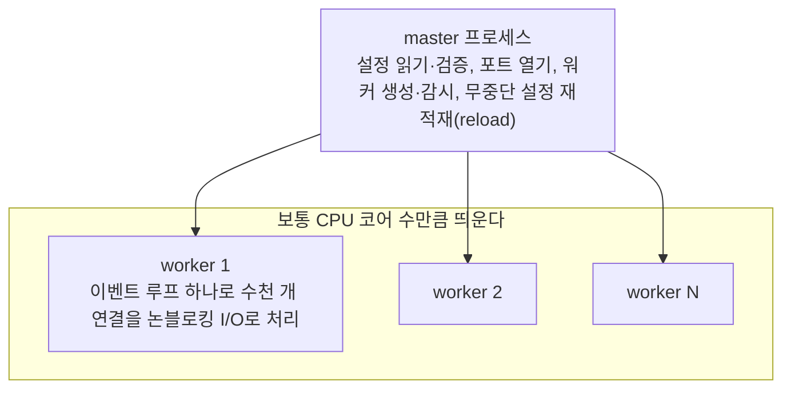

> riverkim.kr에 쓴 글들을 다시 정리한 노트다. 「Nginx의 마스터-워커 구조」는 ByteByteGo의 System Design 101 가이드 「[Why is Nginx so Popular?](https://bytebytego.com/guides/why-is-nginx-so-popular)」를, 「서버의 종류」는 「[Top 6 Most Commonly Used Server Types](https://bytebytego.com/guides/top-6-most-commonly-used-server-types)」를 바탕으로 보강했다.

## 웹 서버와 WAS

웹 서비스의 서버 쪽은 보통 두 층으로 나뉜다. 앞단의 웹 서버가 요청을 받고, 뒤에서 WAS가 실제 로직을 처리한다.

| 구분 | 웹 서버 | WAS (Web Application Server) |
| --- | --- | --- |
| 하는 일 | HTML·CSS·JS·이미지 같은 정적 자원을 지정된 폴더에서 꺼내 준다 | 요청마다 코드를 실행해 동적인 결과를 만든다 |
| 대표 제품 | Apache, Nginx, IIS | Tomcat(Java), 그 밖의 언어에서는 Node.js 서버, Django 서버 등 |
| 위치 | 클라이언트와 WAS 사이 | 웹 서버 뒤 |

웹 서버만으로도 간단한 PHP 정도의 동적 페이지는 처리할 수 있지만, 본격적인 동적 처리는 WAS에 맡기고 웹 서버는 앞에서 관리 역할을 한다.

### 웹 서버를 앞에 두는 이유

WAS 앞에 웹 서버를 두면 그 웹 서버가 **리버스 프록시**가 된다. 클라이언트는 웹 서버만 보고, 웹 서버가 캐시·로드밸런싱·헬스 체크·TLS 종료를 맡아 WAS의 주소와 구성을 감춘다. 각 기능의 설명은 [[proxy|프록시: 포워드 프록시와 리버스 프록시]]에 있다.

### Apache vs Nginx

| | Apache | Nginx |
| --- | --- | --- |
| 처리 방식 | 클라이언트(연결)마다 프로세스·스레드를 따로 만든다 | 이벤트 기반으로 적은 수의 워커가 많은 연결을 처리한다 |
| 장점 | 오래 쓰여 안정적이고 모듈 생태계가 넓다 | 동시 접속이 많아도 메모리·CPU 부담이 적다 |

### Nginx의 마스터-워커 구조

Nginx가 널리 쓰이는 이유는 **마스터-워커 프로세스 모델**에 있다.



- 워커는 연결마다 스레드를 만들지 않고, epoll 같은 I/O 다중화로 준비된 연결만 골라 처리한다. 원리는 [[event-loop-server|비동기 서버의 이벤트 루프]]에 있다.
- 워커 하나가 죽어도 마스터가 새로 띄우고, `nginx -s reload`는 새 설정의 워커를 띄운 뒤 옛 워커가 처리 중인 요청을 마치고 내려가게 해 끊김 없이 설정을 바꾼다.

이 구조 덕분에 Nginx 하나가 여러 역할을 겸한다.

| 역할 | 하는 일 |
| --- | --- |
| 고성능 웹 서버 | 정적 파일을 적은 자원으로 빠르게 내준다 |
| 리버스 프록시·로드 밸런서 | 뒤쪽 여러 서버로 요청을 나눈다(라운드 로빈, 최소 연결, IP 해시) |
| 콘텐츠 캐시 | 뒤쪽 서버의 응답을 디스크·메모리에 저장해 같은 요청에 바로 답한다 |
| SSL/TLS 종료 | HTTPS 암호화를 앞단에서 풀어 뒤쪽 서버는 평문 HTTP만 다루게 한다 |

### Tomcat과 Spring 배포

- Java·JSP로 만든 웹 애플리케이션은 Tomcat 같은 WAS 위에서 실행된다.
- 예전에는 Spring 앱을 **war** 파일(.class, JSP, 정적 파일을 압축한 것)로 빌드해, 설치한 Tomcat의 정해진 폴더에 넣고 실행했다.
- 지금은 반대로 Spring Boot가 Tomcat을 내장해, Tomcat까지 들어 있는 **jar** 하나로 빌드해 배포하는 방식이 일반적이다. 그래서 Tomcat을 직접 만질 일은 줄었다.
- 언어 생태계마다 배포 구조와 용어는 다르지만 "웹 서버를 앞에 두고 뒤에서 애플리케이션 서버가 일한다"는 그림은 같다.

## Nginx 설정 기초: 404를 다른 서버로 넘기기

예를 들어 워드프레스 사이트를 Next.js 사이트로 점진적으로 옮기는 중이라고 하자. 아직 워드프레스가 서빙하는 페이지도 있으니, 요청은 먼저 기존 서버에서 찾아보고 **404가 나면 새 사이트의 404 페이지로 프록시**해야 한다. Nginx는 언어가 아니라 자체 지시어(directive)로 설정한다.

```nginx
server {
    # ... 기존 워드프레스 설정
    error_page 404 = @fallback;

    location @fallback {
        proxy_set_header Host new-site.example.com;  # 프록시할 대상의 호스트
        rewrite ^ /404 break;                         # 모든 경로를 /404로 바꾸고 재작성 중단
        proxy_pass https://new-site.example.com;      # 바뀐 경로로 대상 서버에 요청
    }
}
```

| 지시어 | 역할 |
| --- | --- |
| `location` | 특정 URL(문자열·정규식)에 대한 처리를 묶는 블록. `@이름`은 URL과 무관한 **이름 붙은 location**으로, `error_page`처럼 다른 설정에서 연결고리로 부른다 |
| `proxy_set_header 헤더 값` | 프록시 요청에 실을 헤더를 정한다. 대상 서버가 자기 도메인으로 인식하도록 `Host`를 바꾸는 경우가 많고, 필요한 다른 헤더도 함께 설정한다 |
| `rewrite 정규식 대체경로 플래그` | 요청 경로를 바꾼다. `^`는 모든 경로에 매치되고, `break`는 이후 재작성을 멈춘다. 이 블록에 들어온 요청은 이미 404 판정을 받았으니 전부 `/404`로 바꾼다 |
| `proxy_pass 주소` | 요청을 대상 서버로 넘긴다. 결과적으로 사용자는 `대상 호스트/404` 응답을 받는다 |

기존 설정에 404 처리(불필요한 슬래시 제거, 소문자 변환 후 `/404.html` 보여 주기 등)가 이미 있다면, 그 폴백 지점에서 대상만 새 서버로 바꾸면 된다.

## 서버의 종류

"서버"는 역할로 부르는 이름이다. 웹 서버 말고도 인터넷을 받치는 서버가 여럿 있다.

| 종류 | 하는 일 | 자세히 |
| --- | --- | --- |
| 웹 서버 | 웹 사이트를 호스팅하고 HTTP로 콘텐츠를 내준다 | 이 노트 |
| 메일 서버 | 메일을 보내고(SMTP) 받고(IMAP·POP3) 다른 메일 서버로 전달한다 | [[daemon-and-systemd\|데몬과 systemd]]의 메일 서버 예 |
| DNS 서버 | 도메인 이름을 IP 주소로 바꿔 준다 | [[dns\|DNS]] |
| 프록시 서버 | 클라이언트와 다른 서버 사이에서 중계한다. 보안, 캐싱, 익명성 | [[proxy\|프록시]] |
| FTP 서버 | 네트워크로 파일을 주고받게 한다. 지금은 암호화된 SFTP·HTTPS 업로드가 주로 쓰인다 | |
| 오리진 서버 | 콘텐츠의 원본을 가진 서버. CDN 엣지 서버가 여기서 받아 캐시해 사용자 가까이서 내준다 | [[cdn\|CDN]] |

## 정리

- 웹 서버는 정적 자원과 앞단 관리(프록시·캐시·로드밸런싱·헬스 체크)를, WAS는 동적 처리를 맡는다.
- Apache는 연결마다 프로세스·스레드, Nginx는 이벤트 기반이라 동시 접속에 강하다.
- Nginx는 마스터가 설정과 워커를 관리하고, 워커가 이벤트 루프로 연결을 처리한다. 그래서 웹 서버·프록시·캐시·TLS 종료를 한 프로세스 묶음으로 겸한다.
- Spring Boot는 Tomcat을 내장한 jar로 배포하는 것이 일반적이다.
- Nginx에서는 `location`으로 묶고, `rewrite`로 경로를 바꾸고, `proxy_pass`로 다른 서버에 넘긴다.

관련 노트: [[http-web-architecture|웹 앱의 요청·응답 구조]], [[vm-vs-container|VM과 컨테이너]], [[web-scalability-components|웹 확장성의 구성 요소]], [[cdn|CDN]], [[spring-singleton-thread-safety|스프링의 싱글톤 빈과 요청 스레드]], [[high-traffic-resilience|대규모 트래픽에서 서비스를 지키는 설계]], [[event-loop-server|비동기 서버의 이벤트 루프: 다중 접속 서버에서 Reactor 패턴까지]]
