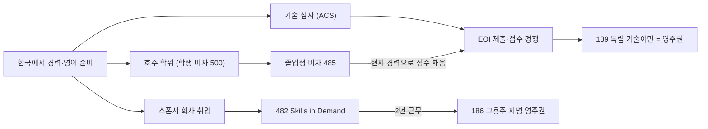

> 개발자 오픈 채팅방에서 호주 거주자가 공유한 이민 경로 조언(2024.02)을 뼈대로, 비자 제도는 호주 내무부(Home Affairs) 안내와 이민 법률 자료로 2026년 기준으로 고쳐 재구성한 노트다.

## 세 갈래 경로

호주 영주권(PR)으로 가는 현실적인 길은 세 가지다. **가장 좋은 것은 한국에서 경력을 쌓아 독립 기술이민으로 영주권을 받고 가는 것**이다. 현지에서 비자 기한에 쫓기지 않기 때문이다.

| 경로 | 흐름 | 장점 | 위험 |
| --- | --- | --- | --- |
| 독립 기술이민 (189) | 한국에서 기술 심사 → 점수 이민 신청 → 초청 → 영주권 받고 입국 | 고용주·주정부 스폰서가 필요 없다. 도착할 때 이미 영주권자다 | 점수 경쟁이 치열하다. IT 직군은 하한 65점보다 훨씬 높은 점수에서 초청이 끊긴다 |
| 학위 → 졸업생 비자 (485) → 점수 이민 | 호주 대학 학위 → 485로 현지 취업 → 호주 경력·학위 점수를 더해 189·190 신청 | 호주 학위·현지 경력이 점수와 취업에 모두 유리하다 | 학비·생활비가 크다. 485 기한 안에 점수를 못 채우면 돌아가야 한다 |
| 스폰서 취업 (482) → 고용주 지명 (186) | 비자 스폰서 회사에 취업 → 482로 근무 → 2년 뒤 회사가 186 영주권 지명 | 점수 경쟁이 없다 | 스폰서를 해 주는 회사를 찾기 어렵다. 회사를 옮기기 어렵다 |

## 1. 독립 기술이민 (subclass 189)

고용주·주정부·가족 스폰서 없이 점수만으로 받는 **영구 비자**다.

| 단계 | 내용 |
| --- | --- |
| 직업 선택 | 장기 부족 직업 목록(MLTSSL)에 있는 직업이어야 한다. 개발자는 Software Engineer(261313), Developer Programmer(261312) 등 |
| 기술 심사 | 직업별 심사 기관에서 학력·경력이 그 직업 수준인지 인정받는다. IT 직군은 **ACS(Australian Computer Society)**가 맡는다. 심사 통과 없이는 다음 단계로 못 간다 |
| 영어 시험 | IELTS·PTE 등. 점수가 높을수록 가산점이 크다 |
| EOI 제출 | SkillSelect에 관심 표명서(Expression of Interest)를 내고 점수 순서대로 초청을 기다린다 |
| 초청 → 신청 | 초청(ITA)을 받으면 비자를 신청한다. 초청 시점에 **45세 미만**이어야 한다 |

- 점수는 나이, 영어, 경력(해외·호주), 학력, 호주 학위, 배우자 조건 등으로 매긴다. 법정 하한은 **65점**이지만 개발 직군의 실제 초청 점수는 대개 그보다 훨씬 높다.
- 주정부 지명 영주권(190, +5점)과 지방 거주 조건부 비자(491, +15점)는 점수가 모자랄 때 쓰는 변형이다.
- 그래서 「한국에서 경력을 쌓으며 영어 점수를 최대한 올려 두는 것」이 이 경로의 핵심 준비다.

## 2. 호주 학위 → 졸업생 비자 (subclass 485)

호주에서 학위를 마친 유학생이 졸업 후 일할 수 있게 해 주는 **임시 비자**다(미국의 OPT에 해당).

| 항목 | 내용 (2024년 7월 개편 이후) |
| --- | --- |
| 대상 | 학사·석사·박사 졸업생은 Post-Higher Education Work stream |
| 나이 | 대부분 **35세 이하**일 때 신청해야 한다(과거 50세에서 낮아졌다). 연구 석사·박사 등 일부만 예외 |
| 기간 | 학사·수업 석사는 최대 2년. 지방(regional) 지역에서 공부·거주했으면 연장 stream이 있다 |
| 이후 | 이 기간에 현지 경력을 쌓고, 호주 학위·경력 가산점으로 189·190 점수를 채운다 |

- 485 자체는 영주권으로 바로 이어지지 않는다. 기한 안에 점수 이민 초청이나 스폰서 취업을 잡아야 한다.
- 나이 제한이 낮아졌으므로 30대라면 학위 기간을 거꾸로 계산해 485 신청 나이를 넘기지 않는지 먼저 확인한다.

## 3. 스폰서 취업 → 고용주 지명 영주권

| 비자 | 내용 |
| --- | --- |
| **482 Skills in Demand** | 2024년 12월 7일 옛 **TSS(482)** 비자를 대체한 고용주 스폰서 임시 비자다. 최대 4년. 연봉에 따라 Core Skills stream(핵심 기술 직업 목록 CSOL + 최저 연봉 기준)과 Specialist Skills stream(고연봉)으로 나뉜다. 연봉 기준은 매년 7월 1일 오른다 |
| **186 ENS (Temporary Residence Transition stream)** | 482 소지자가 스폰서 회사에서 지명 직업으로 **최근 3년 중 2년 이상** 풀타임으로 일하면 회사가 영주권을 지명한다. 과거에는 3년이었고 2년으로 줄었다 |

- 이 경로는 회사가 스폰서 비용과 절차를 감수해야 열린다. 인력이 부족한 시기에는 해외 채용도 활발하지만, IT 업계가 정리해고를 거듭한 시기에는 스폰서 채용이 크게 줄어 당장은 쉽지 않다.
- 해외에서 지원할 때의 일반 요령(레주메 첫머리에 비자 이야기부터 쓰지 않기, LinkedIn 위치 설정 등)은 [[us-work-visa-paths#지금 할 수 있는 준비|미국 취업 노트의 준비 항목]]과 같다.

## 지금 할 수 있는 준비

| 할 일 | 이유 |
| --- | --- |
| 한국에서 경력 쌓기 | 해외 경력 연수가 점수가 되고, ACS 기술 심사도 경력으로 받는다 |
| 영어 시험 점수 최대로 | 점수 이민에서 가장 확실하게 올릴 수 있는 항목이다 |
| 내 점수 계산 | 내무부 점수표로 지금 점수와 부족분을 확인하고, 경로(189 직행·유학·스폰서)를 고른다 |
| 등록 이민 대행사·변호사 상담 | 이민법·연봉 기준·직업 목록이 해마다 바뀐다. 비자·영주권 신청은 등록된 이민 전문가(MARA 등록 에이전트)의 도움을 받는다 |
| 한인 커뮤니티 | 네이버 카페 「지금 함께하는 호주」 같은 호주 한인 커뮤니티에서 생활·취업 정보를 얻는다 |

## 정리

- 호주 영주권은 점수(189), 유학(485 → 점수 이민), 스폰서(482 → 186) 세 갈래다.
- 가장 좋은 것은 한국에서 경력·영어를 쌓아 189로 영주권을 받고 가는 것이다.
- 485는 35세 이하 제한이 생겼고, 482는 Skills in Demand로 바뀌어 2년이면 186 영주권을 노릴 수 있다.
- 숫자(점수 컷, 연봉 기준, 나이)는 매년 바뀌므로 신청 시점에 [호주 내무부](https://immi.homeaffairs.gov.au/)와 전문가에게 확인한다.

관련 노트: [[us-work-visa-paths|한국 개발자가 미국에서 일하는 경로: 비자가 먼저다]], [[resume-writing|합격하는 영문 레주메 작성법]], [[opic|OPIc 공략 전략]]
