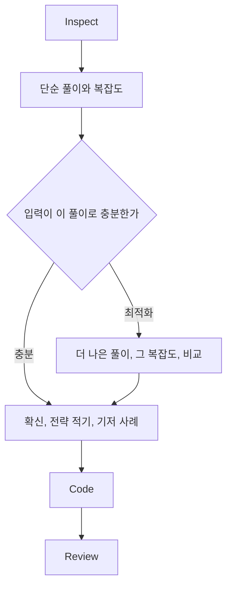

> Daniel Habib의 「[The Big Tech Coding Interview Framework, Pt 1. Inspect](https://danielhabib.substack.com/p/the-coding-interview-pt-1-inspect)」(2021.10), [Strategy](https://www.linkedin.com/pulse/big-tech-coding-interview-framework-pt-2-strategy-daniel-habib) 편(2022.06), [Review](https://dev.to/dannyhabibs/the-big-tech-coding-interview-framework-pt-4-review-28cm) 편(2022.06)과 72점 자기 채점 [시트](https://docs.google.com/spreadsheets/d/1gy9cmPwNhZvola7kqnfY3DElk7PYrz2ARpaCODTp8Go/edit)를 바탕으로 재구성한 노트다. Code 단계의 항목 설명은 같은 시리즈를 옮긴 Daniel W. Farlow의 「[Algorithm Grading Rubric](https://danielwfarlow.com/blog/2026/01/15/2026/algorithm-grading-rubric)」(2026.01)로 대조했다. 모의 면접에서 칸을 채우는 쓰임은 「[Why mock coding interviews are important](https://danielhabib.substack.com/p/why-mock-coding-interviews-are-important)」(2021.11)를 바탕으로 보강했다.

## 자기 채점표란

코딩 인터뷰 자기 채점표는 문제 하나를 **Inspect, Strategy, Code, Review** 순서로 풀었는지 가중치로 합산하는 연습 도구다. 항목은 30개이고 만점은 **72점**이다. 면접관이 소통·문제 해결·기술 역량·테스트로 매기는 채용 구간은 [[coding-interview-rubric|코딩 인터뷰 평가 기준]]에 있고, 면접 당일의 여섯 단계(소개부터 역질문까지)는 [[tech-interview-prep|기술 면접 준비]]에 있다. 이 표는 그중 코딩 문제 하나를 푸는 과정만 점수화한다.

배점이 큰 칸이 시리즈가 어려운 부분으로 다루는 행동과 같다. 떠오르는 접근을 모두 검토하기(5), 막혔을 때의 대처(5), 코드를 말로 풀기(5), 테스트 케이스를 적어 처리하기(6)다.

## 네 단계와 배점

| 단계 | 하는 일 | 만점 |
| --- | --- | --- |
| Inspect | 입력·출력·손 예제·공리·가정을 보드 한쪽에 적는다. 약 5분 | 6 |
| Strategy | 단순 풀이의 복잡도를 적고, 더 나은 풀이와 비교한 뒤 전략을 단계로 적는다. 네 단계 중 가장 어렵다 | 35 |
| Code | 전략을 코드로 옮기며 말한다. 계획을 끝낸 뒤에 시작한다 | 17 |
| Review | 적은 복잡도와 코드를 맞추고, 손 예제 다음 케이스를 한 줄씩 따라간다 | 14 |



화상 면접에서는 보드에 적으라는 항목을 공유 편집기의 주석으로 적는다. 공리와 가정은 줄임말도 된다.

## 채점표

시트의 Score 칸에 각 행의 가중치 이하를 적고 더한다. 아래 합은 72다.

| 단계 | 질문 | 원문 | 가중치 |
| --- | --- | --- | --- |
| Inspect | 입력이 무엇인지 명시했는가 | Did I explicitly state what the input was? | 1 |
| Inspect | 원하는 출력을 확인했는가 | Did I clarify what the desired output was? | 1 |
| Inspect | 손으로 풀 수 있는 작은 예제를 만들었는가 | Did I construct a simple example that could be solved by hand? | 2 |
| Inspect | 공리(axiom)를 모두 적었는가 | Did I write out all Axioms? | 1 |
| Inspect | 타당한 가정을 적고 끌어냈는가 | Did I write out and derive all intelligent assumptions? | 1 |
| Strategy | 단순한 풀이를 떠올렸는가 | Did I brainstorm a simple solution? | 2 |
| Strategy | 그 풀이의 실행 시간을 분석했는가 | Did I analyze the runtime? | 2 |
| Strategy | 그 풀이의 공간 요구를 분석했는가 | Did I analyze the space requirement? | 1 |
| Strategy | 입력 규모가 이 풀이로 충분한지 물었는가 | Did I ask if the input problem set would be small enough for this to suffice? | 1 |
| Strategy | 더 정교한 풀이에 도달했는가 | Was I able to come up with a better more sophisticated solution? | 4 |
| Strategy | 그 풀이의 시간 복잡도를 분석했는가 | Did I analyze the time complexity of this solution? | 2 |
| Strategy | 그 풀이의 공간 복잡도를 분석했는가 | Did I analyze the space complexity of this solution? | 2 |
| Strategy | 처음의 단순 풀이와 직접 비교했는가 | Did I compare it directly to my initial simple solution? | 1 |
| Strategy | 코딩을 시작할 때 확신이 있었는가 | Was I confident when I started coding? | 4 |
| Strategy | 떠오르는 접근을 모두 검토했는가 | Did I think through all approaches that come to mind? | 5 |
| Strategy | 쓸 전략을 명시적으로 적었는가 | Did I explicitly write out my desired strategy? | 4 |
| Strategy | 기저 사례(base case)를 명시적으로 고려했는가 | Did I explicitly consider base cases? | 2 |
| Strategy | 막혔을 때 얼마나 잘 대처했는가 | How well did I handle getting stuck? | 5 |
| Code | 코드가 얼마나 깔끔했는가 | How cleanly was my code written? | 2 |
| Code | off-by-one을 명시적으로 확인했는가 | Did I explicitly check for any off-by-one errors? | 2 |
| Code | 구현하게 될 함수를 예측했는가 | Was I able to predict what functions I would end up implementing? | 1 |
| Code | 떠올린 전략이 문제를 풀었는가 | Did my brainstormed strategy solve the problem? | 3 |
| Code | 코딩 과정이 얼마나 매끄러웠는가 | How smooth was the coding process? | 2 |
| Code | 코드를 말로 풀어 설명할 수 있었는가 | Was I able to talk through my code? | 5 |
| Code | 코드에서 흥미로운 함수를 활용했는가 | Did I leverage any interesting functions in my code? | 2 |
| Review | 시간 복잡도를 증명했는가 | Did I prove my runtime complexity? | 2 |
| Review | 공간 복잡도를 증명했는가 | Did I prove my spacetime complexity? | 2 |
| Review | 서로 다른 테스트 케이스를 적어 처리했는가 | Did I write up different test cases and process them? | 6 |
| Review | 사소해 보이는 줄까지 한 줄씩 봤는가 | Did I go line by line, no matter how trivial? | 2 |
| Review | 검토 중에 코드를 고쳐야 했는가 | Did I have to make any changes when reviewing my code? | 2 |

시트 Review의 둘째 문항 원문은 spacetime이다. 시리즈 본문은 그 칸을 공간 복잡도로 따라간다. 시간 복잡도 표기 자체는 [[big-o|빅오 표기법]]에 있다.

## Inspect

코딩을 시작하기 전에 문제를 검사한다. 다섯 칸은 모두 보드 한쪽에 적는 산출물이 있다. 입력이 몇 개인지, 타입은 무엇인지, 각 입력이 무엇을 나타내는지, 출력의 타입은 무엇인지를 적는다. 그다음 손으로 풀 수 있을 만큼 작은 예제를 만들어 답을 낸다.

**공리**는 제약 안에 숨어 있어 질문으로 확인하는 사실이다. 수학의 공리와 이름이 같을 뿐, 여기서는 입력의 범위와 모양이다. 「배열의 문자열은 한 글자인가?」처럼 묻는다. **가정**은 코드를 단순하게 유지하려고 두는 전제이고, 막혔을 때 문제를 좁히는 데도 쓴다. 입력이 말이 되는 범위(k는 항상 양의 정수)를 적는 것이 기본이다.

배열 `n`에서 어떤 값이 `k`번보다 많이 나오는지를 묻는 문제라면 보드에는 이렇게 남는다.

```text
Input: n(arr<str>), k(int)
Output: bool

Example:
input: n = ["a", "b", "a", "c", "a"], k = 2
output: true

Axiom: 배열의 문자열은 한 글자다
Assumption: k는 항상 양의 정수다
```

## Strategy

전략이 맞으면 코딩은 그 단계를 따라 쓰는 일이 된다. 단순 풀이를 말로 못 하면, 느려도 되는 풀이조차 없는 상태다. 대부분의 문제에는 느리고 곧장 보이는 풀이가 있다. 그 풀이를 말하고, 동작을 설명하고, 시간과 공간을 보드에 적는다.

```text
BF - Runtime: O(N^2)
BF - Space: O(N)
```

적은 뒤 「입력 규모가 이 풀이로 충분한가, 더 줄여야 하는가」를 묻는다. 면접관이 이 풀이로 충분하다고 하면, 더 나은 풀이·그 복잡도·비교 칸을 건너뛰고 「코딩을 시작할 때 확신이 있었는가」로 간다. 그래프 순회와 연결 리스트는 자연스러운 풀이가 하나뿐인 경우가 많아, 따로 둔 단순 풀이가 없을 수 있다.

최적화가 필요하면 단순 풀이의 시간을 한두 단계 빠른 쪽으로 옮긴다. 시리즈가 자주 본다고 적은 순서는 느린 쪽부터 O(n^n), O(n!), O(n³), O(n²), O(n log n), O(n), O(log n), O(1)이다. 면접에 자주 나오는 복잡도만 고른 목록이다. 이 칸은 자료구조와 연습이 채운다. 공부 범위는 [[coding-test|코딩 테스트 접근법]]과 [[books/algorijeum-teureining|알고리즘 트레이닝]], [[books/competitive-programmer-s-handbook|Competitive Programmer's Handbook]] 쪽에 있다. 단순 풀이 자체는 [[brute-force|완전 탐색]]이다.

개선한 풀이도 같은 형식으로 적고, 단순 풀이와 나란히 말한다. 최적이 아니어도 느린 풀이를 줄여 보였으면, 시간이 더 있으면 더 줄일 수 있다는 신호가 된다.

```text
Solution - Runtime: O(N)
Solution - Space: O(1)
```

코딩 직전의 확신은 첫 줄을 쓰기 전에 코드의 모양이 정해져 있는가이다. 주요 단계를 의사 코드로 적는다.

```text
1. 잘못된 입력을 거른다
2. 배열을 정렬한다
3. 이분 탐색으로 값을 찾는다
4. 찾으면 true를 반환한다
```

말로 꺼낸 접근은 따르거나 탈락시킨다. 둘 다 하지 않으면 그 접근을 기각할 근거가 없는 것으로 보인다. 기저 사례는 값이 0, 1, 아주 작을 때, 아주 클 때다. 본 알고리즘이 가장자리를 처리하지 못하면 그 값만 조건문으로 따로 적는다.

막힘 칸(5점)은 멈췄는가, 다른 질문을 꺼냈는가다. 막힌 채로 말을 끊는 쪽이 점수를 깎는다. 그때 바꿔 보는 관점은 [[coding-test#막혔을 때 바꿔 보는 관점|코딩 테스트 접근법]]에 있다.

## Code

코드를 쓰기 전에 상위 풀이는 이미 나와 있어야 한다. 면접이 끝난 뒤 남는 것은 인상, 보드에 적은 메모, 코드다. 코드는 읽히면서 목표한 시간과 공간을 만족하는 쪽이 이 칸의 만점이다. 복잡한 조건과 들쭉날쭉한 이름이 감점 사유로 자주 꼽힌다.

off-by-one은 `while`, 직접 짠 이분 탐색, 포인터를 옮길 때 따로 확인한다. 손 예제를 넣어 포인터가 어디에 서는지를 본다. 코딩 중의 이 확인(2점)과 Review에서 줄을 다시 읽는 확인(2점)은 별도 칸이다.

구현할 함수는 코드를 쓰기 전에 이름을 댄다. 파이썬 [`heapq`](https://docs.python.org/3/library/heapq.html)로 풀기로 했다면 `heapify`, `heappush`, `heappop`을 전략 메모에 적고 비용을 말한다. 문서에서 `heapify`는 선형 시간이고, 루트를 뺀 뒤 힙 불변을 다시 맞추는 과정은 로그 시간이다. `heappush`와 `heappop`이 그 삽입과 삭제다.

전략이 문제를 풀었는가는 계획이 실제 코드와 얼마나 같았는가이다. 재귀만 쓰고 나서 기저 사례나 캐시 모양을 떠올리는 동적 계획법은, 코딩이 매끄럽지 않았다는 신호다. 코딩 중에 전략으로 되돌아가면 이 두 칸이 같이 깎인다.

말로 풀기(5점)는 코드를 쓰는 동안 지금 쓰는 줄을 설명하는 것이다. 문제만 반복해서 풀면 이 칸은 늘지 않는다. 모의 면접과 소리 내어 푸는 연습으로 만든다.

흥미로운 함수 칸은 언어에 있는 도구를 면접 중에 설명할 수 있는가다. 시리즈의 예는 파이썬 `TreeNode`를 `locals()`와 `dict.update`로 채우는 방식이다. 필드를 하나씩 대입하는 것보다 읽기는 나쁘다. 시리즈는 그 가독성을 포기하는 대신, 짧은 관용 코드를 설명하며 언어를 보여 주는 예로 둔다.

```python
class TreeNode:
    def __init__(self, val, left=None, right=None):
        self.__dict__.update(
            {key: value for key, value in locals().items() if key != "self"}
        )
```

## Review

구현이 끝나면 바로 손 예제를 입력으로 코드를 따라간다. 끝난 신호로 「다 됐나요?」를 쓰면 확신이 없다는 쪽으로 읽힌다. 남은 시간이 몇 분이어도 손 예제로 검토를 시작한다. 짧더라도 확인하는 모습이 이 단계의 목적이다.

시간 칸은 전략 때 적어 둔 실행 시간과 지금 코드를 맞추는 것이다. 여유가 있으면 줄마다 비용을 말한다. 공간 칸도 같다. 시트 원문은 spacetime이고, 하는 일은 공간이다. 상수 공간인 줄과 할당이 있는 줄을 가른다.

테스트(6점, 표에서 가장 크다)는 손 예제 다음에 케이스를 더 적고, 단순한 것에서 복잡한 것으로 처리한다. 한 줄씩 읽기는 그 줄이 의도한 일을 하는지, off-by-one과 문법이 맞는지를 본다. 세미콜론이나 인덱스를 빠뜨리는 실수가 이 칸에서 나온다.

마지막 칸(2점)은 자기 기록이다. 검토 중에 고친 부분을 적고, 이분 탐색의 off-by-one처럼 같은 수정이 문제마다 반복되면 그 패턴을 다음 연습의 목표로 둔다. 이 2점은 그 반복 패턴을 적었는지를 본다. 시트는 이 칸의 만점 조건을 따로 적지 않았다.

## 채점하는 법

문제를 푼 직후, 특히 모의 면접 직후에 표를 채운다. 채점 사이트에 제출만 하는 연습에는 검사 내용을 적는 단계와 코드를 손으로 따라가는 단계가 빠진다. 모의 면접에서 30칸을 확인하는 이유가 그것이다.

| 문항 모양 | 점수 |
| --- | --- |
| Did I … (했는가) | 했으면 가중치 전부, 아니면 0. 시트는 부분 점수 공식을 적지 않는다 |
| How … (얼마나) | 깔끔함, 막힘 대처, 코딩이 매끄러운 정도. 가중치가 상한이다 |
| 단순 풀이로 충분하다고 해서 건너뛴 최적화 문항 | 채점에서 제외하고, 확신 칸부터 점수를 매긴다 |
| 검토 중 수정 | 고친 내용을 기록한다. 2점은 그 반복 패턴을 다음 목표로 적었는지를 본다 |

단계 만점은 Inspect 6, Strategy 35, Code 17, Review 14다. Strategy가 절반에 가깝다.

## 한계

- 72점은 과정의 자기 점검이다. 회사의 채용 점수나 Strong hire 구간으로 읽지 않는다.
- 더 나은 풀이와 접근 검토 칸은 자료구조 연습이 채워 주는 자리다. 표의 문장만 따라 읽어서는 그 두 칸이 오르지 않는다.
- 맞게 풀고도 침묵하면 말로 풀기 칸과 접근 검토 칸이 낮다. 칸을 채운 점수는 과정을 잰 값이고, 알고리즘이 맞는지는 손 예제와 추가 케이스로 확인한다.
- 그래프 순회·연결 리스트처럼 풀이 갈래가 하나인 문제에는 단순 풀이 칸이 비는 것이 정상이다.

## 정리

- 문제마다 Inspect에서 입력, 출력, 손 예제, 공리, 가정을 보드 한쪽(또는 주석)에 적고 시작한다.
- Strategy에서 단순 풀이의 시간과 공간을 적고, 입력이 그것으로 충분한지 물은 뒤에야 코드를 쓴다.
- 말로 꺼낸 접근은 채택하거나 기각하고, 막히면 질문을 이어 간다.
- 끝나면 손 예제부터 한 줄씩 따라가고, 전략 때 적은 복잡도와 코드를 맞춘다.
- 모의 면접이 끝난 뒤 30칸을 72점 만점으로 더해, 반복해서 깎이는 칸을 다음 연습의 목표로 둔다.

관련 노트: [[coding-interview-rubric|코딩 인터뷰 평가 기준]], [[tech-interview-prep|기술 면접 준비]], [[coding-test|코딩 테스트 접근법]], [[big-o|빅오 표기법]], [[brute-force|완전 탐색과 백트래킹]], [[books/algorijeum-teureining|알고리즘 트레이닝]], [[books/competitive-programmer-s-handbook|Competitive Programmer's Handbook]]
