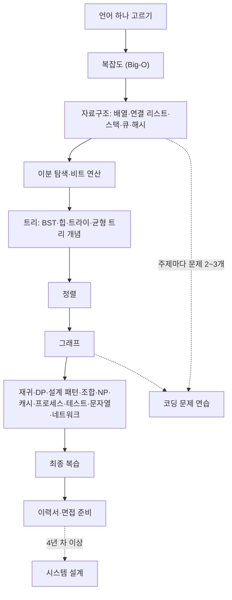

> jwasham의 「[Coding Interview University](https://github.com/jwasham/coding-interview-university)」(CC-BY-SA-4.0) 저장소를 바탕으로 재구성한 노트다. 원문의 방대한 링크 목록은 옮기지 않고 주제마다 핵심 자료만 남겼으며, 개념 설명은 각 주제의 개념 노트로 잇는다.

## Coding Interview University란

**Coding Interview University(CIU)는 CS 전공이 없는 개발자가 대기업 소프트웨어 엔지니어 기술 면접을 통과하는 데 필요한 지식을 위에서 아래로 따라가는 체크리스트로 묶은 학습 계획**이다. GitHub 저장소 하나에 주제, 영상·책 링크, 직접 구현할 연산 목록이 체크박스로 들어 있다.

| 항목 | 내용 |
| --- | --- |
| 대상 | 변수·반복문·함수 정도의 코딩 경험이 있고, 몇 달을 쓸 수 있는 사람 |
| 범위 | **소프트웨어 엔지니어링** 면접. 대학 CS 과정 전체가 아니라 면접에 충분한 약 75%를 다룬다 |
| 다루지 않는 것 | JavaScript, HTML·CSS 같은 프론트엔드 기술, SQL. 프론트엔드·풀스택 경로는 [roadmap.sh](https://roadmap.sh/)를 따른다 |
| 전체 CS 독학 | CIU 자료는 roadmap.sh의 [Computer Science 로드맵](https://roadmap.sh/computer-science)에 합쳐져 있다. 대학 과정 전체를 원하면 [[ossu-introduction-and-tools\|OSSU]]가 맞다 |
| 필수/선택 경계 | 「Getting the Job」까지가 신입 면접 필수, 그 아래(시스템 설계·추가 학습)는 선택이다 |

## 전체 흐름



## 진행 방식

### 하루 한 주제, 보고 구현한다

목록 순서대로 하루에 다음 주제 하나를 잡고, 영상이나 책으로 개념을 본 뒤 **고른 언어로 그 자료구조·알고리즘을 직접 구현**한다. 한 주제에 며칠에서 일주일 넘게 걸릴 수 있다. 알고리즘을 외우는 것이 아니라, 이해해서 백지에서 다시 짤 수 있으면 된다.

진도 관리는 저장소를 포크해 체크박스에 `[x]`를 표시하고 커밋하는 방식이다. 원본의 변경은 `upstream`에서 당겨 오고, 실수로 원본에 진행 상황을 올리지 않도록 `upstream`의 push URL을 막아 둔다.

```bash
git remote add upstream https://github.com/jwasham/coding-interview-university.git
git remote set-url --push upstream DISABLE   # 내 진행 상황이 원본으로 가지 않게
git pull upstream main                        # 원본 갱신 받기
```

### 피해야 할 실수 네 가지

| 실수 | 대신 이렇게 한다 |
| --- | --- |
| 영상 몇 시간 보고 노트를 잔뜩 쓰면 남는다고 믿는다 | **다 기억하지 못한다.** 필요한 것만 골라 복습 장치(플래시카드)에 넣는다 |
| 플래시카드를 한 번 맞히면 「안다」로 넘긴다 | 같은 카드를 **여러 번 연속으로 맞혀야** 아는 것이다. 간격 반복 앱(Anki 등)을 쓴다. 남이 만든 1,000장 넘는 덱은 잡지식이 대부분이라 권하지 않는다 |
| 자료구조·알고리즘을 다 배운 뒤에 문제를 푼다 | **배우는 동안 푼다.** 연결 리스트를 배웠으면 관련 문제 2~3개를 풀고 다음 주제로 넘어갔다가, 나중에 다시 2~3개를 푼다. 면접은 지식이 아니라 지식을 적용하는 능력을 본다 |
| 산만한 환경에서 오래 앉아 있는다 | 집중할 수 있는 환경을 만든다(가사 없는 음악 등) |

간격 반복과 장기 기억에 관해서는 [[memorization|블럭-건물 암기법]]도 참고한다.

### 코딩 문제 연습의 목적

문제 풀이는 답을 외우는 일이 아니다. 연습으로 길러야 하는 것은 다음 여섯 가지다.

1. 문제를 보고 어떤 자료구조·알고리즘이 맞는지 알아보기
2. 요구 사항과 제약 확인하기
3. 면접처럼 생각을 말로 풀며 진행하기
4. 컴퓨터가 아니라 **화이트보드나 종이에** 코드 쓰기
5. 풀이의 시간·공간 복잡도 말하기
6. 직접 만든 입력으로 테스트하기

종이에 먼저 쓰고 예시 입력으로 손으로 돌려 본 뒤, 컴퓨터로 옮겨 실행한다. 지우개가 있는 연필이 펜보다 낫다. 풀이 순서·면접 진행법은 [[coding-test|코딩 테스트 접근법]]과 [[tech-interview-prep|기술 면접 준비]]에, 면접관이 보는 기준은 [[coding-interview-rubric|코딩 인터뷰 평가 기준]]에 있다. 연습 사이트는 [LeetCode](https://leetcode.com/)를 중심으로 쓰고, 문제 해설 영상은 풀이를 막 끝낸 뒤 비교용으로 본다.

## 언어와 책 고르기

| 용도 | 기준 | 예 |
| --- | --- | --- |
| 개념 학습용 | 메모리와 포인터를 직접 만져 자료구조가 「몸으로」 이해되는 언어 | C (포인터·할당·해제), 표현력이 높은 Python과 함께 쓴다 |
| 면접용 | 아주 익숙하고, 대기업에서 무난한 언어 | C++, Java, Python. JavaScript·Ruby도 가능하지만 주의점을 먼저 확인한다 |

**가능하면 두 용도를 한 언어로 맞춘다.** 그래야 한 언어만 능숙해지면 된다. 언어 선택 기준과 언어별 장단점은 [[tech-interview-prep#면접 언어 고르기|기술 면접 준비: 면접 언어 고르기]]에 있다.

책은 **자기 언어로 된 자료구조·알고리즘 교과서 한 권**과 **면접 대비서 한두 권**이면 충분하다.

| 종류 | 책 |
| --- | --- |
| 자료구조·알고리즘 기본서 | Python: 『Coding Interview Patterns』, Java: Sedgewick·Wayne 『Algorithms』(저자 강의 [Coursera Algorithms I](https://www.coursera.org/learn/algorithms-part1)·[II](https://www.coursera.org/learn/algorithms-part2)), C++: Goodrich 『Data Structures and Algorithms in C++』, C: Sedgewick 『Algorithms in C』 |
| 면접 대비서 | 『Cracking the Coding Interview』, 몸풀기로 『Programming Interviews Exposed』, 시간이 아주 많으면 『Elements of Programming Interviews』(언어별 판) |
| 참고서(선택) | Skiena 『Algorithm Design Manual』(뒷부분 알고리즘 카탈로그가 문제 분류용 사전), CLRS 『Introduction to Algorithms』(복습용, 코딩 실력은 따로 길러야 한다), 『Head First Design Patterns』, 『Write Great Code Vol.1』(수 표현·메모리·CPU 구조) |

## 주제별로 할 수 있어야 하는 것

CIU는 주제마다 「이 연산을 직접 구현하라」는 목록을 준다. 아래 표는 그 목록을 요약하고 개념 설명이 있는 노트를 잇는다.

### 기초: 복잡도와 선형 자료구조

| 주제 | 할 수 있어야 하는 것 | 노트 |
| --- | --- | --- |
| 복잡도·Big-O | 알고리즘의 시간·공간 복잡도를 Big-O로 말하기, Ω·Θ의 뜻, 분할 상환 분석, 점화식과 마스터 정리. 수학을 다 몰라도 표현할 수 있으면 된다 | [[big-o\|빅오 표기법과 시간 복잡도]] |
| 배열·동적 배열 | 자동으로 늘어나는 벡터 구현: `size`·`capacity`·`at`·`push`·`insert`·`prepend`·`pop`·`delete`·`remove`·`find`, 가득 차면 두 배로 늘리고 1/4로 줄면 절반으로 줄이는 `resize`. 인덱싱 대신 포인터 연산으로 접근해 보기 | [[data-structures#배열 (Array)\|배열]] |
| 연결 리스트 | 꼬리 포인터가 있는 판과 없는 판 모두: 앞뒤 삽입·삭제, `value_at`, `insert`·`erase`, 끝에서 n번째 값, `reverse`, 값으로 삭제. C에서는 포인터의 포인터가 필요한 이유 이해. 이중 연결 리스트는 개념만 | [[data-structures#연결 리스트 (Linked List)\|연결 리스트]] |
| 스택 | 배열로 구현하면 단순하니 개념과 쓰임만 | [[stack\|스택]] |
| 큐 | 꼬리 포인터 있는 연결 리스트판과 고정 크기 배열(원형 버퍼)판. 머리에 넣고 꼬리에서 빼는 연결 리스트판이 O(n)이 되는 이유 | [[queue-deque\|큐와 덱]] |
| 해시 테이블 | 선형 탐사(linear probing) 배열로 `hash(k, m)`·`add`(있으면 갱신)·`exists`·`get`·`remove` 구현. 체이닝, 테이블 두 배 늘리기, 분산 해시 테이블 개념 | [[hash-table\|해시 테이블]] |
| 이분 탐색 | 정렬된 정수 배열에서 반복문판·재귀판 | [[binary-search\|이분 탐색]] |
| 비트 연산 | `& \| ^ ~ << >>` 조작, 2¹~2¹⁶과 2³² 외우기, 1의 보수·2의 보수, 1비트 개수 세기, 값 교환, 분기 없는 절댓값 | [[bit-manipulation\|비트 연산 기법]], [[data-representation\|데이터 표현]] |

### 트리와 정렬

| 주제 | 할 수 있어야 하는 것 | 노트 |
| --- | --- | --- |
| 트리 순회 | BFS(레벨 순서, 큐)와 DFS 전위·중위·후위. 시간 O(n), 공간은 BFS가 최악 O(n), DFS가 트리 높이 | [[tree#순회 (Traversal)\|트리 순회]] |
| 이진 탐색 트리 | `insert`, 노드 수, 최소→최대 순서 출력, 트리 삭제, 존재 여부, 높이, 최솟값·최댓값, BST 검증, 값 삭제, 다음 큰 값(successor) | [[tree#이진 탐색 트리 (BST)\|이진 탐색 트리]] |
| 힙·우선순위 큐 | 배열 기반 최대 힙: `insert`·`sift_up`·`get_max`·`extract_max`·`sift_down`·`remove(i)`·`heapify`(O(n) 구축)·제자리 `heap_sort` | [[heap-priority-queue\|힙과 우선순위 큐]] |
| 균형 탐색 트리 | 구현보다 개념. AVL·레드-블랙·2-3·2-3-4·B 트리가 어떻게 높이를 O(log n)으로 지키는지 | [[tree#균형 이진 탐색 트리와 AVL\|균형 이진 탐색 트리]] |
| 트라이 | 읽고 이해하는 정도. 접두사 검색, R-way 트라이와 삼진 탐색 트라이의 차이 | [[data-structures#트라이 (Trie)\|트라이]] |
| 정렬 | 병합(O(n log n) 평균·최악)·퀵(평균 O(n log n)) 직접 구현, 선택·삽입은 O(n²), 힙 정렬은 힙에서. 각 정렬의 최선·평균·최악, **안정성**(퀵·힙은 불안정), 연결 리스트에 쓸 수 있는 정렬(병합). 버블 정렬은 n ≤ 16 같은 아주 작은 입력 외에는 쓰지 않는다. 기수·계수 정렬은 선택 | [[elementary-sorts\|기본 정렬]], [[merge-quick-sort\|병합 정렬과 퀵 정렬]] |

### 그래프

그래프 표현 네 가지(객체와 포인터, 인접 행렬, 인접 리스트, 인접 맵)의 장단점을 알고, **문제를 받으면 그래프 풀이부터 떠올려 본다.**

| 구현 목록 | 노트 |
| --- | --- |
| 인접 리스트·인접 행렬 각각으로 DFS(재귀·스택)와 BFS | [[graph-basics\|그래프 기초]], [[dfs\|DFS]], [[bfs\|BFS]] |
| 단일 출발 최단 경로(다익스트라), 벨만-포드 개념 | [[dijkstra\|다익스트라]], [[shortest-path\|최단 경로 알고리즘 고르기]] |
| 최소 신장 트리(프림·크루스칼, Union-Find) | [[minimum-spanning-tree\|최소 신장 트리]], [[disjoint-set\|서로소 집합]] |
| DFS 응용: 사이클 검사, 위상 정렬, 연결 요소 개수, 강한 연결 요소, 이분 그래프 판별 | [[topological-sort\|위상 정렬]], [[articulation-point\|단절점과 단절선]] |

### 더 알아야 할 것

| 주제 | 할 수 있어야 하는 것 | 노트 |
| --- | --- | --- |
| 재귀·백트래킹 | 언제 재귀가 맞는지, 꼬리 재귀가 왜 나은지, 백트래킹 틀(부분집합·순열·조합 합) | [[recursion\|재귀 함수]], [[brute-force\|완전 탐색과 백트래킹]] |
| 동적 계획법 | 면접에 자주 나오지는 않지만, **DP로 풀 수 있는 문제임을 알아보는 것**이 목표. 점화식을 세우는 패턴을 예제로 익힌다(편집 거리 등) | [[dynamic-programming\|동적 계획법]] |
| 객체 지향·설계 패턴 | UML 기초, 전략·싱글턴·어댑터·프로토타입·데코레이터·방문자·(추상) 팩토리·퍼사드·옵서버·프록시·위임·커맨드·상태·메멘토·반복자·컴포지트·플라이웨이트, SOLID 원칙 | [[gof-design-patterns\|GoF 디자인 패턴]], [[coding-principles\|좋은 코드를 위한 원칙]], [[ood-interview-approach\|객체 지향 설계 면접]] |
| 조합·확률 | 팩토리얼·순열·조합(n choose k), 기초 확률, 마르코프 체인 개념 | [[permutation-combination\|순열과 조합]] |
| NP·근사 알고리즘 | NP-완전의 뜻, 외판원·배낭 같은 대표 문제를 위장된 형태로 알아보기, 근사 알고리즘 | [[np-completeness\|P, NP, NP-완전과 근사 알고리즘]] |
| 프로그램 실행 | CPU가 명령을 가져와 실행하는 과정, ALU, 레지스터와 RAM | [[how-programs-run\|프로그램이 실행되는 과정]], [[cpu-instructions\|CPU 명령어]] |
| 캐시 | LRU 캐시 구현(해시 맵 + 이중 연결 리스트), CPU 캐시와 메모리 계층 | [[hash-table#해시 맵 + 연결 리스트: LRU·LFU 캐시\|LRU 캐시]], [[memory-hierarchy\|메모리 계층]] |
| 프로세스·스레드 | 둘의 차이와 각각 가지는 자원(스레드는 스택·PC·레지스터만 따로), 락·뮤텍스·세마포어·모니터, 데드락·라이브락, 인터럽트와 문맥 교환, 페이징·가상 메모리, `fork`의 copy-on-write, Python GIL | [[process-and-thread\|프로세스와 스레드]], [[process-synchronization\|프로세스 동기화]], [[deadlock\|데드락]], [[virtual-memory\|가상 메모리]], [[python-internals\|Python 내부 구조]] |
| 테스트 | 단위 테스트의 원리, 목 객체, 통합 테스트, 의존성 주입 | [[frontend-test-types\|테스트의 종류와 도구]], [[api-mocking\|API 모킹]], [[component-test-dependencies\|의존성이 있는 컴포넌트 테스트]], [[tdd\|TDD]] |
| 문자열 탐색 | 무차별 대입, KMP, 보이어-무어, 라빈-카프(롤링 해시), 접미사 배열 개념 | [[kmp-algorithm\|KMP 문자열 검색]], [[javascript-algorithms-overview\|JavaScript Algorithms 학습 지도]] |
| 수 표현 | 부동소수점 표현, 유니코드와 문자 인코딩, 엔디언 | [[floating-point-arithmetic\|부동소수점 연산]], [[data-representation\|데이터 표현]] |
| 네트워크 | 네트워크·운영 직군이면 반드시 나온다. TCP·UDP, TCP/IP와 OSI, 패킷 전달, HTTP·HTTP/2, TLS·HTTPS, CIDR, 소켓 | [[network-basics\|네트워크 기초]], [[osi-7-layer\|OSI 7계층]], [[transport-layer\|전송 계층]], [[http\|HTTP]], [[https\|HTTPS]] |

## 최종 복습

주제를 모두 돈 뒤에는 2~5분짜리 짧은 영상 시리즈로 핵심 개념을 빠르게 다시 훑는다. 자주 반복할 수 있는 길이가 중요하다. Michael Sambol의 [자료구조·알고리즘 영상](https://www.youtube.com/@MichaelSambol)과 [예제 코드](https://github.com/msambol/dsa), Sedgewick의 Algorithms I·II 강의가 대표적이다.

## 취업 준비

| 단계 | 할 일 | 노트 |
| --- | --- | --- |
| 이력서 | 면접 대비서의 이력서 장, Tech Interview Handbook의 [이력서 가이드](https://www.techinterviewhandbook.org/resume/guide) | [[resume-writing\|영문 레주메 작성법]] |
| 면접 과정 이해 | 빅테크 채용 절차와 코딩 면접 접근법 영상, 모의 면접 플랫폼(동료끼리, 현직 엔지니어, AI) | [[tech-interview-prep\|기술 면접 준비]] |
| 예상 질문 | 받을 만한 질문 약 20개를 뽑고 각각 **수치만이 아니라 이야기로** 답 하나 이상 준비: 지원 동기, 가장 어려웠던 문제·버그, 가장 큰 도전, 본 것 중 최고·최악의 설계, 기존 제품 개선 아이디어, 혼자·팀에서 일하는 방식, 역할에 맞는 강점, 각 프로젝트에서 즐겼던 것·배운 것·다시 한다면 더 잘할 것 | [[behavioral-interview-questions\|인성 면접 준비]] |
| 역질문 | 팀 규모, 개발 주기(스프린트·애자일), 마감 압박 빈도, 팀의 의사 결정 방식, 주당 회의 수, 집중할 수 있는 환경인지, 면접관이 지금 하는 일과 그 일의 좋은 점, 업무와 삶의 균형 | [[interview-attitude#마지막 역질문\|면접 잘 보는 법: 역질문]] |
| 합격 뒤 | 끝이 아니다. 계속 배운다 | - |

## 시스템 설계 (선택, 4년 차 이상)

경력 4년 이상이면 시스템 설계 면접을 예상한다. 범위가 넓어 시간을 많이 들여야 하고, 시작점은 [System Design Primer](https://github.com/donnemartin/system-design-primer)다.

| 고려할 것 | 내용 |
| --- | --- |
| 확장성 | 큰 데이터를 값 하나로 요약하기, 데이터셋을 다른 형태로 변환하기, 아주 큰 데이터 다루기 |
| 설계 | 기능 범위, 인터페이스, 클래스 계층, 제약 아래 설계, 단순함과 견고함, 트레이드오프, 성능 분석·최적화 |
| 핵심 개념 | 지연 시간 숫자(Numbers Everyone Should Know), CAP 정리, 합의 알고리즘(Paxos·Raft), 일관된 해싱, 샤딩, 정규화, NoSQL 패턴, 분산 컴퓨팅의 오류 가정 |

설계 연습은 세 단계로 한다.

1. **문제와 범위 이해**: 면접관과 사용 사례를 정하고, 기능을 제안하고, 범위 밖을 지운다. 고가용성은 기본 요구로 넣는다.
2. **제약 생각하기**: 월·초당 요청 수, 읽기:쓰기 비율(80/20 법칙), 초당 쓰기·읽기 데이터량, 5년 치 저장 용량을 묻거나 계산한다.
3. **추상 설계**: 서비스·데이터·캐시 계층, 로드 밸런싱·메시징 같은 인프라, 서비스를 움직이는 핵심 알고리즘의 개요, 병목과 해결책.

연습 문제로는 고유 ID 생성기, 키-값 DB, 사진 공유, 추천 시스템, URL 단축기, 캐시 시스템을 설계해 본다. 더 자세한 7단계 절차는 [[tech-interview-prep#시스템 디자인 면접 7단계|시스템 디자인 면접 7단계]]에, 개념은 [[system-design-primer|System Design Primer 개념 지도]]와 [[system-design-fundamentals|시스템 설계의 품질 속성과 트레이드오프]]에 있다.

## 선택 주제

신입 면접에는 필요 없지만, 알고 있으면 도구 상자가 넓어지는 주제들이다.

### 도구와 시스템

| 주제 | 핵심 | 노트 |
| --- | --- | --- |
| 컴파일러 | 소스가 기계어가 되는 단계, 컴파일러 최적화 | [[gcc-compile-and-link\|GCC 컴파일과 링크]] |
| vi(m)·Emacs | 유닉스 계열 편집기 하나에 익숙해지기 | [[vim-and-neovim\|Vim과 Neovim]] |
| 유닉스 명령줄 | bash, cat, grep, sed, awk, curl·wget, sort, tr, uniq, strace, tcpdump | [[linux-commands\|리눅스 명령어]] |
| 가비지 컬렉션 | Python·Java 런타임의 GC 방식 | [[garbage-collection\|가비지 컬렉션과 메모리 누수]], [[python-internals\|Python 내부 구조]] |
| 병렬 프로그래밍 | 멀티코어에서 작업을 나누는 법 | [[concurrency-models\|동시성 모델]] |
| 메시징·직렬화·큐 | 직렬화(Thrift, Protocol Buffers, MessagePack, Avro), RPC(gRPC), 큐·브로커(Redis, SQS, SNS, RabbitMQ, Celery, ZeroMQ, ActiveMQ, Kafka) | [[message-queue-kafka\|메시지 큐와 Kafka]] |
| 보안·암호 | 위협 모델, 버퍼 오버플로, 권한 분리, 샌드박스, 웹 보안 모델, 부채널 공격, 해시 함수와 암호화 | [[network-security\|네트워크 보안]], [[encoding-encryption-hashing\|인코딩·암호화·해시]] |
| 정보 이론 | 정보량과 엔트로피, 마르코프 과정, 패리티와 해밍 부호(오류 검출·정정), 압축(허프만, LZ77) | [[data-compression\|데이터 압축]], [[data-representation\|데이터 표현]] |

### 고급 자료구조와 알고리즘

| 주제 | 핵심 | 노트 |
| --- | --- | --- |
| 균형 탐색 트리 상세 | 하나는 구현까지 안다. AVL(엄격한 균형, 조회 빠름), 스플레이(접근한 키를 루트로, 캐시·할당기), 레드-블랙(최악 보장, Linux CFS·Java 8 `HashMap` 버킷), 2-3·2-3-4(레드-블랙의 모델), N-ary(분기 계수), B 트리(DB·파일 시스템) | [[tree\|트리]] |
| 스킵 리스트·트립 | 무작위 레벨로 균형을 흉내 내는 리스트, BST 순서와 힙 우선순위를 합친 트리 | [[data-structures#스킵 리스트 (Skip List)\|스킵 리스트]], [[tree\|트리]] |
| k-d 트리 | 다차원 점 검색, 사각형 범위 질의와 k-최근접 이웃 | [[tree#다차원 탐색 트리: KD 트리, KDB 트리, R 트리\|다차원 탐색 트리]] |
| 증강 자료구조(augmented) | 기존 트리 노드에 부분 트리 크기·구간 최댓값 같은 값을 더 저장해 순위·구간 질의를 O(log n)에 푼다(순위 트리, 구간 트리) | [[segment-tree\|세그먼트 트리]] |
| van Emde Boas 트리 | 키가 0~u-1 정수일 때 삽입·삭제·후속자 질의를 O(log log u)에 하는 재귀 구조 | - |
| 서로소 집합 | 랭크 기준 합치기와 경로 압축 | [[disjoint-set\|서로소 집합]] |
| 블룸 필터 | 비트 m개와 해시 k개로 삽입·조회 O(k), 거짓 양성만 있다 | [[real-world-algorithms\|현실 시스템의 알고리즘]] |
| HyperLogLog | 아주 적은 메모리로 고유 원소 수를 추정 | [[real-world-algorithms\|현실 시스템의 알고리즘]] |
| 지역 민감 해싱(LSH) | 비슷한 문서가 같은 버킷에 모이게 하는 해시. 똑같은지를 보는 MD5·SHA와 목적이 반대 | [[text-similarity\|텍스트 유사도]] |
| A* | 휴리스틱으로 목적지 쪽을 먼저 탐색하는 최단 경로 | [[shortest-path#A*: 목적지가 하나일 때\|A*]] |
| 네트워크 플로 | 용량이 있는 간선에서 출발점→도착점 최대 유량. 포드-풀커슨은 잔여 그래프에서 증가 경로를 반복해 찾고, 최대 유량 = 최소 컷이다. 이분 매칭으로 이어진다 | - |
| 고속 푸리에 변환 | 분할 정복으로 다항식 곱셈·신호 변환을 O(n log n)에 | [[fourier-transform\|푸리에 변환]] |
| 빠른 계산의 수학 | 카라츠바 곱셈(큰 수 곱셈을 세 번의 절반 크기 곱셈으로, O(n^1.585)), 중국인의 나머지 정리(암호에 쓰인다) | [[number-theory-basics\|정수론 기초]] |
| 선형 계획법 | 선형 제약 아래 최소 비용·최대 가치, 단체법(simplex) | [[integer-programming\|정수 계획법]] |
| 계산 기하 | 볼록 껍질(그레이엄 스캔, 자비스 행진) | [[vector-geometry\|벡터 기하]] |
| 이산수학 | 증명, 집합, 그래프 이론, 확률 | [[ossu-core-cs\|OSSU Core CS의 수학 영역]] |

CIU 저장소에는 이 밖에 MIT·버클리·스탠퍼드 강의 영상 시리즈와, GFS·MapReduce·Bigtable·Dynamo·Spanner 같은 고전 분산 시스템 논문 목록이 붙어 있다. 논문 쪽은 [[tech-reading-list|개발자 필독 자료]]와 겹친다.

## 정리

- CIU는 비전공 개발자가 대기업 SWE 면접에 필요한 CS 약 75%를 몇 달에 걸쳐 따라가는 체크리스트다. 「Getting the Job」 아래는 선택이다.
- 하루 한 주제를 보고 **직접 구현**하고, 주제마다 **문제 2~3개를 바로 푼다.** 다 배운 뒤로 미루지 않는다.
- 다 기억하지 못하므로, 꼭 필요한 것만 플래시카드로 **여러 번 연속 맞힐 때까지** 반복한다.
- 학습 언어와 면접 언어는 가능하면 하나로 맞추고, 책은 기본서 한 권과 면접 대비서 한두 권이면 된다.
- 면접 직전에는 짧은 복습 영상, 이야기로 준비한 예상 질문 20개, 역질문을 챙긴다. 경력 4년 이상이면 시스템 설계를 더한다.

관련 노트: [[tech-interview-prep|기술 면접 준비]], [[coding-test|코딩 테스트 접근법]], [[coding-interview-rubric|코딩 인터뷰 평가 기준]], [[big-o|빅오 표기법과 시간 복잡도]], [[np-completeness|P, NP, NP-완전과 근사 알고리즘]], [[ossu-introduction-and-tools|OSSU 입문과 도구]]
